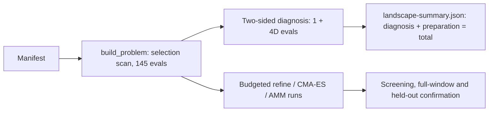

## Summary

Follow-up to the merged #274 benchmark. It re-lands the work from the closed
PRs #275 and #280 onto the current `Develop`, and fixes the review finding
that stalled #280. Both PRs were closed after automated feedback rounds failed
twice; the work itself was not rejected. Their commits fast-forward onto
`Develop` unchanged, so the commits the evidence records (`f0a7b4c`,
`8badaf5`) stay in this branch's history.

- **Full-window confirmation.** It is now a paired column, and it can veto a
  `-better` verdict (output format 3).
- **Flat axes.** Each problem counts its flat chosen axes from the existing
  sensitivity scan. There were none in the predeclared suite.
- **Versions.** Summaries record `gitCommit`, `gitDirty`, `neatCoreSource` and
  `wallClockSeconds`. The synthetic suite, the AMM campaign and the method
  check were regenerated at `f0a7b4c` (crate 0.1.49), and `runs.jsonl` is
  committed.
- **Plateaus and kinks.** A two-sided landscape diagnosis
  (`weight_bench::landscape`, `weight_router_bench --landscape`) classifies
  each chosen axis as flat, edge, kinked, smooth or indeterminate. A new
  `saturated-hard-tanh` family has real flat axes. Refine and CMA-ES were run
  on it with full-window and held-out confirmation.
- **Review fix (new in this run).** The landscape command ran the 145-evaluation
  selection scan for every problem but did not count it, so it reported 30,864
  evaluations when it ran 51,744. Rows and cells now carry
  `preparationEvaluations`. The summary reports diagnosis, preparation and total
  counts (`formatVersion` 2). A test pins the full command cost, and the
  evidence was regenerated at `d505d1a`.

The representative run on a production creature and corpus is still not done,
and the refinement arm is still a surrogate. Part of #266.

## Spec

### Intent and Rationale

- The two closed PRs' work fast-forwards cleanly onto `Develop`. Redoing it
  would only regenerate the same evidence under new commits, so this run kept
  that work and fixed the two #280 review findings.
- The landscape total now counts the selection scan. That scan runs inside
  `build_problem` for every problem the command diagnoses, so leaving it out
  under-reported the command's work. The arm path already counts it once per
  problem.

### Essential Design Decisions

- **The diagnosis is a measurement, not an arm.** Its probes, and the
  selection scan it triggers, are counted in the command's own total and
  charged to no arm's budget. Nothing routes on them. Probes an arm does spend
  are charged to that arm's budget: the router-era router's probes in #274,
  and AMM's through `BudgetedObjective`.
- **Landscape format 1 → 2 is a version bump, with no old-shape read.**
  `preparationEvaluations` is required, so an old `landscape.jsonl` row fails
  to load with `missing field` and is not silently under-counted. The only
  reader is the committed-evidence test, and that evidence was regenerated.
- **Run format 2 → 3 does read the old shape.** `plateau_free_axes` has
  `#[serde(default)]`, unknown router fields are ignored, and the full-window
  column is computed from fields old rows already carry.
  `router_era_reference_rows_still_load_and_summarise` pins this.
- **The full-window veto and the landscape work were decided after the
  predeclared results.** The veto can only make a verdict stricter. The
  landscape constants have no calibration seeds. Finding 5 reports the
  landscape results as a post-hoc diagnosis, not as validation.

### Undiscoverable Facts

- No production creature or corpus exists on this host, so representative
  coverage is 0.
- #280 stalled on a pre-push `markdownlint-cli2` failure. Every error it
  reported was in the worker's own `.git/graft/*.md` files, not in this
  repository's Markdown. No repository lint config was changed.
- The remote branch for #275 and #280 had been deleted. Its commits were still
  readable locally as `origin/issue-266-…-redo-1`, which is a descendant of
  the current `Develop` tip `ac8c7e0`.

## Evidence

CLI and backend only; no UI file is touched.

- **Landscape diagnosis.** Re-run at `d505d1a` on a clean tree: 4 families ×
  D 20/40/100 × 12 seeds, 1.2 s. It used 51,744 evaluations: 30,864 diagnosis
  plus 20,880 preparation (144 × 145). The printed per-cell shape counts match
  the previous evidence, and only the evaluation fields and provenance in the
  JSON changed.
  - Kinked axes: 8–29% of relu axes and 16–36% of hard-tanh axes. tanh has one
    rounding-level kink in 2160 axes.
  - Flat axes: none outside `saturated-hard-tanh`, which has 96 at D=40 and
    816 at D=100.
- **Synthetic suite** at `f0a7b4c`: 648 of 648 runs, 0 failed, 1,631,615
  evaluations. CMA-ES beat the surrogate in 18 cells, was worse in 0 and was
  inconclusive in 9.
- **AMM campaign:** 324 of 324 runs, 0 failed, 855,000 evaluations. AMM was
  worse in all 54 comparisons. The method check gave identical rows for v0.3.0
  and v0.7.0.
- **`saturated-hard-tanh` arm runs** at `8badaf5`: 216 of 216 runs, 0 failed,
  543,852 evaluations. CMA-ES was worse than refine in all six 30D and 100D
  cells, better in 1 cell and inconclusive in 2. Full-window and held-out
  agree in sign with screening in all 9 cells. This code path is unchanged by
  this run.
- Issue numbers cited: #266: Experiment: Benchmark budget-aware routing of
  local weight optimisers. #274, #275 and #280 are this issue's earlier PRs
  (merged, closed and closed).

## Acceptance Criteria

- **missing** — Use AMM as an offline reference against the current refinement method and CMA-ES on fixed deterministic screening records. — reason: the "current refinement method" is still the random-axis surrogate (`lamarck/src/weight_bench/refine.rs`), not the production candidate pipeline. AMM was not run on `saturated-hard-tanh`, and there are no representative screening records.
- **missing** — Count landscape probes within the budget. — reason: the probes arms spend (the router-era router and AMM) are charged to their budgets. The two-sided diagnosis probes are counted only in the command's own total, which now includes preparation, and are charged to no arm's budget, because no arm routes on them yet.
- **missing** — Test plateaus/kinks and activation families, then full/held-out confirmation. — reason: done on synthetic fixtures only. Plateaus appear only in a family built to have them, and "full" means the synthetic 1024-record window, not authoritative confirmation.
- **missing** — Predeclare controls, seeds, sample size, compute limits and success/failure criteria. Identify code/model/data versions; separate calibration from untouched validation and count all preparation/search costs. — reason: there are no representative model or data versions. The veto and the landscape work were decided after the predeclared results. The landscape tests use validation seeds 1001–1003, and the cost of the exploratory runs is not counted.
- **missing** — Deliver a reproducible command/manifest and machine-readable results with paired distributions, uncertainty, failures and actual coverage. Fixtures alone do not demonstrate an optimisation benefit. — reason: representative coverage is 0 runs, so no optimisation benefit is shown. `landscape-summary.json` has no failure or coverage fields (`diagnose_manifest` stops at the first error).
- **missing** — Record negative findings and remove optional code that does not earn its maintenance cost. — reason: whether to keep the `weight_bench::landscape` module and `--landscape` depends on the representative run, which cannot run on this host.

## Test Plan

- `timeout 1500 ./quality.sh < /dev/null` on `30ca5bb` exited 0 with "All quality checks passed!". That head carries every code, test, evidence and doc change in this diff.
- `cargo test --test weight_bench_landscape < /dev/null` (from `lamarck/`) after the evidence regeneration: 13 passed. Before the regeneration, only `committed_landscape_evidence_is_reproduced_and_shows_the_saturated_plateau` failed, with `missing field 'preparationEvaluations'` on the old committed rows.
- Added in this run, in `lamarck/tests/weight_bench_landscape.rs`:
  - `landscape_command_total_counts_preparation_once_per_problem`: 8 problems, total `8 * 145 + 4 * (1 + 4 * 20) + 4 * (1 + 4 * 40)` = 2128, and the cells' preparation counts sum to `8 * 145`. It goes red without the fix: the old total was only the diagnosis sum.
  - `diagnosis_finds_the_saturated_plateau` now asserts `preparation_evaluations == 145` and that it equals the built problem's count.
  - `landscape_rows_and_cells_serialise_in_camel_case` now expects `preparationEvaluations`.
  - `committed_landscape_evidence_is_reproduced_and_shows_the_saturated_plateau` now asserts `formatVersion == 2`, the diagnosis and preparation sums, `totalEvaluations == landscape_total_evaluations(&rows)` and `== 51744`. The file is new relative to `Develop`, so no base assertion is removed.
- Added by the re-landed #275 and #280 commits:
  - `lamarck/tests/weight_bench_landscape.rs`: the classifier, saturated-family, determinism, reproduction and evidence tests.
  - `lamarck/tests/weight_bench_reference.rs`: `full_window_veto_turns_a_screening_win_inconclusive`, `committed_evidence_is_reproduced_by_the_summariser` and `router_era_reference_rows_still_load_and_summarise`.
  - `lamarck/tests/weight_bench.rs`: `plateau_free_axes_count_only_the_flat_synapses_chosen`, `corpus_rows_record_the_plateau_count_of_their_problem`, `synthetic_rows_carry_their_problem_plateau_count` and `rows_without_the_plateau_field_load_as_none`.
  - `lamarck/src/weight_bench/provenance.rs::tests`: `real_lock_pins_neat_core_to_its_git_source`, `lock_without_neat_core_errors_naming_it` and `git_state_reports_the_commit_and_whether_the_tree_is_dirty`.
- Removed from `lamarck/tests/weight_bench_reference.rs`: `assert!(rows.contains("routedTo") && rows.contains("probeEvaluations"));`
  - Obsolete: the committed AMM rows were regenerated from current code and no longer carry router-era fields.
  - Still covered by: `lamarck/tests/weight_bench_reference.rs::router_era_reference_rows_still_load_and_summarise`
  - Replaced by: `assert!(parsed.iter().all(|r| r.plateau_free_axes.is_some()));`
- Changed in `lamarck/tests/weight_bench_reference.rs::clearly_better_and_worse_references_get_matching_verdicts`: `format_version` 2 → 3, as the run-format bump requires.
- Docs: Finding 5 in `docs/weight-optimiser-routing.md` and the `CHANGELOG.md` landscape entry now give the preparation count and the new commit. A grep for `30 864`, `8badaf5` and `totalEvaluations` across `README.md` and `docs/` found nothing else stale. `8badaf5` stays only as the commit of the unchanged `saturated/` arm run.

## Merge verification

- GitHub CI not yet verified.

Not done: everything listed as `missing` above. Also not done: re-running
`scripts/test-amm-reference.py`, which this run did not touch, and an
independent Spec or Standards review, because the issue has no
acceptance-criteria heading.
