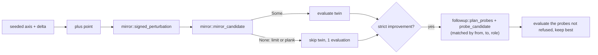

## Summary

Most of #266's weight benchmark is already on Develop (#282, #283). This PR
closes one reuse gap. The `lamarck-refine` arm
(`lamarck/src/weight_bench/refine.rs`) used to build its antithetic twin and its
follow-up probes with hand-written copies of `mirror.rs` and `followup.rs`. It
now calls the production helpers: `mirror::signed_perturbation` and
`mirror::mirror_candidate` build the `-delta` twin, and `followup::plan_probes`
and `followup::probe_candidate` build the follow-up probes. The arm therefore
inherits their refusals (the hard weight limit and the plank constant). Both
committed suites were re-run at `5c9ba38` and reproduced every committed row,
so no evidence file and no reported number changes.

This is the work of the stalled PR #287, carried onto current Develop, with two
differences. First, #287's guard that refused any creature with a repeated
`(from, to)` pair is gone: since #285 the follow-up helpers match a synapse by
source, target and role, so that guard would have rejected valid `IF`
creatures. Second, the provenance sentences that #287's review flagged (the
arms "unchanged" since `f0a7b4c`) are corrected.

The refinement arm is still a random-axis surrogate, not the production
candidate pipeline, and no representative run has been made. Part of #266.

## Spec

### Intent and Rationale

- The issue says "Reuse existing mechanisms", and the routing doc recorded that `refine.rs` "manually recreates mirrors and follow-up steps". Calling the production helpers removes that second copy and keeps the arm's predeclared protocol on the committed suites.
- #285 (merged) made `plan_probes` and `probe_candidate` identify a synapse by `(from, to, synapse_type)`, and `signed_perturbation` pairs synapses by index. So no bench-side guard is needed for an `IF` neuron fed twice by one source.

### Essential Design Decisions

- The RNG draw order (axis, then a nonzero delta), the `remaining() >= 2` loop, start-first evaluation and the tie-break (plus wins ties) are kept, so the committed rows still reproduce. Limits come from `BackpropConfig::default()` (`limit_weight_scale` 100000, `plank_constant` 1e-7).
- When `signed_perturbation` or `mirror_candidate` refuses a twin, the twin is not evaluated, so that round spends one evaluation instead of two. A refused follow-up probe is skipped. The `+delta` point itself is not limit-checked, as before.
- `WeightObjective` gains `creature_at` (which `loss_on` now uses) and `synapse_indices`, and `BudgetedObjective` gains `objective()`. `refine.rs` uses all three to hand creatures to the helpers. Production code (`followup.rs`) changes only a doc comment.

### Undiscoverable Facts

- PRs #284 and #287 carried this reuse change and were closed when their review-fix lanes stalled. #287's one blocking review finding was the stale provenance sentences fixed here.
- The twin is now `x - ((x + delta) - x)` rather than `x - delta`, and the probes come from the realised move. That is not bit-identical by construction, but the re-runs below gave identical rows.

## Evidence

Backend/CLI only; no UI file touched.

- **Main suite.** `cargo run --release --example weight_router_bench -- /tmp/wrb-266/main` from `lamarck/` at `5c9ba38` (clean tree, crate 0.1.53) printed `runs 648/648 completed (0 failed); 1631615 evaluations`. Its `runs.jsonl` equals the committed `docs/evidence/weight-router/runs.jsonl` row by row as parsed JSON: 648 of 648.
- **Saturated suite.** The same binary with `--manifest ../docs/evidence/weight-router-landscape/saturated/manifest.json` printed `runs 216/216 completed (0 failed); 543852 evaluations`. All 216 rows equal `docs/evidence/weight-router-landscape/saturated/runs.jsonl`.
- Commits after `5c9ba38` change only docs and remove one test, so these re-runs hold for the head's code.

## Acceptance Criteria

<!-- vibe-spec-review inputs="diff+issue-body" -->

- **partial** — Use AMM as an offline reference against the current refinement method and CMA-ES on fixed deterministic screening records. — evidence: `docs/evidence/weight-router/reference-summary.json`, `lamarck/src/weight_bench/refine.rs` — reviewer: partial — reason: the refinement arm is still a random-axis surrogate; it does not call `generate_candidate_batch` or the focus/statistics/backprop pipeline.
- **met** — Optimise 20–100 influential weights with budgets 10D, 30D, 100D; mark D>40 as extrapolation requiring validation. — evidence: `predeclared_manifest`, `is_extrapolation`, `docs/evidence/weight-router/manifest.json` — reviewer: met
- **met** — Count landscape probes within the budget. — evidence: `lamarck/tests/weight_bench_landscape.rs::diagnosis_draws_its_probes_from_the_tightest_budget`; every twin and probe goes through `BudgetedObjective::eval` (`lamarck/tests/weight_bench.rs::the_refine_arm_skips_a_refused_twin`) — reviewer: met
- **partial** — Test plateaus/kinks and activation families, then full/held-out confirmation. — evidence: `lamarck/tests/weight_bench_landscape.rs::tanh_axes_are_smooth_and_relu_and_hard_tanh_axes_kink`, `docs/evidence/weight-router/summary.json` — reviewer: met — reason: I depart to partial because the plateau family was added after the predeclared run and no representative full/held-out confirmation exists.
- **met** — Port only winning probes/router to Rust after measurement; no topology optimisation or unverified third-party dependency added by default. — evidence: router removed in #282; the only `Cargo.lock` change is the crate's own version — reviewer: met
- **met** — Read and pin the full method before reproducing it — evidence: `docs/evidence/weight-router/method-check.json`, `scripts/check-amm-method.py` — reviewer: met
- **partial** — First inspect current code, merged work and repository instructions. Reuse existing mechanisms; if functionality already exists, this issue still owns the missing controlled comparison rather than a second implementation. — evidence: `lamarck/src/weight_bench/refine.rs` (`mirrored_pair`, `follow_up_points`) — reviewer: partial — reason: the twin and probes now reuse production helpers, but the axis/step draw is still the bench's own and `generate_candidate_batch` is bypassed.
- **met** — Opt-in experiment only; preserve ordinary behaviour, interfaces, immutable parents and full authoritative acceptance. No automatic deployment or default change. — evidence: `lamarck/src/followup.rs` changes only a doc comment; the new accessors are additive and `creature_at` clones — reviewer: met
- **partial** — Predeclare controls, seeds, sample size, compute limits and success/failure criteria. Identify code/model/data versions; separate calibration from untouched validation and count all preparation/search costs. — evidence: `docs/weight-optimiser-routing.md` (Predeclared protocol, Compute ledger) — reviewer: met — reason: the reviewer said met "with one minor gap" (the re-run costs are in `CHANGELOG.md`, not the ledger); I record partial because no representative manifest with model and data versions exists.
- **met** — Provide deterministic positive/negative correctness tests for new behaviour and pass the repository's normal quality checks. Research runs are separate from routine feature CI. — evidence: `lamarck/tests/weight_bench.rs::the_refine_arm_skips_a_refused_twin`, `lamarck/tests/weight_bench.rs::the_refine_arm_skips_a_refused_follow_up_probe`, the unit tests in `lamarck/src/weight_bench/refine.rs`, and `./quality.sh` (see Test Plan) — reviewer: met
- **met** — Deliver a reproducible command/manifest and machine-readable results with paired distributions, uncertainty, failures and actual coverage. Fixtures alone do not demonstrate an optimisation benefit. — evidence: How to run in `docs/weight-optimiser-routing.md`; committed `runs.jsonl` files reproduced at `5c9ba38` — reviewer: met
- **partial** — Record negative findings and remove optional code that does not earn its maintenance cost. Do not claim success before representative runs. — evidence: the hand-written copies are deleted; `docs/weight-optimiser-routing.md` says the "representative run on the private corpus remains unperformed" — reviewer: met — reason: I depart to partial because the landscape diagnosis is still optional code nothing routes on, and no representative run has been made.
- **met** — Keep public implementation and fixtures application-agnostic; private corpora/results and operational integration remain private. — evidence: the new fixtures are generic toy creatures — reviewer: met
- **met** — Leave unassigned until an implementer actively starts. `work-on` authorises the investigation, not skipping prerequisite verification. — evidence: this run inspected merged #282/#283/#285 and closed #287 before changing code — reviewer: missing — reason: the reviewer said "not judgeable from a diff"; it is a process rule and the run followed it.
- **unrequested** — public accessors `WeightObjective::synapse_indices`, `WeightObjective::creature_at`, `BudgetedObjective::objective` — reviewer: unrequested — reason: the helper reuse needs creatures; `refine.rs` is their caller.
- **unrequested** — crate version 0.1.52 → 0.1.53 (`lamarck/Cargo.toml`, `Cargo.lock`) — reviewer: unrequested — reason: `CONTRIBUTING.md` requires a patch bump for changes under `lamarck/src/`.
- **unrequested** — provenance rewording in `CHANGELOG.md` and `docs/weight-optimiser-routing.md` — reviewer: unrequested — reason: the code change made the old "arms unchanged" sentences false (#287's review finding).
- **unrequested** — the `IF`-twice unit test `follow_up_steps_only_the_role_synapse_that_moved` — reviewer: unrequested — reason: it pins that the reused helpers step the right synapse on a creature #285 made valid for them.

## Standards Review

<!-- vibe-standards-review inputs="diff+CODING-STANDARDS.md" -->

- **clean** — No violations. The repository has no `CODING-STANDARDS.md`; the review used `CONTRIBUTING.md` and `README.md`, which document no review-only rules. Checked: version bump and `Cargo.lock` agree (0.1.53, not behind Develop); the CHANGELOG entry sits under Unreleased/Changed; every cited test exists; no existing test expectation changed (only the `use` list); `the_refine_arm_skips_a_refused_twin` and `the_refine_arm_skips_a_refused_follow_up_probe` fail against the old arm; doc claims on defaults, refusals and role matching match the head. Optional notes acted on: the integration test `the_refine_arm_refines_a_creature_that_feeds_an_if_neuron_twice` could not fail (its `best <= start` always holds, and it passed on Develop), so it was removed and the CHANGELOG now cites the unit test that discriminates. Not acted on: the `+delta` point is never limit-checked (unchanged, and documented).

## Test Plan

- Added in `lamarck/tests/weight_bench.rs`:
  - `the_refine_arm_skips_a_refused_twin` and `the_refine_arm_skips_a_refused_follow_up_probe`, each with a positive control.
  - `the_refine_arm_reproduces_its_committed_rows`, which pins 8 of the 324 committed refine rows and is expected green before and after the change.
- Added as unit tests in `lamarck/src/weight_bench/refine.rs`: `twin_straddles_x_on_the_chosen_axis`, `twin_is_refused_past_the_hard_weight_limit`, `twin_is_refused_below_the_plank_constant`, `follow_up_steps_around_the_winning_move`, `follow_up_drops_a_probe_past_the_hard_limit` and `follow_up_steps_only_the_role_synapse_that_moved`. The last uses an `IF` neuron fed by `input-0` as condition (0.5) and positive (1.5), and asserts the three probes leave axis 0 at 0.5 and put axis 1 at 1.8, 1.6, 1.9. Read against the pre-#285 `followup.rs`, first-match lookup would size the probes from the condition synapse and step axis 0, so the test fails there; this was not executed.
- No existing test was edited apart from the `use` list in `lamarck/tests/weight_bench.rs`, so no assertion was removed.
- On `b15af4c`: `cargo test -p neat_ai_lamarck --test weight_bench` 29 passed, 1 ignored (already ignored); `cargo test -p neat_ai_lamarck --lib weight_bench::refine` 6 passed; `./quality.sh < /dev/null` exited 0 ("All quality checks passed!", 1018 tests passed, 0 failed). `markdownlint-cli2` reported 0 issues on the edited docs; `scripts/spell-check.sh` found no typos.
- Docs read and updated: `docs/weight-optimiser-routing.md` (status paragraph, `lamarck-refine` Arms row, the three AMM provenance sentences, "Controls and remaining experiment", "Verification and process failures") and `CHANGELOG.md`. `README.md` does not mention the refine arm.

## Merge verification

- GitHub CI not yet verified.

## Not done

- Representative runs on a production creature and corpus. None is available on this host, and private inputs stay out of this checkout, so no optimisation benefit is claimed.
- A refinement arm on the production candidate pipeline (`generate_candidate_batch` with focus/statistics/backprop).
- Removing or justifying the landscape diagnosis.
- `scripts/test-amm-reference.py` was not re-run; nothing it drives changed.

🤖 Generated with [Claude Code](https://claude.com/claude-code)
