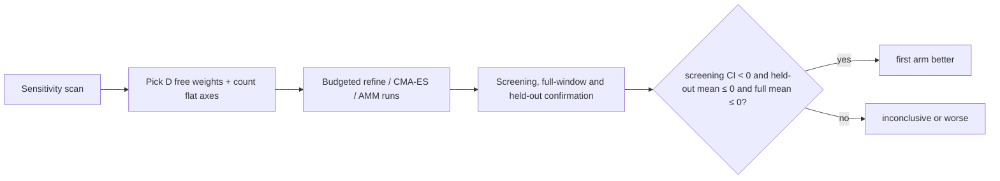

## Summary

Re-lands the closed PR #275 follow-up to the merged #274 benchmark onto the
current `Develop`, and fixes the review finding that stalled it. PR #275 was
closed because its feedback round failed twice, not because the work was
rejected. Its commits are merged here unchanged, so the commit the evidence
records (`f0a7b4c`) stays in this branch's history.

What the branch delivers:

- **Full-window confirmation.** It is now a paired column, and it can veto a
  `-better` verdict.
- **Flat axes.** Each problem now counts its flat chosen axes. None were found
  in the synthetic suite.
- **Versions and evidence.** Runs record the code and dependency versions and
  the wall-clock time. All evidence was regenerated at `f0a7b4c` (crate 0.1.49),
  the AMM campaign and method check were re-run, and `runs.jsonl` is committed.
  The output format is now version 3.
- **Router-era row compatibility (the #275 review finding).** The regenerated
  AMM rows no longer carry `routedTo` or `probeEvaluations`, so no test
  protected loading saved router-era rows any more. A new test loads a verbatim
  router-era row and summarises it through `summarise_reference`.

- **Plateaus and kinks, measured (new in this run).** A two-sided landscape
  diagnosis (`weight_bench::landscape`, `--landscape`) classifies each chosen
  axis as flat, edge, kinked, smooth or indeterminate. A new
  `saturated-hard-tanh` family has real flat axes. Refine and CMA-ES were run
  on it with full-window and held-out confirmation. The new evidence is in
  `docs/evidence/weight-router-landscape/`, and `docs/evidence/weight-router/`
  is byte-identical.

The representative run on a production creature and corpus is still not done,
and the refinement arm is still a surrogate. AMM was not run on the new family.
Part of #266.

- [x] Full-window column and veto (`Comparison.full`, format 3).
- [x] Flat-axis count per problem, from the existing sensitivity scan (no extra evaluations).
- [x] `gitCommit`, `gitDirty`, `neatCoreSource` and `wallClockSeconds` in the bench summaries.
- [x] Regenerate the synthetic suite, AMM campaign and method check, and commit `runs.jsonl`.
- [x] Test that re-summarising the committed rows reproduces the committed summaries.
- [x] Re-land the #275 work on the current `Develop` (clean merge, no conflicts).
- [x] Restore router-era row compatibility coverage (the #275 review finding).
- [ ] Representative runs on production inputs (no authorised creature or corpus on this host).
- [ ] A refinement arm that is the production candidate pipeline, not the surrogate.
- [x] A two-sided kink/plateau diagnosis and a family (`saturated-hard-tanh`) that actually has flat axes, with refine vs CMA-ES runs and full/held-out confirmation on it.
- [ ] AMM on the plateau family, and calibration seeds for the new diagnosis constants.

## Spec

### Intent and Rationale

- #274's own review left three criteria `partial`, and #275 fixed what can be fixed offline: full-window results were computed but never compared, plateaus were not measured, and the evidence was router-era and named by crate version only.
- A merge, not a rebase: the committed evidence names `f0a7b4c` as the commit it was generated at, and a merge keeps that commit reachable.
- The review fix is a test with a verbatim fixture. The `RunRow` code already ignores unknown fields; only the coverage was lost when the evidence was regenerated.

### Essential Design Decisions

- **The verdict rule changed after the format 2 results were seen.** A `-better` verdict now also needs a full-window mean ≤ 0. This can only turn `-better` into `inconclusive`. It changed one cell (hard-tanh D=40 100D, full-window mean +0.0004). `docs/weight-optimiser-routing.md` says so.
- **All three columns share one bootstrap RNG.** The full-window column is drawn after the screening and held-out columns, so the intervals of later cells moved while the paired differences did not. One verdict moved because of this (tanh D=100 30D, `cma-es-worse` → `inconclusive`). The docs record both changes.
- **Flat means one side only.** An axis is flat when a one-sided +0.05 step changes the screening loss by at most `PLATEAU_REL_TOL` (1e-6) × base loss. Older rows without `plateauFreeAxes` load as `None`.
- **The landscape work sits outside the predeclared protocol.** The family and the diagnosis were designed after the predeclared results had been seen. Their tests use validation seeds 1001–1003. The constants (`SATURATION_BIAS` ±12, `LIVE_HIDDEN_UNITS` 2, `KINK_RATIO_REL_TOL` 0.25, `CURVATURE_REL_TOL` 1e-9) have no separate calibration seeds. Finding 5 reports the results as a post-hoc diagnosis, not as validation.
- **The kink test is a second-difference ratio.** `D2(s) = f(x+s)+f(x−s)−2f(x)` scales like s² on a smooth axis (ratio `D2(h)/D2(h/2)` ≈ 4) and like s across a slope jump (≈ 2). An axis is kinked when the ratio is more than 25% away from 4. The diagnosis costs `1 + 4D` evaluations per problem and is reported separately from the arm runs.
- **Only some synthetic families change.** `saturated-hard-tanh` gives 14 of its 16 hidden units a ±12 bias. Those units' input weights stay flat as long as each weight is within about ±1.35 of the teacher's value. The other families draw no extra random numbers, and their JSON is unchanged. `existing_families_rebuild_the_committed_rows_exactly` pins this.
- **Persisted format 2 → 3: the old shape is read, not rejected.** `plateau_free_axes` has `#[serde(default)]`, unknown router fields are ignored, and the full-window column is computed from `fullLossStart` and `fullLossFinal`, which old rows carry. `router_era_reference_rows_still_load_and_summarise` pins this.

### Undiscoverable Facts

- No production creature or corpus was found on the host that generated the evidence, so representative coverage stays at 0.
- Two independent runs, at `757ac15` (0.1.48) and `f0a7b4c` (0.1.49), gave byte-identical `runs.jsonl` and `amm-runs.jsonl`, identical summary cells, and the same canonical method-check hash `33203af0…`.
- #275 stalled on a pre-push `markdownlint-cli2` failure, and every error it reported was in the worker's own `.git/graft/*.md` files. In this checkout `markdownlint-cli2 docs/archive/pr-summaries/pr-summary-266.md` reports 0 issues in 90 files, so no repository lint config was changed.

## Evidence

CLI/backend only; no UI file is touched.

- Synthetic suite, `weight_router_bench` at `f0a7b4c` with a clean tree: 648 of 648 runs, 0 failed, 1,631,615 evaluations, 224.4 s wall time on a shared host (indicative only). CMA-ES beat the surrogate in 18 cells, was worse in 0 and was inconclusive in 9 (format 2 gave 19 / 1 / 7). Every row and every cell has 0 flat free axes.
- AMM campaign, `scripts/amm-reference.py --jobs 8`: 324 of 324 runs, 0 failed, 855,000 evaluations. AMM was worse in all 54 comparisons.
- Method check: v0.3.0 and v0.7.0 each gave 27 rows, identical to each other.
- Landscape diagnosis at `8badaf5` (clean tree), 4 families × D 20/40/100 × 12 seeds: 30,864 evaluations, 1.9 s.
  - Kinked axes: relu 8–29% and hard-tanh 16–36% of the chosen axes. tanh has 1 kinked axis in 2160 (D=100, seed 1006), a rounding artefact with a ratio of about 13.
  - Flat axes: none in tanh, relu or hard-tanh. `saturated-hard-tanh` has 96 flat axes at D=40 and 816 at D=100; at D=20 it has none.
- Arm runs on `saturated-hard-tanh` at `8badaf5`: 216 of 216 runs, 0 failed, 543,852 evaluations, 108.6 s.
  - CMA-ES was worse than refine in all 6 cells at 30D and 100D, better in 1 cell (D=100 10D) and inconclusive in 2.
  - The full-window and held-out means agree in sign with screening in all 9 cells.
  - D=20 has no flat axes and loses in the same way, so the plateaus alone do not explain the reversal (Finding 5).
- Reproduction check: the spec reviewer re-ran both commands. `landscape.jsonl` and `saturated/runs.jsonl` came out byte-identical; the summaries differed only in `wallClockSeconds` and `gitCommit`.
- `git diff --stat f0a7b4c HEAD -- lamarck/src/weight_bench lamarck/examples/weight_router_bench.rs Cargo.lock` printed nothing before the landscape commits, which add `landscape.rs` and the new family. The new family leaves the existing families' problems unchanged, so the original evidence still reproduces. So the benchmark code was unchanged since the evidence was generated, and the four "later commits" sentences in `CHANGELOG.md` and `docs/weight-optimiser-routing.md` now say exactly that. They used to say that later commits change only documentation and evidence, which the `Develop` merge made untrue.
- #266: Experiment: Benchmark budget-aware routing of local weight optimisers.
- #274 and #275 are this issue's earlier PRs (merged and closed respectively).

## Acceptance Criteria

<!-- vibe-spec-review inputs="diff+issue-body" -->

- **partial** — Use AMM as an offline reference against the current refinement method and CMA-ES on fixed deterministic screening records. — evidence: `docs/evidence/weight-router/reference-summary.json`, `lamarck/tests/weight_bench_reference.rs::committed_evidence_is_reproduced_by_the_summariser` — reviewer: partial — reason: the "current refinement method" is still the random-axis surrogate (`lamarck/src/weight_bench/refine.rs`), not the production pipeline; there are no representative screening records; and AMM was not run on `saturated-hard-tanh`, the only family with plateaus.
- **met** — Optimise 20–100 influential weights with budgets 10D, 30D, 100D; mark D>40 as extrapolation requiring validation. — evidence: `lamarck/tests/weight_bench_reference.rs::committed_evidence_parses_and_summarises`, `lamarck/tests/weight_bench.rs::extrapolation_flag_marks_rows_and_cells_just_past_the_boundary` — reviewer: met
- **met** — Count landscape probes within the budget. — evidence: `lamarck/tests/weight_bench.rs::plateau_free_axes_count_only_the_flat_synapses_chosen`, `lamarck/tests/weight_bench.rs::total_evaluations_count_confirmations_and_preparation_once_per_problem` — reviewer: met
- **partial** — Test plateaus/kinks and activation families, then full/held-out confirmation. — evidence: `lamarck/tests/weight_bench_landscape.rs::classify_axis_on_hand_values`, `::diagnosis_finds_the_saturated_plateau`, `::tanh_axes_are_smooth_and_relu_and_hard_tanh_axes_kink`, `::saturated_family_runs_through_the_manifest_with_confirmation`, `::committed_landscape_evidence_is_reproduced_and_shows_the_saturated_plateau`, `docs/evidence/weight-router-landscape/` — reviewer: partial — reason: met on synthetic fixtures only. Plateaus appear only in a family built to have them, "full" means the synthetic 1024-record window rather than authoritative confirmation, and the arms are CMA-ES against the surrogate, with no representative problem.
- **met** — Port only winning probes/router to Rust after measurement; no topology optimisation or unverified third-party dependency added by default. — evidence: the router stays removed, and `lamarck/Cargo.toml` adds no dependency — reviewer: met
- **met** — First inspect current code, merged work and repository instructions. Reuse existing mechanisms; if functionality already exists, this issue still owns the missing controlled comparison rather than a second implementation. — evidence: `lamarck/src/weight_bench/objective.rs` (`scan_sensitivities` split out of `select_influential`) — reviewer: met
- **met** — Opt-in experiment only; preserve ordinary behaviour, interfaces, immutable parents and full authoritative acceptance. No automatic deployment or default change. — evidence: changes confined to `lamarck/src/weight_bench/` and `lamarck/examples/weight_router_bench.rs` — reviewer: met
- **partial** — Predeclare controls, seeds, sample size, compute limits and success/failure criteria. Identify code/model/data versions; separate calibration from untouched validation and count all preparation/search costs. — evidence: `lamarck/src/weight_bench/provenance.rs::tests::real_lock_pins_neat_core_to_its_git_source`, `docs/evidence/weight-router/summary.json` (`gitCommit`, `neatCoreSource`, `wallClockSeconds`) — reviewer: partial — reason: there are no representative model or data versions, and no overall wall-clock ceiling is declared. The full-window veto and the whole landscape work were designed after the predeclared results were seen. The new constants have no calibration seeds, and the landscape tests use validation seeds 1001–1003, so that validation is not untouched. The exploratory runs' cost is not counted.
- **met** — Provide deterministic positive/negative correctness tests for new behaviour and pass the repository's normal quality checks. Research runs are separate from routine feature CI. — evidence: `lamarck/tests/weight_bench_reference.rs::full_window_veto_turns_a_screening_win_inconclusive`, `lamarck/tests/weight_bench_reference.rs::router_era_reference_rows_still_load_and_summarise`, `lamarck/src/weight_bench/provenance.rs::tests::lock_without_neat_core_errors_naming_it`, `./quality.sh` passed — reviewer: met
- **partial** — Deliver a reproducible command/manifest and machine-readable results with paired distributions, uncertainty, failures and actual coverage. Fixtures alone do not demonstrate an optimisation benefit. — evidence: `docs/evidence/weight-router/runs.jsonl`, `lamarck/tests/weight_bench_reference.rs::committed_evidence_is_reproduced_by_the_summariser` — reviewer: partial — reason: the synthetic results reproduce byte for byte and cover every run, but representative coverage is 0 runs, so no optimisation benefit is shown. Also, `landscape-summary.json` has no failure or coverage fields (`diagnose_manifest` stops at the first error), and no test checks the committed `saturated/` runs against the current code.
- **met** — Record negative findings and remove optional code that does not earn its maintenance cost. Do not claim success before representative runs. — evidence: `docs/weight-optimiser-routing.md` Finding 4 (no flat axes); AMM worse in 54 of 54 comparisons — reviewer: met
- **met** — Keep public implementation and fixtures application-agnostic; private corpora/results and operational integration remain private. — evidence: synthetic and temp-dir fixtures in `lamarck/tests/weight_bench.rs`, and the router-era fixture in `lamarck/tests/weight_bench_reference.rs` — reviewer: met — reason: the reviewer noted that `docs/evidence/weight-router/amm-meta.json` records scratch build paths (`/var/tmp/…`, `/tmp/amm266/…`); these are not private data.
- **met** — Leave unassigned until an implementer actively starts. `work-on` authorises the investigation, not skipping prerequisite verification. — evidence: the issue is assigned only to the worker that claimed this run, and this run inspected the merged #274 and the closed #275 before changing anything — reviewer: missing — reason: the reviewer said "not assessable: process requirement; nothing in the diff shows it either way".
- **unrequested** — the public `weight_bench::landscape` module and the `--landscape` mode stay in the library with no consumer — reviewer: unrequested — reason: they serve "test plateaus/kinks". The reviewer noted that the router probes were removed because they did not earn their maintenance cost, and this module may need the same judgement after a representative run.
- **unrequested** — `summarise_runs` made public and re-exported — reviewer: unrequested — reason: `run_manifest` uses it, and it lets a test re-summarise the committed rows to check the committed summaries.
- **unrequested** — `wallClockSeconds` in `summary.json` — reviewer: unrequested — reason: it records compute cost, which "count all preparation/search costs" and "compute limits" cover; the tests compare only the cells.
- **unrequested** — the full-window veto changes the verdict rule instead of only reporting the column — reviewer: unrequested — reason: confirmation that disagrees with a screening win should not count as a win; it can only make a verdict stricter, and it is documented as decided after the format 2 results were seen.
- **unrequested** — `committed_evidence_is_reproduced_by_the_summariser` requires `gitDirty == false` and a 40-hex `gitCommit` in the committed evidence — reviewer: unrequested — reason: evidence from a dirty tree cannot be traced to a commit, so this protects reproducibility.

## Standards Review

<!-- vibe-standards-review inputs="diff+CODING-STANDARDS.md" -->

This review covered the head up to `1f800a7`. It was not re-run over the landscape commits (`8badaf5`, `1b54d70` and the follow-up doc and test fix); the quality gate re-runs over them. The repository has no `CODING-STANDARDS.md`. The reviewer used `CONTRIBUTING.md`, the README's build and quality-gate section and the lint configs, and found no violations.

- **clean** — Version bump (`lamarck/Cargo.toml` and `Cargo.lock` both at 0.1.49, ahead of `Develop`'s 0.1.48), changelog under [Unreleased], markdownlint (MD013 off), every named test exists, no workflow change and no external stub, the corpus path still bounds `dimension`, and the docs' figures match the committed evidence.
- **clean** — Changed expectations in existing tests: `format_version` 2 → 3 still fails without the format bump; the removed `routedTo` premise is moved to `router_era_reference_rows_still_load_and_summarise`, which fails when `RunRow` rejects unknown fields; and the added `full.failures` counts are discriminated by `full_window_veto_turns_a_screening_win_inconclusive`, which uses different held-out and full offsets.
- **clean** — Review-only rules: the reviewer searched README.md, CONTRIBUTING.md and the lint configs, and the standards name none.

## Test Plan

- `timeout 1700 ./quality.sh < /dev/null` passed on `6f658a9`, which carries every code and test change here (exit 0, "All quality checks passed!"). The run covered shell and workflow checks, spelling, dependency audit, formatting, Clippy, workspace tests and rustdoc. The one later commit, `Scope the "later commits" note to the benchmark code`, changes only `CHANGELOG.md` and `docs/weight-optimiser-routing.md`. After it, `markdownlint-cli2` (0 issues) and `codespell` (clean) were re-run, and `cargo test --test docs_link_targets --test literature_citations --test readme_contract` passed (2, 13 and 40).
- `cargo test --test weight_bench --test weight_bench_reference < /dev/null` (from `lamarck/`), run on the final head: 26 passed with 1 ignored, and 16 passed.
- `cargo test --test weight_bench --test weight_bench_reference --test weight_bench_landscape < /dev/null` (from `lamarck/`) after the landscape commits: 26 passed with 1 ignored, 16 passed and 12 passed. The executor also reported a full `cargo test` with 0 failures, and clean `cargo clippy --all-targets -- -D warnings` and `cargo fmt --check`.
- Added for the landscape work, in `lamarck/tests/weight_bench_landscape.rs`:
  - `classify_axis_on_hand_values`, `shape_counts_tally_every_shape` and `axis_shapes_are_deterministic`;
  - `saturated_hard_tanh_has_flat_axes_only_beyond_its_live_synapses`, `saturated_start_creature_carries_the_teacher_biases` and `diagnosis_finds_the_saturated_plateau`, which asserts that the two-sided flat count equals the one-sided count and is at most 68;
  - `tanh_axes_are_smooth_and_relu_and_hard_tanh_axes_kink`, `landscape_rows_and_cells_serialise_in_camel_case` and `landscape_refuses_corpus_and_invalid_manifests`;
  - `saturated_family_runs_through_the_manifest_with_confirmation`, `existing_families_rebuild_the_committed_rows_exactly` and `committed_landscape_evidence_is_reproduced_and_shows_the_saturated_plateau`.
- Added in this PR's own commits: `lamarck/tests/weight_bench_reference.rs::router_era_reference_rows_still_load_and_summarise`. It deserialises a verbatim router-era AMM row from the base branch's old `amm-runs.jsonl` and asserts:
  - the fixture has `routedTo` and `probeEvaluations` and no `plateauFreeAxes`;
  - the row's costs and normalised losses survive loading, and `plateau_free_axes` is `None`;
  - through `summarise_reference`, coverage is 1 / 1 / 0, total evaluations are 350 and the cell's plateau count is `[None]`;
  - each comparison has the one paired screening difference AMM − refine (0.8) and AMM − CMA-ES (0.7).
  
  The test went red (`unknown field 'probeEvaluations'`) with `deny_unknown_fields` temporarily added to `RunRow`, and green once it was removed.
- Added by the merged #275 commits:
  - `lamarck/tests/weight_bench_reference.rs`: `full_window_veto_turns_a_screening_win_inconclusive` and `committed_evidence_is_reproduced_by_the_summariser`.
  - `lamarck/tests/weight_bench.rs`: `plateau_free_axes_count_only_the_flat_synapses_chosen`, `corpus_rows_record_the_plateau_count_of_their_problem`, `synthetic_rows_carry_their_problem_plateau_count` and `rows_without_the_plateau_field_load_as_none`.
  - `lamarck/src/weight_bench/provenance.rs::tests`: the lock-parse tests and `git_state_reports_the_commit_and_whether_the_tree_is_dirty`.
- Removed from `lamarck/tests/weight_bench_reference.rs`: `assert!(rows.contains("routedTo") && rows.contains("probeEvaluations"));`
  - Obsolete: the committed AMM rows were regenerated from current code and no longer carry router-era fields.
  - Still covered by: `lamarck/tests/weight_bench_reference.rs::router_era_reference_rows_still_load_and_summarise`
  - Replaced by: `assert!(parsed.iter().all(|r| r.plateau_free_axes.is_some()));`
- Changed in `lamarck/tests/weight_bench_reference.rs::clearly_better_and_worse_references_get_matching_verdicts`: `format_version` 2 → 3, as the format bump requires.
- `scripts/test-amm-reference.py` was not re-run. The AMM driver is unchanged, and the AMM campaign and method check were run end to end at `f0a7b4c`.

## Merge verification

- GitHub CI not yet verified.

Not done: representative runs on production inputs, a production-pipeline
refinement arm, AMM on the plateau family, calibration seeds for the landscape
constants, and failure and coverage fields for the landscape output. The
example's git-failure warning path is only covered at the probe level.
