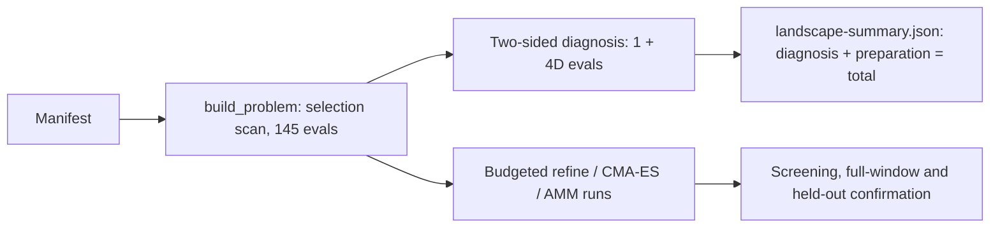

## Summary

Follow-up to the merged #274 benchmark. It re-lands the work from the closed
PRs #275 and #280 onto the current `Develop`, and fixes the review finding
that stalled #280. Both PRs were closed after automated feedback rounds failed
twice; the work itself was not rejected. Their commits fast-forward onto
`Develop` unchanged, so the commits the evidence records (`f0a7b4c`,
`8badaf5`) stay in this branch's history.

- **Full-window confirmation.** It is now a paired column, and it can veto a
  `-better` verdict (output format 3).
- **Flat axes.** Each problem counts its flat chosen axes from the existing
  sensitivity scan. There were none in the predeclared suite.
- **Versions.** Summaries record `gitCommit`, `gitDirty`, `neatCoreSource` and
  `wallClockSeconds`. The synthetic suite, the AMM campaign and the method
  check were regenerated at `f0a7b4c` (crate 0.1.49), and `runs.jsonl` is
  committed.
- **Plateaus and kinks.** A two-sided landscape diagnosis
  (`weight_bench::landscape`, `weight_router_bench --landscape`) classifies
  each chosen axis as flat, edge, kinked, smooth or indeterminate. A new
  `saturated-hard-tanh` family has real flat axes. Refine and CMA-ES were run
  on it with full-window and held-out confirmation.
- **Review fix (new in this run).** The landscape command ran the 145-evaluation
  selection scan for every problem but did not count it, so it reported 30,864
  evaluations when it ran 51,744. Rows and cells now carry
  `preparationEvaluations`. The summary reports diagnosis, preparation and total
  counts (`formatVersion` 2). A test pins the full command cost, and the
  evidence was regenerated at `d505d1a`.
- **AMM on `saturated-hard-tanh` (this run).** The pinned AMM reference ran
  108 of 108 runs, 0 failed, 285,000 evaluations, at `84096bb`. AMM was worse
  than both refine and CMA-ES in all 18 comparisons. The evidence is in
  `docs/evidence/weight-router-landscape/saturated/`, and a test pins it.
- **Landscape failures and coverage (this run).** The landscape command
  stopped at the first failed problem and reported no coverage. It now records
  a failed problem as a row with its `error` and the evaluations it spent,
  counts `failures` per cell, and reports `coverage` (planned, completed and
  failed problems) in `landscape-summary.json` (`formatVersion` 3). The
  evidence was regenerated at `cf2ff11`: 144 of 144 problems, 0 failed,
  unchanged counts.
- **Compute ledger (this run).** `docs/weight-optimiser-routing.md` lists every
  committed campaign's evaluations, 3,367,211 in all. It also says what is not
  counted: the router-era run, the method check, tests and development runs.
- **Doc correction (this run).** The docs and CHANGELOG said that commits after
  `f0a7b4c` leave the bench code unchanged. They add the saturated family, the
  landscape diagnosis and its command; the predeclared families, the arms and
  `Cargo.lock` are unchanged.

The representative run on a production creature and corpus is still not done,
and the refinement arm is still a surrogate. Part of #266.

## Spec

### Intent and Rationale

- The two closed PRs' work fast-forwards cleanly onto `Develop`. Redoing it
  would only regenerate the same evidence under new commits, so this run kept
  that work and fixed the two #280 review findings.
- The landscape total now counts the selection scan. That scan runs inside
  `build_problem` for every problem the command diagnoses, so leaving it out
  under-reported the command's work. The arm path already counts it once per
  problem.

### Essential Design Decisions

- **The diagnosis is a measurement, not an arm.** Its probes, and the
  selection scan it triggers, are counted in the command's own total and
  charged to no arm's budget. Nothing routes on them. Probes an arm does spend
  are charged to that arm's budget: the router-era router's probes in #274,
  and AMM's through `BudgetedObjective`.
- **A failed landscape problem is a row, not an abort (format 2 → 3).** It
  mirrors the arm runs: the row carries `error` and the evaluations it spent,
  and the run goes on. A failed `build_problem` reports 0 preparation, because
  the build does not expose a partial count. `failures` defaults to 0, so a
  format 2 cell still loads.
- **The compute ledger counts only what was logged.** Development, smoke and
  test runs were not logged, so the ledger names them as uncounted rather than
  estimating them.
- **Landscape format 1 → 2 is a version bump, with no old-shape read.**
  `preparationEvaluations` is required, so an old `landscape.jsonl` row fails
  to load with `missing field` and is not silently under-counted. The only
  reader is the committed-evidence test, and that evidence was regenerated.
- **Run format 2 → 3 does read the old shape.** `plateau_free_axes` has
  `#[serde(default)]`, unknown router fields are ignored, and the full-window
  column is computed from fields old rows already carry.
  `router_era_reference_rows_still_load_and_summarise` pins this.
- **The full-window veto and the landscape work were decided after the
  predeclared results.** The veto can only make a verdict stricter. The
  landscape constants have no calibration seeds. Finding 5 reports the
  landscape results as a post-hoc diagnosis, not as validation.

### Undiscoverable Facts

- No production creature or corpus exists on this host, so representative
  coverage is 0.
- #280 stalled on a pre-push `markdownlint-cli2` failure. Every error it
  reported was in the worker's own `.git/graft/*.md` files, not in this
  repository's Markdown. No repository lint config was changed.
- The remote branch for #275 and #280 had been deleted. Its commits were still
  readable locally as `origin/issue-266-…-redo-1`, which is a descendant of
  the current `Develop` tip `ac8c7e0`.

## Evidence

CLI and backend only; no UI file is touched.

- **Landscape diagnosis.** Re-run at `cf2ff11` on a clean tree: 4 families ×
  D 20/40/100 × 12 seeds, 1.3 s. Coverage was 144 of 144 problems, 0 failed.
  It used 51,744 evaluations: 30,864 diagnosis plus 20,880 preparation
  (144 × 145). Against the `d505d1a` run, the rows differ only by
  `"error": null`, the cells only by `failures: 0`, and the summary only by
  `coverage`, `formatVersion` 3 and provenance.
  - Kinked axes: 8–29% of relu axes and 16–36% of hard-tanh axes. tanh has one
    rounding-level kink in 2160 axes.
  - Flat axes: none outside `saturated-hard-tanh`, which has 96 at D=40 and
    816 at D=100.
- **Synthetic suite** at `f0a7b4c`: 648 of 648 runs, 0 failed, 1,631,615
  evaluations. CMA-ES beat the surrogate in 18 cells, was worse in 0 and was
  inconclusive in 9.
- **AMM campaign:** 324 of 324 runs, 0 failed, 855,000 evaluations. AMM was
  worse in all 54 comparisons. The method check gave identical rows for v0.3.0
  and v0.7.0.
- **`saturated-hard-tanh` arm runs** at `8badaf5`: 216 of 216 runs, 0 failed,
  543,852 evaluations. CMA-ES was worse than refine in all six 30D and 100D
  cells, better in 1 cell and inconclusive in 2. Full-window and held-out
  agree in sign with screening in all 9 cells. This code path is unchanged by
  this run.
- **AMM on `saturated-hard-tanh`** at `84096bb` (AMM 0.7.0, preset `c46`,
  `--jobs 8`, 3.2 s): 108 of 108 runs, 0 failed, each spending exactly its
  budget, 285,000 evaluations. `amm-reference-worse` against refine and
  CMA-ES in all 9 cells (18 of 18). Screening mean differences run from
  +0.0586 to +0.2757, and every 95% interval is above zero.
- **Compute ledger:** 3,367,211 evaluations across the five committed
  campaigns. Uncounted: the router-era run, the method check, tests and
  development runs.
- Issue numbers cited: #266: Experiment: Benchmark budget-aware routing of
  local weight optimisers. #274, #275 and #280 are this issue's earlier PRs
  (merged, closed and closed).

## Acceptance Criteria

<!-- vibe-spec-review inputs="diff+issue-body" -->

- **met** — Use AMM as an offline reference against the current refinement method and CMA-ES on fixed deterministic screening records. — evidence: `lamarck/tests/weight_bench_reference.rs::committed_saturated_amm_evidence_is_reproduced_and_amm_loses_every_cell`, `lamarck/tests/weight_bench_reference.rs::committed_evidence_is_reproduced_by_the_summariser` — reviewer: met
- **met** — Count landscape probes within the budget. — evidence: `lamarck/tests/weight_bench_reference.rs::exceeding_the_budget_is_an_error_but_using_it_all_is_not`, `lamarck/tests/weight_bench.rs::budget_refuses_evaluation_past_limit` — reviewer: met
- **met** — Test plateaus/kinks and activation families, then full/held-out confirmation. — evidence: `lamarck/tests/weight_bench_landscape.rs::tanh_axes_are_smooth_and_relu_and_hard_tanh_axes_kink`, `lamarck/tests/weight_bench_landscape.rs::diagnosis_finds_the_saturated_plateau`, `lamarck/tests/weight_bench_landscape.rs::saturated_family_runs_through_the_manifest_with_confirmation` — reviewer: met
- **partial** — Predeclare controls, seeds, sample size, compute limits and success/failure criteria. Identify code/model/data versions; separate calibration from untouched validation and count all preparation/search costs. — evidence: `lamarck/src/weight_bench/experiment.rs`, `lamarck/src/weight_bench/provenance.rs`, `docs/weight-optimiser-routing.md` (compute ledger) — reviewer: partial — reason: the full-window veto and the post-hoc campaigns reused validation seeds 1001–1012 after results were seen; there is no overall wall-clock or compute ceiling; method-check, development and smoke costs are not counted; and no representative model or data version is frozen.
- **met** — Deliver a reproducible command/manifest and machine-readable results with paired distributions, uncertainty, failures and actual coverage. Fixtures alone do not demonstrate an optimisation benefit. — evidence: `lamarck/tests/weight_bench_landscape.rs::failed_problems_are_recorded_and_counted_not_fatal`, `lamarck/tests/weight_bench_reference.rs::coverage_counts_failed_rows_and_missing_runs` — reviewer: met
- **met** — Record negative findings and remove optional code that does not earn its maintenance cost. — evidence: `docs/weight-optimiser-routing.md` (Findings 2, 4 and 5, AMM results, Outstanding), `lamarck/tests/weight_bench.rs::manifest_rejects_unknown_fields` — reviewer: met

## Standards Review

<!-- vibe-standards-review inputs="diff+CODING-STANDARDS.md" -->

- **violation** — Docs must describe the code on the branch (a stale claim, not a written-standard breach) — evidence: `CHANGELOG.md:113` — reason: fixed in this diff (`3a25774`)
- **clean** — Checked against `CONTRIBUTING.md`, the README's build and development rules and `quality.sh` (there is no `CODING-STANDARDS.md`): version bump, `Cargo.lock`, changelog placement, tests for the behaviour change, no new dependency, `cargo fmt`, clippy with `-D warnings`, `cargo doc`, spell check and repository layout.

## Test Plan

- This run, from `lamarck/` with stdin from `/dev/null`: `cargo test --test weight_bench_landscape --test weight_bench --test weight_bench_reference` gave 15, 26 (1 ignored) and 17 passed. `cargo fmt --check`, `scripts/spell-check.sh` and `markdownlint-cli2` on the changed Markdown are clean. The executor ran `cargo clippy --all-targets -- -D warnings`, and the Standards reviewer ran the `quality.sh` clippy flags and `cargo doc` with `-D warnings`; all were clean. `./quality.sh` was not re-run in this session; the worker re-runs the quality gate.
- Added in this run:
  - `lamarck/tests/weight_bench_reference.rs::committed_saturated_amm_evidence_is_reproduced_and_amm_loses_every_cell`: re-summarises the committed AMM and arm rows, matches cells, coverage and totals, and pins all 18 verdicts. It goes red when one committed verdict is changed to `inconclusive`.
  - `lamarck/tests/weight_bench_landscape.rs::failed_problems_are_recorded_and_counted_not_fatal`: three injected failures (a failed build, an out-of-range axis, a NaN target) among six problems. It checks each failed row's error and spent evaluations, coverage 6/3/3 and cell failures. It goes red when `diagnose_specs` stops at the first failure (1 row, not 6), and when a failure records 0 diagnosis evaluations.
  - `lamarck/tests/weight_bench_landscape.rs::a_clean_run_covers_every_planned_problem`: coverage 4/4/0, and `diagnose_specs` matches `diagnose_manifest`.
  - `lamarck/src/weight_bench/landscape.rs::tests::a_failure_partway_through_the_axes_keeps_the_evaluations_spent`: a loss that fails on its 7th call records 7 evaluations.
  - Updated: `landscape_rows_and_cells_serialise_in_camel_case` now expects `error`, `failures` and the coverage JSON. `committed_landscape_evidence_is_reproduced_and_shows_the_saturated_plateau` now expects `formatVersion` 3, coverage 144/144/0, `error` null on every row and 0 failures per cell. The file is new relative to `Develop`, so no base assertion is removed.
- Earlier in this branch: `timeout 1500 ./quality.sh < /dev/null` on `30ca5bb` exited 0 with "All quality checks passed!". That predates this run's commits (`af1d3cb` to the summary commit).
- `cargo test --test weight_bench_landscape < /dev/null` (from `lamarck/`) after the evidence regeneration: 13 passed. Before the regeneration, only `committed_landscape_evidence_is_reproduced_and_shows_the_saturated_plateau` failed, with `missing field 'preparationEvaluations'` on the old committed rows.
- Added by the previous run (`d505d1a`), in `lamarck/tests/weight_bench_landscape.rs`:
  - `landscape_command_total_counts_preparation_once_per_problem`: 8 problems, total `8 * 145 + 4 * (1 + 4 * 20) + 4 * (1 + 4 * 40)` = 2128, and the cells' preparation counts sum to `8 * 145`. It goes red without the fix: the old total was only the diagnosis sum.
  - `diagnosis_finds_the_saturated_plateau` now asserts `preparation_evaluations == 145` and that it equals the built problem's count.
  - `landscape_rows_and_cells_serialise_in_camel_case` now expects `preparationEvaluations`.
  - `committed_landscape_evidence_is_reproduced_and_shows_the_saturated_plateau` now asserts `formatVersion == 2`, the diagnosis and preparation sums, `totalEvaluations == landscape_total_evaluations(&rows)` and `== 51744`. The file is new relative to `Develop`, so no base assertion is removed.
- Added by the re-landed #275 and #280 commits:
  - `lamarck/tests/weight_bench_landscape.rs`: the classifier, saturated-family, determinism, reproduction and evidence tests.
  - `lamarck/tests/weight_bench_reference.rs`: `full_window_veto_turns_a_screening_win_inconclusive`, `committed_evidence_is_reproduced_by_the_summariser` and `router_era_reference_rows_still_load_and_summarise`.
  - `lamarck/tests/weight_bench.rs`: `plateau_free_axes_count_only_the_flat_synapses_chosen`, `corpus_rows_record_the_plateau_count_of_their_problem`, `synthetic_rows_carry_their_problem_plateau_count` and `rows_without_the_plateau_field_load_as_none`.
  - `lamarck/src/weight_bench/provenance.rs::tests`: `real_lock_pins_neat_core_to_its_git_source`, `lock_without_neat_core_errors_naming_it` and `git_state_reports_the_commit_and_whether_the_tree_is_dirty`.
- Removed from `lamarck/tests/weight_bench_reference.rs`: `assert!(rows.contains("routedTo") && rows.contains("probeEvaluations"));`
  - Obsolete: the committed AMM rows were regenerated from current code and no longer carry router-era fields.
  - Still covered by: `lamarck/tests/weight_bench_reference.rs::router_era_reference_rows_still_load_and_summarise`
  - Replaced by: `assert!(parsed.iter().all(|r| r.plateau_free_axes.is_some()));`
- Changed in `lamarck/tests/weight_bench_reference.rs::clearly_better_and_worse_references_get_matching_verdicts`: `format_version` 2 → 3, as the run-format bump requires.
- Docs: Finding 5 in `docs/weight-optimiser-routing.md` and the `CHANGELOG.md` landscape entry now give the preparation count and the new commit. A grep for `30 864`, `8badaf5` and `totalEvaluations` across `README.md` and `docs/` found nothing else stale. `8badaf5` stays only as the commit of the unchanged `saturated/` arm run.

## Merge verification

- GitHub CI not yet verified.

Not done: the `partial` criterion above, the representative run on a
production creature and corpus, and the comparison against the production
refinement pipeline. `scripts/test-amm-reference.py` was not re-run; this run
used the unchanged `scripts/amm-reference.py` driver for the saturated
campaign.
