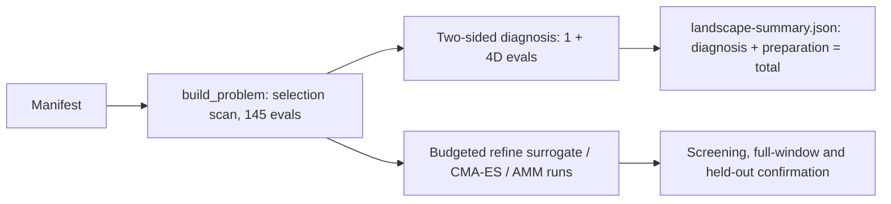

## Summary

Follow-up to the merged #274 benchmark. This PR re-lands the work of the closed
PRs #275, #280 and #281 onto the current `Develop`, and fixes the review
finding that stalled #281. Those PRs were closed after automated feedback rounds
failed twice. Their work was not rejected. The #281 branch already contained
`Develop` (`ac8c7e0`), so its commits fast-forward unchanged, and the commits
the evidence records (`f0a7b4c`, `8badaf5`, `84096bb`, `cf2ff11`) stay in this
branch's history.

- **The review fix.** #281's summary marked "against the current refinement
  method" as met. The refine arm is a random-axis surrogate
  (`lamarck/src/weight_bench/refine.rs`), not the production candidate
  pipeline. That criterion is now `partial`, and `CHANGELOG.md` now says
  "CMA-ES beat the refine surrogate" instead of "beat the refinement".
- **Full-window confirmation.** It is now a paired column, and it can veto a
  `-better` verdict (run output format 3).
- **Versions and costs.** Summaries record `gitCommit`, `gitDirty`,
  `neatCoreSource` and `wallClockSeconds`. `docs/weight-optimiser-routing.md`
  carries a compute ledger of every committed campaign.
- **Plateaus and kinks.** A two-sided landscape diagnosis
  (`weight_bench::landscape`, `weight_router_bench --landscape`) classifies each
  chosen axis as flat, edge, kinked, smooth or indeterminate. It records failed
  problems and coverage. A `saturated-hard-tanh` family has real flat axes, and
  refine, CMA-ES and the AMM reference were run on it with full-window and
  held-out confirmation.

Still outstanding:

- the representative run on a production creature and corpus;
- a comparison against the production refinement pipeline;
- a fully predeclared protocol, because the veto and the saturated family were
  added after results were seen.

Part of #266.

## Spec

### Intent and Rationale

- The #281 work fast-forwards cleanly onto `Develop`. Redoing it would only
  regenerate the same evidence under new commits, so this run kept it and fixed
  the one review finding: an overstated completion claim.
- Kinks and plateaus are measured by a diagnosis outside every arm's budget, so
  the predeclared arm results stay comparable. The saturated family exists
  because the predeclared suite had no flat axes.

### Essential Design Decisions

- **The diagnosis is a measurement, not an arm.** Its probes and the selection
  scan it triggers are counted in the command's own total, and no arm's budget
  pays for them. Nothing routes on them. AMM's probes are charged to its own
  budget through `BudgetedObjective`.
- **A failed landscape problem is recorded as a row, and the run continues.**
  The row carries `error` and the evaluations it spent (landscape format 3).
- **Run format 2 → 3 reads the old shape.** `plateau_free_axes` has
  `#[serde(default)]` and unknown router fields are ignored.
  `router_era_reference_rows_still_load_and_summarise` pins this. Landscape
  format 1 → 2 is a version bump with no old-shape read. Its only reader is the
  committed-evidence test, and that evidence was regenerated.
- **The full-window veto was decided after the format 2 results were seen.** It
  can only make a verdict stricter. It is reported as post-hoc, and the
  predeclaration criterion stays `partial`.

### Undiscoverable Facts

- No production creature or corpus exists on this host, so representative
  coverage is 0.
- #281 stalled on a pre-push `markdownlint-cli2` failure. Every error in it came
  from the worker's own `.git/graft/*.md` and `.git/worktrees/*/graft/*.md`
  files, not from this repository's Markdown. No repository lint config was
  changed.
- `docs/archive/handover/issue-266.md` is the worker's own note from an
  interrupted run. This run did not write it.

## Evidence

CLI and backend only. No UI file is touched.

- **Synthetic suite** at `f0a7b4c`: 648 of 648 runs, 0 failed, 1,631,615
  evaluations. CMA-ES beat the refine surrogate in 18 cells, was worse in 0 and
  was inconclusive in 9.
- **AMM campaign:** 324 of 324 runs, 0 failed, 855,000 evaluations. AMM was
  worse in all 54 comparisons. The method check gave identical rows for v0.3.0
  and v0.7.0.
- **Landscape diagnosis** at `cf2ff11`: 144 of 144 problems, 0 failed, 51,744
  evaluations (30,864 diagnosis plus 20,880 preparation).
  - Kinked axes: 8–29% of relu axes and 16–36% of hard-tanh axes.
  - Flat axes: found only in `saturated-hard-tanh`.
- **`saturated-hard-tanh` arm runs** at `8badaf5`: 216 of 216 runs, 0 failed,
  543,852 evaluations. Against refine, CMA-ES was worse in all six 30D and 100D
  cells, better in 1 and inconclusive in 2.
- **AMM on `saturated-hard-tanh`** at `84096bb`: 108 of 108 runs, 0 failed,
  285,000 evaluations. AMM was worse than refine and CMA-ES in all 18
  comparisons.
- **Compute ledger:** 3,367,211 evaluations across the five committed campaigns.
  The method check, tests and development runs are named as uncounted.
- Issue numbers cited:
  - #266: Experiment: Benchmark budget-aware routing of local weight
    optimisers.
  - #274, #275, #280 and #281 are this issue's earlier PRs (#274 merged, the
    others closed).

## Acceptance Criteria

<!-- vibe-spec-review inputs="diff+issue-body" -->

- **partial** — Use AMM as an offline reference against the current refinement method and CMA-ES on fixed deterministic screening records. — evidence: `lamarck/tests/weight_bench_reference.rs::committed_saturated_amm_evidence_is_reproduced_and_amm_loses_every_cell`, `docs/evidence/weight-router/reference-summary.json` — reviewer: partial — reason: AMM and CMA-ES are compared, but the refinement baseline is the `lamarck_refine` random-axis surrogate, not the production refinement pipeline.
- **met** — Optimise 20–100 influential weights with budgets 10D, 30D, 100D; mark D>40 as extrapolation requiring validation. — evidence: `lamarck/src/weight_bench/suite.rs` (dimension bounds, `is_extrapolation`), `docs/evidence/weight-router/manifest.json` — reviewer: met
- **met** — Count landscape probes within the budget. — evidence: `lamarck/tests/weight_bench_landscape.rs::landscape_command_total_counts_preparation_once_per_problem`, `lamarck/src/weight_bench/landscape.rs` (`diagnosisEvaluations`, `preparationEvaluations`) — reviewer: met
- **partial** — Test plateaus/kinks and activation families — evidence: `lamarck/tests/weight_bench_landscape.rs::diagnosis_finds_the_saturated_plateau`, `lamarck/tests/weight_bench_landscape.rs::tanh_axes_are_smooth_and_relu_and_hard_tanh_axes_kink` — reviewer: partial — reason: the plateau family and the kink test were added after the predeclared run, and the predeclared suite has 0 flat axes.
- **met** — then full/held-out confirmation. — evidence: `lamarck/tests/weight_bench_reference.rs::full_window_veto_turns_a_screening_win_inconclusive`, `lamarck/tests/weight_bench_reference.rs::held_out_veto_turns_a_screening_win_inconclusive` — reviewer: met
- **met** — Port only winning probes/router to Rust after measurement; no topology optimisation or unverified third-party dependency added by default. — evidence: the router was removed after it never beat CMA-ES, and `Cargo.lock` changes only the crate version — reviewer: met
- **met** — First inspect current code, merged work and repository instructions. Reuse existing mechanisms; if functionality already exists, this issue still owns the missing controlled comparison rather than a second implementation. — evidence: `lamarck/src/weight_bench/objective.rs` (`scan_sensitivities`/`pick_influential` split from `select_influential`), `lamarck/src/weight_bench/experiment.rs` — reviewer: met
- **met** — Opt-in experiment only; preserve ordinary behaviour, interfaces, immutable parents and full authoritative acceptance. No automatic deployment or default change. — evidence: changes confined to `lamarck/src/weight_bench/` and `lamarck/examples/weight_router_bench.rs`; `lamarck/src/run.rs` untouched; `lamarck/tests/weight_bench_landscape.rs::existing_families_rebuild_the_committed_rows_exactly` — reviewer: met
- **partial** — Predeclare controls, seeds, sample size, compute limits and success/failure criteria. Identify code/model/data versions; separate calibration from untouched validation and count all preparation/search costs. — evidence: `lamarck/src/weight_bench/provenance.rs`, `docs/weight-optimiser-routing.md` (compute ledger) — reviewer: partial — reason: the full-window veto was added after the format 2 results were seen, and development and smoke runs were not logged, so their cost is not counted.
- **partial** — Provide deterministic positive/negative correctness tests for new behaviour and pass the repository's normal quality checks. Research runs are separate from routine feature CI. — evidence: `lamarck/tests/weight_bench_landscape.rs::failed_problems_are_recorded_and_counted_not_fatal`, `lamarck/tests/weight_bench_landscape.rs::landscape_refuses_corpus_and_invalid_manifests`; `./quality.sh` passed on `955882b` — reviewer: partial — reason: `saturated_family_runs_through_the_manifest_with_confirmation` and `existing_families_rebuild_the_committed_rows_exactly` run small `run_manifest` campaigns inside `cargo test`, which blurs the line between research runs and routine CI.
- **partial** — Deliver a reproducible command/manifest and machine-readable results with paired distributions, uncertainty, failures and actual coverage. Fixtures alone do not demonstrate an optimisation benefit. — evidence: `lamarck/tests/weight_bench_reference.rs::committed_evidence_is_reproduced_by_the_summariser`, `docs/evidence/weight-router-landscape/landscape-summary.json` — reviewer: partial — reason: the synthetic side is delivered, but representative coverage is 0 runs, so there is no evidence beyond fixtures.
- **partial** — Record negative findings and remove optional code that does not earn its maintenance cost. Do not claim success before representative runs. — evidence: `docs/weight-optimiser-routing.md` (Findings 2, 4 and 5, AMM results) — reviewer: partial — reason: the landscape module and `--landscape` command are kept although nothing routes on the diagnosis, so their value is unproven; no success is claimed.
- **met** — Keep public implementation and fixtures application-agnostic; private corpora/results and operational integration remain private. — evidence: synthetic teacher networks only (`lamarck/src/weight_bench/suite.rs`); no corpus data committed under `docs/evidence/` — reviewer: met
- **met** — Leave unassigned until an implementer actively starts. `work-on` authorises the investigation, not skipping prerequisite verification. — evidence: the issue was unassigned by the worker's closed-PR self-healing between runs, and this run inspected #274 and #281 before changing anything — reviewer: met
- **unrequested** — `lamarck/src/weight_bench/provenance.rs` runs `git` and parses `Cargo.lock` at run time — reviewer: unrequested — reason: it serves "Identify code/model/data versions"; it passes fixed arguments, uses no shell, and only warns on failure.
- **unrequested** — the `saturated-hard-tanh` family and its refine, CMA-ES and AMM campaigns — reviewer: unrequested — reason: added after the predeclared run to test plateaus, because no predeclared family had a flat axis; reported as post-hoc.
- **unrequested** — the `landscape.rs` diagnosis module and the `--landscape` command as public API — reviewer: unrequested — reason: it is the measurement for "Test plateaus/kinks"; no arm or router uses it, which the docs list as open.
- **unrequested** — the screening, held-out and full-window columns share one bootstrap RNG stream, which moved one tanh D=100 30D verdict — reviewer: unrequested — reason: a side effect of adding the full-window column; the docs record the change.
- **unrequested** — crate version bump 0.1.48 → 0.1.49 (`lamarck/Cargo.toml`, `Cargo.lock`) — reviewer: unrequested — reason: required by `CONTRIBUTING.md` for a change to what the crate builds from.

## Standards Review

<!-- vibe-standards-review inputs="diff+CODING-STANDARDS.md" -->

- **clean** — No violations. The repository has no `CODING-STANDARDS.md`, so the reviewer used `CONTRIBUTING.md`, the README's "Development rules", "Build and quality gate" and "Safety invariants" sections, and `quality.sh`. None of them names a rule as review-only. Areas checked:
  - the version bump and changelog placement;
  - TDD for each behaviour change;
  - no new dependency;
  - the edition and `rust-version` floor;
  - no duplication of neat-core or the scorer;
  - the safety invariants (the diagnosis is measurement only);
  - the changed expectations in the existing tests (the `format_version` 2 → 3 assertion goes red when the summariser's version is reverted);
  - that every named test exists.

  Optional notes, not pursued: the format-3 CHANGELOG entry sits under `### Added` rather than `### Changed`, and the example's provenance probe runs `git` in the build-time `CARGO_MANIFEST_DIR`.

## Test Plan

- `timeout 1700 ./quality.sh < /dev/null` on `955882b` (the last commit that touches code, tests or evidence): exited 0, "All quality checks passed!". It ran `weight_bench_reference` (17 passed) along with the rest of the suite, plus `cargo doc`.
- After that commit, the branch changes only the `CHANGELOG.md` wording, this summary and the worker's handover note. `markdownlint-cli2 CHANGELOG.md` reported 0 issues, and `scripts/spell-check.sh` found no typos.
- Tests added by the re-landed #275, #280 and #281 commits:
  - `lamarck/tests/weight_bench_landscape.rs`:
    - the classifier, saturated-family, determinism, reproduction and committed-evidence tests;
    - `landscape_command_total_counts_preparation_once_per_problem`;
    - `failed_problems_are_recorded_and_counted_not_fatal`;
    - `a_clean_run_covers_every_planned_problem`.
  - `lamarck/tests/weight_bench_reference.rs`:
    - `full_window_veto_turns_a_screening_win_inconclusive`;
    - `committed_evidence_is_reproduced_by_the_summariser`;
    - `committed_saturated_amm_evidence_is_reproduced_and_amm_loses_every_cell`;
    - `router_era_reference_rows_still_load_and_summarise`.
  - `lamarck/tests/weight_bench.rs`:
    - `plateau_free_axes_count_only_the_flat_synapses_chosen`;
    - `corpus_rows_record_the_plateau_count_of_their_problem`;
    - `synthetic_rows_carry_their_problem_plateau_count`;
    - `rows_without_the_plateau_field_load_as_none`.
  - `lamarck/src/weight_bench/provenance.rs::tests`:
    - `real_lock_pins_neat_core_to_its_git_source`;
    - `lock_without_neat_core_errors_naming_it`;
    - `git_state_reports_the_commit_and_whether_the_tree_is_dirty`.
  - `lamarck/src/weight_bench/landscape.rs::tests::a_failure_partway_through_the_axes_keeps_the_evaluations_spent`.
- Removed from `lamarck/tests/weight_bench_reference.rs`: `assert!(rows.contains("routedTo") && rows.contains("probeEvaluations"));`
  - Obsolete: the committed AMM rows were regenerated from current code and no longer carry router-era fields.
  - Still covered by: `lamarck/tests/weight_bench_reference.rs::router_era_reference_rows_still_load_and_summarise`
  - Replaced by: `assert!(parsed.iter().all(|r| r.plateau_free_axes.is_some()));`
- Changed in `lamarck/tests/weight_bench_reference.rs::clearly_better_and_worse_references_get_matching_verdicts`: `format_version` 2 → 3, as the run-format bump requires.
- Docs: I grepped `CHANGELOG.md`, `README.md` and `docs/weight-optimiser-routing.md` for "beat the refinement", "than the refinement" and "current refinement". The only hit was `CHANGELOG.md:84`, which is now fixed. `docs/weight-optimiser-routing.md` already calls the arm a "random-axis surrogate".

## Merge verification

- GitHub CI not yet verified.

Not done:

- the `partial` criteria above;
- the representative run on a production creature and corpus;
- the comparison against the production refinement pipeline.

`scripts/test-amm-reference.py` was not re-run: it needs a scratch AMM
environment.
