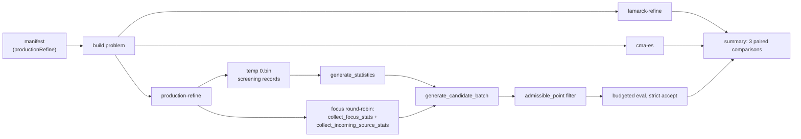

## Summary

The #266 weight benchmark compared CMA-ES and AMM only against a random-axis
surrogate, not against the current refinement method. This PR adds an opt-in
third arm, `production-refine`. It drives the real production generator,
`generate_candidate_batch`, using production focus, incoming and observations
statistics over the bench's screening records. It evaluates only the
candidates that change the selected weights.

The arm was run on the predeclared synthetic suite (972 of 972 runs, 0 failed).
It was the weakest arm:

- **Against the surrogate:** worse in 26 of 27 cells and inconclusive in 1.
- **Against CMA-ES:** worse in all 27 cells.

The committed AMM rows were then paired with the new arm. AMM was worse than
`production-refine` in 23 of 27 cells and inconclusive in 4. The 4 are tanh
D=20 10D, relu D=20 30D, relu D=40 30D and hard-tanh D=20 10D.

The arm's statistics scans over the screening records are counted, apart from loss
evaluations, as `statisticsCost` (record and network passes) on each of its rows
and in the summary total, including rounds that yield no admissible candidate.
The campaign was re-run to record them (348,611 record passes, 348,287 of them
network passes, over the 324 production runs). Every loss figure and verdict is
unchanged.

This is a negative synthetic finding (Finding 6) with no default change. Default
output is unchanged: the run's 648 surrogate and CMA-ES rows equal the committed
`weight-router/runs.jsonl` apart from wall clock, and the new field is omitted
from any row or summary that has none.

Representative runs on a production creature and corpus are still not made.
Part of #266.

## Spec

### Intent and Rationale

- The merged summary (#294) and the routing doc's Outstanding list named the missing comparison against "the actual production refinement pipeline". The `reference` arm compares against `lamarck-refine`, which is a surrogate. This arm calls the production generator itself, so "the current refinement method" is measured, not approximated.
- The arm reuses the production helpers (`generate_statistics`, `collect_focus_stats`, `collect_incoming_source_stats`, `generate_candidate_batch`) and does not reimplement them, as the issue's "reuse existing mechanisms" asks.

### Essential Design Decisions

- **Selected weights only.** The bench optimises exactly the D selected weights, so a candidate is evaluated only when `admissible_point` accepts it: the same neurons (uuid, type, squash, bias), the same synapse list, and only selected weights changed. Structural, bias and out-of-set proposals are skipped. This keeps the "no topology optimisation" boundary, but it means the arm measures the generator's weight proposals only.
- **Opt-in.** The arm runs only when `Manifest.productionRefine` is true (`#[serde(default)]`, omitted when false) or the example's `--production-refine` flag is passed. Older manifests read as false, and default manifests serialise byte-for-byte as before. The arm's seed constant is pinned in `arm_seeds_are_pinned`.
- **Fixed batch, no learning signal.** `PRODUCTION_BATCH` is 16, `scale_quotas: false`, `learning: None`, `ranked_sources: None` and the mirror policy is the default. Focus neurons are taken round-robin over the distinct targets of the selected synapses. The arm stops, with budget unused, when a whole focus cycle yields nothing admissible (8 of 324 rows did).
- **AMM paired with the new arm.** `summarise_reference` adds an AMM vs `production-refine` pair only when the manifest sets `productionRefine`. Without the flag the output is unchanged. With it, the first two pairs keep their means, medians, paired differences, win/loss counts and verdicts. Only their bootstrap interval bounds move, because the extra pair draws from the same bootstrap random stream.
- **Statistics passes counted, in their own unit.** `BudgetedObjective::charge_record_pass` records each scan the arm's statistics helpers make: one `generate_statistics` record pass per run and, per round, a `collect_focus_stats` network pass and a `collect_incoming_source_stats` network pass. The incoming helper is charged only when it scanned: `collect_incoming_source_stats_reporting_scan` returns that flag, and `collect_incoming_source_stats` is now a thin wrapper that drops it, so its behaviour and every other caller are unchanged. The counts are not drawn from the evaluation budget and are not added into `totalEvaluations`, because a record or network pass is not a loss evaluation. They are reported separately as `statisticsCost`. A scan is charged before it runs, except the incoming one, which is charged when it succeeds.
- **Kept, with a removal condition.** The code is kept, opt-in and bench-only, as the harness for the representative comparison. The routing doc's Outstanding list says to remove it if that run does not use it or confirms the synthetic negative result.

### Undiscoverable Facts

- No production creature/corpus pair is available on this host, and private inputs stay out of the checkout, so the representative campaign is an owner step.
- The arm campaign was produced at commit `11b7953` and re-run at `128436a` to record the statistics passes; the evidence now committed is the `128436a` run. The AMM pairing (`reference-summary.json`) was produced at `5006cf6`, which re-reads committed rows and makes no evaluation. Its inputs are unchanged by the re-run (every loss figure is identical), so it was not regenerated and carries no cost field.

## Evidence

Backend/CLI only; no UI file touched.

- **Campaign.** The command was `cargo run --release --example weight_router_bench -- docs/evidence/weight-router-production --production-refine`, run at `128436a` (crate 0.1.55, `gitDirty` false). It exited 0: `runs 972/972 completed (0 failed); 2431738 evaluations`, then `statistics passes over the screening records (not loss evaluations): 348611 record passes, 348287 of them network passes`. Wall clock was 406 s on a shared, parallel host (indicative only). A Python comparison against the earlier `11b7953` evidence found all 972 rows identical once `statisticsCost` was removed from the 324 production rows, and `summary.json` differing only in `gitCommit`, `wallClockSeconds` and the new `statisticsCost`. Results are in `docs/evidence/weight-router-production/{manifest.json,runs.jsonl,summary.json}`.
- **Paired results** (324 pairs per comparison, production minus the other arm):

  | Comparison | Screening (wins / losses) | Held-out | Full window |
  |---|---|---|---|
  | vs `lamarck-refine` | 12 / 312 | 24 / 300 | 23 / 301 |
  | vs `cma-es` | 3 / 321 | 15 / 309 | 10 / 314 |

  Per-cell bootstrap intervals and paired differences are in `summary.json`. Against the surrogate, the mean screening differences run from +0.0001 to +0.26 across all 27 cells (+0.002 to +0.26 across the 26 production-worse cells), and are largest at 10D.
- **AMM against production-refine.** The command was `cargo run --release --example weight_router_bench -- docs/evidence/weight-router-production --compare-reference docs/evidence/weight-router/amm-runs.jsonl`, run at `5006cf6` (crate 0.1.55, `gitDirty` false). It reported `reference runs 324/324 completed (0 failed)` and wrote `docs/evidence/weight-router-production/reference-summary.json`. AMM was worse in 23 of 27 cells and inconclusive in 4. Pairs (wins / losses) were: screening 35 / 289, held-out 39 / 285 and full window 34 / 290. A Python check against `weight-router/reference-summary.json` found all 54 AMM-vs-refine and AMM-vs-CMA-ES verdicts identical. Only the `ciLow`/`ciHigh` fields differed.
- **Default output unchanged.** A Python comparison of the `11b7953` campaign's `lamarck-refine` and `cma-es` rows against the committed `docs/evidence/weight-router/runs.jsonl`, keyed on (arm, family, dimension, seed, budget) with `wallClockSeconds` dropped, found 648 of 648 identical. The re-run left those 648 rows byte-identical to the `11b7953` evidence (above).
- **Smoke run.** `--smoke --production-refine` ran 3 runs with 760 evaluations at `11b7953`, and again at `128436a`, where it printed `123 record passes, 122 of them network passes` (neither run is committed; both are counted in the compute ledger).

## Acceptance Criteria

<!-- vibe-spec-review inputs="diff+issue-body" -->

- **partial** — Use AMM as an offline reference against the current refinement method and CMA-ES on fixed deterministic screening records. — evidence: `docs/evidence/weight-router-production/reference-summary.json`, `lamarck/tests/weight_bench_reference.rs::production_refine_manifest_pairs_amm_with_the_production_arm` — reviewer: partial — reason: AMM is now paired with `production-refine` (worse in 23 of 27 cells, inconclusive in 4) and with CMA-ES, but only on synthetic records, and the production arm is weight-only (no learning signal, no ranked sources, no structural or bias proposals).
- **partial** — Test plateaus/kinks and activation families, then full/held-out confirmation. — evidence: `docs/evidence/weight-router-production/summary.json` (held-out and full windows per arm) — reviewer: partial — reason: plateaus, kinks and families were tested on synthetic problems only, with no full authoritative confirmation on a representative model or corpus.
- **partial** — Predeclare controls, seeds, sample size, compute limits and success/failure criteria. Identify code/model/data versions; separate calibration from untouched validation and count all preparation/search costs. — evidence: `docs/weight-optimiser-routing.md` (Compute ledger, Controls) — reviewer: partial — reason: `production-refine` was added after the predeclared run, with no success criteria of its own. Its statistics passes over the screening records are now counted (`statisticsCost`, in record and network passes, kept apart from loss evaluations because the units differ) in the committed campaign and in the compute ledger. There is no calibration/validation split without a representative run.
- **partial** — Deliver a reproducible command/manifest and machine-readable results with paired distributions, uncertainty, failures and actual coverage. Fixtures alone do not demonstrate an optimisation benefit. — evidence: `docs/evidence/weight-router-production/{manifest.json,runs.jsonl,summary.json,reference-summary.json}` — reviewer: partial — reason: the synthetic results are reproducible and complete. Representative coverage is 0 runs, so no optimisation benefit is shown.
- **partial** — Record negative findings and remove optional code that does not earn its maintenance cost. Do not claim success before representative runs. — evidence: `docs/weight-optimiser-routing.md` Finding 6 and "AMM against `production-refine`" — reviewer: partial — reason: the negative findings are recorded and no success is claimed. `production-refine` lost to CMA-ES in every cell and is still kept as opt-in code, pending a representative run that has not been made.
- **unrequested** — README #266 row corrected from "19 of 27" to "18 of 27" cells — reviewer: unrequested — reason: the reviewer found the row this PR edits contradicted `summary.json`, so it was fixed in place.

## Test Plan

- Added `lamarck/src/weight_bench/production.rs` unit tests:
  - `accepts_a_selected_weight_change_and_returns_x` checks that a change to a selected weight returns the new weight vector.
  - `rejects_bias_out_of_set_added_synapse_and_identical` checks four refusals. The bias case also changes a selected weight, so only the bias can refuse it. The out-of-set case is tested with and without a selected change. The other two cases are an added synapse and an identical creature.
  - `production_refine_is_bounded_deterministic_and_cleans_up` runs a tanh D=20 problem with a 200-evaluation budget. It asserts that the run uses all 200 evaluations and ends strictly below the start loss. It also asserts identical loss and evaluation count for two runs with one seed, and that both temporary directories are distinct and removed. Red-checked: a copy of `run` that drops every admissible candidate fails at the full-budget assert.
- Added statistics-cost tests (PR #295 review). Each one asserts exact counts or exact absence, so it fails when a pass is not charged or is charged twice:
  - `lamarck/src/weight_bench/production.rs::a_round_with_no_admissible_candidate_still_costs_its_statistics_passes` selects only the `h1 -> o1` synapse, on records where the generator proposes nothing admissible. It asserts one evaluation used and 3 record passes (2 network): the observations pass plus the idle round's focus and incoming passes.
  - `lamarck/src/weight_bench/production.rs::a_hidden_neuron_fed_by_inputs_costs_one_network_pass_per_round` selects only `input-0 -> h1`, where the incoming helper skips its scan. It asserts 6 record passes (5 network), which would be 11 if the skipped scan were charged. The figure is pinned to seed 7 and moves only if the generator's output does.
  - `lamarck/src/weight_bench/production.rs::the_statistics_cost_is_not_drawn_from_the_evaluation_budget` asserts the full 200-evaluation budget is still spent, that exactly one record pass has no network run, and that a second run with the same seed charges the same passes.
  - `lamarck/src/focus.rs::incoming_scan_is_reported_only_when_the_records_were_read` covers the no-scan path directly: a hidden neuron fed only by an input reports `false`, and an output neuron, a direct input-to-output neuron and a hidden neuron fed by a neuron report `true`, each with stats equal to `collect_incoming_source_stats`.
  - `lamarck/tests/weight_bench.rs::production_refine_reports_its_statistics_passes_apart_from_evaluations` asserts that default arms and results carry no `statisticsCost` key, that the production row's cost is one non-network pass plus network passes, that the total equals that row's, that `totalEvaluations` still counts loss evaluations only, and that the camelCase fields round-trip.
  - `lamarck/tests/weight_bench.rs::rows_written_before_the_statistics_cost_read_as_zero` is the old-shape test: a row without the field, as the committed rows were written, reads as zero.
- `lamarck/tests/weight_bench_reference.rs` gains `statistics_cost: StatisticsCost::default()` in its `RunRow` fixture literal; no assertion changed.
- Added `lamarck/tests/weight_bench.rs` tests:
  - `production_refine_manifest_adds_arm_rows_and_pairs` checks that the flag adds a `production-refine` row per problem and budget and the two new comparison pairs. The flag-off control has no such row and only the original pair.
  - `production_refine_flag_serialisation_is_backward_compatible` checks that a manifest without `productionRefine` reads as false and that a default manifest serialises without the key.
- Added `lamarck/tests/weight_bench_reference.rs::production_refine_manifest_pairs_amm_with_the_production_arm`. Without the flag it checks that production rows are ignored and only two pairs appear. With the flag it checks for the third pair, unchanged first-two means, and the expected AMM-minus-production means (−0.8 screening, −0.6 held out) and verdict.
- Extended `lamarck/src/weight_bench/arms.rs::arm_seeds_are_pinned` with the new arm's seed. The existing asserts are kept.
- `lamarck/tests/weight_bench_landscape.rs` and the existing `lamarck/tests/weight_bench_reference.rs` tests only gain `production_refine: false` in `Manifest` literals. No assertion was removed from any existing test, and the committed-evidence reproduction tests pass unchanged.
- Results on the final head: `./quality.sh < /dev/null` exited 0 with "All quality checks passed!" (1031 tests passed, 0 failed), covering `cargo fmt --check`, `cargo clippy --all-targets` and the committed-evidence reproduction tests. The evidence was generated at `128436a`; the commits after it change only documentation, doc comments and this summary.
- Results on the earlier head:
  - `./quality.sh < /dev/null` exited 0 with "All quality checks passed!" (1024 tests passed, 0 failed).
  - The first gate run failed `readme_contract::readme_mentions_no_unknown_lamarck_flags`, because the README named the example-only `--production-refine` flag. The flag was removed from README, and `cargo test --test readme_contract` passed 40 tests.
- Docs read and updated:
  - `docs/weight-optimiser-routing.md`: Arms table, How to run (including the compare command), the Results pointer, Finding 6 (range corrected), the new "AMM against `production-refine`" section, Compute ledger (committed total 5,798,949; total including re-runs 10,407,674; the new statistics-pass table) and the Arms table row, the Controls section and Outstanding. Its opening sentences no longer say the bench has no production-pipeline comparison.
  - The README #266 row and `CHANGELOG.md` (a statistics-cost paragraph on the production-refine entry).
  - The `weight_bench/mod.rs` and example module docs.

## Merge verification

- GitHub CI not yet verified.

## Not done

- **Representative runs:** none on a production creature and corpus, for any arm. No optimisation benefit is claimed.
- **Arm scope:** `production-refine` excludes the generator's structural and bias proposals and runs without a learning signal or ranked sources, so it measures the weight proposals only.
- **Review:** the Spec reviewer was dispatched over the diff (verdicts above). The Standards reviewer was not dispatched in this session.
- **Pass-to-evaluation conversion:** the statistics passes are counted but not converted into loss-evaluation equivalents; the ledger gives both figures in their own units.

🤖 Generated with [Claude Code](https://claude.com/claude-code)
