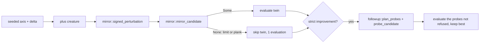

## Summary

Most of #266's weight benchmark has already merged (#282, #283). One reuse gap
remained: the `lamarck-refine` arm built its antithetic twin and its follow-up
probes with a hand-written copy of what `mirror.rs` and `followup.rs` do. This
PR makes `lamarck/src/weight_bench/refine.rs` call the production helpers
instead: `mirror::signed_perturbation` and `mirror::mirror_candidate` for the
`-delta` twin, and `followup::plan_probes` and `followup::probe_candidate` for
the follow-up probes. The arm therefore inherits their refusals (the hard
weight limit and the plank constant). Re-running both committed refine
suites with this code reproduced every committed row, so no evidence file and
no reported number changes.

The refinement arm is still a random-axis surrogate, not the production
candidate pipeline, and no representative run has been made, so this PR is
Part of #266.

## Spec

### Intent and Rationale

- The issue says "Reuse existing mechanisms", and the routing doc recorded that `refine.rs` "manually recreates mirrors and follow-up steps". Calling the production helpers removes that second copy without changing the arm's predeclared protocol on the committed suites.

### Essential Design Decisions

- The RNG draw order (axis, then a nonzero delta), the `remaining() >= 2` loop, start-first evaluation and the tie-break (plus wins ties) are kept, so the committed rows still reproduce exactly.
- The limits come from `BackpropConfig::default()` (`limit_weight_scale` 100000, `plank_constant` 1e-7). A twin that `signed_perturbation` or `mirror_candidate` refuses is not evaluated, so that round spends one evaluation instead of two. A refused follow-up probe is skipped.
- `WeightObjective` gains `creature_at` and `synapse_indices`, and `BudgetedObjective` gains `objective()`, only so the arm can hand creatures to the helpers. `loss_on` now builds its creature through `creature_at`.

### Undiscoverable Facts

- The new arithmetic is not bit-identical by construction: the twin is now `x - ((x + delta) - x)` instead of `x - delta`. Re-running both suites still gave identical rows (Evidence below).

## Evidence

Backend/CLI only, no UI file touched.

- **Main suite:** `cargo run --release --example weight_router_bench -- /tmp/wrb-266/main` at `a5484b0` finished 648/648 runs, 0 failed, 1,631,615 evaluations. Comparing its `runs.jsonl` with the committed `docs/evidence/weight-router/runs.jsonl` row by row as parsed JSON gave 648 equal, 0 different. Every cell verdict is unchanged.
- **Saturated suite:** the same binary with `--manifest docs/evidence/weight-router-landscape/saturated/manifest.json` finished 216/216 runs. All 216 rows are equal to the committed `docs/evidence/weight-router-landscape/saturated/runs.jsonl`.
- **Pin test:** `lamarck/tests/weight_bench.rs::the_refine_arm_reproduces_its_committed_rows` pins 8 of those rows in CI.
- **Unit tests** in `lamarck/src/weight_bench/refine.rs`:
  - `twin_straddles_x_on_the_chosen_axis`
  - `twin_is_refused_past_the_hard_weight_limit` (positive control included)
  - `twin_is_refused_below_the_plank_constant` (positive control included)
  - `follow_up_steps_around_the_winning_move` (steps +0.5, -0.5 and +1.0 of the move, in that order)
  - `follow_up_drops_a_probe_past_the_hard_limit`

## Acceptance Criteria

<!-- vibe-spec-review inputs="diff+issue-body" -->

- **partial** — Use AMM as an offline reference against the current refinement method and CMA-ES on fixed deterministic screening records. — evidence: `docs/evidence/weight-router/reference-summary.json`, `lamarck/src/weight_bench/refine.rs` — reviewer: partial — reason: the refinement arm now reuses the production mirror and follow-up helpers, but it is still a random-axis surrogate, not `generate_candidate_batch` with its focus, statistics and backprop proposals.
- **met** — Optimise 20–100 influential weights with budgets 10D, 30D, 100D; mark D>40 as extrapolation requiring validation. — evidence: `predeclared_manifest`, `is_extrapolation` in `lamarck/src/weight_bench/` — reviewer: met
- **met** — Count landscape probes within the budget. — evidence: `lamarck/src/weight_bench/landscape.rs` on `BudgetedObjective` (merged in #283) — reviewer: met
- **partial** — Test plateaus/kinks and activation families, then full/held-out confirmation. — evidence: `docs/evidence/weight-router-landscape/`, `docs/evidence/weight-router/summary.json` — reviewer: partial — reason: synthetic fixtures only; the saturated family was added after the predeclared run, and there is no representative or authoritative confirmation.
- **met** — Port only winning probes/router to Rust after measurement; no topology optimisation or unverified third-party dependency added by default. — evidence: router removed in #282; `Cargo.lock` changes only the crate's own version — reviewer: met
- **met** — Read and pin the full method before reproducing it — evidence: `docs/evidence/weight-router/method-check.json`, `scripts/check-amm-method.py` — reviewer: met
- **partial** — First inspect current code, merged work and repository instructions. Reuse existing mechanisms; if functionality already exists, this issue still owns the missing controlled comparison rather than a second implementation. — evidence: `lamarck/src/weight_bench/refine.rs` (`mirrored_pair`, `follow_up_points`) — reviewer: partial — reason: the mirror and follow-up copies are gone; the greedy accept loop and the `+delta` step are still a simplified stand-in for refinement.
- **met** — Opt-in experiment only; preserve ordinary behaviour, interfaces, immutable parents and full authoritative acceptance. No automatic deployment or default change. — evidence: only `weight_bench/` code and a doc comment in `lamarck/src/followup.rs` change; `creature_at` clones the creature — reviewer: met
- **partial** — Predeclare controls, seeds, sample size, compute limits and success/failure criteria. Identify code/model/data versions; separate calibration from untouched validation and count all preparation/search costs. — evidence: `docs/evidence/weight-router/manifest.json`, `docs/weight-optimiser-routing.md` — reviewer: partial — reason: the saturated family, landscape diagnosis and full-window veto came after results were seen, and the arm's refusal limits come from `BackpropConfig::default()` rather than the manifest.
- **met** — Provide deterministic positive/negative correctness tests for new behaviour and pass the repository's normal quality checks. Research runs are separate from routine feature CI. — evidence: `lamarck/src/weight_bench/refine.rs` tests (hard-limit and plank-constant refusals with positive controls), `./quality.sh < /dev/null` exit 0 on `1ef7b58` — reviewer: partial — reason: the reviewer asked for a plank-constant test, now added as `twin_is_refused_below_the_plank_constant`, and could not run the gate itself. No test drives a refused twin through `lamarck_refine` to show the round spends one evaluation; the loop's `if let Some(minus)` is the only path, and the helper tests cover when it is `None`.
- **partial** — Deliver a reproducible command/manifest and machine-readable results with paired distributions, uncertainty, failures and actual coverage. Fixtures alone do not demonstrate an optimisation benefit. — evidence: `docs/evidence/weight-router/`, `lamarck/tests/weight_bench.rs::the_refine_arm_reproduces_its_committed_rows` — reviewer: partial — reason: synthetic only; the committed summaries carry crate 0.1.49 provenance, and CI pins 8 rows (the full 648 + 216 reproduction was a manual re-run, recorded above).
- **partial** — Record negative findings and remove optional code that does not earn its maintenance cost. Do not claim success before representative runs. — evidence: `docs/weight-optimiser-routing.md` (Findings, Outstanding) — reviewer: met — reason: kept partial because no representative run has been made, and the landscape diagnosis, which nothing routes on, is kept only to reproduce Finding 5.
- **met** — Keep public implementation and fixtures application-agnostic; private corpora/results and operational integration remain private. — evidence: synthetic fixtures only — reviewer: met
- **met** — Leave unassigned until an implementer actively starts. `work-on` authorises the investigation, not skipping prerequisite verification. — evidence: this run inspected the merged #283 before changing code — reviewer: missing — reason: the reviewer said "not judgeable" (a process item the diff cannot show); the worker managed assignment.

## Standards Review

<!-- vibe-standards-review inputs="diff+CODING-STANDARDS.md" -->

- **clean** — Reviewed against `CONTRIBUTING.md`, because the repository has no `CODING-STANDARDS.md`. No violation was found.
  - The version bump (0.1.50 → 0.1.51) and the CHANGELOG entry follow `CONTRIBUTING.md`.
  - `refine.rs` calls the four helpers its docs name.
  - The refusal conditions and default limits match `lamarck/src/mirror.rs`, `lamarck/src/followup.rs` and `lamarck/src/backprop.rs`.
  - The probe order and tie-break are preserved.
  - No review-only rules are declared, so none needed checking.
- **clean** — The reviewer's optional items were fixed in `6f0efa8`:
  - the CHANGELOG had credited the saturated rows to the predeclared manifest, and gave the wrong `saturated/` path;
  - the twin skip by `signed_perturbation` was undocumented;
  - the `creature_at` doc contradicted itself;
  - a pass-through test wrapper was removed;
  - a test comment was misleading;
  - the plank-constant test was missing.

## Test Plan

- **Added in `lamarck/src/weight_bench/refine.rs`:**
  - `twin_straddles_x_on_the_chosen_axis`
  - `twin_is_refused_past_the_hard_weight_limit`
  - `twin_is_refused_below_the_plank_constant`
  - `follow_up_steps_around_the_winning_move`
  - `follow_up_drops_a_probe_past_the_hard_limit`
- **Added in `lamarck/tests/weight_bench.rs`:** `the_refine_arm_reproduces_its_committed_rows`. It is a pin, expected green both before and after this change, because the rows did not move.
- **Unchanged:** no existing assertion was edited or removed. `arms_respect_budget_and_improve`, `arms_are_deterministic_and_seed_sensitive` and `arms_share_the_start_without_mutating_the_parent` still drive `lamarck_refine` through the new helpers.
- **Callers of the changed `WeightObjective::loss_on`:** the arms, confirmation and landscape code. They are covered by `cargo test --test weight_bench_reference` and the gate's full suite.
- **Results:**
  - `cargo test --lib weight_bench::refine`: 5 passed on `6f0efa8`.
  - `cargo test --test weight_bench`: 27 passed, 1 ignored.
  - `cargo test --test weight_bench_reference`: 17 passed.
  - `cargo test --lib mirror`: 15 passed. `cargo test --lib followup`: 13 passed.
  - `cargo clippy --all-targets -- -D warnings` and `cargo doc` with `-D warnings`: clean on `6f0efa8`.
  - `./quality.sh < /dev/null`: exited 0 on `1ef7b58` ("All quality checks passed!"). `6f0efa8` changes only one added test, test comments, doc comments, the CHANGELOG and the routing doc.
- **Docs read and updated:** in `docs/weight-optimiser-routing.md`, the status paragraph, the evidence-provenance paragraph, the `lamarck-refine` row of the Arms table and "Controls and remaining experiment". Also the `STEP_FRACTIONS` doc in `lamarck/src/followup.rs`, the `refine.rs` module doc and `CHANGELOG.md`. `README.md` does not mention the refine arm.

## Merge verification

- GitHub CI not yet verified.

## Not done

- **Production refinement arm:** the arm does not call `generate_candidate_batch`, so the comparison is still against a surrogate.
- **Representative runs:** no production creature or corpus is available here, so no optimisation benefit is claimed.
- **Predeclared protocol:** none exists for the post-hoc additions, and the refusal limits are not echoed in the manifest.
- **Refused twin in the loop:** no `lamarck_refine`-level test shows that a refused twin costs one evaluation.
- **AMM reference script:** `scripts/test-amm-reference.py` was not re-run, because it needs a scratch AMM environment.
