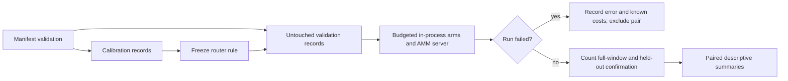

## Summary

Add an opt-in weight-optimiser benchmark, an offline AMM reference driver and
synthetic evidence. Harden trial validation, failure accounting and reference
process handling; verify the pinned AMM release against the paper's release.
The production-baseline and representative comparisons remain incomplete.
Part of #266.

The branch also carries two CI fixes from the #268 branch, unchanged
(`98e7b28`, `5614dd8`). The Vibe Coder pre-push gate refused every earlier push
of this branch, and both commits are needed for it to pass. The `quality` job
in `ci.yml`, `cargo-quality.yml` and the `family-sync` job now install Rust
through `.github/actions/rust-toolchain`, which wraps the same pinned step. The
family-sync ShellCheck step falls back to the job's `CANONICAL_PATHS` list
when that variable is unset, and rule 17 in
`scripts/check-family-sync-workflow.sh` checks that the two lists match. The
carried-over CHANGELOG bullet still names Issue #268, word for word, so the
branch that merges second applies it cleanly.

- [x] Preserve the checkpointed harness and synthetic results.
- [x] Read and pin the full AMM method; check release compatibility.
- [x] Correct demonstrated comparison/accounting defects and run validation.
- [x] Carry over the pre-push gate fixes so the branch can be pushed.
- [ ] Establish production-baseline equivalence and freeze/run representative inputs.
- [ ] Complete full authoritative confirmation and the router/probe retirement decision.

## Spec

### Intent and Rationale

- Compare local weight search under explicit budgets without changing production acceptance.
- Preserve the archived synthetic experiment while making its limitations and failure handling explicit.

### Essential Design Decisions

- `lamarck-refine` is a random-axis surrogate, not `generate_candidate_batch`. Its uniform half-width and CMA-ES's coordinate standard deviation do not match search radii; the docs no longer claim equivalence.
- The synthetic dimensions, budgets, families and disjoint seed sets remain unchanged. A corrected baseline/protocol needs fresh validation data rather than tuning against the archived results.
- AMM stays in a separate, checksum-pinned scratch environment, with explicit preset `c46`. No production router or default is enabled.
- Errored rows cannot enter paired distributions, even with retained metrics. Their reported costs remain counted; a missing server row explicitly means incomplete cost accounting.

### Undiscoverable Facts

- The full method in [arXiv:2611.06879v1](https://arxiv.org/pdf/2611.06879v1) was read through the PDF reader: Section 3, Algorithms 1–2, Tables 2/6, Appendices A–B, Section 6 and software availability. The paper identifies `v0.3.0`, resolved to `c4f0ab160aae912311328145aa5a426b26a06b26`.
- Both `v0.3.0` and pinned `v0.7.0` produced 27 identical completed RunRows on one synthetic validation seed. This is a limited compatibility check, not evidence of representative benefit or identical internal evaluation traces.
- Local searches found test fixtures but no authorised production model/corpus pair. Representative coverage is zero and its provenance/manifest is not frozen.
- The worker's pre-push gate blocked earlier pushes in two ways. It read the `dtolnay/rust-toolchain` commit SHA as a toolchain, and `cargo +29eef336… --version` exited 101 with `error: no such command`. It also re-ran the family-sync ShellCheck step without the job's `env:`, where `set -u` stopped on `CANONICAL_PATHS: unbound variable`. The carried-over commits fix both, and no guard was bypassed. The SHA-as-toolchain misreading is a worker defect and is not fixed. Workflow steps that still call the pinned action directly (`ci.yml`'s `validation` job, `auto-format`, `cargo-audit`, `sbom`, `security`) can still trigger it.

## Evidence

- Public synthetic distributions, coverage and costs remain in `docs/evidence/weight-router/summary.json` and `reference-summary.json`. These are historical synthetic measurements, not representative results.
- `docs/evidence/weight-router/method-check.json` records the paper/source/dependency pins, compatibility manifest, result digest, code checkpoint and binary hash. Both releases have `c46` hash `2153948ebed51150`; the environment builder re-verified its source and wheel SHA-256 values.
- `scripts/check-amm-method.py` reuses the real reference driver and Rust objective server. It normalises the public seed/config arguments for both released APIs and rejects different results or empty campaigns.
- CLI/backend only. The existing production scorer acceptance path in `lamarck/src/run.rs` remains unchanged; the benchmark reports window MSE and does not authoritatively accept/install candidates.
- #266: Experiment: Benchmark budget-aware routing of local weight optimisers.

## Acceptance Criteria

- **missing** — Use AMM as an offline reference against the current refinement method and CMA-ES on fixed deterministic screening records. — reason: the offline machinery and synthetic comparison exist, but the refinement arm is a surrogate rather than the production pipeline.
- **missing** — Predeclare controls, seeds, sample size, compute limits and success/failure criteria. Identify code/model/data versions; separate calibration from untouched validation and count all preparation/search costs. — reason: the synthetic protocol exists; no representative model/data versions or complete representative manifest can be recorded from the available fixtures. Lost server rows retain an explicit incomplete-cost limitation.
- **missing** — Deliver a reproducible command/manifest and machine-readable results with paired distributions, uncertainty, failures and actual coverage. Fixtures alone do not demonstrate an optimisation benefit. — reason: public synthetic artefacts and commands are provided, but representative measurement and full authoritative confirmation have not run.
- **missing** — Record negative findings and remove optional code that does not earn its maintenance cost. — reason: the synthetic router's lack of advantage is recorded; its offline code remains for reproduction and the final removal decision is outstanding.

## Test Plan

- `timeout 1600 ./quality.sh < /dev/null` passed (exit 0, "All quality checks passed!") on `1da2506`, the last code commit: shell/workflow checks, spelling, dependency audit, formatting, Clippy, workspace tests and rustdoc. CI is not yet verified.
- Carried-over gate fixes: `scripts/test-check-family-sync-workflow.sh` passed, including its two rule-17 negative cases (no fallback, stale fallback), each refused with exit 1. `scripts/check-family-sync-workflow.sh`, `scripts/check-bot-push-action.sh` and `scripts/check-cargo-quality-overlap.sh` passed. The gate step re-run under `env -i … bash --noprofile --norc -eo pipefail`, with no `CANONICAL_PATHS`, exited 0.
- `cargo test --test weight_bench --test weight_bench_reference` passed: 20 and 11 tests, with one existing debug-mode ignore. The ignored `lamarck/tests/weight_bench.rs::extrapolation_flag_on_rows_for_large_dimension` passed separately with `--release -- --ignored`.
- Added `lamarck/tests/weight_bench.rs::manifest_rejects_duplicate_trial_identifiers`, `objective_requires_distinct_weights` and `objective_requires_nonzero_record_dimensions`; each rejected the checkpoint implementation before its fix and passes now. `arms_share_the_start_without_mutating_the_parent` pins an existing invariant and was not claimed as a previously failing bug.
- Added `lamarck/tests/weight_bench_reference.rs::failed_reference_with_completed_metrics_is_excluded_from_pairs`: before the fix it counted six wins instead of five; after the fix it drops the failed sample while retaining its costs.
- Added `lamarck/src/weight_bench/experiment.rs::tests::failed_confirmations_keep_the_calls_already_spent`: before the fix failed confirmations reported zero calls; now full/held-out failures retain two/four attempted calls and the successful control records five. The focused library test passed, as did the full gate.
- `scripts/test-amm-reference.py` passed seven offline integration checks with real pinned AMM and the real Rust server: success, missing executable, failure before the header, non-zero exit after a completed row, verbose stderr, method-result mismatch, and empty campaigns. Missing executables previously raised outside the failure handler; post-row non-zero exits previously reported success. The verbose-server check against `eb90364` timed out with exit 124 at 15 seconds; the new driver completes it. The diagnostic test also failed until the first cause replaced trailing wrapper boilerplate.
- The method check completed 27 rows per release with zero failures and identical rows. Its D=100 cells remain extrapolation. It is separate from correctness CI and from representative measurement.
- Targeted Semgrep `p/default` scan passed: 14 files, zero findings. Rust all-target Clippy passed. New Python process/method checks are deliberately offline integration checks, not routine feature CI.
- Callers checked: `WeightObjective::new` in `build_one` and `select_influential` receive positive dimensions and distinct indices. `summarise_cells` is shared by `run_manifest` and `summarise_reference`; both now exclude errored rows. No copied validation rule was found. Existing positive/negative tests still reach their original paths; no existing fixture needed a new environment precondition.
- No pre-existing test assertion is removed relative to Develop: the two benchmark integration test files and the benchmark module are new in this PR. Hand-built summary fixtures now use the real successful server's five-confirmation count.
- Read and updated README's local weight-optimiser status row, the routing document's Arms/Protocol/Findings/Outstanding sections, CHANGELOG and affected module/doc comments. The final docs sweep removed the baseline-equivalence and equal-radius claims. Generated Python bytecode was removed and is ignored.

## Merge verification

- The branch is pushed through the normal guarded `git push`, with no hook or gate bypassed. GitHub CI is not yet verified.

Skipped: the full archived synthetic campaign was not repeated in this run;
only the compatibility subset was rerun. Representative inputs, production
baseline equivalence, full authoritative confirmation, box/radius controls on
fresh data and the final router/probe removal decision remain outstanding.
These limitations prevent an optimisation-benefit or issue-completion claim.
