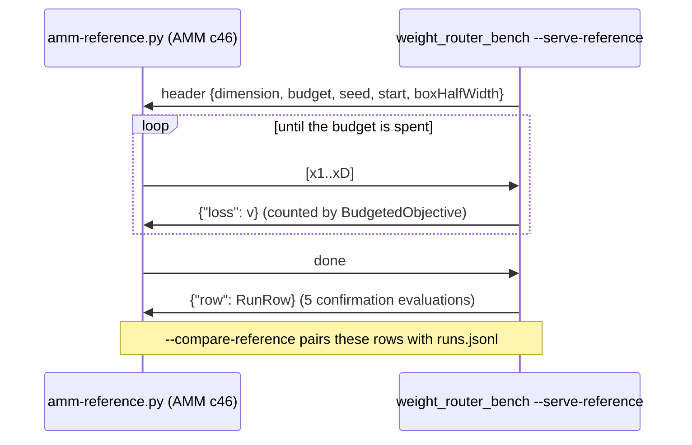

## Summary

Adds an **opt-in, offline** benchmark of local weight optimisers on fixed,
deterministic screening records. Four arms run under the same counted
evaluation budget:

- Lamarck's current local refinement, replayed on a fixed weight set;
- an in-repo CMA-ES;
- an in-repo budget-aware router, which spends counted landscape probes and
  then picks refine or CMA-ES;
- **AMM** (arXiv 2611.06879, "Adaptive Multi Mode: Budget-Aware Routing of
  Optimizers By Online Landscape Probes") as an offline reference. It is pinned
  to its authors' implementation and served the exact same budgeted objective
  over a JSON-lines pipe.

The predeclared synthetic suite and the AMM reference were run, and the
machine-readable results are committed. The findings are negative:

- AMM was worse than refine, CMA-ES and the router in all 27 cells (81 of 81
  comparisons).
- The router never beat CMA-ES alone.

Nothing is ported, nothing in the optimisation loop calls this code, and no
default changed. The representative run on the private production corpus has
not been made, and two protocol gaps remain (see Acceptance Criteria).
Part of #266.

## Spec

### Intent and Rationale

- The issue owns a controlled comparison, not a production change. The harness
  lives in `lamarck/src/weight_bench/` and is driven only by the
  `weight_router_bench` example, `scripts/amm-reference.py` and tests.
- AMM runs out of process instead of being ported. The issue says to port only
  what wins and to add no unverified dependency by default. So AMM, NumPy and
  SciPy live in a scratch Python 3.13 environment, built by
  `scripts/amm-reference-env.py` (stdlib-only Python) from sha256-pinned wheels
  and the pinned AMM tarball, never in Cargo or CI.
- The serve mode (`reference.rs::serve_reference`) charges every AMM evaluation,
  probes included, to the same `BudgetedObjective`. The comparison
  (`summarise_reference`) reuses the existing paired bootstrap and verdict rule
  rather than a second copy in Python.
- Corpus mode splits the loaded window into a calibration half and a
  validation half (`CorpusRole` in `suite.rs`). Calibration seeds never see
  the records that validation and the AMM reference are judged on, which
  matches the disjoint seeds the synthetic suite already uses.

### Essential Design Decisions

- AMM is pinned to `BjBodner/amm-optimizer` commit
  `74d39b4f7988a1f1aa8b40a2a0c3ee547f251107` (0.7.0), using its default preset
  `c46`, the configuration frozen for the paper. The driver refuses to start
  unless `config_hash()` is `2153948ebed51150`.
- AMM's box is start ± `REFERENCE_BOX_HALF_WIDTH` (0.5). The value was
  predeclared before the run and not tuned, and no box-sensitivity sweep was run
  because it would be post hoc.
- The serve mode only serves validation seeds 1001–1012, and calibration seeds
  are refused. Its seed is the arm seed, passed as `numpy.random.SeedSequence`,
  because AMM rejects integers of 2³² or more.
- Cost accounting:
  - each successful run records 5 confirmation evaluations, counted by
    `finish_row`;
  - preparation (145 evaluations) counts once per problem built;
  - router probes (17) come out of the router's own budget;
  - each AMM serve process rebuilds its problem, so the AMM total counts
    preparation per run.

### Undiscoverable Facts

- `https://arxiv.org/abs/2611.06879` still fails from the sandbox with "proxy
  refused the connection". The title and abstract came from web search, and the
  method was pinned through the reference code (read with `gh api`), not the
  PDF.
- A first AMM attempt failed all 324 runs with `ValueError: seed must be an
  integer in [0, 2**32) or a numpy.random.SeedSequence, got 71800265524911`.
  This led to the `SeedSequence` fix, and the driver now puts AMM's own error
  ahead of the server's.
- The worker's pre-push gate blocked three earlier attempts. The cause: it
  replays `.github/workflows/family-sync.yml`'s "Gate the refreshed scripts"
  step whenever a branch changes a `.sh` file, but without that workflow's
  `env:` block. Under `set -u` the unset `CANONICAL_PATHS` exits 1 (reproduced
  with `env -i PATH="$PATH" HOME="$HOME" bash --noprofile --norc -eo pipefail`
  on the step body). That is a worker defect, not one in this repository; the
  same block hit NEAT-AI-Ockham#262. The environment builder was therefore
  ported from `scripts/amm-reference-env.sh` to `scripts/amm-reference-env.py`
  with the same pins, checksums, refusals and output. CI's own ShellCheck step
  passed on the old script.
- Wall times on a shared, parallel aarch64 container, indicative only: the
  synthetic suite took about 12.5 min single-threaded, and AMM took 100.2 s with
  18 workers.

## Evidence

Backend/CLI only, with no UI. The committed results are in
[`docs/evidence/weight-router/`](../../evidence/weight-router/summary.json)
(`manifest.json`, `summary.json`, `reference-summary.json`, `amm-runs.jsonl`,
`amm-meta.json`). The write-up and the exact commands are in
[`docs/weight-optimiser-routing.md`](../../weight-optimiser-routing.md).
Both runs used commit `cf8950c` (crate 0.1.46).

- **Coverage:** the suite completed 1404 of 1404 runs (0 failed, 3,528,609
  evaluations). AMM completed 324 of 324 runs (0 failed, 855,000 evaluations).
- **Determinism:** re-running reproduced every summary cell exactly, and the
  AMM losses were identical across two runs.
- **CMA-ES vs current refinement:** 20 better, 1 worse, 6 inconclusive.
- **Router vs CMA-ES:** 0 better, 13 worse, 14 inconclusive. All validation
  router runs routed to CMA-ES, so the router reduces to CMA-ES plus a probe
  charge.
- **AMM vs each in-repo arm:** `amm-reference-worse` in 27 of 27 cells. For
  example, at hard-tanh D=40 100D the median normalised screening loss is
  0.2716 for AMM and 0.0705 for CMA-ES, and the held-out loss confirms it. The
  full table is in the write-up.
- These are synthetic fixtures only. They do not show a NEAT-AI benefit.

Owner step: run the corpus mode (`--creature FILE --training-data DIR`, also
accepted by `--serve-reference`) on the private production creature and corpus,
on a quiet machine, and keep the results private.

## Acceptance Criteria

<!-- vibe-spec-review inputs="diff+issue-body" -->

- **partial** — Use AMM as an offline reference against the current refinement
  method and CMA-ES on fixed deterministic screening records — evidence:
  `lamarck/src/weight_bench/reference.rs`, `scripts/amm-reference.py`,
  `docs/evidence/weight-router/reference-summary.json` — reviewer: partial —
  reason: the "current refinement" arm (`refine.rs`) replays the Random-strategy
  weight moves with the mirror and follow-up steps, not the full candidate
  pipeline.
- **met** — Optimise 20–100 influential weights with budgets 10D, 30D, 100D;
  mark D>40 as extrapolation requiring validation — evidence:
  `lamarck/tests/weight_bench.rs::extrapolation_boundary` — reviewer: met
- **met** — Count landscape probes within the budget — evidence:
  `lamarck/tests/weight_bench_reference.rs::exceeding_the_budget_is_an_error_but_using_it_all_is_not`,
  `lamarck/tests/weight_bench.rs::probe_counts_evaluations_against_the_budget`
  — reviewer: met
- **met** — Test plateaus/kinks and activation families, then full/held-out
  confirmation — evidence: `lamarck/src/weight_bench/probes.rs`,
  `lamarck/src/weight_bench/suite.rs`, `finish_row` in
  `lamarck/src/weight_bench/experiment.rs` — reviewer: met
- **met** — Port only winning probes/router to Rust after measurement; no
  topology optimisation or unverified third-party dependency added by default —
  evidence: `scripts/amm-reference-env.py` (scratch environment, sha256 pins),
  no Cargo dependency added — reviewer: met
- **partial** — Read and pin the full method before reproducing it — evidence:
  `scripts/amm-reference.py` (commit, preset and config-hash gate) —
  reviewer: partial — reason: pinned through the authors' implementation; the
  paper PDF still cannot be fetched from the sandbox.
- **partial** — First inspect current code, merged work and repository
  instructions. Reuse existing mechanisms — evidence:
  `lamarck/src/candidates.rs` (`RANDOM_DELTA_HALF_WIDTH`),
  `lamarck/src/followup.rs` (`STEP_FRACTIONS`) — reviewer: partial — reason:
  the refine arm reuses the production constants but re-codes the mirror and
  follow-up steps instead of calling the candidate pipeline.
- **met** — Opt-in experiment only; preserve ordinary behaviour, interfaces,
  immutable parents and full authoritative acceptance. No automatic deployment
  or default change — evidence: no optimisation-loop caller of `weight_bench`;
  `cargo test --lib` passes — reviewer: met
- **met** — Predeclare controls, seeds, sample size, compute limits and
  success/failure criteria — evidence: `predeclared_manifest`,
  `Manifest::validate`, `verdict` in `lamarck/src/weight_bench/experiment.rs` —
  reviewer: met
- **met** — Identify code/model/data versions; separate calibration from
  untouched validation and count all preparation/search costs — evidence:
  `lamarck/tests/weight_bench.rs::total_evaluations_count_confirmations_and_preparation_once_per_problem`,
  `lamarck/tests/weight_bench.rs::corpus_problem_splits_records`,
  `lamarck/tests/weight_bench.rs::corpus_manifest_runs_within_budget`,
  `crateVersion` in `summary.json`, `amm-meta.json` — reviewer: partial —
  reason: the reviewer found three gaps: the evaluation count, the versions,
  and corpus mode building the same problem for both phases. All three are
  fixed in this diff, the last by the calibration and validation halves in
  `problem_from_corpus`.
- **met** — Provide deterministic positive/negative correctness tests for new
  behaviour and pass the repository's normal quality checks — evidence:
  `lamarck/tests/weight_bench_reference.rs`, `lamarck/tests/weight_bench.rs`,
  `./quality.sh` on the head — reviewer: missing — reason: the reviewer judged
  the tests met but called the gate "not verifiable" because it is read-only;
  the gate was run here (see Test Plan).
- **met** — Research runs are separate from routine feature CI — evidence: the
  `weight_router_bench` example and `scripts/amm-reference.py` are never run in
  CI — reviewer: met
- **met** — Deliver a reproducible command/manifest and machine-readable
  results with paired distributions, uncertainty, failures and actual coverage
  — evidence: `docs/evidence/weight-router/summary.json`,
  `docs/evidence/weight-router/reference-summary.json`,
  `lamarck/tests/weight_bench_reference.rs::hand_built_error_row_with_null_fields_counts_as_failed`
  — reviewer: partial — reason: the reviewer's gap (AMM failure rows were not
  RunRows) is fixed in this diff, and the failure path is tested.
- **met** — Fixtures alone do not demonstrate an optimisation benefit —
  evidence: `docs/weight-optimiser-routing.md` claims no NEAT-AI benefit —
  reviewer: met
- **partial** — Record negative findings and remove optional code that does not
  earn its maintenance cost — evidence: `docs/weight-optimiser-routing.md`
  (AMM reference results, router findings) — reviewer: partial — reason: the
  router and probe code is kept until the representative corpus run decides
  whether to remove it.
- **met** — Do not claim success before representative runs — evidence: the
  status line in `docs/weight-optimiser-routing.md` — reviewer: met
- **met** — Keep public implementation and fixtures application-agnostic;
  private corpora/results and operational integration remain private —
  evidence: `lamarck/src/weight_bench/suite.rs` (synthetic teacher networks;
  corpus paths given at run time) — reviewer: met
- **met** — Leave unassigned until an implementer actively starts — evidence:
  no assignment change in this run — reviewer: missing — reason: the reviewer
  said "n/a — process step; nothing in a diff can show it".
- **unrequested** — `RANDOM_DELTA_HALF_WIDTH` extracted in `candidates.rs` and
  `STEP_FRACTIONS` made `pub` in `followup.rs` — reviewer: unrequested —
  reason: lets the refine arm reuse the production constants; the value and
  behaviour are unchanged.
- **unrequested** — the `--smoke` and `--manifest` flags of
  `weight_router_bench` — reviewer: unrequested — reason: a cheap plumbing check
  and a way to run a validated alternative manifest.

## Standards Review

<!-- vibe-standards-review inputs="diff+CODING-STANDARDS.md" -->

- **clean** — No `CODING-STANDARDS.md` exists, so the review used
  `CONTRIBUTING.md` and README "Build and quality gate", which define no
  review-only rule. Checked and clean:
  - the changelog entry;
  - the version rule (CI-enforced; Develop is also 0.1.46);
  - every named test exists;
  - no stub of another repository's binary;
  - no workflow change;
  - no build docs copied into CONTRIBUTING;
  - canonical scripts untouched;
  - every download sha256-pinned, with no Cargo dependency.

  The reviewer's optional notes are fixed in this diff: the stale `mod.rs`
  AMM wording, the non-RunRow AMM failure row, and `import os` placement.

## Test Plan

- `lamarck/tests/weight_bench_reference.rs` (new, 10 tests):
  - the serve header and per-point replies;
  - arm-seed handling, blank lines and EOF;
  - budget refusal, with an exactly-at-budget control;
  - malformed and wrong-length points recorded on the row;
  - calibration seeds and cells outside the manifest refused, next to an
    accepted validation request;
  - `run_arm` refusing the reference arm;
  - `amm-reference-better` and `amm-reference-worse` verdicts from separated
    fixtures;
  - coverage of failed and missing runs;
  - a foreign-arm row and a duplicate row refused, each with an accepted
    control;
  - an all-null error row counted as a failure.
- `lamarck/tests/weight_bench.rs`:
  - added
    `total_evaluations_count_confirmations_and_preparation_once_per_problem`,
    which asserts the smoke total against an independently computed figure (5
    confirmations per row, preparation once per problem) and would fail with
    the old count of 4;
  - corpus calibration and validation use disjoint halves of the window:
    - `corpus_problem_splits_records` checks each role's screening, held-out
      and full records against literal slices of the 600-record fixture;
    - `corpus_manifest_runs_within_budget` checks that the calibration and
      validation refine rows have different starting screening and held-out
      losses. This failed (`Some(0.40842782244970616)` on both sides) when
      `calibration_phase` was temporarily given `CorpusRole::Validation`, and
      passed once it was restored;
    - `corpus_with_too_few_records_is_rejected` checks that 400/400 needs
      1600, and at the boundary accepts 150/150 (exactly 600) for both roles
      and refuses 151/150 (needs 602);
  - this whole file is new relative to `Develop`, so no existing test was
    edited.
- Run on the head: `cargo test --test weight_bench --test weight_bench_reference`
  passed (16 passed with 1 ignored, and 10 passed). The ignored test is
  `extrapolation_flag_on_rows_for_large_dimension`, about 40 s in debug, run
  with `--release -- --ignored`.
- Behaviour preservation: `--smoke` `summary.json` and `runs.jsonl` were
  byte-identical before and after the serve/compare refactor (`cmp`). After the
  accounting fix, every full-suite summary cell matched the earlier run, and
  only `totalEvaluations` changed.
- Driver checks:
  - a real 18-run smoke against the serve binary;
  - `--bench /bin/false`, which writes RunRow-shaped failure rows and exits 1;
  - the key set of a failure row matches a real row.
- `scripts/amm-reference-env.py` checks: `python3 -I -m py_compile` passed. With
  no argument and with `""` it refused with
  `amm-reference-env: usage: scripts/amm-reference-env.py DIR` and exit 1. A
  real run on Python 3.13.5 into a fresh temp dir printed the `PYTHONPATH=` line
  and exited 0, and so did a re-run into the same dir. With that `PYTHONPATH`,
  `import numpy, scipy, amm_optimizer` reported numpy 2.5.4 and scipy 1.18.1.
- `./quality.sh < /dev/null` passed at `29a5103`, the last code commit ("All
  quality checks passed!").

Not done:

- the representative private-corpus run (owner step);
- an AMM box-size sensitivity sweep;
- a refine arm that calls the full candidate pipeline;
- the router and probe removal decision.

Remaining risk: CMA-ES's synthetic advantage, and AMM's loss under a ±0.5 box,
may not carry over to real creatures.

🤖 Generated with [Claude Code](https://claude.com/claude-code)
