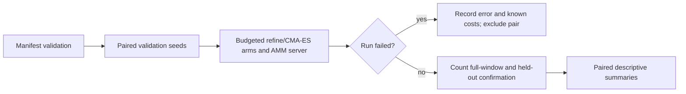

## Summary

Add an opt-in weight-optimiser benchmark, an offline AMM reference driver and
synthetic evidence. Harden trial validation, failure accounting and reference
process handling; verify the pinned AMM release against the paper's release.
The budget-aware router and its landscape probes were measured, never beat
CMA-ES alone, and have now been removed. The committed manifest and summaries
are regenerated from the head code. The production-baseline and
representative comparisons remain incomplete. Part of #266.

The branch also carries two CI fixes from the #268 branch, unchanged
(`98e7b28`, `5614dd8`). The Vibe Coder pre-push gate refused every earlier push
of this branch, and both commits are needed for it to pass. The `quality` job
in `ci.yml`, `cargo-quality.yml` and the `family-sync` job now install Rust
through `.github/actions/rust-toolchain`, which wraps the same pinned step. The
family-sync ShellCheck step falls back to the job's `CANONICAL_PATHS` list
when that variable is unset, and rule 17 in
`scripts/check-family-sync-workflow.sh` checks that the two lists match. The
carried-over CHANGELOG bullet still names Issue #268, word for word, so the
branch that merges second applies it cleanly.

- [x] Preserve the checkpointed harness and synthetic results.
- [x] Read and pin the full AMM method; check release compatibility.
- [x] Correct demonstrated comparison/accounting defects and run validation.
- [x] Carry over the pre-push gate fixes so the branch can be pushed.
- [ ] Establish production-baseline equivalence and freeze/run representative inputs.
- [x] Remove the router and probes after the negative finding; regenerate evidence from head.
- [ ] Complete full authoritative confirmation on representative inputs.

## Spec

### Intent and Rationale

- Compare local weight search under explicit budgets without changing production acceptance.
- Preserve the archived synthetic experiment while making its limitations and failure handling explicit.

### Essential Design Decisions

- `lamarck-refine` is a random-axis surrogate, not `generate_candidate_batch`. Its uniform half-width and CMA-ES's coordinate standard deviation do not match search radii; the docs no longer claim equivalence.
- The synthetic dimensions, budgets, families and validation seeds remain unchanged. A corrected baseline/protocol needs fresh validation data rather than tuning against the existing results.
- The router and probes are removed, not kept for reproduction: the issue ports only winning probes/routers, and they never beat CMA-ES. With no tuned parameter left there is no calibration phase; any future tuned parameter needs calibration seeds/records disjoint from validation. `Manifest` now refuses unknown fields (so a stale `calibrationSeeds` is rejected). `RunRow` still tolerates `routedTo`/`probeEvaluations` because the committed `amm-runs.jsonl` was written by the earlier driver.
- `scripts/check-amm-method.py` is kept: it is the recorded reproduction command for `method-check.json` and is exercised by `scripts/test-amm-reference.py`.
- AMM stays in a separate, checksum-pinned scratch environment, with explicit preset `c46`. No production router or default is enabled.
- Errored rows cannot enter paired distributions, even with retained metrics. Their reported costs remain counted; a missing server row explicitly means incomplete cost accounting.

### Undiscoverable Facts

- The full method in [arXiv:2611.06879v1](https://arxiv.org/pdf/2611.06879v1) was read through the PDF reader: Section 3, Algorithms 1–2, Tables 2/6, Appendices A–B, Section 6 and software availability. The paper identifies `v0.3.0`, resolved to `c4f0ab160aae912311328145aa5a426b26a06b26`.
- Both `v0.3.0` and pinned `v0.7.0` produced 27 identical completed RunRows on one synthetic validation seed. This is a limited compatibility check, not evidence of representative benefit or identical internal evaluation traces.
- Local searches found test fixtures but no authorised production model/corpus pair. Representative coverage is zero and its provenance/manifest is not frozen.
- The worker's pre-push gate blocked earlier pushes in two ways. It read the `dtolnay/rust-toolchain` commit SHA as a toolchain, and `cargo +29eef336… --version` exited 101 with `error: no such command`. It also re-ran the family-sync ShellCheck step without the job's `env:`, where `set -u` stopped on `CANONICAL_PATHS: unbound variable`. The carried-over commits fix both, and no guard was bypassed. The SHA-as-toolchain misreading is a worker defect and is not fixed. Workflow steps that still call the pinned action directly (`ci.yml`'s `validation` job, `auto-format`, `cargo-audit`, `sbom`, `security`) can still trigger it.

## Evidence

- `docs/evidence/weight-router/manifest.json`, `summary.json` and `reference-summary.json` were regenerated from the head code (crate 0.1.47, `formatVersion` 2): 648/648 runs, 0 failed, 1,631,615 evaluations, 3 min 32 s single-threaded; CMA-ES better than the surrogate in 19 of 27 cells, worse in 1, inconclusive in 7. The CMA-ES-minus-refine paired differences equal the earlier router-era run's exactly; one boundary verdict (relu, D=40, 100D) moved to inconclusive because the bootstrap stream no longer draws router pairs first. The reference summary, recomputed over the committed 324 AMM rows, has AMM worse in all 54 comparisons. These are synthetic measurements, not representative results. The router columns and 20-of-27 count in the doc are labelled as the earlier run (crate 0.1.46), kept as the negative finding.
- `docs/evidence/weight-router/method-check.json` records the paper/source/dependency pins, compatibility manifest, result digest, code checkpoint and binary hash. Both releases have `c46` hash `2153948ebed51150`; the environment builder re-verified its source and wheel SHA-256 values. It and `amm-runs.jsonl` are router-era output (crate 0.1.46, checkpoint `8f77004`), not re-run after the removal; the doc labels them so.
- `scripts/check-amm-method.py` reuses the real reference driver and Rust objective server. It normalises the public seed/config arguments for both released APIs and rejects different results or empty campaigns.
- CLI/backend only. The existing production scorer acceptance path in `lamarck/src/run.rs` remains unchanged; the benchmark reports window MSE and does not authoritatively accept/install candidates.
- #266: Experiment: Benchmark budget-aware routing of local weight optimisers.

## Acceptance Criteria

<!-- vibe-spec-review inputs="diff+issue-body" -->

- **partial** — Use AMM as an offline reference against the current refinement method and CMA-ES on fixed deterministic screening records. — evidence: `lamarck/src/weight_bench/reference.rs`, `docs/evidence/weight-router/reference-summary.json` — reviewer: partial — reason: AMM and CMA-ES run offline on fixed deterministic synthetic screening records, but the refinement arm is a random-axis surrogate, not the current production refinement pipeline.
- **partial** — Predeclare controls, seeds, sample size, compute limits and success/failure criteria. Identify code/model/data versions; separate calibration from untouched validation and count all preparation/search costs. — evidence: `lamarck/src/weight_bench/experiment.rs::predeclared_manifest`, `lamarck/tests/weight_bench.rs::total_evaluations_count_confirmations_and_preparation_once_per_problem` — reviewer: partial — reason: outputs record only the crate version (no git commit/neat-core version), no representative model/data versions are frozen, no overall wall-clock ceiling is set, and validation seeds 1001–1012 were already seen in the router-era run.
- **partial** — Deliver a reproducible command/manifest and machine-readable results with paired distributions, uncertainty, failures and actual coverage. Fixtures alone do not demonstrate an optimisation benefit. — evidence: `docs/evidence/weight-router/summary.json` (reviewer re-ran it byte-identically) — reviewer: partial — reason: synthetic side reproduces exactly, but representative coverage is 0 runs, and `amm-runs.jsonl`/`method-check.json` are router-era output (now labelled as such in the doc).
- **met** — Record negative findings and remove optional code that does not earn its maintenance cost. — evidence: `docs/weight-optimiser-routing.md` Findings; `router.rs`/`probes.rs` deleted in `a549ff1`; `lamarck/tests/weight_bench.rs::manifest_rejects_unknown_fields` — reviewer: met
- **unrequested** — CI rust-toolchain wrapper and family-sync `CANONICAL_PATHS` fallback (`.github/`, `scripts/check-family-sync-workflow.sh`, its test) — reviewer: unrequested — reason: pre-push gate fixes carried over unchanged from the #268 branch so this branch can be pushed.
- **unrequested** — `RANDOM_DELTA_HALF_WIDTH` extracted in `candidates.rs`, `STEP_FRACTIONS` made public in `followup.rs` — reviewer: unrequested — reason: lets the surrogate arm reuse the production constants; no behaviour change.
- **unrequested** — `.gitignore` `__pycache__/`, version bump to 0.1.47, CHANGELOG/README entries — reviewer: unrequested — reason: repository convention and Python-script hygiene.

## Standards Review

<!-- vibe-standards-review inputs="diff+CODING-STANDARDS.md" -->

- **violation** — Docs must match code: committed evidence was attributed to commit `4c2b740` and called reproducible from it (it was crate 0.1.46 output, and the hash does not survive a squash merge) — evidence: `docs/weight-optimiser-routing.md` — reason: fixed in this diff (evidence regenerated from head; attributions removed)
- **violation** — Stale `routed-to arm`/`probe` fields in the `runs.jsonl` doc row; README/CHANGELOG giving 20 of 27 — evidence: `docs/weight-optimiser-routing.md`, `README.md:2050`, `CHANGELOG.md` — reason: fixed in this diff
- **violation** — Test comment claimed `--compare-reference` could read router-era `runs.jsonl` — evidence: `lamarck/tests/weight_bench_reference.rs` — reason: fixed in this diff (test renamed `committed_evidence_parses_and_summarises`)
- **violation** — `RunRow::phase` comment said committed archived rows carry `"calibration"` — evidence: `lamarck/src/weight_bench/experiment.rs:147` — reason: fixed in this diff
- **clean** — No dead router/probe/calibration code or identifiers remain; removed tests covered only removed behaviour and the replacements are as strong or stronger; `deny_unknown_fields` is documented and tested; evidence JSON coverage and totals match the docs; corpus-split docs match `suite.rs`; version bump and CHANGELOG follow CONTRIBUTING.md; fmt and clippy are clean.

## Test Plan

- Router/probe removal (`a549ff1`), stdin from `/dev/null`: `cargo test --test weight_bench --test weight_bench_reference` passed 18 and 12 (one existing debug-mode ignore) at that commit; the review-fix tests below bring the current head to 19 and 13; `cargo test --lib weight_bench` passed 2; `cargo fmt --check` and `cargo clippy --all-targets -- -D warnings` were clean. The removed tests (`probe_counts_evaluations_against_the_budget`, `route_follows_the_rule`, `calibrate_picks_the_favoured_rule`, the calibration-overlap assertion) covered only removed behaviour. New: `manifest_rejects_unknown_fields` (a manifest with `calibrationSeeds` is refused), `committed_evidence_parses_and_summarises` (committed manifest and 324 AMM rows), `arms::tests::arm_seeds_are_pinned`, and a `problem_from_corpus` short-window refusal. The release binary accepted the committed manifest and refused it with `calibrationSeeds` added. The full quality gate has not been re-run on `a549ff1` in this session; the worker re-runs it.
- Evidence regeneration: `weight_router_bench /tmp/wrb266/out` then `--compare-reference docs/evidence/weight-router/amm-runs.jsonl`; outputs copied unedited into `docs/evidence/weight-router/`. The AMM Python integration checks were not re-run: no scratch AMM environment exists here and building one needs network access.
- `timeout 1600 ./quality.sh < /dev/null` passed (exit 0, "All quality checks passed!") on `1da2506`, the last code commit: shell/workflow checks, spelling, dependency audit, formatting, Clippy, workspace tests and rustdoc. CI is not yet verified.
- Carried-over gate fixes: `scripts/test-check-family-sync-workflow.sh` passed, including its two rule-17 negative cases (no fallback, stale fallback), each refused with exit 1. `scripts/check-family-sync-workflow.sh`, `scripts/check-bot-push-action.sh` and `scripts/check-cargo-quality-overlap.sh` passed. The gate step re-run under `env -i … bash --noprofile --norc -eo pipefail`, with no `CANONICAL_PATHS`, exited 0.
- Before the removal, `cargo test --test weight_bench --test weight_bench_reference` passed: 20 and 11 tests, with one existing debug-mode ignore. The ignored `lamarck/tests/weight_bench.rs::extrapolation_flag_on_rows_for_large_dimension` passed separately with `--release -- --ignored`.
- Review fix, held-out half of the verdict rule: the `lamarck/tests/weight_bench_reference.rs` fixtures now take separate screening and held-out values (screening about 0.8, held-out about 0.9), so a test fails if the code reads the wrong column. `clearly_better_and_worse_references_get_matching_verdicts` also asserts the held-out mean (-0.15) separately from the screening mean (-0.3). New `held_out_veto_turns_a_screening_win_inconclusive`: screening interval wholly below zero with a held-out mean of +0.05 gives `inconclusive`; held-out means of 0 and -0.05 keep `amm-reference-better`; a screening loss stays `amm-reference-worse` whatever held-out says. Loosening the guard in `verdict` (`held <= 0.0` to `held <= 9.0`) made this test fail; the guard was restored.
- Review fix, extrapolation mark: new non-ignored `lamarck/tests/weight_bench.rs::extrapolation_flag_marks_rows_and_cells_just_past_the_boundary` runs a manifest at D=40 (control: every row and the cell summary unmarked) and D=41 (every row and the cell summary marked). The ignored D=100 test now also asserts the cell summary is marked; it passed with `--release -- --ignored`.
- Review-fix checks on the working tree: `cargo test -p neat_ai_lamarck --test weight_bench --test weight_bench_reference` passed 19 and 13 (one existing debug-mode ignore), `cargo test --lib weight_bench` passed 2, `cargo fmt --check` and `cargo clippy --all-targets -- -D warnings` were clean. The full `quality.sh` was not re-run for this test-only change.
- Added `lamarck/tests/weight_bench.rs::manifest_rejects_duplicate_trial_identifiers`, `objective_requires_distinct_weights` and `objective_requires_nonzero_record_dimensions`; each rejected the checkpoint implementation before its fix and passes now. `arms_share_the_start_without_mutating_the_parent` pins an existing invariant and was not claimed as a previously failing bug.
- Added `lamarck/tests/weight_bench_reference.rs::failed_reference_with_completed_metrics_is_excluded_from_pairs`: before the fix it counted six wins instead of five; after the fix it drops the failed sample while retaining its costs.
- Added `lamarck/src/weight_bench/experiment.rs::tests::failed_confirmations_keep_the_calls_already_spent`: before the fix failed confirmations reported zero calls; now full/held-out failures retain two/four attempted calls and the successful control records five. The focused library test passed, as did the full gate.
- `scripts/test-amm-reference.py` passed seven offline integration checks with real pinned AMM and the real Rust server: success, missing executable, failure before the header, non-zero exit after a completed row, verbose stderr, method-result mismatch, and empty campaigns. Missing executables previously raised outside the failure handler; post-row non-zero exits previously reported success. The verbose-server check against `eb90364` timed out with exit 124 at 15 seconds; the new driver completes it. The diagnostic test also failed until the first cause replaced trailing wrapper boilerplate.
- The method check completed 27 rows per release with zero failures and identical rows. Its D=100 cells remain extrapolation. It is separate from correctness CI and from representative measurement.
- Targeted Semgrep `p/default` scan passed: 14 files, zero findings. Rust all-target Clippy passed. New Python process/method checks are deliberately offline integration checks, not routine feature CI.
- Callers checked: `WeightObjective::new` in `build_one` and `select_influential` receive positive dimensions and distinct indices. `summarise_cells` is shared by `run_manifest` and `summarise_reference`; both now exclude errored rows. No copied validation rule was found. Existing positive/negative tests still reach their original paths; no existing fixture needed a new environment precondition.
- No pre-existing test assertion is removed relative to Develop: the two benchmark integration test files and the benchmark module are new in this PR. Hand-built summary fixtures now use the real successful server's five-confirmation count.
- Read and updated README's local weight-optimiser status row, the routing document's Arms/Protocol/Findings/Outstanding sections, CHANGELOG and affected module/doc comments. The final docs sweep removed the baseline-equivalence and equal-radius claims. Generated Python bytecode was removed and is ignored.

## Merge verification

- The branch is pushed through the normal guarded `git push`, with no hook or gate bypassed. GitHub CI is not yet verified.

Skipped: the AMM campaign itself was not re-run (no scratch environment);
its committed rows were re-summarised against the regenerated in-process runs.
Representative inputs, production baseline equivalence, full authoritative
confirmation and box/radius controls on fresh data remain outstanding.
These limitations prevent an optimisation-benefit or issue-completion claim.
