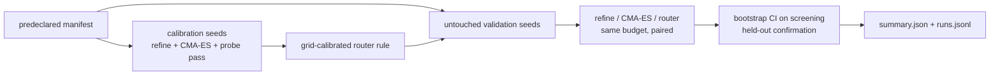

## Summary

Adds an **opt-in, offline** benchmark of local weight optimisers on fixed,
deterministic screening records. It compares three arms:

- Lamarck's current local refinement;
- an in-repo CMA-ES;
- a budget-aware router. The router spends counted landscape probes, then routes
  by budget and smoothness. It is calibrated on predeclared seeds and validated
  on untouched seeds.

The predeclared synthetic suite was run and the machine-readable results are
committed. A corpus mode runs the same protocol on a real creature and its
records. Nothing in the optimisation loop calls this code, no default changed
and nothing was ported.

AMM is **not** implemented: arXiv 2611.06879 could not be retrieved from the
sandbox, so its method could not be pinned. The representative (private) run is
also still outstanding. Part of #266.

## Spec

### Intent and Rationale

- The issue owns a controlled comparison, not a production change. The harness
  lives in `lamarck/src/weight_bench/` and is driven only by the
  `weight_router_bench` example and tests.
- The "current refinement" arm reuses the production constants rather than
  copying them:
  - `candidates::RANDOM_DELTA_HALF_WIDTH`, newly extracted; the Random strategy
    now reads it, with unchanged behaviour;
  - `followup::STEP_FRACTIONS`, made `pub`.
- The arm also mirrors the antithetic pairs of `mirror.rs`.
- CMA-ES is written in-repo (Hansen tutorial defaults, Jacobi
  eigendecomposition), because the issue rules out unverified third-party
  dependencies.

### Essential Design Decisions

- Every evaluation is counted. `BudgetedObjective` refuses an evaluation past
  its limit with `BenchError::BudgetExhausted`. Router probes (2 x 8 + 1 = 17)
  come out of the router's own budget. Preparation (influential-weight
  selection, synapses + 1 evaluations) and confirmation evaluations go into
  `totalEvaluations`.
- Calibration seeds 1 to 8 and validation seeds 1001 to 1012 must be disjoint,
  and `Manifest::validate` rejects overlap. Budgets are restricted to 10D, 30D
  and 100D, and D to 20..=100. D > 40 is flagged as `extrapolation` on every row
  and cell.
- The verdict rule is predeclared in code (`experiment.rs::verdict`). An arm is
  `-better` only when the 95% bootstrap CI of the paired screening difference
  lies below zero **and** the held-out mean does not regress.
- Assumption: with the paper unreachable, "budget-aware routing" is tested as a
  transparent, calibrated rule over the two pinnable arms. AMM is left as a
  `missing` item rather than guessed at.

### Undiscoverable Facts

- Fetching `https://arxiv.org/abs/2611.06879` failed with WebFetch "proxy
  refused the connection". `curl` to `export.arxiv.org` failed with "CONNECT
  tunnel failed, response 403".
- The synthetic run took 13 min 34 s wall, single-threaded, on a shared,
  parallel container. The timing is indicative only.

## Evidence

Backend/CLI only, so there is no UI. Results of the predeclared synthetic suite
(`cargo run --release --example weight_router_bench -- /tmp/wrb-full`):
[`docs/evidence/weight-router/summary.json`](../../evidence/weight-router/summary.json)
and [`manifest.json`](../../evidence/weight-router/manifest.json). The full
write-up is in [`docs/weight-optimiser-routing.md`](../../weight-optimiser-routing.md).

- Coverage: 1404 of 1404 runs completed, 0 failed, 3,704,685 evaluations.
- Calibrated rule: `minBudgetMultiple` 10, `maxNonSmoothShare` 0.25,
  `probeAxes` 8.
- CMA-ES vs current refinement (27 cells): 20 better, 1 worse (tanh D=100 at
  30D), 6 inconclusive.
- Router vs CMA-ES: 0 better, 13 worse, 14 inconclusive. **Negative finding:**
  all 324 validation router runs routed to CMA-ES, so the router reduces to
  CMA-ES plus a 17-evaluation probe charge. The probes did not discriminate on
  this suite, so the router and probes are not ported.
- These are synthetic fixtures only. They do not show a NEAT-AI benefit.

Owner step: run the corpus mode
(`--creature FILE --training-data DIR`) on the private production creature and
corpus on a quiet machine, and keep the results private. Decide any port, or
the removal of the router and probe code, from that run.

## Acceptance Criteria

- **missing** — Use AMM as an offline reference against the current refinement
  method and CMA-ES — reason: the paper (arXiv 2611.06879) could not be fetched
  from the sandbox, so the method could not be read and pinned; only the
  refinement, CMA-ES and the router arms exist.
- **missing** — Do not claim success before representative runs — reason: no
  representative run on a real creature and corpus has been made. The corpus
  mode exists, but the private corpus is not in this repository, so that run is
  the owner step above.
- **missing** — Port only winning probes/router to Rust after measurement —
  reason: nothing is ported. The synthetic router lost to CMA-ES alone, and the
  port or removal decision waits on the representative run.

## Test Plan

- Added `lamarck/tests/weight_bench.rs` (15 run, 1 ignored with its reason):
  - budget refusal past the limit, with an allowed control;
  - arms stay within budget and improve;
  - determinism and seed sensitivity;
  - probe evaluation count;
  - `route` positive and negative cases;
  - `calibrate` picks the favoured grid pair, and `None` when the refinement
    always wins;
  - manifest rejections (budget 50, overlapping seeds, D 19 and 101, empty
    validation seeds), each with an allowed control;
  - extrapolation boundary at 40/41;
  - smoke end-to-end coverage and per-run budgets;
  - `select_influential` contract;
  - corpus mode: runs within budget, too few records rejected next to a
    positive control on the same files, corpus/family mismatch rejected, and
    record splits.
- `extrapolation_flag_on_rows_for_large_dimension` is `#[ignore]`d in debug
  (about 40 s) and passes with `cargo test --release --test weight_bench --
  --ignored`.
- The reuse edits leave behaviour unchanged. `cargo test --lib -- followup::
  candidates::` gave 57 passed. The synthetic smoke `summary.json` was
  byte-identical before and after the corpus-mode change (`cmp`).
- `./quality.sh < /dev/null` passed on the head before the summary commit
  ("All quality checks passed!", including clippy `-D warnings`, the full test
  suite, rustdoc, markdownlint and codespell).
- No existing test assertion was removed or edited.

Not done: AMM reproduction, the representative corpus run, and any port
decision (see above). Remaining risk: CMA-ES's synthetic advantage may not carry
over to real creatures.

🤖 Generated with [Claude Code](https://claude.com/claude-code)
