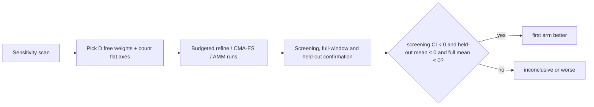

## Summary

Follow-up to the merged #274 benchmark. It closes three of the gaps that PR
left open:

- **Full-window confirmation.** It is now a paired column, and it can veto a
  `-better` verdict.
- **Flat axes.** Each problem now counts its flat chosen axes. None were found
  in the synthetic suite.
- **Versions and evidence.** Runs record the code and dependency versions and
  the wall-clock time. All evidence was regenerated from the current code, and
  the AMM campaign and the AMM method check were re-run too. `runs.jsonl` is now
  committed.

The output format is now version 3. A second, independent run reproduced every
row file and every summary cell exactly.

The representative run on a production creature and corpus is still not done,
the refinement arm is still a surrogate, and kinks are not measured.
Part of #266.

- [x] Full-window column and veto (`Comparison.full`, format 3).
- [x] Flat-axis count per problem, from the existing sensitivity scan (no extra evaluations).
- [x] `gitCommit`, `gitDirty`, `neatCoreSource` and `wallClockSeconds` in the bench summaries.
- [x] Regenerate the synthetic suite, AMM campaign and method check, and commit `runs.jsonl`.
- [x] Test that re-summarising the committed rows reproduces the committed summaries.
- [x] Bump the crate to 0.1.49 and regenerate the evidence at that commit.
- [ ] Representative runs on production inputs (no authorised creature or corpus on this host).
- [ ] A refinement arm that is the production candidate pipeline, not the surrogate.
- [ ] A kink measurement, and a problem family that actually has flat axes.

## Spec

### Intent and Rationale

- #274's own review left three criteria `partial`, and this PR fixes what can be fixed offline:
  - full-window results were computed but never compared;
  - plateaus were not measured at all;
  - the evidence was router-era or not committed, and was named by crate version only.
- The flat-axis count reuses the sensitivity scan the problem already runs (`scan_sensitivities`), so preparation costs stay the same. Nothing else that is committed moved apart from the new fields: the AMM rows' screening losses are identical to the committed router-era rows.

### Essential Design Decisions

- **The verdict rule changed after the format 2 results were seen.** A `-better` verdict now also needs a full-window mean ≤ 0. This can only turn `-better` into `inconclusive`, never create a verdict. It changed exactly one cell (hard-tanh D=40 100D, full-window mean +0.0004). The docs say so.
- **All three columns share one bootstrap RNG.** The full-window column is drawn after the screening and held-out columns, so every later cell's interval moved, while the paired differences did not change. One verdict moved because of this (tanh D=100 30D, `cma-es-worse` → `inconclusive`). The docs record both changes.
- **Flat means one side only.** An axis is flat when a one-sided +0.05 step changes the screening loss by at most `PLATEAU_REL_TOL` (1e-6) × base loss. Older rows without `plateauFreeAxes` load as `None`.
- **`summarise_runs` is now public.** `run_manifest` calls it. It exists so the committed `runs.jsonl` can be re-summarised and compared with the committed `summary.json`.
- **Version format change.** Persisted outputs move from format 2 to format 3. Old AMM rows still load, because `plateau_free_axes` has `#[serde(default)]` and the full-window column is computed from the raw `fullLossStart` and `fullLossFinal`, which old rows carry.

### Undiscoverable Facts

- No production creature or corpus was found on this host (`find / -xdev` for `*.creature.json`, `best.json` and `training-data`), so representative coverage stays at 0.
- The AMM environment was built with `scripts/amm-reference-env.py`. The v0.3.0 tarball (`c4f0ab16…`) matched its pinned sha256 `c3435857…`.
- Two independent runs, at `757ac15` (0.1.48) and `f0a7b4c` (0.1.49), gave byte-identical `runs.jsonl` and `amm-runs.jsonl`, identical summary cells, and the same canonical method-check hash `33203af0…`.

## Evidence

CLI/backend only; no UI file is touched.

- Synthetic suite, `weight_router_bench` at `f0a7b4c` with a clean tree: 648 of 648 runs, 0 failed, 1,631,615 evaluations, 224.4 s wall time on a shared host (indicative only). CMA-ES beat the surrogate in 18 cells, was worse in 0 and inconclusive in 9 (format 2 gave 19 / 1 / 7). Every row and every cell has 0 flat free axes.
- AMM campaign, `scripts/amm-reference.py --jobs 8`: 324 of 324 runs, 0 failed, 855,000 evaluations. AMM was worse in all 54 comparisons.
- Method check: v0.3.0 and v0.7.0 each gave 27 rows, identical to each other ("AMM 0.7.0: 27 completed rows, identical to comparison").
- `neatCoreSource` = `git+https://github.com/stSoftwareAU/NEAT-AI-core?tag=v0.23.7#3759355634b1cabc8034cd76df5dbd44a867d18c`, read from `Cargo.lock`.
- #266: Experiment: Benchmark budget-aware routing of local weight optimisers.

## Acceptance Criteria

<!-- vibe-spec-review inputs="diff+issue-body" -->

- **partial** — Use AMM as an offline reference against the current refinement method and CMA-ES on fixed deterministic screening records. — evidence: `docs/evidence/weight-router/reference-summary.json`, `lamarck/tests/weight_bench_reference.rs::committed_evidence_is_reproduced_by_the_summariser` — reviewer: met — reason: the AMM reference is regenerated and reproduced, but `lamarck-refine` is still a random-axis surrogate (`lamarck/src/weight_bench/refine.rs`), not the production candidate pipeline.
- **met** — Optimise 20–100 influential weights with budgets 10D, 30D, 100D; mark D>40 as extrapolation requiring validation. — evidence: `lamarck/tests/weight_bench_reference.rs::committed_evidence_parses_and_summarises`, `lamarck/tests/weight_bench.rs::extrapolation_flag_marks_rows_and_cells_just_past_the_boundary` — reviewer: met
- **met** — Count landscape probes within the budget. — evidence: `lamarck/tests/weight_bench.rs::plateau_free_axes_count_only_the_flat_synapses_chosen`, `lamarck/tests/weight_bench.rs::total_evaluations_count_confirmations_and_preparation_once_per_problem` — reviewer: met
- **partial** — Test plateaus/kinks and activation families, then full/held-out confirmation. — evidence: `lamarck/tests/weight_bench_reference.rs::full_window_veto_turns_a_screening_win_inconclusive`, `lamarck/tests/weight_bench.rs::corpus_rows_record_the_plateau_count_of_their_problem` — reviewer: partial — reason: full and held-out confirmation and the flat-axis count are done, but the synthetic suite has no flat axes, the test is one-sided, and kinks are not measured.
- **met** — Port only winning probes/router to Rust after measurement; no topology optimisation or unverified third-party dependency added by default. — evidence: `lamarck/src/weight_bench/arms.rs` (router stays removed), no new dependency in `lamarck/Cargo.toml` — reviewer: met
- **met** — First inspect current code, merged work and repository instructions. Reuse existing mechanisms; if functionality already exists, this issue still owns the missing controlled comparison rather than a second implementation. — evidence: `lamarck/src/weight_bench/objective.rs` (`scan_sensitivities` split out of `select_influential`) — reviewer: met
- **met** — Opt-in experiment only; preserve ordinary behaviour, interfaces, immutable parents and full authoritative acceptance. No automatic deployment or default change. — evidence: changes confined to `lamarck/src/weight_bench/` and `lamarck/examples/weight_router_bench.rs` — reviewer: met
- **partial** — Predeclare controls, seeds, sample size, compute limits and success/failure criteria. Identify code/model/data versions; separate calibration from untouched validation and count all preparation/search costs. — evidence: `lamarck/src/weight_bench/provenance.rs::tests::real_lock_pins_neat_core_to_its_git_source`, `docs/evidence/weight-router/summary.json` (`gitCommit`, `neatCoreSource`, `wallClockSeconds`) — reviewer: partial — reason: the full-window veto was added after format 2 was seen (stricter only, documented), and no model or data version exists for a representative run.
- **met** — Provide deterministic positive/negative correctness tests for new behaviour and pass the repository's normal quality checks. Research runs are separate from routine feature CI. — evidence: `lamarck/tests/weight_bench_reference.rs::full_window_veto_turns_a_screening_win_inconclusive`, `lamarck/src/weight_bench/provenance.rs::tests::lock_without_neat_core_errors_naming_it`, `./quality.sh` passed — reviewer: met
- **partial** — Deliver a reproducible command/manifest and machine-readable results with paired distributions, uncertainty, failures and actual coverage. Fixtures alone do not demonstrate an optimisation benefit. — evidence: `docs/evidence/weight-router/runs.jsonl`, `lamarck/tests/weight_bench_reference.rs::committed_evidence_is_reproduced_by_the_summariser` — reviewer: met — reason: synthetic results are reproducible and fully covered, but representative coverage is 0 runs, so no optimisation benefit is shown.
- **met** — Record negative findings and remove optional code that does not earn its maintenance cost. Do not claim success before representative runs. — evidence: `docs/weight-optimiser-routing.md` Finding 4 (no flat axes), AMM worse in 54 of 54 — reviewer: met
- **met** — Keep public implementation and fixtures application-agnostic; private corpora/results and operational integration remain private. — evidence: synthetic and temp-dir fixtures in `lamarck/tests/weight_bench.rs` — reviewer: met
- **missing** — Representative full/held-out confirmation on production inputs. — reviewer: missing — reason: no authorised production creature or corpus exists on this host; `representativeCoverage` is 0 in `docs/evidence/weight-router/method-check.json`.
- **unrequested** — `summarise_runs` made public and re-exported — reviewer: unrequested — reason: `run_manifest` uses it, and it lets the committed rows be re-summarised to prove the committed summaries.
- **unrequested** — the bootstrap stream shift from the shared RNG — reviewer: unrequested — reason: a side effect of adding the full-window column; documented, with the one verdict it moved.

## Standards Review

<!-- vibe-standards-review inputs="diff+CODING-STANDARDS.md" -->

The repository has no `CODING-STANDARDS.md`. The reviewer used `CONTRIBUTING.md`, the README's development rules and the workspace lints.

- **violation** — `CONTRIBUTING.md` › Version bumping: "Every binary-affecting change must bump the patch version" — evidence: `lamarck/Cargo.toml:3` — reason: fixed in this diff; bumped 0.1.48 → 0.1.49 with `scripts/bump-lamarck-version.sh`, and all evidence was regenerated at that commit (`f0a7b4c`).
- **clean** — Changes to existing test expectations: `format_version` 2 → 3, the `routedTo` assertion replaced by a `plateau_free_axes` check, and the added `full.failures` assertions. Each still fails without its code. The full-window veto test uses different held-out and full offsets.
- **clean** — Lint rules: `missing_docs` is met on every new public item, and Clippy is clean.
- **clean** — Housekeeping: there is a changelog entry under [Unreleased], and every named test exists.
- **clean** — Behaviour and security: `git` runs with fixed arguments and null stdin, and a missing `neat-core` pin fails loudly. The standards name no review-only rules.

## Test Plan

- `timeout 1700 ./quality.sh < /dev/null` passed on `e360bf9` with exit 0 and "All quality checks passed!". That run covered shell and workflow checks, spelling, dependency audit, formatting, Clippy, workspace tests and rustdoc. It was re-run on `e69261d` (after the version bump and the final evidence regeneration, with this summary in the working tree) and passed again with exit 0.
- `cargo test --test weight_bench --test weight_bench_reference < /dev/null` (from `lamarck/`): 26 passed with 1 ignored, and 15 passed. `cargo test --lib weight_bench`: 7 passed. After the final evidence regeneration, `cargo test --test weight_bench_reference --test contributing_contract`: 21 passed.
- Added tests:
  - `lamarck/tests/weight_bench_reference.rs`: `full_window_veto_turns_a_screening_win_inconclusive` and `committed_evidence_is_reproduced_by_the_summariser`.
  - `lamarck/tests/weight_bench.rs`: `plateau_free_axes_count_only_the_flat_synapses_chosen`, `corpus_rows_record_the_plateau_count_of_their_problem`, `synthetic_rows_carry_their_problem_plateau_count` and `rows_without_the_plateau_field_load_as_none`.
  - `lamarck/src/weight_bench/provenance.rs::tests`: four lock-parse tests and `git_state_reports_the_commit_and_whether_the_tree_is_dirty`.
- Red-first: the new tests failed before the code existed, either by not compiling or by failing at runtime against stubs. `full_window_veto_turns_a_screening_win_inconclusive` also went red with the full-window term dropped from `verdict`.
- Removed from `lamarck/tests/weight_bench_reference.rs`: `assert!(rows.contains("routedTo") && rows.contains("probeEvaluations"));`
  - Obsolete: the committed AMM rows were regenerated from current code and no longer carry router-era fields.
  - Still covered by: `lamarck/tests/weight_bench.rs::rows_without_the_plateau_field_load_as_none` (older rows still load).
  - Replaced by: `assert!(parsed.iter().all(|r| r.plateau_free_axes.is_some()));`
- Changed in `lamarck/tests/weight_bench_reference.rs::clearly_better_and_worse_references_get_matching_verdicts`: `format_version` 2 → 3, as the format bump requires.
- `scripts/test-amm-reference.py` was not re-run. The AMM driver is unchanged, and the real campaign and method check were run end to end instead.

## Merge verification

- GitHub CI not yet verified.

Not done: representative runs on production inputs, a production-pipeline
refinement arm, a kink measurement, and a family with real flat axes. The
example's git-failure warning path is only covered at the probe level.
