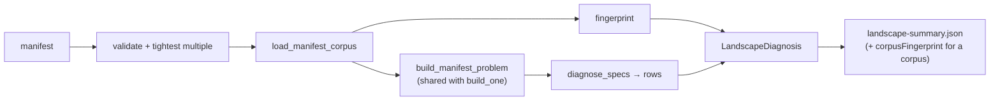

## Summary

Most of #266's weight benchmark is already on Develop (#282, #283, #293). This
PR removes the one thing that stopped the plateau and kink check from running
on a real model: `weight_bench::landscape::diagnose_manifest` refused any
manifest that declares a `corpus`. It now builds each corpus problem exactly as
the arm run does, through a new shared `build_manifest_problem` that
`build_one` also calls. It returns `LandscapeDiagnosis { rows,
corpus_fingerprint }`, and `weight_router_bench --landscape` accepts
`--creature`/`--training-data` and writes `corpusFingerprint` into
`landscape-summary.json`. Synthetic output is unchanged, so the committed
landscape evidence still reproduces.

No representative run has been made, and the refinement arm is still a
random-axis surrogate rather than the production candidate pipeline.
Part of #266.

## Spec

### Intent and Rationale

- The routing doc's Outstanding list said the landscape diagnosis "refuses corpus manifests, so it cannot yet diagnose a representative problem", and that it should be removed if the representative run does not use it. Neither plateau axes on a representative problem nor the keep-or-remove decision can be settled while the tool refuses the corpus. This change makes both decidable at the owner's representative run.
- Problems are built by the same function the arm run uses, so a diagnosis describes the very weights the arms optimise.

### Essential Design Decisions

- `diagnose_manifest` still runs `validate()` and the budget-multiple check before any file I/O. A corpus that cannot be loaded is a hard error, as in `run_manifest`. A problem that fails to build (for example, D larger than the creature's synapse count) is recorded on its row, as before.
- `corpusFingerprint` is written only for a corpus manifest. `formatVersion` stays 4, so synthetic summaries are byte-for-byte the old shape.
- The return type changed from `Vec<LandscapeRow>` to `LandscapeDiagnosis` so that the fingerprint comes from the same load as the rows, not from a second read of the files.

### Undiscoverable Facts

- No production creature/corpus pair is available on this host. Private inputs stay out of this checkout, so the representative diagnosis is an owner step.
- The worker's periodic checkpoint committed this change as `c055cfd` ("WIP checkpoint"), not under a hand-written message.

## Evidence

Backend/CLI only; no UI file touched.

- **End-to-end CLI run.** The command was `cargo run --release --example weight_router_bench -- /tmp/s266/out --creature creature.json --training-data data --screening-records 128 --held-out-records 96 --max-records 600 --landscape`, run on a scratch copy of the test fixture corpus (8 inputs, 36 synapses, 600 records), outside the repo.
  - It exited 0 and printed `Corpus D=20 (12 problems, 0 failed): ... smooth 240 ...` and `problems 12/36 completed (24 failed)`.
  - The D=40 and D=100 rows recorded `"error":"invalid configuration: dimension 40 exceeds the creature's 36 synapses"`.
  - The summary carried `corpusFingerprint` `{creatureFnv1a64: b00aff5a27adcce9, recordsFnv1a64: bba066ccf65b5309, records: 600}` with `formatVersion` 4.
- **CLI refusal.** `--smoke --landscape` exited 1 with `--landscape takes the default or --manifest manifest, or a corpus (--creature and --training-data), and no --smoke or reference flags`.
- **Red before the fix.** Against the unchanged code, `landscape_diagnoses_a_corpus_manifest` failed with `InvalidConfig("the landscape diagnosis needs a synthetic manifest, not a corpus")`.

## Acceptance Criteria

<!-- vibe-spec-review inputs="diff+issue-body" -->

- **partial** — Use AMM as an offline reference against the current refinement method and CMA-ES on fixed deterministic screening records. — evidence: `docs/evidence/weight-router/reference-summary.json`, `lamarck/src/weight_bench/refine.rs` — reviewer: partial — reason: the refinement arm is a random-axis surrogate that does not call `generate_candidate_batch`, so "the current refinement method" is only approximated.
- **met** — Optimise 20–100 influential weights with budgets 10D, 30D, 100D; mark D>40 as extrapolation requiring validation. — evidence: `predeclared_manifest`, `is_extrapolation`, `docs/evidence/weight-router/manifest.json` — reviewer: met
- **met** — Count landscape probes within the budget. — evidence: `lamarck/tests/weight_bench_landscape.rs::diagnosis_draws_its_probes_from_the_tightest_budget`, `lamarck/tests/weight_bench.rs::landscape_diagnoses_a_corpus_manifest` (81 probes of a 200 budget) — reviewer: met
- **partial** — Test plateaus/kinks and activation families, then full/held-out confirmation. — evidence: `lamarck/tests/weight_bench.rs::landscape_diagnoses_a_corpus_manifest`, `docs/evidence/weight-router-landscape/` — reviewer: partial — reason: the diagnosis can now run on a corpus, but no representative diagnosis or full authoritative confirmation has been made.
- **met** — Port only winning probes/router to Rust after measurement; no topology optimisation or unverified third-party dependency added by default. — evidence: router removed in #282; the only `Cargo.lock` change is the crate's own version — reviewer: met
- **met** — Read and pin the full method before reproducing it — evidence: `docs/evidence/weight-router/method-check.json`, `scripts/check-amm-method.py` — reviewer: met
- **partial** — First inspect current code, merged work and repository instructions. Reuse existing mechanisms; if functionality already exists, this issue still owns the missing controlled comparison rather than a second implementation. — evidence: `lamarck/src/weight_bench/experiment.rs` (`build_manifest_problem` shared by `build_one` and `diagnose_manifest`; `load_manifest_corpus` and `fingerprint` reused) — reviewer: met — reason: the reviewer rated this diff's reuse met but noted that the refine control still does not reuse `generate_candidate_batch`. I keep it partial because this criterion also owns that missing controlled comparison.
- **met** — Opt-in experiment only; preserve ordinary behaviour, interfaces, immutable parents and full authoritative acceptance. No automatic deployment or default change. — evidence: changes are confined to `weight_bench` and its example; `run.rs` and the production pipeline are untouched — reviewer: met
- **partial** — Predeclare controls, seeds, sample size, compute limits and success/failure criteria. Identify code/model/data versions; separate calibration from untouched validation and count all preparation/search costs. — evidence: `docs/weight-optimiser-routing.md` (Predeclared protocol; Compute ledger); `corpusFingerprint` now identifies the model and records of a landscape run — reviewer: partial — reason: no representative manifest is frozen, no model/data versions are selected, no overall wall-clock ceiling is set, and the earlier development and smoke runs are not counted.
- **met** — Provide deterministic positive/negative correctness tests for new behaviour and pass the repository's normal quality checks. Research runs are separate from routine feature CI. — evidence: `lamarck/tests/weight_bench.rs::landscape_diagnoses_a_corpus_manifest`, `lamarck/tests/weight_bench_landscape.rs::landscape_refuses_an_unloadable_corpus_and_invalid_manifests`, `./quality.sh` (see Test Plan) — reviewer: met — reason: the reviewer could not run the gate and noted that the CLI refusal has no automated test. The gate was run here and passed, and the CLI refusal was exercised by hand (see Evidence).
- **partial** — Deliver a reproducible command/manifest and machine-readable results with paired distributions, uncertainty, failures and actual coverage. Fixtures alone do not demonstrate an optimisation benefit. — evidence: How to run in `docs/weight-optimiser-routing.md` (now including the corpus `--landscape` command) — reviewer: partial — reason: the synthetic results are reproducible, but representative coverage is 0 runs.
- **partial** — Record negative findings and remove optional code that does not earn its maintenance cost. Do not claim success before representative runs. — evidence: `docs/weight-optimiser-routing.md` Outstanding — reviewer: partial — reason: the keep-or-remove decision on the landscape diagnosis still waits on a representative run. This diff adds a small public type to it so that run can use it.
- **met** — Keep public implementation and fixtures application-agnostic; private corpora/results and operational integration remain private. — evidence: the corpus test writes a generic fixture to a temporary directory — reviewer: met
- **met** — Leave unassigned until an implementer actively starts. `work-on` authorises the investigation, not skipping prerequisite verification. — evidence: this run inspected merged #293 and the Outstanding list before changing code — reviewer: missing — reason: the reviewer said "not assessable from the diff"; it is a process rule, and the run followed it.
- **unrequested** — `diagnose_manifest` now returns `LandscapeDiagnosis` (newly exported) instead of `Vec<LandscapeRow>` — reviewer: unrequested — reason: the bench-only API change is needed to return the corpus fingerprint from the same load as the rows.
- **unrequested** — crate version 0.1.53 → 0.1.54 (`lamarck/Cargo.toml`, `Cargo.lock`) and the CHANGELOG entry — reviewer: unrequested — reason: `CONTRIBUTING.md` requires a patch bump and a changelog entry for changes under `lamarck/src/`.

## Standards Review

<!-- vibe-standards-review inputs="diff+CODING-STANDARDS.md" -->

- **clean** — No violations. The repository has no `CODING-STANDARDS.md`; the review used `CONTRIBUTING.md` and `README.md`, which document no review-only rules. Checked:
  - The version bump and `Cargo.lock` agree (0.1.54, not behind Develop), and the CHANGELOG entry is under Unreleased/Changed.
  - The docs no longer say the diagnosis is synthetic-only.
  - The CLI wiring builds the corpus manifest before `landscape()`.
  - The renamed refusal test's new `corpus creature missing.json` expectation fails if the old refusal returns.
  - The new corpus test fails if the synthetic builder or the refusal is restored.
  - No cited test is missing and no workflow changed.

  Optional notes: the one long rustdoc line on `diagnose_manifest` was re-wrapped in a follow-up comment-only commit. Not acted on: a CHANGELOG phrase that does not say corpus output is also format 4, and the generic name `fingerprint` for a `pub(super)` function.

## Test Plan

- Added `lamarck/tests/weight_bench.rs::landscape_diagnoses_a_corpus_manifest`. Its fixture is the existing generic corpus (`corpus_fixture`). It asserts:
  - one `Corpus` row at D=20, seed 1001, with no error, 20 classified axes, 81 evaluations and a budget of 200;
  - that the row equals `diagnose` of the `problem_from_corpus` problem, with matching `preparation_evaluations`;
  - a fingerprint with `records` 600 that equals `run_manifest`'s.

  It failed before the fix (see Evidence) and passes after it.
- Edited `lamarck/tests/weight_bench_landscape.rs`:
  - The old `landscape_refuses_corpus_and_invalid_manifests` asserted that a corpus manifest is refused. The issue's plateau/kink criterion on a representative problem makes that refusal obsolete. It is renamed `landscape_refuses_an_unloadable_corpus_and_invalid_manifests` and now asserts that the specific `corpus creature missing.json` error is returned for a missing creature file. The empty-seeds refusal is kept unchanged.
  - `landscape_command_total_counts_preparation_once_per_problem` additionally asserts `corpus_fingerprint == None` for a synthetic manifest.
  - Every other edit only appends `.rows`, so no assertion was removed. `committed_landscape_evidence_is_reproduced_and_shows_the_saturated_plateau` still checks that the synthetic rows equal the committed evidence.
- On the final code (`c055cfd`; the later commit re-wraps one doc comment, after which `cargo fmt --check` and `cargo doc --no-deps` passed):
  - `cargo test --test weight_bench --test weight_bench_landscape`: 30 passed and 1 ignored (already ignored), and 18 passed.
  - `cargo test --lib weight_bench`: 14 passed.
  - `cargo clippy --all-targets -- -D warnings`: clean.
  - `./quality.sh < /dev/null`: exited 0 with "All quality checks passed!" (1019 tests passed, 0 failed).
  - markdownlint: 0 issues on `CHANGELOG.md` and `docs/weight-optimiser-routing.md`; `scripts/spell-check.sh` found no typos.
- Docs read and updated:
  - `docs/weight-optimiser-routing.md`: How to run gains the corpus `--landscape` command, Finding 5 gains a corpus paragraph, and the Outstanding bullet is rewritten.
  - The `weight_router_bench.rs` module doc and the `diagnose_manifest` rustdoc are updated.
  - `CHANGELOG.md` is updated.
  - After editing, a grep for `refus\w* corpus`, `synthetic.only` and `synthetic manifest` found no stale claim. `README.md` does not mention the landscape diagnosis.

## Merge verification

- GitHub CI not yet verified.

## Not done

- **Representative runs:** none on a production creature and corpus, for either the arms or the landscape diagnosis. No optimisation benefit is claimed.
- **Production pipeline:** there is no refinement arm on the production candidate pipeline (`generate_candidate_batch` with focus/statistics/backprop). That changes the protocol and needs fresh validation data.
- **Landscape diagnosis:** the keep-or-remove decision waits on the representative run.
- **Compute and costing:** no overall wall-clock ceiling is predeclared, and the earlier development and smoke runs are not costed.
- **Untested:** the CLI flag refusal has no automated test; it was checked by hand only.

🤖 Generated with [Claude Code](https://claude.com/claude-code)
