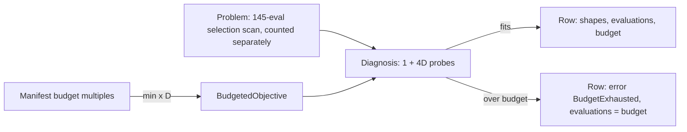

## Summary

Most of #266's weight benchmark was merged in #282. That left the landscape
diagnosis outside every evaluation budget. This PR makes the diagnosis draw its
`1 + 4D` probes from the same `BudgetedObjective` the arms use, limited to the
manifest's tightest budget (smallest budget multiple × D, so 10D for the
predeclared manifest). Each landscape row and cell records that `budget`, and a
diagnosis that needs more is recorded as `BudgetExhausted` with the evaluations
it spent. Rows and summaries written before this change still load, with no
budget. The landscape summary moves to format 4, and the committed landscape
evidence (`docs/evidence/weight-router-landscape/`) is regenerated in format 4:
every row carries `budget` = 10D, and apart from that field the rows are
identical to the format 3 rows. The crate goes from 0.1.49 to 0.1.50.

The representative runs, a production refinement baseline and a predeclared
protocol for the post-hoc additions are still outstanding, so this PR is
Part of #266.

## Spec

### Intent and Rationale

- The open "Count landscape probes within the budget" gap was that the diagnosis's probes were counted but charged to no budget; reusing `BudgetedObjective` puts them under the same counter and refusal the arms use, with no new counting code.

### Essential Design Decisions

- The budget is the manifest's *smallest* multiple × D, the tightest budget any arm gets, so a diagnosis fits there or fails loudly as `BudgetExhausted`. Preparation (the 145-evaluation selection scan) stays outside the budget, because every arm shares that scan and no arm's budget pays for it either.
- Persisted shape: `LandscapeRow.budget` is `Option<usize>` and `LandscapeCell.budget` is `usize`, both `#[serde(default)]`, so format-3 rows read as `None`/`0` (old shape read, key not bumped). `landscape_rows_without_a_budget_still_load` seeds a row and a cell copied verbatim from the format-3 files this PR replaces.
- The budget is a cap on the diagnosis, not a reduction of any arm's budget: nothing routes on the diagnosis, and the router was removed in #282 after it never beat CMA-ES.

### Undiscoverable Facts

- #282 (the earlier branch for this issue) was merged into `Develop` as `06c250b` while the issue stayed open as `Part of #266`; this branch starts from that commit.

## Evidence

Backend/CLI only, no UI file touched.

- `lamarck/tests/weight_bench_landscape.rs::diagnosis_draws_its_probes_from_the_tightest_budget`: multiples `[30, 10, 100]` give every row `budget == 10D`, `evaluations == 1 + 4D`, and cell budgets equal to the sum of their rows'.
- `lamarck/tests/weight_bench_landscape.rs::a_diagnosis_over_its_budget_is_recorded_as_budget_exhausted`: at D=20 a budget of 80 (one short of 81) records `evaluation budget of 80 exhausted` with 80 evaluations. The positive control, a budget of 100, completes with 81.
- `lamarck/tests/weight_bench_landscape.rs::landscape_rows_without_a_budget_still_load`: a format-3 row and summary cell (copied from the replaced files) load with `budget` `None` and `0`.
- `lamarck/tests/weight_bench_landscape.rs::committed_landscape_evidence_is_reproduced_and_shows_the_saturated_plateau`: the committed format-4 summary has `formatVersion` 4 and `diagnosisBudgetMultiple` 10; every committed row has `budget == Some(10D)` and `evaluations <= 10D`, every cell has `budget == problems × 10D`, and the current code reproduces the first-seed rows exactly, `budget` included.
- `docs/evidence/weight-router-landscape/landscape-summary.json` / `landscape.jsonl`: regenerated by `cargo run --release --example weight_router_bench -- ../docs/evidence/weight-router-landscape --manifest ../docs/evidence/weight-router-landscape/manifest.json --landscape` at `8e79db7` (clean tree, crate 0.1.50, 1.8 s): 144 of 144 problems, 0 failed, 51 744 evaluations. Stripping `budget` from the new rows gives the old rows byte for byte.

## Acceptance Criteria

<!-- vibe-spec-review inputs="diff+issue-body" -->

- **partial** — Use AMM as an offline reference against the current refinement method and CMA-ES on fixed deterministic screening records. — evidence: `docs/evidence/weight-router/reference-summary.json`, `scripts/amm-reference.py`, `lamarck/src/weight_bench/cmaes.rs` — reviewer: partial — reason: the refinement arm is a simplified random-axis surrogate (`refine.rs`), not the production refinement pipeline.
- **met** — Optimise 20–100 influential weights with budgets 10D, 30D, 100D; mark D>40 as extrapolation requiring validation. — evidence: `predeclared_manifest`, `EXTRAPOLATION_ABOVE`, `docs/evidence/weight-router/manifest.json` — reviewer: met
- **met** — Count landscape probes within the budget. — evidence: `lamarck/src/weight_bench/landscape.rs` (`measure_axes` on `BudgetedObjective`), `lamarck/tests/weight_bench_landscape.rs::diagnosis_draws_its_probes_from_the_tightest_budget`, `lamarck/tests/weight_bench_landscape.rs::a_diagnosis_over_its_budget_is_recorded_as_budget_exhausted`, committed format-4 evidence with `budget` = 10D on every row (`committed_landscape_evidence_is_reproduced_and_shows_the_saturated_plateau`) — reviewer: met (synthetic); it notes that `1 + 4D` < 10D, so `BudgetExhausted` never fires on the predeclared manifest, and nothing routes on the diagnosis.
- **partial** — Test plateaus/kinks and activation families — evidence: `lamarck/tests/weight_bench_landscape.rs::diagnosis_finds_the_saturated_plateau`, `lamarck/tests/weight_bench_landscape.rs::tanh_axes_are_smooth_and_relu_and_hard_tanh_axes_kink` — reviewer: partial — reason: the plateau-bearing `saturated-hard-tanh` family and the two-sided diagnosis were added after the predeclared run, outside the protocol; everything is synthetic.
- **partial** — then full/held-out confirmation. — evidence: `docs/evidence/weight-router/summary.json` (held-out and full-window comparisons), `lamarck/tests/weight_bench_reference.rs::held_out_veto_turns_a_screening_win_inconclusive` — reviewer: partial — reason: confirmation exists on synthetic fixtures only; none on a representative corpus.
- **met** — Port only winning probes/router to Rust after measurement; no topology optimisation or unverified third-party dependency added by default. — evidence: the router was removed in #282; `Cargo.lock` changes only the crate version — reviewer: met
- **met** — Read and pin the full method before reproducing it — evidence: `docs/evidence/weight-router/method-check.json`, `scripts/check-amm-method.py`, `amm-meta.json` — reviewer: met
- **met** — First inspect current code, merged work and repository instructions. Reuse existing mechanisms; if functionality already exists, this issue still owns the missing controlled comparison rather than a second implementation. — evidence: the diagnosis reuses `BudgetedObjective`, `PLATEAU_REL_TOL` and `RANDOM_DELTA_HALF_WIDTH`; this run started from the merged #282 — reviewer: met
- **met** — Opt-in experiment only; preserve ordinary behaviour, interfaces, immutable parents and full authoritative acceptance. No automatic deployment or default change. — evidence: only `lamarck/examples/weight_router_bench.rs` and tests call `weight_bench` — reviewer: met
- **partial** — Predeclare controls, seeds, sample size, compute limits and success/failure criteria. Identify code/model/data versions; separate calibration from untouched validation and count all preparation/search costs. — evidence: `lamarck/src/weight_bench/provenance.rs`, committed landscape evidence (`gitCommit` `8e79db7`, `gitDirty` false, `preparationEvaluations` counted), `docs/weight-optimiser-routing.md` (compute ledger) — reviewer: partial — reason: the diagnosis and its 10D budget were chosen after the run; the current code has no calibration phase; no predeclared protocol exists for a representative run.
- **met** — Provide deterministic positive/negative correctness tests for new behaviour and pass the repository's normal quality checks. Research runs are separate from routine feature CI. — evidence: `lamarck/tests/weight_bench_landscape.rs::a_diagnosis_over_its_budget_is_recorded_as_budget_exhausted` (negative case, positive control), `landscape_rows_without_a_budget_still_load`, `committed_landscape_evidence_is_reproduced_and_shows_the_saturated_plateau`; `./quality.sh < /dev/null` exited 0 on `02c7356` ("All quality checks passed!"); the later doc-only edits passed `cargo fmt --check` and `cargo doc` with `-D warnings` — reviewer: met (for the tests; the reviewer did not run the gate itself)
- **met** — Deliver a reproducible command/manifest and machine-readable results with paired distributions, uncertainty, failures and actual coverage. Fixtures alone do not demonstrate an optimisation benefit. — evidence: `--landscape` command with `docs/evidence/weight-router-landscape/manifest.json`, format-4 `landscape-summary.json` (coverage 144/144, 0 failed), `docs/evidence/weight-router/summary.json` — reviewer: met (synthetic only; no optimisation benefit is claimed from fixtures)
- **partial** — Record negative findings and remove optional code that does not earn its maintenance cost. Do not claim success before representative runs. — evidence: `docs/weight-optimiser-routing.md` (Findings, Outstanding); router removed in #282 — reviewer: partial — reason: the landscape diagnosis is optional code nothing routes on, and this branch extends it rather than justifying or removing it; no representative run has been made (no success is claimed).
- **met** — Keep public implementation and fixtures application-agnostic; private corpora/results and operational integration remain private. — evidence: synthetic teacher networks only; corpus mode records only FNV hashes — reviewer: met
- **met** — Leave unassigned until an implementer actively starts. `work-on` authorises the investigation, not skipping prerequisite verification. — evidence: the worker unassigned the issue between runs; this run inspected the merged #282 before changing anything — reviewer: not assessed (a process requirement the diff cannot show); it was followed by the worker.
- **unrequested** — doc wording about what "a diagnose-then-optimise router at that budget would have left" (`landscape.rs` docs, CHANGELOG, routing doc) — reviewer: unrequested — reason: kept to explain what the recorded `budget` means; no router exists or is added.
- **unrequested** — `classify_each_axis` folded into `classify_axes`, and the internal test renamed to `classify_axes_stops_at_the_first_failed_evaluation` — reviewer: unrequested — reason: cleanup that falls out of moving the evaluation count into `measure_axes`.

## Standards Review

<!-- vibe-standards-review inputs="diff+CODING-STANDARDS.md" -->

- **violation** — a changed test no longer failed without the code it was named for (`a_failure_partway_through_the_axes_keeps_the_evaluations_spent` counted its own closure calls once the evaluation count moved to `measure_axes`) — evidence: `lamarck/src/weight_bench/landscape.rs` — reason: fixed in this diff (renamed to `classify_axes_stops_at_the_first_failed_evaluation`, which is what it proves).
- **violation** — stale claim that `Cargo.lock` is unchanged since `f0a7b4c`, though this branch moves the crate's own version in it — evidence: `CHANGELOG.md:116`, `docs/weight-optimiser-routing.md:177`, `:277`, `:552` — reason: fixed in this diff (now "the dependencies pinned in `Cargo.lock` are unchanged (only the crate's own version moves)").
- **violation** — stale module doc saying the diagnosis is "measured outside every arm's budget" — evidence: `lamarck/src/weight_bench/mod.rs:27` — reason: fixed in this diff (now drawn from a `BudgetedObjective` of the tightest arm budget).
- **violation** — CHANGELOG listed the private `measure_axes` and said `diagnose_specs` takes a budget (it takes a budget multiple) — evidence: `CHANGELOG.md:187` — reason: fixed in this diff.
- **clean** — version bump and Cargo.lock agree (0.1.50); regenerated landscape evidence matches the CHANGELOG and doc claims (rows identical to format 3 apart from `budget`, every row `budget` = 10D, totals and coverage unchanged); tests do what their names say with negative and positive cases; no assertion removed without replacement. `CODING-STANDARDS.md` is absent, so the review used `CONTRIBUTING.md`.

## Test Plan

- Added in `lamarck/tests/weight_bench_landscape.rs`: `diagnosis_draws_its_probes_from_the_tightest_budget`, `a_diagnosis_over_its_budget_is_recorded_as_budget_exhausted`, `landscape_rows_without_a_budget_still_load`.
- Edited, signature only (a `10 * D` budget passed, every assertion kept): `diagnosis_finds_the_saturated_plateau`, `failed_problems_are_recorded_and_counted_not_fatal`, `tanh_axes_are_smooth_and_relu_and_hard_tanh_axes_kink`, `axis_shapes_are_deterministic` and the `diagnose_specs` equality in `lamarck/tests/weight_bench_landscape.rs`.
- Edited in `lamarck/tests/weight_bench_landscape.rs`: `committed_landscape_evidence_is_reproduced_and_shows_the_saturated_plateau` now expects `formatVersion` 4 and `diagnosisBudgetMultiple` 10, adds per-row and per-cell budget assertions on the committed evidence, and keeps `assert_eq!(diagnose_manifest(&first_seed).unwrap(), expected);` unchanged (the committed rows now carry `budget`). `landscape_rows_without_a_budget_still_load` reads an inline format-3 row and cell instead of the committed files, which are now format 4.
- Renamed in `lamarck/src/weight_bench/landscape.rs`: `a_failure_partway_through_the_axes_keeps_the_evaluations_spent` → `classify_axes_stops_at_the_first_failed_evaluation`, with all assertions kept. It now counts calls in its own closure, because `classify_axes` no longer returns a count.
- `cargo test --test weight_bench_landscape`: 18 passed. `cargo test --lib weight_bench::landscape`: 1 passed. `cargo test --test weight_bench_reference`: 17 passed. Clippy (`-D warnings`) and `cargo fmt --check` were clean.
- `./quality.sh < /dev/null` exited 0 on `02c7356` (the regenerated evidence and test changes): "All quality checks passed!". The later doc-only commit (CHANGELOG, routing doc, `mod.rs` doc comment) passed `cargo fmt --check` and `cargo doc` with `-D warnings`.
- Docs read and updated: `docs/weight-optimiser-routing.md` (the evidence provenance paragraph, Finding 5, the compute ledger row and the three `Cargo.lock` provenance sentences), the `weight_router_bench.rs` module doc, the `weight_bench` module doc (`mod.rs`), the `landscape.rs` field docs, and `CHANGELOG.md`. `README.md` has no `--landscape` mention.

## Merge verification

- GitHub CI not yet verified.

## Not done

- Representative runs on a production creature and corpus: none is available on this host, so no optimisation benefit is claimed.
- A refinement arm on the production candidate pipeline.
- Removing or justifying the landscape diagnosis, which nothing routes on (kept as the instrument behind Finding 5; recorded as partial).
- A predeclared protocol for the post-hoc additions.
- `scripts/test-amm-reference.py` not re-run, because it needs a scratch AMM environment.
