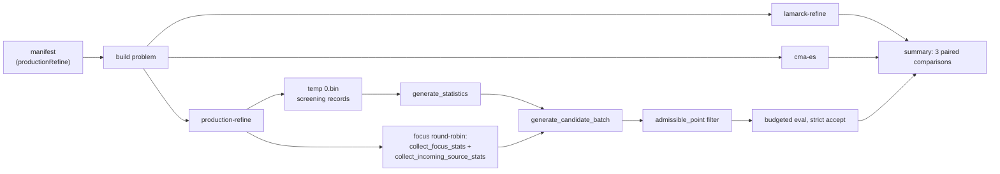

## Summary

The #266 weight benchmark compared CMA-ES and AMM only against a random-axis
surrogate, not against the current refinement method. This PR adds an opt-in
third arm, `production-refine`. It drives the real production generator,
`generate_candidate_batch`, using production focus, incoming and observations
statistics over the bench's screening records. It evaluates only the
candidates that change the selected weights.

The arm was run on the predeclared synthetic suite (972 of 972 runs, 0 failed).
It was the weakest arm:

- **Against the surrogate:** worse in 26 of 27 cells and inconclusive in 1.
- **Against CMA-ES:** worse in all 27 cells.

This is a negative synthetic finding (Finding 6) with no default change. Default
output is unchanged: the run's 648 surrogate and CMA-ES rows equal the committed
`weight-router/runs.jsonl` apart from wall clock.

Representative runs on a production creature and corpus are still not made.
Part of #266.

## Spec

### Intent and Rationale

- The merged summary (#294) and the routing doc's Outstanding list named the missing comparison against "the actual production refinement pipeline". The `reference` arm compares against `lamarck-refine`, which is a surrogate. This arm calls the production generator itself, so "the current refinement method" is measured, not approximated.
- The arm reuses the production helpers (`generate_statistics`, `collect_focus_stats`, `collect_incoming_source_stats`, `generate_candidate_batch`) and does not reimplement them, as the issue's "reuse existing mechanisms" asks.

### Essential Design Decisions

- **Selected weights only.** The bench optimises exactly the D selected weights, so a candidate is evaluated only when `admissible_point` accepts it: the same neurons (uuid, type, squash, bias), the same synapse list, and only selected weights changed. Structural, bias and out-of-set proposals are skipped. This keeps the "no topology optimisation" boundary, but it means the arm measures the generator's weight proposals only.
- **Opt-in.** The arm runs only when `Manifest.productionRefine` is true (`#[serde(default)]`, omitted when false) or the example's `--production-refine` flag is passed. Older manifests read as false, and default manifests serialise byte-for-byte as before. The arm's seed constant is pinned in `arm_seeds_are_pinned`.
- **Fixed batch, no learning signal.** `PRODUCTION_BATCH` is 16, `scale_quotas: false`, `learning: None`, `ranked_sources: None` and the mirror policy is the default. Focus neurons are taken round-robin over the distinct targets of the selected synapses. The arm stops, with budget unused, when a whole focus cycle yields nothing admissible (8 of 324 rows did).
- **Kept, with a removal condition.** The code is kept, opt-in and bench-only, as the harness for the representative comparison. The routing doc's Outstanding list says to remove it if that run does not use it or confirms the synthetic negative result.

### Undiscoverable Facts

- No production creature/corpus pair is available on this host, and private inputs stay out of the checkout, so the representative campaign is an owner step.
- The evidence was produced at commit `11b7953`. The only later source change in `production.rs` is that the temp-directory drop guard now logs a failed removal; it does not affect results. The worker's periodic checkpoint committed the README follow-up as `c9c75ba`.

## Evidence

Backend/CLI only; no UI file touched.

- **Campaign.** The command was `cargo run --release --example weight_router_bench -- docs/evidence/weight-router-production --production-refine`, run at `11b7953` (crate 0.1.55, `gitDirty` false). It exited 0: `runs 972/972 completed (0 failed); 2431738 evaluations`. Wall clock was 503 s on a shared, parallel host (indicative only). Results are in `docs/evidence/weight-router-production/{manifest.json,runs.jsonl,summary.json}`.
- **Paired results** (324 pairs per comparison, production minus the other arm):

  | Comparison | Screening (wins / losses) | Held-out | Full window |
  |---|---|---|---|
  | vs `lamarck-refine` | 12 / 312 | 24 / 300 | 23 / 301 |
  | vs `cma-es` | 3 / 321 | 15 / 309 | 10 / 314 |

  Per-cell bootstrap intervals and paired differences are in `summary.json`. Against the surrogate, the mean screening differences run from +0.002 to +0.27 and are largest at 10D.
- **Default output unchanged.** A Python comparison of the campaign's `lamarck-refine` and `cma-es` rows against the committed `docs/evidence/weight-router/runs.jsonl`, keyed on (arm, family, dimension, seed, budget) with `wallClockSeconds` dropped, found 648 of 648 identical.
- **Smoke run.** `--smoke --production-refine` ran 3 runs with 760 evaluations (not committed, counted in the compute ledger).

## Acceptance Criteria

- **missing** — Use AMM as an offline reference against the current refinement method and CMA-ES on fixed deterministic screening records. — reason: the production generator is now an arm (`production-refine`) and is compared with CMA-ES. The committed AMM reference summary was not re-run against it: `reference.rs` still pairs AMM with `lamarck-refine` and `cma-es` only.
- **missing** — Test plateaus/kinks and activation families, then full/held-out confirmation. — reason: the full and held-out windows are reported for every arm, including the new one. Full authoritative confirmation and a plateau diagnosis on a representative problem need the private production creature and corpus.
- **missing** — Predeclare controls, seeds, sample size, compute limits and success/failure criteria. Identify code/model/data versions; separate calibration from untouched validation and count all preparation/search costs. — reason: no representative manifest or model/data version is frozen, and no overall wall-clock ceiling is declared. The earlier development runs remain uncounted; this run's smoke and campaign runs are counted.
- **missing** — Deliver a reproducible command/manifest and machine-readable results with paired distributions, uncertainty, failures and actual coverage. Fixtures alone do not demonstrate an optimisation benefit. — reason: the synthetic results, including the new arm, are reproducible and committed. Representative coverage is still 0 runs.
- **missing** — Record negative findings and remove optional code that does not earn its maintenance cost. Do not claim success before representative runs. — reason: Finding 6 records the negative result. Whether to keep or remove `production-refine` and the landscape diagnosis waits on the representative run, as the Outstanding list states.

## Test Plan

- Added `lamarck/src/weight_bench/production.rs` unit tests:
  - `accepts_a_selected_weight_change_and_returns_x` checks that a change to a selected weight returns the new weight vector.
  - `rejects_bias_out_of_set_added_synapse_and_identical` checks four refusals. The bias case also changes a selected weight, so only the bias can refuse it. The out-of-set case is tested with and without a selected change. The other two cases are an added synapse and an identical creature.
  - `production_refine_is_bounded_deterministic_and_cleans_up` runs a tanh D=20 problem with a 200-evaluation budget. It asserts 1 ≤ used ≤ 200, identical loss and evaluation count for two runs with one seed, best loss ≤ start loss, and that both temporary directories are distinct and removed.
- Added `lamarck/tests/weight_bench.rs` tests:
  - `production_refine_manifest_adds_arm_rows_and_pairs` checks that the flag adds a `production-refine` row per problem and budget and the two new comparison pairs. The flag-off control has no such row and only the original pair.
  - `production_refine_flag_serialisation_is_backward_compatible` checks that a manifest without `productionRefine` reads as false and that a default manifest serialises without the key.
- Extended `lamarck/src/weight_bench/arms.rs::arm_seeds_are_pinned` with the new arm's seed. The existing asserts are kept.
- `lamarck/tests/weight_bench_landscape.rs` and `lamarck/tests/weight_bench_reference.rs` only gain `production_refine: false` in `Manifest` literals. No assertion was removed from any existing test, and the committed-evidence reproduction tests pass unchanged.
- Results on the final head:
  - `./quality.sh < /dev/null` exited 0 with "All quality checks passed!" (1024 tests passed, 0 failed).
  - The first gate run failed `readme_contract::readme_mentions_no_unknown_lamarck_flags`, because the README named the example-only `--production-refine` flag. The flag was removed from README, and `cargo test --test readme_contract` passed 40 tests.
- Docs read and updated:
  - `docs/weight-optimiser-routing.md`: Arms table, How to run, the Results pointer, Finding 6, Compute ledger (committed total 5,798,949; total including re-runs 7,975,176), the Controls section and Outstanding. Its opening sentences no longer say the bench has no production-pipeline comparison.
  - The README #266 row and `CHANGELOG.md`.
  - The `weight_bench/mod.rs` and example module docs.

## Merge verification

- GitHub CI not yet verified.

## Not done

- **Representative runs:** none on a production creature and corpus, for any arm. No optimisation benefit is claimed.
- **Arm scope:** `production-refine` excludes the generator's structural and bias proposals and runs without a learning signal or ranked sources, so it measures the weight proposals only.
- **AMM against the new arm:** the AMM reference was not re-paired with `production-refine`.
- **Review:** the independent Spec and Standards reviewers were not dispatched, because the issue has no acceptance-criteria heading.

🤖 Generated with [Claude Code](https://claude.com/claude-code)
