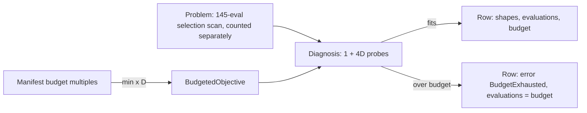

## Summary

Most of #266's weight benchmark was merged in #282. That left the landscape
diagnosis outside every evaluation budget. This PR makes the diagnosis draw its
`1 + 4D` probes from the same `BudgetedObjective` the arms use, limited to the
manifest's tightest budget (smallest budget multiple × D, so 10D for the
predeclared manifest). Each landscape row and cell records that `budget`, and a
diagnosis that needs more is recorded as `BudgetExhausted` with the evaluations
it spent. Rows and summaries written before this change still load, with no
budget. The landscape summary moves to format 4; the committed landscape
evidence stays format 3. The crate goes from 0.1.49 to 0.1.50.

The representative runs, a production refinement baseline and a predeclared
protocol for the post-hoc additions are still outstanding, so this PR is
Part of #266.

## Spec

### Intent and Rationale

- The open "Count landscape probes within the budget" gap was that the diagnosis's probes were counted but charged to no budget; reusing `BudgetedObjective` puts them under the same counter and refusal the arms use, with no new counting code.

### Essential Design Decisions

- The budget is the manifest's *smallest* multiple × D, the tightest budget any arm gets, so a diagnosis fits there or fails loudly as `BudgetExhausted`. Preparation (the 145-evaluation selection scan) stays outside the budget, because every arm shares that scan and no arm's budget pays for it either.
- Persisted shape: `LandscapeRow.budget` is `Option<usize>` and `LandscapeCell.budget` is `usize`, both `#[serde(default)]`, so the committed format-3 rows read as `None`/`0` (old shape read, key not bumped). `landscape_rows_without_a_budget_still_load` seeds the committed rows.
- The budget is a cap on the diagnosis, not a reduction of any arm's budget: nothing routes on the diagnosis, and the router was removed in #282 after it never beat CMA-ES.

### Undiscoverable Facts

- #282 (the earlier branch for this issue) was merged into `Develop` as `06c250b` while the issue stayed open as `Part of #266`; this branch starts from that commit.

## Evidence

Backend/CLI only, no UI file touched.

- `lamarck/tests/weight_bench_landscape.rs::diagnosis_draws_its_probes_from_the_tightest_budget`: multiples `[30, 10, 100]` give every row `budget == 10D`, `evaluations == 1 + 4D`, and cell budgets equal to the sum of their rows'.
- `lamarck/tests/weight_bench_landscape.rs::a_diagnosis_over_its_budget_is_recorded_as_budget_exhausted`: at D=20 a budget of 80 (one short of 81) records `evaluation budget of 80 exhausted` with 80 evaluations. The positive control, a budget of 100, completes with 81.
- `lamarck/tests/weight_bench_landscape.rs::landscape_rows_without_a_budget_still_load`: committed rows and summary cells load with `budget` `None` and `0`.
- `lamarck/tests/weight_bench_landscape.rs::committed_landscape_evidence_is_reproduced_and_shows_the_saturated_plateau`: regenerated rows carry `budget == Some(10D)` and `evaluations <= 10D`, and match the committed rows field for field otherwise.

## Acceptance Criteria

<!-- vibe-spec-review inputs="diff+issue-body" -->

- **partial** — Use AMM as an offline reference against the current refinement method and CMA-ES on fixed deterministic screening records. — evidence: `scripts/amm-reference.py`, `lamarck/src/weight_bench/cmaes.rs` — reviewer: partial — reason: the refinement arm is the hand-written `refine.rs` surrogate, not the production refinement pipeline.
- **met** — Optimise 20–100 influential weights with budgets 10D, 30D, 100D; mark D>40 as extrapolation requiring validation. — evidence: `lamarck/src/weight_bench/suite.rs` (`is_extrapolation`), `docs/evidence/weight-router/manifest.json` — reviewer: met
- **partial** — Count landscape probes within the budget. — evidence: `lamarck/src/weight_bench/landscape.rs` (`measure_axes` on `BudgetedObjective`), `lamarck/tests/weight_bench_landscape.rs::diagnosis_draws_its_probes_from_the_tightest_budget`, `lamarck/tests/weight_bench_landscape.rs::a_diagnosis_over_its_budget_is_recorded_as_budget_exhausted` — reviewer: partial — reason: the probes are now drawn from and refused by the tightest arm budget, but no optimiser spends the remainder, and the committed landscape evidence was not regenerated in format 4.
- **met** — Test plateaus/kinks and activation families — evidence: `lamarck/tests/weight_bench_landscape.rs::diagnosis_finds_the_saturated_plateau`, `lamarck/tests/weight_bench_landscape.rs::tanh_axes_are_smooth_and_relu_and_hard_tanh_axes_kink` — reviewer: met
- **partial** — then full/held-out confirmation. — evidence: `lamarck/tests/weight_bench_reference.rs::held_out_veto_turns_a_screening_win_inconclusive` — reviewer: partial — reason: full and held-out columns exist for synthetic fixtures only; representative coverage is 0 runs.
- **met** — Port only winning probes/router to Rust after measurement; no topology optimisation or unverified third-party dependency added by default. — evidence: the router was removed in #282; `Cargo.lock` changes only the crate version — reviewer: met
- **met** — Read and pin the full method before reproducing it — evidence: `docs/evidence/weight-router/method-check.json`, `docs/weight-optimiser-routing.md` (AMM reference) — reviewer: met
- **partial** — First inspect current code, merged work and repository instructions. Reuse existing mechanisms; if functionality already exists, this issue still owns the missing controlled comparison rather than a second implementation. — evidence: this diff reuses `BudgetedObjective` — reviewer: partial — reason: `lamarck/src/weight_bench/refine.rs` re-implements mirroring and follow-up by hand instead of calling `mirror_candidate`, `FollowUpPlan` or `generate_candidate_batch`.
- **met** — Opt-in experiment only; preserve ordinary behaviour, interfaces, immutable parents and full authoritative acceptance. No automatic deployment or default change. — evidence: changes confined to `lamarck/src/weight_bench/landscape.rs`, `lamarck/examples/weight_router_bench.rs` and tests — reviewer: met
- **partial** — Predeclare controls, seeds, sample size, compute limits and success/failure criteria. Identify code/model/data versions; separate calibration from untouched validation and count all preparation/search costs. — evidence: `lamarck/src/weight_bench/provenance.rs`, `docs/weight-optimiser-routing.md` (compute ledger) — reviewer: partial — reason: the diagnosis, the saturated family, the full-window veto and this budget rule were added after results were seen, on the same validation seeds; no wall-clock ceiling was predeclared.
- **partial** — Provide deterministic positive/negative correctness tests for new behaviour and pass the repository's normal quality checks. Research runs are separate from routine feature CI. — evidence: `lamarck/tests/weight_bench_landscape.rs::a_diagnosis_over_its_budget_is_recorded_as_budget_exhausted`; `./quality.sh` exited 0 on `24a233f` — reviewer: partial — reason: the reviewer could not run the gate (it was run here and passed). Small `run_manifest` campaigns still run inside `cargo test`.
- **partial** — Deliver a reproducible command/manifest and machine-readable results with paired distributions, uncertainty, failures and actual coverage. Fixtures alone do not demonstrate an optimisation benefit. — evidence: `docs/evidence/weight-router/summary.json`, `docs/evidence/weight-router-landscape/landscape-summary.json` — reviewer: partial — reason: representative coverage is 0 runs. `--landscape` now writes format 4 (with `budget`) while the committed landscape files are format 3; the reproduction test compares them with `budget` cleared.
- **partial** — Record negative findings and remove optional code that does not earn its maintenance cost. Do not claim success before representative runs. — evidence: `docs/weight-optimiser-routing.md` (Findings, Outstanding) — reviewer: partial — reason: the landscape diagnosis is still kept though nothing routes on it; no success is claimed.
- **met** — Keep public implementation and fixtures application-agnostic; private corpora/results and operational integration remain private. — evidence: synthetic teacher networks only (`lamarck/src/weight_bench/suite.rs`) — reviewer: met
- **met** — Leave unassigned until an implementer actively starts. `work-on` authorises the investigation, not skipping prerequisite verification. — evidence: the worker unassigned the issue between runs; this run inspected the merged #282 before changing anything — reviewer: missing — reason: the reviewer said "not assessable" (a process requirement the diff cannot show); it was followed by the worker.
- **unrequested** — crate version bump 0.1.49 → 0.1.50 (`lamarck/Cargo.toml`, `Cargo.lock`) — reviewer: unrequested — reason: `CONTRIBUTING.md` requires it for a change to what the crate builds from.
- **unrequested** — doc wording about what "a diagnose-then-optimise router at that budget would have left" — reviewer: unrequested — reason: it explains what the recorded `budget` means. No router is added.
- **unrequested** — the existing Unreleased CHANGELOG "Added" entry was amended — reviewer: unrequested — reason: its "no arm's budget is charged" clause became false; the entry is unreleased, so it was corrected rather than left false.
- **unrequested** — changed console output in `lamarck/examples/weight_router_bench.rs` — reviewer: unrequested — reason: it reports the new diagnosis budget.

## Standards Review

<!-- vibe-standards-review inputs="diff+CODING-STANDARDS.md" -->

- **violation** — a changed test no longer failed without the code it was named for (`a_failure_partway_through_the_axes_keeps_the_evaluations_spent` counted its own closure calls once the evaluation count moved to `measure_axes`) — evidence: `lamarck/src/weight_bench/landscape.rs` — reason: fixed in this diff (renamed to `classify_axes_stops_at_the_first_failed_evaluation`, which is what it proves). The failure-count behaviour is covered by `a_diagnosis_over_its_budget_is_recorded_as_budget_exhausted` and `failed_problems_are_recorded_and_counted_not_fatal`.
- **clean** — version bump and Cargo.lock agree; CHANGELOG entry under Unreleased; no named-but-absent test; no workflow or stub changes; `BudgetedObjective` refusal not counted; boundary 80/81 has negative and positive cases. `CODING-STANDARDS.md` is absent, so the review used `CONTRIBUTING.md`, which declares no review-only rules. The optional `formatVersion` note was acted on (landscape summary format 4).

## Test Plan

- Added in `lamarck/tests/weight_bench_landscape.rs`: `diagnosis_draws_its_probes_from_the_tightest_budget`, `a_diagnosis_over_its_budget_is_recorded_as_budget_exhausted`, `landscape_rows_without_a_budget_still_load`.
- Edited, signature only (a `10 * D` budget passed, every assertion kept): `diagnosis_finds_the_saturated_plateau`, `failed_problems_are_recorded_and_counted_not_fatal`, `tanh_axes_are_smooth_and_relu_and_hard_tanh_axes_kink`, `axis_shapes_are_deterministic` and the `diagnose_specs` equality in `lamarck/tests/weight_bench_landscape.rs`.
- Removed from `lamarck/tests/weight_bench_landscape.rs`: `assert_eq!(diagnose_manifest(&first_seed).unwrap(), expected);`
  - Moved to: `lamarck/tests/weight_bench_landscape.rs` — the same test compares every field with `budget` cleared, and asserts `budget == Some(10 * dimension)` and `evaluations <= 10 * dimension`. Committed rows predate the budget field.
- Renamed in `lamarck/src/weight_bench/landscape.rs`: `a_failure_partway_through_the_axes_keeps_the_evaluations_spent` → `classify_axes_stops_at_the_first_failed_evaluation`, with all assertions kept. It now counts calls in its own closure, because `classify_axes` no longer returns a count.
- `cargo test --test weight_bench_landscape`: 18 passed. `cargo test --lib weight_bench::landscape`: 1 passed. `cargo test --test weight_bench_reference`: 17 passed. Clippy (`-D warnings`) and `cargo fmt --check` were clean.
- `./quality.sh < /dev/null` exited 0 on `24a233f` ("All quality checks passed!").
- Docs read and updated: `docs/weight-optimiser-routing.md` (the evidence provenance paragraph and Finding 5), the `weight_router_bench.rs` module doc, and `CHANGELOG.md`. `README.md` has no `--landscape` mention.

## Merge verification

- GitHub CI not yet verified.

## Not done

- Representative runs on a production creature and corpus: none is available on this host.
- A refinement arm on the production candidate pipeline.
- Regenerating the committed landscape evidence in format 4.
- A predeclared protocol for the post-hoc additions.
- `scripts/test-amm-reference.py` not re-run, because it needs a scratch AMM environment.
