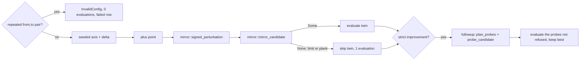

## Summary

Most of #266's weight benchmark has already merged (#282, #283). This PR closes
one reuse gap. The `lamarck-refine` arm (`lamarck/src/weight_bench/refine.rs`)
used to build its antithetic twin and its follow-up probes with hand-written
copies of `mirror.rs` and `followup.rs`. It now calls the production helpers:
`mirror::signed_perturbation` and `mirror::mirror_candidate` build the `-delta`
twin, and `followup::plan_probes` and `followup::probe_candidate` build the
follow-up probes. The arm therefore inherits their refusals (the hard weight
limit and the plank constant).

The follow-up helpers find a synapse by `(from_uuid, to_uuid)` and take the
first match, but the bench's axes are synapse indices. So `lamarck_refine` now
refuses, before any evaluation, any creature in which a `(from, to)` pair
appears on more than one synapse. This is the fix for the review finding that
stalled #284. Both committed refine suites were re-run at `68ed75d` and
reproduced every committed row, so no evidence file and no reported number
changes. The crate goes from 0.1.50 to 0.1.51.

The refinement arm is still a random-axis surrogate, not the production
candidate pipeline, and no representative run has been made. This PR is
therefore Part of #266.

## Spec

### Intent and Rationale

- The issue says "Reuse existing mechanisms", and the routing doc recorded that `refine.rs` "manually recreates mirrors and follow-up steps". Calling the production helpers removes that second copy and keeps the arm's predeclared protocol on the committed suites.
- On a creature with a repeated `(from, to)` pair (one source feeding an `IF` neuron in two roles, which neat-core allows), `plan_probes` compares the wrong synapses and `probe_candidate` steps the first match. The arm would then run steps the protocol does not describe. Failing closed avoids that without changing production code.

### Essential Design Decisions

- The guard lives in the bench (`require_unique_synapse_pairs` in `refine.rs`) and checks the whole creature, not only the free synapses, because any repeated pair can mislead `plan_probes`. `followup.rs` and `mirror.rs` behave exactly as before (only a doc comment in `followup.rs` changes). Making the helpers role-aware would change production behaviour, which the issue says to preserve.
- The refusal happens before the first evaluation (`used() == 0`). Through `run_manifest` it becomes a failed row (`finish_row` in `experiment.rs`), counted in coverage and dropped from the paired distributions, while CMA-ES on the same problem still runs.
- The RNG draw order (axis, then a nonzero delta), the `remaining() >= 2` loop, start-first evaluation and the tie-break (plus wins ties) are kept, so the committed rows still reproduce. The limits come from `BackpropConfig::default()` (`limit_weight_scale` 100000, `plank_constant` 1e-7). When `signed_perturbation` or `mirror_candidate` refuses a twin, the twin is not evaluated, so that round spends one evaluation instead of two. A refused follow-up probe is skipped.
- `WeightObjective` gains `creature_at` (which `loss_on` now uses) and `synapse_indices`, and `BudgetedObjective` gains `objective()`. `refine.rs` uses all three to hand creatures to the helpers.

### Undiscoverable Facts

- #284 carried the same reuse change. It was closed when its review-fix lane stalled. The stall came from a worker markdownlint run over `.git/graft/`, not from this repository. This branch starts again from `Develop` at `5752e28` and adds the guard that review asked for.
- The twin is now `x - ((x + delta) - x)` instead of `x - delta`, and the probes come from the realised move. This is not bit-identical by construction, but the re-runs below gave identical rows.

## Evidence

Backend/CLI only, no UI file touched.

- **Main suite.** `cargo run --release --example weight_router_bench -- /tmp/wrb-266/main` at `68ed75d` (crate 0.1.51, `gitDirty` false) finished 648/648 runs, 0 failed, 1,631,615 evaluations. I compared its `runs.jsonl` with the committed `docs/evidence/weight-router/runs.jsonl` row by row as parsed JSON: 648 equal, 0 different.
- **Saturated suite.** The same binary with `--manifest ../docs/evidence/weight-router-landscape/saturated/manifest.json` finished 216/216, 0 failed, 543,852 evaluations. All 216 rows equal `docs/evidence/weight-router-landscape/saturated/runs.jsonl`.
- **Red, then green.** `lamarck/tests/weight_bench.rs::the_refine_arm_refuses_a_creature_with_a_repeated_synapse_pair` failed with the guard call removed (`expected InvalidConfig, got Ok(())`) and passes with it.

## Acceptance Criteria

<!-- vibe-spec-review inputs="diff+issue-body" -->

- **partial** — Use AMM as an offline reference against the current refinement method and CMA-ES on fixed deterministic screening records. — evidence: `docs/evidence/weight-router/reference-summary.json`, `lamarck/src/weight_bench/refine.rs` — reviewer: partial — reason: the refinement arm is still a random-axis surrogate; it does not call `generate_candidate_batch` or the focus/statistics/backprop pipeline.
- **met** — Optimise 20–100 influential weights with budgets 10D, 30D, 100D; mark D>40 as extrapolation requiring validation. — evidence: `predeclared_manifest`, `is_extrapolation`, `docs/evidence/weight-router/manifest.json` — reviewer: met
- **met** — Count landscape probes within the budget. — evidence: `lamarck/src/weight_bench/landscape.rs` (`BudgetedObjective`), `lamarck/tests/weight_bench_landscape.rs::diagnosis_draws_its_probes_from_the_tightest_budget` — reviewer: met
- **partial** — Test plateaus/kinks and activation families, then full/held-out confirmation. — evidence: `lamarck/tests/weight_bench_landscape.rs::tanh_axes_are_smooth_and_relu_and_hard_tanh_axes_kink`, `docs/evidence/weight-router/summary.json` — reviewer: met — reason: the reviewer said "met (synthetic only)". I record partial because the plateau family was added after the predeclared run and no representative full/held-out confirmation exists.
- **met** — Port only winning probes/router to Rust after measurement; no topology optimisation or unverified third-party dependency added by default. — evidence: router removed in #282; the only `Cargo.lock` change is the crate's own version — reviewer: met
- **met** — Read and pin the full method before reproducing it — evidence: `docs/evidence/weight-router/method-check.json`, `scripts/check-amm-method.py` — reviewer: met
- **partial** — First inspect current code, merged work and repository instructions. Reuse existing mechanisms; if functionality already exists, this issue still owns the missing controlled comparison rather than a second implementation. — evidence: `lamarck/src/weight_bench/refine.rs` (`mirrored_pair`, `follow_up_points`) — reviewer: partial — reason: the `+delta` draw is still a copy of the Random strategy, and `FollowUpPlan` and `generate_candidate_batch` are still bypassed.
- **met** — Opt-in experiment only; preserve ordinary behaviour, interfaces, immutable parents and full authoritative acceptance. No automatic deployment or default change. — evidence: `lamarck/src/followup.rs` changes only a doc comment; the new accessors are additive and `creature_at` clones — reviewer: met
- **partial** — Predeclare controls, seeds, sample size, compute limits and success/failure criteria. Identify code/model/data versions; separate calibration from untouched validation and count all preparation/search costs. — evidence: `docs/weight-optimiser-routing.md` (Predeclared protocol, Compute ledger) — reviewer: partial — reason: no representative manifest with model and data versions exists, and the development and re-run costs are not in the ledger.
- **met** — Provide deterministic positive/negative correctness tests for new behaviour and pass the repository's normal quality checks. Research runs are separate from routine feature CI. — evidence: `lamarck/tests/weight_bench.rs::the_refine_arm_refuses_a_creature_with_a_repeated_synapse_pair`, `lamarck/tests/weight_bench.rs::the_refine_arm_skips_a_refused_twin`, `lamarck/tests/weight_bench.rs::the_refine_arm_skips_a_refused_follow_up_probe`, the unit tests in `lamarck/src/weight_bench/refine.rs`, and `./quality.sh` (see Test Plan) — reviewer: met
- **met** — Deliver a reproducible command/manifest and machine-readable results with paired distributions, uncertainty, failures and actual coverage. Fixtures alone do not demonstrate an optimisation benefit. — evidence: How to run in `docs/weight-optimiser-routing.md`, committed `summary.json` and `runs.jsonl` reproduced at `68ed75d` — reviewer: met
- **partial** — Record negative findings and remove optional code that does not earn its maintenance cost. Do not claim success before representative runs. — evidence: the hand-written copies are deleted; `docs/weight-optimiser-routing.md` keeps "Representative coverage is 0 runs" — reviewer: met — reason: I record partial because the landscape diagnosis is still optional code that nothing routes on, and no representative run has been made.
- **met** — Keep public implementation and fixtures application-agnostic; private corpora/results and operational integration remain private. — evidence: the new fixtures are generic toy creatures — reviewer: met
- **met** — Leave unassigned until an implementer actively starts. `work-on` authorises the investigation, not skipping prerequisite verification. — evidence: this run inspected the merged #282/#283 and the closed #284 before changing code — reviewer: missing — reason: the reviewer said "not assessable" because this is a process rule that a diff cannot show; the worker followed it.
- **unrequested** — the repeated `(from, to)` pair refusal in `lamarck_refine` — reviewer: unrequested — reason: the reuse needs it; without it, the production follow-up helpers would probe the wrong synapse.
- **unrequested** — a refused twin now costs one evaluation instead of two, and refused probes are skipped — reviewer: unrequested — reason: the arm inherits this from the production helpers; no committed row moves.
- **unrequested** — crate version 0.1.50 → 0.1.51 (`lamarck/Cargo.toml`, `Cargo.lock`) — reviewer: unrequested — reason: `CONTRIBUTING.md` requires a patch bump for changes under `lamarck/src/`.

## Standards Review

<!-- vibe-standards-review inputs="diff+CODING-STANDARDS.md" -->

- **violation** — doc sentences said "those helpers" (including the mirror helpers) address a weight by `(from, to)`, but only the follow-up helpers do — evidence: `lamarck/src/weight_bench/refine.rs:10`, `CHANGELOG.md:200`, `docs/weight-optimiser-routing.md:59`, `docs/weight-optimiser-routing.md:698` — reason: fixed in this diff (each now says "the follow-up helpers (`plan_probes` and `probe_candidate`)").
- **violation** — CHANGELOG said `the_refine_arm_reproduces_its_committed_rows` "pins the rows", but it compares 8 of the 324 refine rows — evidence: `CHANGELOG.md:218` — reason: fixed in this diff (the entry now says 8 of 324, and that the full 648/216 reproduction was a manual re-run).
- **clean** — The version bump and `Cargo.lock` agree (0.1.51, not behind Develop). The CHANGELOG entry sits under Unreleased/Changed. Every cited test exists in the diff. No existing test expectation changed, and each new refusal test fails against the old arm. The doc claims about defaults, refusal conditions and failed-row handling match the head. The repository has no `CODING-STANDARDS.md`, so the review used `CONTRIBUTING.md`, which documents no review-only rules. Optional notes not acted on: a `run_manifest`-level test of the failed row, and the unstated fact that the `+delta` point itself is never refused.

## Test Plan

- Added in `lamarck/tests/weight_bench.rs`:
  - `the_refine_arm_refuses_a_creature_with_a_repeated_synapse_pair`. Through `run_arm`, an `IF` fixture fed twice from `input-0` gets `InvalidConfig` naming `input-0 -> o1`, with `used() == 0`. Two controls: CMA-ES on the same objective runs, and the refine arm runs on the unique-pair fixture.
  - `the_refine_arm_skips_a_refused_twin` and `the_refine_arm_skips_a_refused_follow_up_probe`. Each has a positive control.
  - `the_refine_arm_reproduces_its_committed_rows`. This pins 8 committed refine rows and is expected green both before and after the change.
- Added as unit tests in `lamarck/src/weight_bench/refine.rs`: `twin_straddles_x_on_the_chosen_axis`, `twin_is_refused_past_the_hard_weight_limit`, `twin_is_refused_below_the_plank_constant`, `follow_up_steps_around_the_winning_move` and `follow_up_drops_a_probe_past_the_hard_limit`.
- No existing test was edited apart from the `use` list in `lamarck/tests/weight_bench.rs`, so no assertion was removed.
- `cargo test --test weight_bench`: 30 passed, 1 ignored (the ignored test was already ignored). `cargo test --lib weight_bench`: 13 passed.
- `./quality.sh < /dev/null` exited 0 on `8aa5bb3` ("All quality checks passed!"). The later commit changed only comments and docs; `cargo fmt --check`, `cargo doc --no-deps` (no warnings) and `markdownlint-cli2` (0 issues) passed on it.
- Docs read and updated:
  - `docs/weight-optimiser-routing.md`: the status paragraph, the `lamarck-refine` Arms row, "Controls and remaining experiment" and "Verification and process failures".
  - `CHANGELOG.md`.
  - The `refine.rs` module and function docs, and the `STEP_FRACTIONS` doc in `followup.rs`.
- `README.md` does not mention the refine arm.

## Merge verification

- GitHub CI not yet verified.

## Not done

- Representative runs on a production creature and corpus. None is available on this host, and private inputs stay out of this checkout, so no optimisation benefit is claimed.
- A refinement arm on the production candidate pipeline (`generate_candidate_batch` with focus/statistics/backprop), or role-aware follow-up helpers, so that a creature with a repeated `(from, to)` pair can run the refine arm.
- Removing or justifying the landscape diagnosis.
- A predeclared protocol for the post-hoc additions.
- `scripts/test-amm-reference.py` was not re-run, because it needs a scratch AMM environment and nothing it drives changed.

🤖 Generated with [Claude Code](https://claude.com/claude-code)
