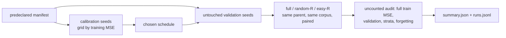

## Summary

Adds an **opt-in, offline** experiment on temporarily skipping easy records
during refinement. Each epoch it drives Lamarck's own refinement path over the
records a schedule keeps, and compares seven arms:

- full data;
- matched random skipping at 25%, 50% and 75% processing reductions;
- per-record error-EWMA easy skipping at 25%, 50% and 75%, with rare-stratum
  protection and periodic revisits of omitted records.

The predeclared synthetic suite was run, and its machine-readable results are
committed. A corpus mode runs the same protocol on a real creature and its
records. Nothing in the optimisation loop calls this code, no default changed
and nothing was ported.

The source paper's text (arXiv 2611.10386) was still unreachable from the
sandbox. Its method, Sequence Pruning, is pinned from the authors' released
code at a fixed commit, along with its DSI-targeted variant and the
InfoBatch, B-PAS and EL2N baselines. `docs/easy-record-skipping.md` says how
the tested scheme differs from them. After the negative synthetic result,
optional harness code that fed no reported result was removed. The
representative (private) run is outstanding, and the doc now carries an explicit
removal rule for the whole harness. Part of #267.

The branch also carries two CI-plumbing commits, cherry-picked unchanged from
the #268 branch (`98e7b28`, `5614dd8`). Without them the worker could not push
this branch at all:

- `ci.yml`'s `quality` job, `cargo-quality.yml` and `family-sync.yml` now
  install Rust through `.github/actions/rust-toolchain`. That composite action
  wraps the same pinned `dtolnay/rust-toolchain` SHA with `rustfmt, clippy`.
- The family-sync "Gate the refreshed scripts" step falls back to the job's
  `CANONICAL_PATHS` list when the variable is unset.
  `scripts/check-family-sync-workflow.sh` gains a rule that fails when the
  fallback is missing or differs from the job's list.

## Spec

### Intent and Rationale

- The issue owns a controlled comparison, not a production change. The
  harness lives in `lamarck/src/record_skip/` and only the
  `record_skip_bench` example and `lamarck/tests/record_skip.rs` call it.
- "Integrate the update path with Backpropagation": in this repository the
  refinement path is `propagate_layout.rs` plus `backprop.rs`, over neat-core's
  `propagate_topological_loop`. `refine` reuses that path:
  `LearningPlan`/`LearningScan`, the same code `accumulate_creature_learning`
  uses, then `apply_learnings` with `calculate_learning_rate`. It is not a
  second implementation.
- Matched random skipping keeps the same protected set and the same processed
  count as easy skipping. The only difference between the two arms is the
  difficulty signal.

### Essential Design Decisions

- Difficulty scores are bound to a `DifficultyScope` (parent fingerprint,
  corpus key, record count). `ensure_scope` refuses a different parent or
  corpus before every epoch's selection, so stale scores are never shared.
- Fitness and validation records are never pruned. The full training MSE and
  the untouched validation MSE are measured over every record after
  refinement. That audit is not charged to the arm. Calibration picks the
  schedule (EWMA α, revisit share) on calibration seeds by **training** MSE
  only.
- Strata are application-agnostic: equal-width bins of the first target value.
  Strata under `rareStratumShare` are protected.
- The verdict rule is predeclared in `stats.rs::verdict`. `better` needs the
  95% bootstrap CI of the paired validation-MSE difference wholly below zero
  **and** no mean rare-stratum regression. `worse` needs the CI wholly above
  zero. Anything else is `inconclusive`. The learning rate 0.2 was fixed in
  `manifest.rs` from a full-arm sweep on two seeds before the predeclared run.

### Undiscoverable Facts

- arXiv 2611.10386 is "Pruning DNA Sequence" (Satter, Islam and Islam). On
  14 November, `curl` to `arxiv.org`, `export.arxiv.org`, Semantic Scholar,
  alphaXiv and Hugging Face all failed with "CONNECT tunnel failed, response
  403", while `pypi.org` returned 200. `gh search code 2611.10386` found the
  abstract, which names <https://github.com/FaiasPromit/pruning-dna-sequence>.
  The method is pinned from `dnabert2/pretraining/run_mlm.py` at `804aedb`
  (`run_epoch_end_pruning`). At each epoch end it **permanently** removes
  sequences whose windowed accuracy lies in `[lower, 1.0]`. It has no revisits
  and no strata, and its `RP` control is a random subset fixed before
  training. The same commit also pins:
  - DSI-targeted SP (`run_mlm_dsi_targeted.py`): a geometric or linear
    schedule of active counts, filled by removing the highest-accuracy
    sequences;
  - the DSI formula (`analysis/compute_dsi.py`);
  - InfoBatch (`infobatch.py`, r 0.5, delta 0.875): below-mean-loss sequences
    are skipped by a per-epoch coin flip, with 1/(1 - r) rescaling and a
    full-data tail;
  - B-PAS and EL2N.

  InfoBatch is the closest to the issue's temporary skipping. The scheme
  tested here is the issue's own (temporary EWMA skipping at fixed
  reductions), so SP and InfoBatch are documented but not run as arms. On a
  retry on 14 November, the web-fetch tool's proxy also refused the arXiv
  abstract and PDF, alphaXiv and Hugging Face.
- No `stSoftwareAU` repository named Backpropagation exists (`gh repo list
  stSoftwareAU`). Lamarck's refinement lives in this repository.
- The synthetic run took 15 s wall in release, on a shared, parallel
  container. The timing is indicative only.
- All five earlier attempts on this issue died at the worker's pre-push gate
  with "`cargo +29eef336d9b2848a0b548edc03f92a220660cdb8 --version` exited
  101: error: no such command: `+…`". The gate takes the `dtolnay/rust-toolchain`
  ref as a toolchain name, and this host has no rustup. A local action has no
  such ref, so the gate runs plain `cargo`. The gate also re-runs a changed
  workflow's ShellCheck step without the job's `env:`, which is why the
  `CANONICAL_PATHS` fallback is needed. That defect is in VibeCoder, which this
  repository does not depend on. The other workflows (`ci.yml`'s `validation`
  job, `auto-format`, `cargo-audit`, `sbom`, `security`) keep the inline step.
- The CHANGELOG "Fixed" entry carried over from #268 still names Issue #268.
  It was kept word for word so both branches merge cleanly.

## Evidence

Backend/CLI only, so there is no UI. The predeclared synthetic suite was run
with `cargo run --release --example record_skip_bench -- /tmp/rsb-final`. Its
outputs are
[`docs/evidence/record-skip/summary.json`](../../evidence/record-skip/summary.json)
and [`manifest.json`](../../evidence/record-skip/manifest.json). The write-up
is [`docs/easy-record-skipping.md`](../../easy-record-skipping.md).

- Coverage: 228 of 228 runs completed, 0 failed. Versions: crate 0.1.46,
  neat-core v0.23.4.
- Calibration chose α 0.7 and revisit share 0.25. Calibration cost 4,464,000
  record passes, which is more than the whole validation phase (2,952,000).

| comparison | mean Δ validation MSE | 95% CI | rare-stratum Δ | verdict |
|---|---|---|---|---|
| easy-25 vs random-25 | +0.0015 | [+0.0008, +0.0023] | +0.094 | worse |
| easy-50 vs random-50 | −0.0028 | [−0.0049, −0.0010] | +0.198 | inconclusive |
| easy-75 vs random-75 | −0.0368 | [−0.0427, −0.0312] | +0.344 | inconclusive |
| easy-25 vs full | +0.0007 | [+0.0003, +0.0012] | −0.013 | worse |
| easy-50 vs full | +0.0002 | [−0.0006, +0.0011] | −0.095 | inconclusive |
| easy-75 vs full | +0.0062 | [+0.0029, +0.0098] | −0.341 | worse |

- **Negative finding:**
  - At 50% and 75%, easy skipping lowers overall validation MSE against
    matched random skipping, but it raises rare-stratum error, so the
    predeclared guard makes both `inconclusive`.
  - No easy-skip arm beats full data.
  - The forgotten share rises when records are skipped: 0.381 for full data
    against 0.46 to 0.57 for the skipped arms.
- These are synthetic fixtures only. They do not show a NEAT-AI benefit.

Owner step: run the corpus mode (see `docs/easy-record-skipping.md`) on the
private production creature and corpus, on a quiet machine, and keep the
results private. That run decides whether `record_skip/` stays or is removed.

## Acceptance Criteria

<!-- vibe-spec-review inputs="diff+issue-body" -->

- **partial** — Read and pin the full method before reproducing it — evidence: `docs/easy-record-skipping.md` ("Source": SP, DSI-targeted SP, DSI, InfoBatch, B-PAS and EL2N pinned from the authors' code at `804aedb`, with how the repository is tied to the arXiv ID) — reviewer: partial — reason: the paper text was never readable from the sandbox (the proxy refused it again this run), and the pin was committed after the synthetic run, not before it.
- **met** — Do not claim success before representative runs — evidence: `docs/easy-record-skipping.md` (Status, Findings), the README #267 row, the CHANGELOG entry and `lamarck/src/record_skip/mod.rs` all say synthetic-only, negative or inconclusive, with the representative run outstanding — reviewer: met
- **partial** — Record negative findings and remove optional code that does not earn its maintenance cost — evidence: `docs/easy-record-skipping.md` ("Findings", "Maintenance cost": what was removed, what was kept and why, and a removal rule); `lamarck/src/record_skip/{experiment,schedule,stats}.rs`; `lamarck/tests/record_skip.rs::tracker_refuses_strata_that_do_not_match_record_count`; a re-run reproduces `summary.json` byte for byte — reviewer: partial — reason: optional code inside the harness was removed, but the harness itself (about 2,050 lines, `pub mod record_skip`) still ships, with its removal deferred to the owner's representative run or the next release.
- **met** — Opt-in only; parents immutable; no default change — evidence: `lamarck/tests/record_skip.rs::refine_full_lowers_train_mse_and_keeps_parent` — reviewer: met
- **met** — Reuse the existing refinement mechanism — evidence: `lamarck/src/record_skip/experiment.rs` (`LearningPlan`, `LearningScan`, `apply_learnings`, `calculate_learning_rate`) — reviewer: met
- **partial** — Predeclare controls, seeds, sample size, compute limits and criteria; identify versions; count all preparation costs — evidence: `docs/evidence/record-skip/manifest.json`, `stats.rs::verdict` — reviewer: partial — reason: no compute limit is declared, versions carry no git SHA, and the learning-rate sweep is not counted in the cost table.
- **met** — Deterministic positive and negative tests; normal quality checks pass — evidence: `lamarck/tests/record_skip.rs` (17 tests) and `lamarck/src/record_skip/experiment.rs` (2 unit tests for the run-failure path: `refused_grid_point_is_reported_beside_a_valid_one`, `all_failed_calibration_names_the_first_failure`); `neat_core_tag` is read from `lamarck/Cargo.toml`, so a moved pin cannot fail a test (`reported_neat_core_tag_follows_the_cargo_toml_pin`) — reviewer: met
- **met** — Reproducible command and manifest, machine-readable results with paired distributions, uncertainty, failures and coverage — evidence: `docs/evidence/record-skip/summary.json` (228/228) — reviewer: met
- **partial** — Record stratum error and forgetting — evidence: `strataValidationMse`, `rareStratumValidationMse` and `forgottenShare` in each `runs.jsonl` row — reviewer: partial — reason: `summary.json` aggregates only the rare-stratum error, and `runs.jsonl` is not committed.
- **partial** — Integrate the update path with Backpropagation if it owns refinement — evidence: `lamarck/src/record_skip/experiment.rs` uses Lamarck's port of the update path — reviewer: partial — reason: the README names NEAT-AI (TypeScript) as the current backpropagation implementation, and the doc does not say whether that repository owns refinement.
- **met** — Application-agnostic public code; private results stay private — evidence: `lamarck/src/record_skip/corpus.rs` (synthetic fixtures only); corpus-mode results are marked private — reviewer: met
- **unrequested** — the `.github/actions/rust-toolchain` action, its use in `ci.yml`, `cargo-quality.yml` and `family-sync.yml`, the `CANONICAL_PATHS` fallback with its check rule and tests, and the #268 CHANGELOG entry — reviewer: unrequested — reason: cherry-picked unchanged from the #268 branch; without them the worker's pre-push gate refuses every Rust change on this branch.

## Standards Review

<!-- vibe-standards-review inputs="diff+CODING-STANDARDS.md" -->

- **violation** — CONTRIBUTING.md "Version bumping" (bump the patch version when `lamarck/src/` changes) — evidence: `lamarck/Cargo.toml:3` — reason: not fixed in this diff. The committed evidence records crate `0.1.46`, and the PR bot's auto-increment bumps the version on the PR.
- **clean** — there is no CODING-STANDARDS.md, so the review used CONTRIBUTING.md. Clean: the CHANGELOG `[Unreleased]` entry; every removed item is confirmed gone by grep; every kept item is present; the doc's removed/kept lists match the code; the test changes include allowed controls; the removal-rule targets exist.

## Test Plan

- Added `lamarck/tests/record_skip.rs` with 17 tests and two unit tests in
  `lamarck/src/record_skip/experiment.rs`, all passing:
  - `ewma_blends_observations`: literal EWMA value.
  - `full_and_warmup_keep_everything`.
  - `easy_skip_keeps_the_hardest`.
  - `rare_stratum_is_protected`: the easiest record is kept when it sits in a
    rare stratum.
  - `revisits_come_from_the_easy_pool`.
  - `random_skip_matches_easy_count_and_varies_with_seed`.
  - `ensure_scope_refuses_other_parent_or_corpus`: refusals with an allowed
    control.
  - `config_and_reduction_refusals`: each refusal names its field, with an
    allowed control.
  - `output_strata_bins`.
  - `refine_full_lowers_train_mse_and_keeps_parent`: the parent stays
    immutable.
  - `easy_skip_record_passes_follow_the_rule`: literal pass count.
  - `manifest_refusals`: overlapping seeds, empty validation seeds, reduction
    1.0 and epochs 0, with the predeclared manifest as the allowed control.
  - `smoke_run_is_complete_and_deterministic`: full coverage, an identical
    summary across two runs, and calibration cost equal to the sum of the
    calibration rows.
  - `files_mode_runs_and_load_corpus_checks_counts`: too few records are
    rejected, next to a positive control on the same files.
  - `verdict_rules`: includes a case with an empty rare-stratum guard, which
    can never be `better`.
  - `tracker_refuses_strata_that_do_not_match_record_count`: the refusal,
    next to an allowed control.
  - `reported_neat_core_tag_follows_the_cargo_toml_pin`: the reported tag is
    parsed from `lamarck/Cargo.toml` (`include_str!`), not typed in, so the
    automated pin refresh in Family Sync cannot turn it red. The test reads the
    tag from the manifest at test time, compares it with
    `BenchReport.versions.neat_core_tag`, and checks the parser on a moved tag.
  - Unit `refused_grid_point_is_reported_beside_a_valid_one`: a grid point
    with `ewmaAlpha: 0.0` beside a valid one. It asserts the failed rows (arm,
    seed, phase, error text), `coverage.failed` 2 and `completed` 8, the
    `nPairs` 0 and null `meanTrainDiff` entry, the valid point chosen, and the
    two error lines in `runs.jsonl`.
  - Unit `all_failed_calibration_names_the_first_failure`: with every
    calibration run refused, the returned error names the first failure.
  - `manifest_refusals` now also covers `warmupEpochs` 0, `rareStratumShare`
    out of range, and grid `ewmaAlpha` and `revisitShare` out of range, each
    with an allowed control. `Manifest::validate` refuses them up front, so
    the unit tests reach the run-failure path through the private
    `run_validated`.
- `timeout 1500 ./quality.sh < /dev/null` passed (exit 0, "All quality
  checks passed!") on this run's tree, before `strataValidationMse` was
  restored. After the restore, `cargo fmt`, clippy `-D warnings`, the 17
  `record_skip` tests (plus the 2 unit tests after the review fix) and the byte-for-byte evidence re-run all passed again. That includes clippy
  `-D warnings`, the full test suite (`readme_contract`, `docs_link_targets`),
  rustdoc and codespell.
- `scripts/test-check-family-sync-workflow.sh` gains two negative cases (no
  `CANONICAL_PATHS` fallback; a stale fallback), each expecting exit 1, and the
  real workflow is the passing control. The script passed, and so did
  `scripts/check-family-sync-workflow.sh`, `check-bot-push-action.sh`,
  `check-cargo-quality-overlap.sh` and `actionlint`. The gate step's
  ShellCheck, run under `env -i` with no `CANONICAL_PATHS`, came back clean.
- Optional-code removal (criterion 3): the unread `meanForgettingIncrease`
  field,
  three dead accessors, the unused `verdict` argument, three unused serde
  derives and one re-export were removed, and three helpers became private.
  After that, `cargo run --release --example record_skip_bench --
  /tmp/rsb-recheck` reproduced the committed `summary.json` and
  `manifest.json` byte for byte (`cmp` exit 0). Running `cargo test
  --release < /dev/null` passed in full, and so did `cargo clippy --release
  --all-targets -- -D warnings`.
- The only assertions edited are the four `verdict_rules` calls, which drop
  the removed unused argument and keep the expected verdicts. No assertion
  was removed. Outside `record_skip/` and its
  tests, the source changes are `pub mod record_skip;` in `lamarck/src/lib.rs`
  and the rule added to `scripts/check-family-sync-workflow.sh`.

Not done: reading the paper text (the method is pinned from its code), running
SP or InfoBatch as an arm, the representative corpus run, and deleting the
harness itself (the removal rule in `docs/easy-record-skipping.md` decides
that). Remaining risk: the synthetic outcome may not carry over
to real creatures and corpora.

🤖 Generated with [Claude Code](https://claude.com/claude-code)
