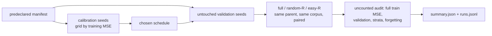

## Summary

Adds an **opt-in, offline** experiment on temporarily skipping easy records
during refinement. Each epoch it drives Lamarck's own refinement path over the
records a schedule keeps, and compares seven arms:

- full data;
- matched random skipping at 25%, 50% and 75% processing reductions;
- per-record error-EWMA easy skipping at 25%, 50% and 75%, with rare-stratum
  protection and periodic revisits of omitted records.

The predeclared synthetic suite was run, and its machine-readable results are
committed. A corpus mode runs the same protocol on a real creature and its
records. Nothing in the optimisation loop calls this code, no default changed
and nothing was ported.

The source paper's text (arXiv 2611.10386) was still unreachable from the
sandbox. Its method, Sequence Pruning, is pinned from the authors' released
code at a fixed commit, and `docs/easy-record-skipping.md` says how the tested
scheme differs from it. The representative (private) run is outstanding.
Part of #267.

## Spec

### Intent and Rationale

- The issue owns a controlled comparison, not a production change. The
  harness lives in `lamarck/src/record_skip/` and only the
  `record_skip_bench` example and `lamarck/tests/record_skip.rs` call it.
- "Integrate the update path with Backpropagation": in this repository the
  refinement path is `propagate_layout.rs` plus `backprop.rs`, over neat-core's
  `propagate_topological_loop`. `refine` reuses that path:
  `LearningPlan`/`LearningScan`, the same code `accumulate_creature_learning`
  uses, then `apply_learnings` with `calculate_learning_rate`. It is not a
  second implementation.
- Matched random skipping keeps the same protected set and the same processed
  count as easy skipping. The only difference between the two arms is the
  difficulty signal.

### Essential Design Decisions

- Difficulty scores are bound to a `DifficultyScope` (parent fingerprint,
  corpus key, record count). `ensure_scope` refuses a different parent or
  corpus before every epoch's selection, so stale scores are never shared.
- Fitness and validation records are never pruned. The full training MSE and
  the untouched validation MSE are measured over every record after
  refinement. That audit is not charged to the arm. Calibration picks the
  schedule (EWMA α, revisit share) on calibration seeds by **training** MSE
  only.
- Strata are application-agnostic: equal-width bins of the first target value.
  Strata under `rareStratumShare` are protected.
- The verdict rule is predeclared in `stats.rs::verdict`. `better` needs the
  95% bootstrap CI of the paired validation-MSE difference wholly below zero
  **and** no mean rare-stratum regression. `worse` needs the CI wholly above
  zero. Anything else is `inconclusive`. The learning rate 0.2 was fixed in
  `manifest.rs` from a full-arm sweep on two seeds before the predeclared run.

### Undiscoverable Facts

- arXiv 2611.10386 is "Pruning DNA Sequence" (Satter, Islam and Islam). On
  14 November, `curl` to `arxiv.org`, `export.arxiv.org`, Semantic Scholar,
  alphaXiv and Hugging Face all failed with "CONNECT tunnel failed, response
  403", while `pypi.org` returned 200. `gh search code 2611.10386` found the
  abstract, which names <https://github.com/FaiasPromit/pruning-dna-sequence>.
  The method is pinned from `dnabert2/pretraining/run_mlm.py` at `804aedb`
  (`run_epoch_end_pruning`). At each epoch end it **permanently** removes
  sequences whose windowed accuracy lies in `[lower, 1.0]`. It has no revisits
  and no strata, and its `RP` control is a random subset fixed before
  training. The scheme tested here is the issue's own (temporary EWMA skipping
  at fixed reductions), so SP is documented but not run as an arm.
- No `stSoftwareAU` repository named Backpropagation exists (`gh repo list
  stSoftwareAU`). Lamarck's refinement lives in this repository.
- The synthetic run took 15 s wall in release, on a shared, parallel
  container. The timing is indicative only.

## Evidence

Backend/CLI only, so there is no UI. The predeclared synthetic suite was run
with `cargo run --release --example record_skip_bench -- /tmp/rsb-final`. Its
outputs are
[`docs/evidence/record-skip/summary.json`](../../evidence/record-skip/summary.json)
and [`manifest.json`](../../evidence/record-skip/manifest.json). The write-up
is [`docs/easy-record-skipping.md`](../../easy-record-skipping.md).

- Coverage: 228 of 228 runs completed, 0 failed. Versions: crate 0.1.46,
  neat-core v0.23.4.
- Calibration chose α 0.7 and revisit share 0.25. Calibration cost 4,464,000
  record passes, which is more than the whole validation phase (2,952,000).

| comparison | mean Δ validation MSE | 95% CI | rare-stratum Δ | verdict |
|---|---|---|---|---|
| easy-25 vs random-25 | +0.0015 | [+0.0008, +0.0023] | +0.094 | worse |
| easy-50 vs random-50 | −0.0028 | [−0.0049, −0.0010] | +0.198 | inconclusive |
| easy-75 vs random-75 | −0.0368 | [−0.0427, −0.0312] | +0.344 | inconclusive |
| easy-25 vs full | +0.0007 | [+0.0003, +0.0012] | −0.013 | worse |
| easy-50 vs full | +0.0002 | [−0.0006, +0.0011] | −0.095 | inconclusive |
| easy-75 vs full | +0.0062 | [+0.0029, +0.0098] | −0.341 | worse |

- **Negative finding:**
  - At 50% and 75%, easy skipping lowers overall validation MSE against
    matched random skipping, but it raises rare-stratum error, so the
    predeclared guard makes both `inconclusive`.
  - No easy-skip arm beats full data.
  - The forgotten share rises when records are skipped: 0.381 for full data
    against 0.46 to 0.57 for the skipped arms.
- These are synthetic fixtures only. They do not show a NEAT-AI benefit.

Owner step: run the corpus mode (see `docs/easy-record-skipping.md`) on the
private production creature and corpus, on a quiet machine, and keep the
results private. That run decides whether `record_skip/` stays or is removed.

## Acceptance Criteria

- **missing** — Read and pin the full method before reproducing it — reason:
  the method is pinned from the authors' code at `804aedb` (see
  `docs/easy-record-skipping.md`, "Source"), but the paper text itself is still
  unreadable from the sandbox (HTTP 403 from the proxy). Anything stated only
  in the PDF is unchecked.
- **missing** — Do not claim success before representative runs — reason: no
  representative run on a real creature and corpus has been made. The corpus
  mode exists, but the private corpus is not in this repository, so that run
  is the owner step above. No success is claimed.
- **missing** — remove optional code that does not earn its maintenance cost —
  reason: the synthetic result is negative or inconclusive. Whether to remove
  `record_skip/` waits on the representative run.

## Test Plan

- Added `lamarck/tests/record_skip.rs` with 16 tests, all passing:
  - `ewma_blends_observations`: literal EWMA value.
  - `full_and_warmup_keep_everything`.
  - `easy_skip_keeps_the_hardest`.
  - `rare_stratum_is_protected`: the easiest record is kept when it sits in a
    rare stratum.
  - `revisits_come_from_the_easy_pool`.
  - `random_skip_matches_easy_count_and_varies_with_seed`.
  - `ensure_scope_refuses_other_parent_or_corpus`: refusals with an allowed
    control.
  - `config_and_reduction_refusals`: each refusal names its field, with an
    allowed control.
  - `output_strata_bins`.
  - `refine_full_lowers_train_mse_and_keeps_parent`: the parent stays
    immutable.
  - `easy_skip_record_passes_follow_the_rule`: literal pass count.
  - `manifest_refusals`: overlapping seeds, empty validation seeds, reduction
    1.0 and epochs 0, with the predeclared manifest as the allowed control.
  - `smoke_run_is_complete_and_deterministic`: full coverage, an identical
    summary across two runs, and calibration cost equal to the sum of the
    calibration rows.
  - `files_mode_runs_and_load_corpus_checks_counts`: too few records are
    rejected, next to a positive control on the same files.
  - `verdict_rules`.
  - `neat_core_tag_matches_cargo_toml`.
- `timeout 1500 ./quality.sh < /dev/null` passed on the head (exit 0, "All
  quality checks passed!"). That includes clippy
  `-D warnings`, the full test suite (`readme_contract`, `docs_link_targets`),
  rustdoc and codespell.
- No existing test was edited or removed. The only change to existing source
  is `pub mod record_skip;` in `lamarck/src/lib.rs`.

Not done: reading the paper text (the method is pinned from its code), running
SP itself as an arm, the representative corpus run, and the keep-or-remove
decision (see above). Remaining risk: the synthetic outcome may not carry over
to real creatures and corpora.

🤖 Generated with [Claude Code](https://claude.com/claude-code)
