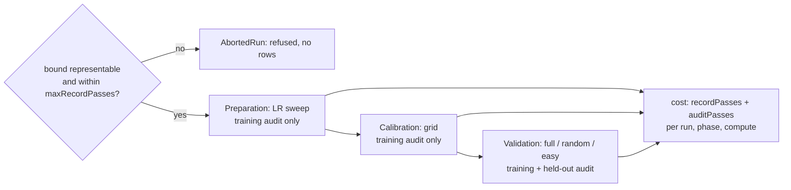

# PR summary — Issue #267 follow-up: record-skip harness hardening

## Summary

This PR follows up the easy-record skipping experiment that PR #270 merged.
It carries the work from the closed PR #288, which was based on the current
`Develop` tip, and fixes the two defects its review blocked on:

- The planned compute bound now uses checked arithmetic. A bound that cannot
  be represented in `u64` is refused before any run, where before it wrapped
  in release builds and panicked in debug builds.
- Preparation and calibration runs no longer read held-out records. A
  held-out record can therefore no longer change the chosen learning rate or
  schedule.

It also counts the measurement ("audit") passes that preparation and
calibration select on as a search cost, and regenerates the synthetic
evidence. Finally, it drops record-skip's own git probe:
`record_skip::git_commit` now formats the result of the shared
`weight_bench::provenance::git_state`.

The harness and its outputs, as of this head:

- a counted learning-rate preparation sweep (training MSE only);
- a predeclared `maxRecordPasses` compute limit, with the planned bound
  checked before any run;
- code, crate and neat-core versions plus the git commit in `summary.json`;
- per-arm means;
- failed runs charged with the passes they spent;
- runs that stop early (`AbortedRun`) keep their rows and costs, and the
  example writes them out;
- the method pinned to the authors' released code.

No success is claimed. The representative corpus run is an owner step and is
still outstanding, and the paper itself could not be read from this host.
Part of #267.

## Spec

### Intent and Rationale

- Preparation and calibration choices must depend on training data only. The
  issue says to separate calibration from untouched validation, and PR #288's
  review showed that a held-out NaN made every learning rate ineligible.
- Audit passes are counted apart from `record_passes`. This keeps the arms'
  training cost and the `maxRecordPasses` limit comparable with the earlier
  evidence, and still counts every search cost the issue asks for.

### Essential Design Decisions

- `refine_inner` takes `audit_held_out`, and `Runner::run_one` sets it only
  for the `validation` phase. The public `refine` always audits held-out
  records.
- `RunOutcome.finalValidationMse` is now `Option`. It is `null` on preparation
  and calibration rows (with `rareStratumValidationMse: null` and
  `strataValidationMse: []`). This changes the shape of `runs.jsonl`, but
  `runs.jsonl` is written and never read by code, and it is not committed. The
  manifest stays at version 2 because its shape is unchanged.
- An overflowing bound is reported as `plannedBoundRecordPasses` =
  `u64::MAX`. `planned` is reported as `usize::MAX` only when the run count
  itself overflows.
- `versions.gitCommit` comes from `weight_bench::provenance::git_state`, the
  probe `weight_router_bench` already uses (merged at the base by #282).
  `record_skip::git_commit` keeps only the string format: `<sha>`,
  `<sha>-dirty` or `unavailable: <cause>`. Its own `git` helper is deleted.
  The shared probe runs `git status --porcelain` without
  `--untracked-files=no`, so an untracked file now also marks the commit
  `-dirty`.
- `.gitleaks.toml` is restored to `Develop`'s content. PR #288's change to it
  was comments and indentation only, and it was out of scope.

### Undiscoverable Facts

- arXiv is still unreachable from this host. On 2026-11-18,
  `curl https://arxiv.org/abs/2611.10386` failed with `CONNECT tunnel failed,
  response 403`, and so did `export.arxiv.org`, the PDF, alphaXiv, Semantic
  Scholar and Hugging Face. `gh search code 2611.10386` found only abstract
  digests, not the full text. So the method stays pinned from the authors' released code at
  `804aedb`.
- A NaN or infinite training *input* does not fail a run, because the network
  sanitises inputs. Only a non-finite training *target* does. The
  training-side failure fixtures therefore use `train[0].outputs[0] = NaN`.
  The strata edges skip NaN, so the fixtures still bin correctly.

## Evidence

- Synthetic suite re-run at clean commit `327f8e8` with
  `cargo run --release --example record_skip_bench -- OUT_DIR`.
  `manifest.json` is byte-identical. In `summary.json` every field equals the
  committed run at `e13a19a` except `versions.gitCommit` and the new counts:
  `preparationCost.auditPasses` 96,000, `calibrationCost.auditPasses` 576,000,
  `validationCost.auditPasses` 420,000 and `compute.actualAuditPasses`
  1,092,000. All 24 preparation rows in `runs.jsonl` carry
  `"finalValidationMse":null`.
- Red before the fix, observed on this branch:
  - `a_compute_bound_that_overflows_is_refused_before_any_run` panicked at
    `experiment.rs` with "attempt to multiply with overflow".
  - `a_held_out_record_cannot_steer_preparation_or_calibration` aborted in
    preparation, with every row reading `refinement diverged: non-finite MSE`.
  - The audit-pass assertions did not compile (E0609, no field
    `audit_passes`).
- This is a backend/CLI change; there is no UI surface.

## Acceptance Criteria

<!-- vibe-spec-review inputs="diff+issue-body" -->

- **met** — Maintain per-record error EWMA during refinement; temporarily omit consistently easy examples while preserving rare strata and periodically sampling omitted records — evidence: `lamarck/src/record_skip/schedule.rs` (merged in #270), `lamarck/tests/record_skip.rs::easy_skip_record_passes_follow_the_rule` — reviewer: met
- **met** — Compare full data, matched random skipping and 25/50/75% processing reductions — evidence: `docs/evidence/record-skip/summary.json` (`arms`, `comparisons`) — reviewer: met
- **met** — Record scheduling/refresh cost, forgetting, stratum error, full fitness and untouched validation outcomes — evidence: `lamarck/tests/record_skip.rs::arms_summarise_validation_runs` — reviewer: met
- **met** — Do not prune fitness/validation records or share stale difficulty scores across incompatible parents/corpora — evidence: `lamarck/src/record_skip/experiment.rs` (`refine_inner` audits every training record, and every held-out record in validation runs), `lamarck/tests/record_skip.rs::easy_skip_record_passes_follow_the_rule` — reviewer: met
- **met** — Integrate the update path with Backpropagation if it owns the actual refinement implementation — evidence: `docs/easy-record-skipping.md` ("What is refined") — reviewer: met
- **partial** — Read and pin the full method before reproducing it — evidence: `docs/easy-record-skipping.md` ("Source", which records the fourth retry on 18 November) — reviewer: partial — reason: arXiv still returns 403 through this host's proxy and no full-text copy exists on GitHub, so the paper is not read; the method is pinned from the authors' released code at `804aedb`
- **met** — transfer to NEAT-AI remains experimental — evidence: `docs/easy-record-skipping.md` ("Status") — reviewer: met
- **partial** — First inspect current code, merged work and repository instructions. Reuse existing mechanisms — evidence: `lamarck/src/record_skip/experiment.rs::git_commit` (now formats `weight_bench::provenance::git_state`, and the duplicate `git` helper is deleted), `lamarck/tests/record_skip.rs::git_commit_names_the_commit_or_the_cause`, `lamarck/tests/record_skip.rs::stratum_edges_bin_first_targets` (the `output_strata` wrapper is removed); backprop and `creature_fingerprint` are reused — reviewer: partial — reason: the git probe duplication is fixed, but `record_skip/stats.rs` (`mean`, `bootstrap_mean_ci`, merged in #270) still duplicates `weight_bench/stats.rs` (`mean`, `bootstrap_ci_mean`). The two pick percentiles differently (floor/ceil against round), so switching would change the committed confidence bounds and needs the evidence regenerated. That is not done in this PR
- **met** — Opt-in experiment only; preserve ordinary behaviour, interfaces, immutable parents and full authoritative acceptance. No automatic deployment or default change — evidence: only `record_skip/` and its example change, `lamarck/tests/record_skip.rs::refine_full_lowers_train_mse_and_keeps_parent` — reviewer: met
- **met** — Predeclare controls, seeds, sample size, compute limits and success/failure criteria. Identify code/model/data versions; separate calibration from untouched validation — evidence: `lamarck/src/record_skip/experiment.rs::a_compute_bound_that_overflows_is_refused_before_any_run`, `lamarck/src/record_skip/experiment.rs::a_held_out_record_cannot_steer_preparation_or_calibration`, `lamarck/tests/record_skip.rs::learning_rate_sweep_is_counted_and_chooses_by_training_mse` — reviewer: met
- **met** — count all preparation/search costs — evidence: `lamarck/tests/record_skip.rs::audit_passes_are_counted_apart_from_record_passes`, `lamarck/src/record_skip/experiment.rs::failed_runs_charge_the_passes_they_spent` — reviewer: partial — reason: the reviewer's only gap was the uncounted audit passes that preparation and calibration select on; commit `01ba3bd`, after the review, counts them in `auditPasses` and `compute.actualAuditPasses`
- **partial** — Provide deterministic positive/negative correctness tests for new behaviour and pass the repository's normal quality checks — evidence: public-entry-point tests `lamarck/src/record_skip/experiment.rs::an_aborted_preparation_keeps_the_passes_it_spent` (real NaN-target corpus through `run_manifest`), `lamarck/tests/record_skip.rs::learning_rate_sweep_is_counted_and_chooses_by_training_mse`; `./quality.sh` passed on an earlier head (1007 tests, 0 failed) — reviewer: partial — reason: the rule that a rate which failed one calibration seed is never chosen (`choose_learning_rate`'s `n_runs != seeds` guard) has no test. No real input reaches it (a probe with rates up to `f64::MAX` on the synthetic corpus produced no failure, and a file corpus fails every run alike), and a test-only fault-injection seam was removed as non-behavioural
- **met** — Deliver a reproducible command/manifest and machine-readable results with paired distributions, uncertainty, failures and actual coverage — evidence: `lamarck/examples/record_skip_bench.rs`, `docs/evidence/record-skip/manifest.json`, `docs/evidence/record-skip/summary.json` — reviewer: met
- **partial** — Record negative findings and remove optional code that does not earn its maintenance cost — evidence: `docs/easy-record-skipping.md` ("Findings", "Maintenance cost", which now lists the removed duplicate git probe) — reviewer: partial — reason: the negative synthetic result is recorded and dead code is removed, but the decision on the harness itself waits for the representative run, and the duplicate stats helpers above remain
- **met** — Do not claim success before representative runs — evidence: `docs/easy-record-skipping.md` ("Status", "Findings"), `CHANGELOG.md` ("the representative corpus run is outstanding") — reviewer: met — reason: no success is claimed anywhere. The representative run on the owner's private corpus has still not been made (see "Not done")
- **met** — Keep public implementation and fixtures application-agnostic; private corpora/results and operational integration remain private — evidence: only synthetic evidence is committed — reviewer: met
- **unrequested** — `AbortedRun`, `write_aborted_outputs` and `run_manifest` returning `Box<AbortedRun>` — reviewer: unrequested — reason: a run that stops early must still report its failures, coverage and spent cost, which the issue requires; the old `String` error dropped them
- **unrequested** — refusal of manifest `version != 2` and of `maxRecordPasses == 0` — reviewer: unrequested — reason: the manifest shape changed (learning-rate grid, compute limit), so a version-1 file fails loudly instead of being misread
- **unrequested** — the 15 November network-retry log in the doc — reviewer: unrequested — reason: it records why the paper is not read, which the "read and pin" criterion needs on the record

## Standards Review

<!-- vibe-standards-review inputs="diff+CODING-STANDARDS.md" -->

- **clean** — The repository has no `CODING-STANDARDS.md`, so the reviewer used `CONTRIBUTING.md` and `README.md`. It found no violations and no review-only rules in them. It checked:
  - the changelog rule;
  - that every named test exists;
  - that there are no stubs of external binaries (the `git_commit` test runs real git);
  - that there are no workflow changes;
  - that the docs match the code (version-2 refusal, compute bound and overflow message, `phase == "validation"` gating, failed-run charging, `AbortedRun` outputs);
  - that the evidence matches `Manifest::predeclared()`;
  - that each changed test expectation still fails without its code.

## Test Plan

- Added (in-module tests in `lamarck/src/record_skip/experiment.rs`):
  - `a_compute_bound_that_overflows_is_refused_before_any_run`;
  - `a_representable_bound_over_the_limit_is_still_refused_exactly` (control);
  - `a_held_out_record_cannot_steer_preparation_or_calibration`. A clean corpus and the same corpus with only a NaN held-out target choose the same rate and schedule. The NaN run's validation rows all fail on "validation" and the clean run has no failures.
- Removed the `#[cfg(test)]` `test_support::DIVERGE` seam and its tests (`a_rate_that_fails_on_one_seed_is_not_chosen_and_its_cost_is_counted`, and `a_rate_that_missed_a_seed_is_never_chosen`, which called the private `choose_learning_rate`). They injected a failure no real run produces. Cost counting for failed runs stays covered through `run_manifest` by `an_aborted_preparation_keeps_the_passes_it_spent`, and rate choice by `learning_rate_sweep_is_counted_and_chooses_by_training_mse`.
  - Branch outcomes: the `n_runs != seeds` arm of `choose_learning_rate` — exempt (untestable): no real input reaches it (rates up to `f64::MAX` on the synthetic corpus all complete; a file corpus is the same for every seed and rate). Harnesses searched: `lamarck/tests/record_skip.rs` and the in-module tests call `run_manifest`/`run_validated` and cannot stage a one-seed failure.
- Added `lamarck/tests/record_skip.rs::audit_passes_are_counted_apart_from_record_passes`, which uses literal counts (200 audit passes per preparation and calibration row, 250 per validation row).
- Edited `failed_runs_charge_the_passes_they_spent` and `an_aborted_preparation_keeps_the_passes_it_spent` (fixture renamed `nan_training_source`). They now fail on a training target rather than a held-out one, assert that the error names "training", and assert the audit passes.
- Removed from `lamarck/tests/record_skip.rs`: `assert_ne!(e.mean_train_mse, Some(o.final_validation_mse));`
  - Required by: "separate calibration from untouched validation"
  - Replaced by: `assert_eq!(o.final_validation_mse, None);`, `assert!(o.strata_validation_mse.is_empty());` and `assert!(o.rare_stratum_validation_mse.is_none());` in the same file
- Removed from `lamarck/src/record_skip/experiment.rs`: `assert_eq!(report.coverage.planned, 10);`, `assert_eq!(report.coverage.completed, 8);` and `assert_eq!(runs.lines().count(), 10);`
  - Obsolete: before the counted preparation sweep, the plan had no preparation runs
  - Still covered by: `lamarck/src/record_skip/experiment.rs::refused_grid_point_is_reported_beside_a_valid_one` (now 14, 12 and 14)
- Removed from `lamarck/src/record_skip/experiment.rs`: `assert_eq!(report.calibration[0].n_pairs, 0);`, `assert!(report.calibration[0].mean_train_diff.is_none());`, `assert_eq!(report.calibration[1].n_pairs, 1);` and `assert!(report.calibration[1].mean_train_diff.is_some());`
  - Obsolete: the grid order was swapped so that preparation runs on a valid point
  - Still covered by: `lamarck/src/record_skip/experiment.rs::refused_grid_point_is_reported_beside_a_valid_one` (same assertions on the swapped indices) and `lamarck/src/record_skip/experiment.rs::schedule_choice_skips_a_refused_point_and_takes_the_lowest_diff`
- Removed from `lamarck/src/record_skip/experiment.rs`: `assert!(err.contains("no matched pairs"), "{err}");` in the warmup-zero case
  - Obsolete: with the preparation sweep, an all-failing manifest now stops in preparation
  - Still covered by: `lamarck/src/record_skip/experiment.rs::all_failed_calibration_names_the_first_failure` (reductions `[1.5]`)
- Removed from `lamarck/tests/record_skip.rs`: `assert_eq!(output_strata(&[2.5, 2.5, 2.5], 4), vec![0, 0, 0]);`
  - Removed functionality: the test-only `output_strata` wrapper. No production code called it.
  - Still covered by: `lamarck/tests/record_skip.rs::stratum_edges_bin_first_targets`
- Removed from `lamarck/tests/record_skip.rs`: `assert_eq!(a.coverage.planned, 4 + 6);`, `assert_eq!(a.coverage.completed, 10);` and `assert_eq!(runs.lines().count(), 10);`
  - Obsolete: the preparation sweep adds 4 runs
  - Still covered by: `lamarck/tests/record_skip.rs::smoke_run_is_complete_and_deterministic` (now 14)
- Changed `record_skip::git_commit` to format `weight_bench::provenance::git_state` and deleted its own `git` helper. The existing `lamarck/tests/record_skip.rs::git_commit_names_the_commit_or_the_cause` covers the format unchanged (clean `<sha>`, tracked-file change `<sha>-dirty`, non-repository `unavailable: …not a git repository`).
- Results:
  - `cargo test --lib record_skip`: 10 passed.
  - `cargo test --test record_skip`: 24 passed.
  - `cargo clippy --all-targets -- -D warnings`: clean.
  - `cargo fmt --check`: clean.
  - `cargo test --lib provenance`: 7 passed.
  - `./quality.sh < /dev/null` on the tree with the git-probe change: "All quality checks passed!" (1007 tests, 0 failed).

## Merge verification

- GitHub CI on the pushed head is not yet verified.

## Not done

- The representative experiment on the private creature and corpus. This is an owner step on a quiet machine, and its results stay private.
- Reading the paper. arXiv returns 403 from this host.
- The removal decision, which waits for the representative run.
- Folding `record_skip/stats.rs` into `weight_bench/stats.rs`. Their percentile rounding differs, so this needs the evidence regenerated.
- Not checked: CI on GitHub.
