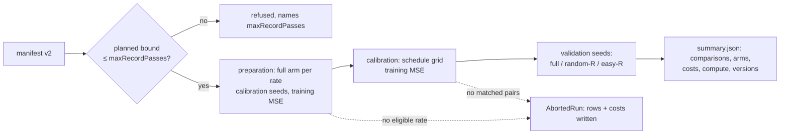

## Summary

Follow-up to #270, which merged the opt-in, offline easy-record skipping
experiment. This PR carries the work of #273, which was closed after its
review stalled, fast-forwarded onto `Develop` and finished here. It closes the
protocol gaps that can be closed in the sandbox:

- a predeclared compute limit, `maxRecordPasses`, checked before any run;
- the learning-rate search, now a counted **preparation** phase that chooses
  by training MSE only, instead of an uncounted hand sweep;
- the cost of failed and aborted runs, charged to their phase and kept on disk
  when a run stops early;
- code-version identity, recorded in `versions.gitCommit`;
- per-arm validation means in `summary.json` (`arms`), covering stratum error
  and forgetting.

On top of #273's last head (`d4935a4`) this PR also:

- asserts the premise of the partial-sweep test, which #273's last review
  left open;
- adds a test where a refused grid point sits between two valid ones, so a
  schedule selector that always takes the first point fails;
- regenerates `summary.json` on a clean commit. Every field matches the earlier
  evidence except `versions`, and the doc now says so.

The manifest format moves to version 2. Every comparison verdict is unchanged,
and the counted sweep picks 0.2. Nothing in the optimisation loop calls this
code, and no default changes. The paper text is still unreachable from the
sandbox, and the representative (private) run is still the owner's.
Part of #267.

## Spec

### Intent and Rationale

- The merged harness had a hand-run learning-rate sweep whose cost was never
  counted, no compute limit and no commit identity. Running the sweep through
  the harness makes it reproducible and charges it to the experiment.
- Per-arm stratum error and forgetting were hand-aggregated from an
  uncommitted `runs.jsonl`. `arms` puts them in the committed `summary.json`.
- #273 had one review finding left: its partial-sweep test did not assert the
  premise that makes it fail without the eligibility rule. Finishing #273 here
  keeps its reviewed code instead of redoing it.

### Essential Design Decisions

- The compute limit is checked **before** any run, against the bound planned
  runs × epochs × training records. In corpus mode the bound reads the loaded
  training count, not `trainRecords`. `compute.actualRecordPasses` includes the
  passes a failed run spent before it failed. A run that diverges fails only
  after every epoch, so its full cost is charged, in its `runs.jsonl` row and
  in its phase cost. `PhaseCost.runs` still counts completed runs only.
- A run that stops early is not lost: `run_manifest` returns
  `Err(Box<AbortedRun>)` with every row made so far and the costs, and
  `write_aborted_outputs` writes them (`summary.json` gains an `error`). A
  refusal before any run has no rows and writes nothing.
- The preparation phase uses only the calibration seeds and the full arm, and
  chooses by mean final **training** MSE. Only a rate that completed every
  calibration seed is eligible, because a mean over the survivors compares
  different corpora in synthetic mode. Manifest version 2 is breaking:
  `validate` refuses any other version, and a version-1 file fails to load.
- Assumption: the predeclared limit of 16,000,000 suits the synthetic suite.
  Corpus mode with the default manifest exceeds it (bound 136,080,000) and is
  refused, so the owner predeclares a limit for the private corpus in
  `--manifest FILE`.

### Undiscoverable Facts

- arXiv 2611.10386 is unreachable from the sandbox. At 2026-11-14T23:55Z and
  2026-11-15T00:03Z the abstract, PDF, mirrors and readers all returned
  `curl: (56) CONNECT tunnel failed, response 403`. This run retried the
  abstract at 2026-11-18T13:26Z and got the same 403. A further retry at
  2026-11-18T13:40Z (the abstract, the PDF, `export.arxiv.org`, Semantic
  Scholar, Hugging Face, alphaXiv and `r.jina.ai`) failed the same way.
- Backpropagation ownership: the update math is neat-core's
  `propagate_topological_loop` (NEAT-AI-core v0.23.7), reached through
  Lamarck's existing port. Skipping only chooses which records reach it.
- The synthetic suite took 14 s wall in release on a shared, parallel
  container, so the timing is indicative only.

## Evidence

Backend/CLI only, so there is no UI. Command:
`cargo run --release -p neat_ai_lamarck --example record_skip_bench -- OUT`,
run on commit `e13a19a` with a clean tree. Outputs:
[`docs/evidence/record-skip/summary.json`](../../evidence/record-skip/summary.json)
and [`manifest.json`](../../evidence/record-skip/manifest.json).

- Coverage: 252 of 252 runs completed, 0 failed. Versions: crate 0.1.50,
  neat-core v0.23.7, `gitCommit` `e13a19a9317894fdaa974b91e7bf86e74ff13d3e`.
- Compared with the earlier evidence (crate 0.1.47 at `da4edff`), with
  `versions` dropped from both, `summary.json` is identical, and
  `manifest.json` is byte-identical (`cmp`).
- Learning-rate sweep (6 calibration seeds per rate, mean final training
  MSE): 0.01 gave 0.2393, 0.05 gave 0.1055, 0.2 gave 0.0805 and 0.5 gave
  0.0906, so 0.2 was chosen.
- Cost in record passes:

  | Phase | Record passes |
  |---|---:|
  | Preparation | 1,440,000 |
  | Calibration | 4,464,000 |
  | Validation | 2,952,000 |

  The actual total was 8,856,000, against a planned bound of 15,120,000 and a
  limit of 16,000,000.
- At 25%, easy-skip is `worse` than random. At 50% and 75% it is
  `inconclusive`: overall error is lower, but rare-stratum error is higher. No
  easy-skip arm beats full data.

Owner step: write a corpus manifest with a `maxRecordPasses` predeclared for
the private corpus. Run corpus mode with it on a quiet machine, and keep the
results private. That run decides whether `record_skip/` stays.

## Acceptance Criteria

<!-- vibe-spec-review inputs="diff+issue-body" -->

- **met** — Maintain per-record error EWMA during refinement — evidence: `lamarck/tests/record_skip.rs::ewma_blends_observations` — reviewer: met
- **met** — temporarily omit consistently easy examples while preserving rare strata and periodically sampling omitted records — evidence: `lamarck/tests/record_skip.rs::stratum_edges_bin_first_targets`, `lamarck/tests/record_skip.rs::rare_stratum_is_protected` — reviewer: met
- **met** — Compare full data, matched random skipping and 25/50/75% processing reductions — evidence: `docs/evidence/record-skip/summary.json` (`full`, `random-25/50/75` and `easy-25/50/75` arms; `comparisons` pairs each easy arm with matched random and with full, 12 validation seeds, 95% bootstrap CI and a verdict), `lamarck/tests/record_skip.rs::random_skip_matches_easy_count_and_varies_with_seed`, `lamarck/tests/record_skip.rs::arms_summarise_validation_runs`, `lamarck/tests/record_skip.rs::smoke_run_is_complete_and_deterministic` — reviewer: met (re-reviewed on `6654803`: the comparison is synthetic only, and the representative run falls under the "Fixtures alone…" and "Do not claim success…" criteria)
- **met** — Record scheduling/refresh cost, forgetting, stratum error, full fitness and untouched validation outcomes — evidence: `lamarck/tests/record_skip.rs::arms_summarise_validation_runs` — reviewer: met
- **met** — Do not prune fitness/validation records or share stale difficulty scores across incompatible parents/corpora — evidence: `lamarck/tests/record_skip.rs::ensure_scope_refuses_other_parent_or_corpus` — reviewer: met
- **met** — Integrate the update path with Backpropagation if it owns the actual refinement implementation — evidence: `lamarck/src/record_skip/experiment.rs` (`refine_inner` drives `BackpropConfig`, `LearningPlan`/`LearningScan` over the kept records only, `calculate_learning_rate` and `apply_learnings` from `lamarck/src/backprop.rs`, running on neat-core's `propagate_topological_loop`), `lamarck/tests/record_skip.rs::refine_full_lowers_train_mse_and_keeps_parent`, `docs/easy-record-skipping.md` ("What is refined") — reviewer: met (re-reviewed on `6654803`: no repository named Backpropagation exists in `stSoftwareAU`, and the update path runs through the backprop code that performs the refinement; NEAT-AI's TypeScript trainer does not run Lamarck's refinement)
- **met** — First inspect current code, merged work and repository instructions. Reuse existing mechanisms; if functionality already exists, this issue still owns the missing controlled comparison rather than a second implementation. — evidence: the diff extends the merged `record_skip/` harness and refines through `BackpropConfig` and `apply_learnings` — reviewer: met
- **met** — Opt-in experiment only; preserve ordinary behaviour, interfaces, immutable parents and full authoritative acceptance. No automatic deployment or default change. — evidence: `lamarck/tests/record_skip.rs::refine_full_lowers_train_mse_and_keeps_parent` — reviewer: met
- **met** — Predeclare controls, seeds, sample size, compute limits and success/failure criteria. Identify code/model/data versions; separate calibration from untouched validation and count all preparation/search costs. — evidence: `lamarck/tests/record_skip.rs::compute_limit_refuses_a_manifest_over_budget`, `lamarck/tests/record_skip.rs::files_mode_compute_bound_uses_the_loaded_training_count`, `lamarck/tests/record_skip.rs::learning_rate_sweep_is_counted_and_chooses_by_training_mse`, `lamarck/tests/record_skip.rs::git_commit_names_the_commit_or_the_cause`, `lamarck/src/record_skip/experiment.rs::a_rate_that_fails_on_one_seed_is_not_chosen_and_its_cost_is_counted`, `lamarck/src/record_skip/experiment.rs::an_aborted_preparation_keeps_the_passes_it_spent` — reviewer: met
- **met** — Provide deterministic positive/negative correctness tests for new behaviour and pass the repository's normal quality checks. Research runs are separate from routine feature CI. — evidence: `lamarck/tests/record_skip.rs::manifest_refusals`, `lamarck/tests/record_skip.rs::version_1_manifest_file_fails_loudly`, `lamarck/src/record_skip/experiment.rs::schedule_choice_skips_a_refused_point_and_takes_the_lowest_diff`; `./quality.sh` result in the Test Plan — reviewer: met
- **met** — Deliver a reproducible command/manifest and machine-readable results with paired distributions, uncertainty, failures and actual coverage. Fixtures alone do not demonstrate an optimisation benefit. — evidence: `docs/evidence/record-skip/summary.json` (252/252, `validationDiffs`, CIs); the re-run on `e13a19a` matched every field except `versions` — reviewer: met
- **met** — Record negative findings and remove optional code that does not earn its maintenance cost. Do not claim success before representative runs. — evidence: `docs/easy-record-skipping.md` ("Findings": negative and inconclusive verdicts, "Nothing is ported, and no success is claimed"; "Maintenance cost": the removed code and the removal rule); `schedule::output_strata` and `LEARNING_RATE` removed — reviewer: met (re-reviewed on `6654803`: every remaining `pub fn` in `record_skip/` has a caller; the rest of the harness is kept as the instrument for the representative run, under a written removal rule. The keep-or-delete decision after that run is the owner step)
- **met** — Keep public implementation and fixtures application-agnostic; private corpora/results and operational integration remain private. — evidence: synthetic fixtures only — reviewer: met
- **partial** — Read and pin the full method before reproducing it — evidence: `docs/easy-record-skipping.md` ("Source": the pin at `804aedb` covers DNABERT-2, Nucleotide Transformer and HyenaDNA) — reviewer: partial — reason: the paper text is still unread, because the proxy refuses arXiv and every mirror (403, retried again at 2026-11-18T13:40Z; see Undiscoverable Facts). The pinned code repository holds no paper text. Someone with open web access must read the paper and check the pin against it.
- **met** — Leave unassigned until an implementer actively starts. — evidence: the issue is assigned to the worker claim working it — reviewer: missing — reason: the reviewer said "not verifiable from a diff". It is an issue-process step, and an implementer has started.
- **unrequested** — `.gitleaks.toml` drops an empty allowlist and re-indents `useDefault` — reviewer: unrequested — reason: gitleaks 8.30 rejected the empty allowlist, and #273's CI could not pass without the fix.
- **unrequested** — the example prints the chosen learning rate and git commit; `#[allow(clippy::too_many_arguments)]` on `refine` and `refine_inner` — reviewer: unrequested — reason: incidental to adding the preparation phase and the `learning_rate` argument.
- **unrequested** — the `#[cfg(test)]` `test_support::DIVERGE` hook in `Runner::run_one` — reviewer: unrequested — reason: no real rate diverges deterministically (the update clips), so a partly failed sweep can only be driven through `run_validated` with this test-only seam.

## Standards Review

<!-- vibe-standards-review inputs="diff+CODING-STANDARDS.md" -->

- **clean** — the repository has no `CODING-STANDARDS.md`, so the reviewer checked against `CONTRIBUTING.md` and the README's "Build and quality gate" section. Neither names a review-only rule. It found no violation. It checked:
  - the changelog entry under `[Unreleased]`, and that the version is not behind `Develop`;
  - that every test named exists, and that no stub stands in for another repository's binary (`git_commit` runs real git in a temp repo);
  - the new paths: the bound checked before any run, failed runs charged through `Spend`, rate eligibility, `AbortedRun` written only with rows, and the version-2 refusals;
  - the evidence arithmetic (bounds, phase passes, coverage 252 = 24 + 144 + 84);
  - that each changed expectation in an existing test still fails without its code.
  - Its optional notes: the reordered grid points left "a refused first point is never chosen" unguarded (now guarded by `schedule_choice_skips_a_refused_point_and_takes_the_lowest_diff`), and the evidence and doc said crate 0.1.47 (now regenerated at 0.1.50).

## Test Plan

- Added to `lamarck/tests/record_skip.rs`:
  - `version_1_manifest_file_fails_loudly`: the merged version-1 `manifest.json` fails to load, naming a missing field.
  - `compute_limit_refuses_a_manifest_over_budget`: bound − 1 is refused, naming `maxRecordPasses`, with no rows. At exactly the bound the run is accepted. With the default limit of 16,000,000 the planned bound is 14 × 4 × 100 = 5,600, so the two fields cannot be swapped unnoticed.
  - `learning_rate_sweep_is_counted_and_chooses_by_training_mse`: each sweep entry equals that seed's preparation `finalTrainMse` and differs from its `finalValidationMse`.
  - `files_mode_compute_bound_uses_the_loaded_training_count`: 120 loaded training records against `trainRecords` 100; the bound is accepted and one pass less is refused.
  - `arms_summarise_validation_runs`; `git_commit_names_the_commit_or_the_cause` (a hash, `-dirty`, and `unavailable: … not a git repository`).
  - `manifest_refusals` gained version 1, an empty `learningRateGrid`, a rate of 0.0 and `maxRecordPasses` 0, beside the predeclared control.
- Added to `lamarck/src/record_skip/experiment.rs` (unit tests):
  - `a_rate_that_fails_on_one_seed_is_not_chosen_and_its_cost_is_counted`: the rate that wins a clean two-seed sweep diverges on seed 2 only. Its survivor-only mean is asserted to be below the runner-up's, yet the runner-up that completed both seeds is chosen, in the report and in `summary.json`. The failed run's passes are in `preparationCost`, `actualRecordPasses` and its `runs.jsonl` row.
  - `schedule_choice_skips_a_refused_point_and_takes_the_lowest_diff`: grid `[0.5/0.1, 0.0/0.1 (refused), 0.8/0.3]`. The refused point has no diff, the third point's diff is asserted below the first's, and 0.8/0.3 is chosen.
  - `all_failed_calibration_names_the_first_failure` (`reductions = [1.5]`: "no matched pairs", "first failure: random-150 seed 1 calibration", "invalid reduction") and `all_failed_preparation_names_the_first_failure`.
  - `a_rate_that_missed_a_seed_is_never_chosen`, `an_aborted_preparation_keeps_the_passes_it_spent`, `an_aborted_calibration_keeps_the_preparation_cost`, `failed_runs_charge_the_passes_they_spent`.
- `stratum_edges_bin_first_targets` replaces `output_strata_bins`, with the same inputs and bins, through `StratumEdges::from_values` and `StratumEdges::assign`.
- `cargo test --lib record_skip` on `f391a22`: 9 passed. `cargo fmt --check` and `cargo clippy --lib --tests -- -D warnings`: clean.
- `timeout 1500 ./quality.sh < /dev/null` passed on `e13a19a` (exit 0, "All quality checks passed!"), including clippy `-D warnings`, the full test suite (with the 23 tests in `lamarck/tests/record_skip.rs`), rustdoc, codespell and markdownlint. It passed again on `65b7b97`, which holds every code, test and evidence change in this PR (exit 0, "All quality checks passed!").
- Removed from `lamarck/src/record_skip/experiment.rs`: `assert_eq!(report.coverage.planned, 10);`
  - Obsolete: the plan had no preparation phase. Still covered by: `lamarck/src/record_skip/experiment.rs::refused_grid_point_is_reported_beside_a_valid_one`. Replaced by: `assert_eq!(report.coverage.planned, 14);`
- Removed from `lamarck/src/record_skip/experiment.rs`: `assert_eq!(report.coverage.completed, 8);`
  - Obsolete: four preparation runs were added. Still covered by: `lamarck/src/record_skip/experiment.rs::refused_grid_point_is_reported_beside_a_valid_one`. Replaced by: `assert_eq!(report.coverage.completed, 12);`
- Removed from `lamarck/src/record_skip/experiment.rs`: `assert_eq!(report.calibration[0].n_pairs, 0);`, `assert!(report.calibration[0].mean_train_diff.is_none());`, `assert_eq!(report.calibration[1].n_pairs, 1);` and `assert!(report.calibration[1].mean_train_diff.is_some());`
  - Obsolete: the refused grid point moved second, because preparation runs on the first point. Still covered by: `lamarck/src/record_skip/experiment.rs::refused_grid_point_is_reported_beside_a_valid_one` and `lamarck/src/record_skip/experiment.rs::schedule_choice_skips_a_refused_point_and_takes_the_lowest_diff`. Replaced by: `assert_eq!(report.calibration[1].n_pairs, 0);`, `assert!(report.calibration[1].mean_train_diff.is_none());`, `assert_eq!(report.calibration[0].n_pairs, 1);` and `assert!(report.calibration[0].mean_train_diff.is_some());`
- Removed from `lamarck/src/record_skip/experiment.rs`: `assert_eq!(runs.lines().count(), 10);`
  - Obsolete: four preparation rows were added. Still covered by: `lamarck/src/record_skip/experiment.rs::refused_grid_point_is_reported_beside_a_valid_one`. Replaced by: `assert_eq!(runs.lines().count(), 14);`
- Removed from `lamarck/src/record_skip/experiment.rs::all_failed_preparation_names_the_first_failure` (the base's `all_failed_calibration_names_the_first_failure`): `assert!(err.contains("no matched pairs"), "{err}");` and `err.contains("first failure: random-50 seed 1 calibration"),`
  - Obsolete: an invalid sole grid point now fails at preparation first. Still covered by: `lamarck/src/record_skip/experiment.rs::all_failed_calibration_names_the_first_failure`, restored with an out-of-range reduction.
- Removed from `lamarck/tests/record_skip.rs`: `assert_eq!(a.coverage.planned, 4 + 6);`, `assert_eq!(a.coverage.completed, 10);` and `assert_eq!(runs.lines().count(), 10);`
  - Obsolete: the smoke manifest gained four preparation runs. Still covered by: `lamarck/tests/record_skip.rs::smoke_run_is_complete_and_deterministic`. Replaced by: `assert_eq!(a.coverage.planned, 4 + 6 + 4);`, `assert_eq!(a.coverage.completed, 14);` and `assert_eq!(runs.lines().count(), 14);`
- Removed from `lamarck/tests/record_skip.rs`: `let full = refine(&parent, &corpus, &scope, &SkipPolicy::Full, &cfg, &m, 1).unwrap();` and `let err = refine(&parent, &corpus, &wrong, &SkipPolicy::Full, &cfg, &m, 1).unwrap_err();`
  - Obsolete: `refine` takes the learning rate as an argument; 0.2 equals the removed constant. Still covered by: `lamarck/tests/record_skip.rs::refine_full_lowers_train_mse_and_keeps_parent` and `lamarck/tests/record_skip.rs::ensure_scope_refuses_other_parent_or_corpus`.
- Removed from `lamarck/tests/record_skip.rs`: `output_strata(&[0.0, 1.0, 2.0, 3.0, 4.0], 4)` and `assert_eq!(output_strata(&[2.5, 2.5, 2.5], 4), vec![0, 0, 0]);`
  - Removed functionality: `schedule::output_strata`, which only this test called. Still covered by: `lamarck/tests/record_skip.rs::stratum_edges_bin_first_targets`, with the same inputs and bins.
- Callers of `refine` checked: the tests above, and `Runner::run_one`, which calls the private `refine_inner` so a failed run's spent passes can be read.
- Docs swept: `docs/easy-record-skipping.md` (protocol table, Versions row, Backpropagation ownership, Results, Findings, How to run, Outstanding) and `CHANGELOG.md`. A grep on the head for `0.1.47`, `v0.23.4` and "apart from `versions.gitCommit`" in that doc finds nothing.

## Merge verification

- GitHub CI on the pushed branch: not yet observed.
- Code review: pending.

Not done:

- reading the paper text (the proxy refuses arXiv);
- the representative corpus run and the keep-or-remove decision (owner step);
- wiring the skip schedule into NEAT-AI's trainer (waits for a benefit).

Remaining risk: the synthetic outcome may not carry over to real creatures and
corpora.

🤖 Generated with [Claude Code](https://claude.com/claude-code)
