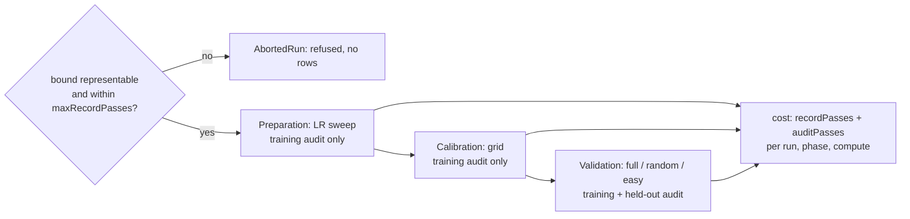

# PR summary — Issue #267 follow-up: record-skip harness hardening

## Summary

This PR follows up the easy-record skipping experiment that PR #270 merged.
It carries the work of the closed PR #289 onto the current `Develop` tip and
fixes the finding its review blocked on: a test-only fault-injection seam.

- The `#[cfg(test)]` divergence hook in `Runner::run_one` is removed, along
  with the two tests that used it or called the private learning-rate
  selector. No real learning rate diverges on one calibration seed but not
  another, so that scenario was manufactured. The failed-run cost assertions
  now run through the public `run_manifest`.
- `record_skip::stats::mean` and `bootstrap_mean_ci` now call the shared
  `weight_bench::stats` helpers instead of duplicating them. The regenerated
  evidence is unchanged.
- `DifficultyTracker::ewma`, a public accessor that only a test called, is
  removed. The integration test checks which record easy-skip keeps.
  A sweep found no other public item in `record_skip/` used only by tests.

Carried from PR #289, on top of PR #270:

- a counted learning-rate preparation sweep (training MSE only);
- a predeclared `maxRecordPasses` compute limit, with the planned bound
  checked (overflow-safe) before any run;
- held-out records read only by validation-phase runs;
- audit passes counted apart from record passes;
- code, crate and neat-core versions plus the git commit in `summary.json`,
  with the git probe shared with `weight_bench::provenance::git_state`;
- per-arm means;
- failed runs charged with the passes they spent;
- runs that stop early (`AbortedRun`) keep their rows and costs;
- the method pinned to the authors' released code.

No success is claimed. The representative corpus run is an owner step and is
still outstanding, and the paper itself could not be read from this host.
Part of #267.

## Spec

### Intent and Rationale

- The review of PR #289 rejected a `cfg(test)` branch that turned a successful
  refinement into an error. Running the real code showed that no rate from
  1e2 to 1e300 diverges on the synthetic corpus, and a file corpus is the same
  for every seed. The scenario cannot occur, so it is removed rather than
  re-staged.
- Preparation and calibration choices depend on training data only. This is
  the issue's "separate calibration from untouched validation".

### Essential Design Decisions

- `choose_learning_rate` keeps its rule that a rate must complete every
  calibration seed. It is a defensive guard that no input reaches today; its
  doc comment and `docs/easy-record-skipping.md` say so. No test reaches that
  case, because the only way to stage one was the removed seam.
- `record_skip::stats::{mean, bootstrap_mean_ci}` stay as thin adapters, so
  their NaN-for-empty contract and the ~20 call sites are unchanged. At 2000
  resamples the old and shared bootstraps pick the same order statistics
  (50 and 1949) from the same draws.
- Tests use the private `run_validated` only for values `Manifest::validate`
  refuses (`ewmaAlpha` 0, `warmupEpochs` 0, reduction 1.5), which no public
  path can reach.
- `RunOutcome.finalValidationMse` is `null` on preparation and calibration
  rows. `runs.jsonl` is written, never read by code, and not committed; the
  manifest stays at version 2.

### Undiscoverable Facts

- arXiv is still unreachable from this host. On 2026-11-18 at 21:00Z,
  `curl` to the abstract, the PDF, `export.arxiv.org`, alphaXiv, Hugging Face,
  the Wayback Machine, Semantic Scholar and `r.jina.ai` failed with
  `CONNECT tunnel failed, response 403`, and the web-fetch tool's proxy refused
  the PDF. The authors' repository is still at `804aedb`, with no paper copy. The method stays pinned from the
  authors' released code at `804aedb`.
- A NaN or infinite training *input* does not fail a run, because the network
  sanitises inputs. Only a non-finite training *target* does, so the
  training-side failure fixtures use `train[0].outputs[0] = NaN`.
- `scripts/bump-lamarck-version.sh --base-ref origin/Develop` skipped the bump
  because an older auto-increment commit (`a6bcc83`) is on the branch, while
  the version still equalled the base. The bump to 0.1.51 was made by hand.

## Evidence

- Divergence probe: a scratch example (deleted) ran `run_manifest` with
  `learningRateGrid` `[0.05, X]` for X in 1e2, 1e4, 1e8, 1e15, 1e30, 1e100 and
  1e300, on 8 calibration seeds. Every rate completed all 8 seeds
  (`sweep [(0.05, 8), (X, 8)]`).
- Synthetic suite re-run with
  `cargo run --release --example record_skip_bench -- OUT_DIR`:
  - at clean commit `6cc10f6` (shared stats): `manifest.json` was
    byte-identical, and `summary.json` matched the committed file in every
    field except `versions.gitCommit`;
  - at clean commit `9cdf29f` (crate 0.1.51): the same, with
    `versions.crate` 0.1.51. This is the committed evidence.
- This is a backend/CLI change; there is no UI surface.

## Acceptance Criteria

<!-- vibe-spec-review inputs="diff+issue-body" -->

- **met** — Maintain per-record error EWMA during refinement; temporarily omit consistently easy examples while preserving rare strata and periodically sampling omitted records — evidence: `lamarck/src/record_skip/schedule.rs` (merged in #270), `lamarck/tests/record_skip.rs::easy_skip_record_passes_follow_the_rule` — reviewer: met
- **met** — Compare full data, matched random skipping and 25/50/75% processing reductions — evidence: `docs/evidence/record-skip/summary.json` (`arms`, `comparisons`) — reviewer: met
- **met** — Record scheduling/refresh cost, forgetting, stratum error, full fitness and untouched validation outcomes — evidence: `lamarck/tests/record_skip.rs::arms_summarise_validation_runs` — reviewer: met
- **met** — Do not prune fitness/validation records or share stale difficulty scores across incompatible parents/corpora — evidence: `lamarck/src/record_skip/experiment.rs` (`refine_inner` audits every training record, and every held-out record in validation runs), `lamarck/tests/record_skip.rs::easy_skip_record_passes_follow_the_rule` — reviewer: met
- **met** — Integrate the update path with Backpropagation if it owns the actual refinement implementation — evidence: `docs/easy-record-skipping.md` ("Backpropagation ownership") — reviewer: met
- **partial** — Read and pin the full method before reproducing it — evidence: `docs/easy-record-skipping.md` ("Source") — reviewer: partial — reason: arXiv still returns 403 through this host's proxy (fifth retry, 2026-11-18 21:00Z), so the paper is not read; the method is pinned from the authors' released code at `804aedb`, and someone with arXiv access must read the paper and confirm or correct that pin
- **met** — transfer to NEAT-AI remains experimental — evidence: `docs/easy-record-skipping.md` ("Status") — reviewer: met
- **met** — First inspect current code, merged work and repository instructions. Reuse existing mechanisms — evidence: `lamarck/src/record_skip/stats.rs` (calls `weight_bench::stats`), `lamarck/src/record_skip/experiment.rs::git_commit` (formats `weight_bench::provenance::git_state`), `lamarck/tests/record_skip.rs::git_commit_names_the_commit_or_the_cause`, `lamarck/tests/record_skip.rs::stratum_edges_bin_first_targets` — reviewer: met
- **met** — Opt-in experiment only; preserve ordinary behaviour, interfaces, immutable parents and full authoritative acceptance. No automatic deployment or default change — evidence: only `record_skip/`, its example, tests and docs change; `lamarck/tests/record_skip.rs::refine_full_lowers_train_mse_and_keeps_parent` — reviewer: met
- **met** — Predeclare controls, seeds, sample size, compute limits and success/failure criteria — evidence: `docs/evidence/record-skip/manifest.json`, `lamarck/tests/record_skip.rs::compute_limit_refuses_a_manifest_over_budget`, `lamarck/src/record_skip/experiment.rs::a_compute_bound_that_overflows_is_refused_before_any_run` — reviewer: met
- **met** — Identify code/model/data versions — evidence: `versions` in `docs/evidence/record-skip/summary.json`, `lamarck/tests/record_skip.rs::git_commit_names_the_commit_or_the_cause` — reviewer: met
- **met** — separate calibration from untouched validation — evidence: `lamarck/src/record_skip/experiment.rs::a_held_out_record_cannot_steer_preparation_or_calibration` — reviewer: met
- **met** — count all preparation/search costs — evidence: `lamarck/tests/record_skip.rs::audit_passes_are_counted_apart_from_record_passes`, `lamarck/tests/record_skip.rs::learning_rate_sweep_is_counted_and_chooses_by_training_mse`, `lamarck/src/record_skip/experiment.rs::an_aborted_preparation_keeps_the_passes_it_spent` — reviewer: met
- **met** — Provide deterministic positive/negative correctness tests for new behaviour and pass the repository's normal quality checks — evidence: `./quality.sh` on `d37cfaf` exited 0 (1004 tests passed, 0 failed); `lamarck/tests/record_skip.rs::easy_skip_ranks_records_by_smoothed_error` checks the selected record before and after repeated observations reverse its smoothed ranking; the failed-run tests go through `run_manifest` with no injected failure — reviewer: met
- **met** — Research runs are separate from routine feature CI — evidence: `lamarck/examples/record_skip_bench.rs`; tests use the `tiny()` and `smoke()` manifests — reviewer: met
- **met** — Deliver a reproducible command/manifest and machine-readable results with paired distributions, uncertainty, failures and actual coverage — evidence: `lamarck/examples/record_skip_bench.rs`, `docs/evidence/record-skip/manifest.json`, `docs/evidence/record-skip/summary.json` — reviewer: met
- **met** — Fixtures alone do not demonstrate an optimisation benefit — evidence: `docs/easy-record-skipping.md` ("Findings"), which claims no benefit — reviewer: met
- **met** — Record negative findings and remove optional code that does not earn its maintenance cost — evidence: `docs/easy-record-skipping.md` ("Findings", "Maintenance cost", removal rule), `lamarck/tests/record_skip.rs::easy_skip_ranks_records_by_smoothed_error` (the test-only `DifficultyTracker::ewma` accessor is removed; no other public item lacks a non-test caller) — reviewer: met
- **met** — Do not claim success before representative runs — evidence: `docs/easy-record-skipping.md` ("Status"), `CHANGELOG.md` — reviewer: met
- **met** — Keep public implementation and fixtures application-agnostic; private corpora/results and operational integration remain private — evidence: only synthetic evidence is committed — reviewer: met
- **unrequested** — `AbortedRun`, `write_aborted_outputs` and `run_manifest` returning `Box<AbortedRun>` — reviewer: unrequested — reason: a run that stops early must still report failures, coverage and spent cost, which the issue requires; a bare `String` error dropped them
- **unrequested** — refusal of manifest `version != 2` and `maxRecordPasses == 0`, with `version_1_manifest_file_fails_loudly` — reviewer: unrequested — reason: the manifest shape changed, so a version-1 file fails loudly instead of being misread
- **unrequested** — `schedule_choice_skips_a_refused_point_and_takes_the_lowest_diff` — reviewer: unrequested — reason: pins the calibration choice after the preparation phase changed the grid order in the existing refused-grid test
- **unrequested** — the network-retry log and search fragments in `docs/easy-record-skipping.md` ("Source") — reviewer: unrequested — reason: it records why the paper is not read, which the "read and pin" criterion needs

## Standards Review

<!-- vibe-standards-review inputs="diff+CODING-STANDARDS.md" -->

- **violation** — a test named as evidence did not exist (`failed_runs_charge_the_passes_they_spent`) — evidence: `docs/archive/pr-summaries/pr-summary-267.md:322` — reason: fixed in this diff; the summary was rewritten and now cites `an_aborted_preparation_keeps_the_passes_it_spent`
- **violation** — crate version not bumped for changes under `lamarck/src/` (CONTRIBUTING.md "Version bumping") — evidence: `lamarck/Cargo.toml:3` — reason: fixed in this diff; bumped to 0.1.51 in `9cdf29f`, with `Cargo.lock` in sync and the evidence regenerated at that commit
- **violation** — the PR summary still described duplicated stats helpers and the removed `test_support::DIVERGE` seam — evidence: `docs/archive/pr-summaries/pr-summary-267.md:319` — reason: fixed in this diff; the summary was rewritten against the head
- **clean** — The repository has no `CODING-STANDARDS.md`, so the reviewer used `CONTRIBUTING.md` and `README.md`; neither has a review-only rule. It checked: the changelog entry, no stubs of external binaries (the `git_commit` test runs real git), no workflow changes, docs against code (version-2 refusal, overflow message, `phase == "validation"` gating, failed-run charging, `AbortedRun` outputs, the bootstrap order-statistics claim), no test-only production seams (`audit_held_out` is set by production code), private `run_validated` used only for values `validate` refuses, and that each changed test expectation still fails without its code.

## Test Plan

- Removed from this branch (never on `Develop`): the `#[cfg(test)]`
  divergence hook and the tests
  `a_rate_that_fails_on_one_seed_is_not_chosen_and_its_cost_is_counted`,
  `a_rate_that_missed_a_seed_is_never_chosen` and
  `failed_runs_charge_the_passes_they_spent`. The last one's per-row checks
  (error names "diverged" and "training", record, audit and schedule passes,
  phase, `"auditPasses"` in `runs.jsonl`) now sit in
  `lamarck/src/record_skip/experiment.rs::an_aborted_preparation_keeps_the_passes_it_spent`,
  which runs through `run_manifest`.
- `a_compute_bound_that_overflows_is_refused_before_any_run` and
  `a_representable_bound_over_the_limit_is_still_refused_exactly` now call
  `run_manifest`, with a premise that the manifest validates.
- Other tests in `lamarck/src/record_skip/experiment.rs`:
  `a_held_out_record_cannot_steer_preparation_or_calibration`,
  `an_aborted_calibration_keeps_the_preparation_cost`,
  `all_failed_preparation_names_the_first_failure`,
  `schedule_choice_skips_a_refused_point_and_takes_the_lowest_diff`. In
  `lamarck/tests/record_skip.rs`:
  `audit_passes_are_counted_apart_from_record_passes`,
  `learning_rate_sweep_is_counted_and_chooses_by_training_mse`,
  `compute_limit_refuses_a_manifest_over_budget`,
  `files_mode_compute_bound_uses_the_loaded_training_count`,
  `version_1_manifest_file_fails_loudly`.
- Removed from `lamarck/src/record_skip/experiment.rs`: `assert_eq!(report.coverage.planned, 10);`, `assert_eq!(report.coverage.completed, 8);` and `assert_eq!(runs.lines().count(), 10);`
  - Obsolete: before the counted preparation sweep, the plan had no preparation runs
  - Still covered by: `lamarck/src/record_skip/experiment.rs::refused_grid_point_is_reported_beside_a_valid_one` (now 14, 12 and 14)
- Removed from `lamarck/src/record_skip/experiment.rs`: `assert_eq!(report.calibration[0].n_pairs, 0);`, `assert!(report.calibration[0].mean_train_diff.is_none());`, `assert_eq!(report.calibration[1].n_pairs, 1);` and `assert!(report.calibration[1].mean_train_diff.is_some());`
  - Obsolete: the grid order was swapped so that preparation runs on a valid point
  - Still covered by: `lamarck/src/record_skip/experiment.rs::refused_grid_point_is_reported_beside_a_valid_one` (same assertions on the swapped indices)
- Removed from `lamarck/src/record_skip/experiment.rs`: `assert!(err.contains("no matched pairs"), "{err}");` in the warmup-zero case
  - Obsolete: with the preparation sweep, an all-failing manifest now stops in preparation
  - Still covered by: `lamarck/src/record_skip/experiment.rs::all_failed_calibration_names_the_first_failure` (reductions `[1.5]`)
- Removed from `lamarck/tests/record_skip.rs`: `assert_eq!(output_strata(&[2.5, 2.5, 2.5], 4), vec![0, 0, 0]);` and the `output_strata(&[0.0, 1.0, 2.0, 3.0, 4.0], 4)` assertion
  - Removed functionality: the test-only `output_strata` wrapper. No production code called it.
  - Still covered by: `lamarck/tests/record_skip.rs::stratum_edges_bin_first_targets`
- Removed from `lamarck/tests/record_skip.rs`: `assert_eq!(a.coverage.planned, 4 + 6);`, `assert_eq!(a.coverage.completed, 10);` and `assert_eq!(runs.lines().count(), 10);`
  - Obsolete: the preparation sweep adds 4 runs
  - Still covered by: `lamarck/tests/record_skip.rs::smoke_run_is_complete_and_deterministic` (now 14)
- Replaced in `lamarck/tests/record_skip.rs`: `ewma_blends_observations` (its `t.ewma(0)` assertions)
  - Removed functionality: the test-only `DifficultyTracker::ewma` accessor. `select` reads the field directly.
  - Still covered by: `lamarck/tests/record_skip.rs::easy_skip_ranks_records_by_smoothed_error` (selection follows the smoothed ranking and `last_seen` returns the latest error)
- After the `ewma` removal: `cargo test --lib record_skip` 10 passed,
  `cargo test --test record_skip` 23 passed, `cargo clippy --all-targets -- -D warnings`
  clean, `cargo fmt --check` clean. The full `./quality.sh` is re-run by the worker.
- Results on the earlier code head `d37cfaf`:
  - `cargo test --lib record_skip`: 9 passed.
  - `cargo test --test record_skip`: 24 passed.
  - `cargo clippy --all-targets -- -D warnings`: clean.
  - `./quality.sh < /dev/null`: exit 0, "All quality checks passed!" (1004 tests passed, 0 failed).

## Merge verification

- GitHub CI on the pushed head is not yet verified.

## Not done

- The representative experiment on the private creature and corpus. This is an owner step on a quiet machine, and its results stay private.
- Reading the paper. arXiv returns 403 from this host.
- The keep-or-delete decision on the harness, which the predeclared removal rule makes once the representative run is in (or at the next release).
- No test reaches the partly-completed-rate guard in `choose_learning_rate`; no real input reaches it today.
- Not checked: CI on GitHub.
