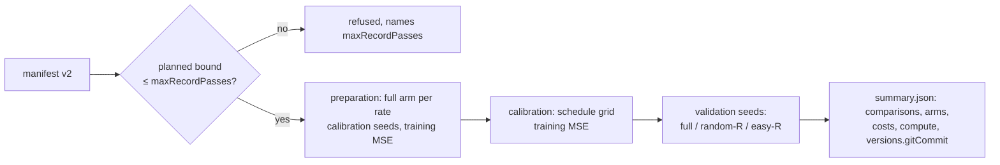

## Summary

Follow-up to #270, which merged the opt-in, offline easy-record skipping
experiment. Its review left gaps in the predeclared protocol. This PR closes
the ones that can be closed in the sandbox:

- a predeclared compute limit, `maxRecordPasses`, checked before any run;
- the learning-rate search, now a counted **preparation** phase that chooses
  by training MSE only, instead of an uncounted hand sweep;
- code-version identity, recorded in `versions.gitCommit`;
- per-arm validation means in `summary.json` (`arms`), covering stratum error
  and forgetting.

The manifest format moves to version 2, and the synthetic suite was re-run
from a clean commit. Every comparison verdict is unchanged, and the counted
sweep picks 0.2 again. Nothing in the optimisation loop calls this code, and
no default changes.

The method pin now also covers the authors' HyenaDNA (accuracy and perplexity)
and Nucleotide Transformer scripts. A web search could quote fragments of the
PDF, but the paper text itself is still unreachable from the sandbox. The
test-only `schedule::output_strata` wrapper is removed. The representative
(private) run is still the owner's. Part of #267.

## Spec

### Intent and Rationale

- The merged harness had a hand-run learning-rate sweep whose cost was never
  counted, no compute limit and no commit identity. Running the sweep through
  the harness makes it both reproducible and charged to the experiment.
- Per-arm stratum error and forgetting were hand-aggregated from an
  uncommitted `runs.jsonl`. `arms` puts them in the committed `summary.json`.

### Essential Design Decisions

- The compute limit is checked **before** any run, against the bound
  planned runs × epochs × training records. A run can never process more
  records than this, so the check cannot be passed by a run that later
  overspends. `compute.actualRecordPasses` reports what was spent, including the
  passes a failed run spent before it failed. A run that diverges fails only
  after every epoch, so its full cost is charged, in its `runs.jsonl` row
  (`recordPasses`, `revisitPasses`, `scheduleOps`) and in its phase cost.
  `PhaseCost.runs` still counts completed runs only.
- Manifest version 2 is a breaking change: `validate` refuses any other
  version, and a version-1 file also fails to load because the new fields are
  missing. Old manifests are therefore refused, never read with made-up
  defaults (`version_1_manifest_file_fails_loudly`).
- The preparation phase uses only the calibration seeds and the full arm, and
  chooses by mean final **training** MSE, so validation stays untouched.
  Only a rate that completed every calibration seed is eligible. A rate scored
  on the surviving seeds alone would be compared over different corpora in
  synthetic mode. When no rate qualifies the run stops and names the first
  failure.
- `git_commit` returns `unavailable: <first stderr line>` when git fails. The
  library leaves `gitCommit` null, and only the example fills it in.
- In corpus mode the bound reads the loaded training record count, not
  `trainRecords`, so the owner's corpus is checked against its real size.
- Assumption: the predeclared limit of 16,000,000 is set for the synthetic
  suite. Corpus mode with the default manifest exceeds it (bound 136,080,000)
  and is refused, so the owner predeclares a limit for the private corpus in
  `--manifest FILE`. `docs/easy-record-skipping.md` ("How to run",
  "Outstanding") says so.

### Undiscoverable Facts

- At 2026-11-14T23:55Z, `curl https://arxiv.org/abs/2611.10386` (and the PDF,
  Semantic Scholar and r.jina.ai URLs) failed with
  `curl: (56) CONNECT tunnel failed, response 403`, and the web-fetch tool
  returned "proxy refused the connection". A retry at 2026-11-15T00:03Z also
  failed with 403, this time on the abstract, PDF and HTML views,
  `export.arxiv.org`, Semantic Scholar, alphaXiv, Hugging Face,
  `scholar.archive.org` and `r.jina.ai`. Only GitHub was reachable, and a web
  search returned short PDF fragments.
- Backpropagation ownership: the update math is neat-core's
  `propagate_topological_loop` (NEAT-AI-core v0.23.4), reached through
  Lamarck's existing port. Skipping only chooses which records reach it, so
  neither neat-core nor NEAT-AI needs a change. The README calls NEAT-AI the
  current backpropagation implementation, and nothing is wired into it.
- The re-run suite took 14 s wall in release, on a shared, parallel
  container, so the timing is indicative only.

## Evidence

Backend/CLI only, so there is no UI. The command was
`cargo run --release -p neat_ai_lamarck --example record_skip_bench -- OUT`,
run on commit `da4edff` with a clean tree. Its outputs are
[`docs/evidence/record-skip/summary.json`](../../evidence/record-skip/summary.json)
and [`manifest.json`](../../evidence/record-skip/manifest.json).

- Coverage: 252 of 252 runs completed, 0 failed. Versions: crate 0.1.47,
  neat-core v0.23.4, `gitCommit` `da4edffe5714531dbc16a3d905c6f962f2f9cc77`.
- A second run reproduced `summary.json` exactly apart from `gitCommit`.
- Learning-rate sweep (6 calibration seeds per rate, mean final training
  MSE): 0.01 gave 0.2393, 0.05 gave 0.1055, 0.2 gave 0.0805 and 0.5 gave
  0.0906, so 0.2 was chosen.
- Cost in record passes:

  | Phase | Record passes |
  |---|---:|
  | Preparation | 1,440,000 |
  | Calibration | 4,464,000 |
  | Validation | 2,952,000 |

  The actual total was 8,856,000, against a planned bound of 15,120,000 and a
  limit of 16,000,000.
- All nine comparison verdicts and the per-arm means match the merged
  results. At 25%, easy-skip is `worse` than random. At 50% and 75% it is
  `inconclusive`: overall error is lower, but rare-stratum error is higher.
  No easy-skip arm beats full data.

Owner step: write a corpus manifest with a `maxRecordPasses` predeclared for
the private corpus. Run corpus mode with it on a quiet machine, and keep the
results private. That run decides whether `record_skip/` stays.

## Acceptance Criteria

<!-- vibe-spec-review inputs="diff+issue-body" -->

- **met** — Maintain per-record error EWMA during refinement — evidence: `lamarck/src/record_skip/experiment.rs` (`refine`, `tracker.observe`) — reviewer: met
- **met** — temporarily omit consistently easy examples while preserving rare strata and periodically sampling omitted records — evidence: `lamarck/src/record_skip/schedule.rs` (`DifficultyTracker::select`), `lamarck/tests/record_skip.rs::rare_stratum_is_protected` — reviewer: met
- **partial** — Compare full data, matched random skipping and 25/50/75% processing reductions — evidence: `docs/evidence/record-skip/summary.json` (`comparisons`, `arms`) — reviewer: partial — reason: synthetic only ("fixtures alone"). The representative run on the private creature and corpus, with a `maxRecordPasses` predeclared for that corpus, is the owner step above; neither is in the sandbox.
- **met** — Record scheduling/refresh cost, forgetting, stratum error, full fitness and untouched validation outcomes — evidence: `arms` in `summary.json`; `lamarck/tests/record_skip.rs::arms_summarise_validation_runs` — reviewer: met
- **met** — Do not prune fitness/validation records or share stale difficulty scores across incompatible parents/corpora — evidence: `lamarck/tests/record_skip.rs::ensure_scope_refuses_other_parent_or_corpus` — reviewer: met
- **met** — Integrate the update path with Backpropagation if it owns the actual refinement implementation — evidence: `lamarck/src/record_skip/experiment.rs` (`LearningPlan`, `apply_learnings`); `docs/easy-record-skipping.md` ("What is refined", Backpropagation ownership) — reviewer: met
- **met** — Reuse existing mechanisms; if functionality already exists, this issue still owns the missing controlled comparison rather than a second implementation — evidence: the diff extends the merged harness — reviewer: met
- **met** — Opt-in experiment only; preserve ordinary behaviour, interfaces, immutable parents and full authoritative acceptance. No automatic deployment or default change. — evidence: `lamarck/tests/record_skip.rs::refine_full_lowers_train_mse_and_keeps_parent` — reviewer: met
- **met** — Predeclare controls, seeds, sample size, compute limits and success/failure criteria — evidence: `lamarck/tests/record_skip.rs::compute_limit_refuses_a_manifest_over_budget`, `manifest_refusals`; `stats.rs::verdict` — reviewer: met
- **met** — Identify code/model/data versions — evidence: `lamarck/tests/record_skip.rs::git_commit_names_the_commit_or_the_cause`; `source` in `summary.json` — reviewer: partial — reason: the reviewer said corpus mode records no creature or data identity. But `source` reads `files: corpus corpus:<training_data_key>:… parent <fingerprint>` (`corpus.rs::load_corpus`, `experiment.rs::run_validated`), and `training_data_key` hashes every corpus file's name, length and modification time. The doc now says so.
- **met** — separate calibration from untouched validation and count all preparation/search costs — evidence: `lamarck/tests/record_skip.rs::learning_rate_sweep_is_counted_and_chooses_by_training_mse`; `preparationCost` in `summary.json` — reviewer: met
- **met** — Provide deterministic positive/negative correctness tests for new behaviour and pass the repository's normal quality checks — evidence: `lamarck/tests/record_skip.rs` (23 tests) and `lamarck/src/record_skip/experiment.rs` (5 unit tests), including `files_mode_compute_bound_uses_the_loaded_training_count`, `all_failed_calibration_names_the_first_failure`, `a_rate_that_missed_a_seed_is_never_chosen` and `failed_runs_charge_the_passes_they_spent`; `./quality.sh` result below — reviewer: partial — reason: the corpus-mode compute limit, the calibration all-failed error and a partly failed sweep had no test at the earlier head. Each now has one.
- **met** — Deliver a reproducible command/manifest and machine-readable results with paired distributions, uncertainty, failures and actual coverage — evidence: `docs/evidence/record-skip/summary.json` (252/252, `validationDiffs`, CIs) — reviewer: met
- **partial** — Read and pin the full method before reproducing it — evidence: `docs/easy-record-skipping.md` ("Source": the pin at `804aedb` now covers DNABERT-2, Nucleotide Transformer, HyenaDNA accuracy and perplexity, the RP controls, DSI and the baselines, plus the PDF fragments from a web search) — reviewer: partial — reason: the pin is thorough, but the paper text is still unread (proxy 403 on three retries, see Undiscoverable Facts), so "read the full method" is not met.
- **met** — Record negative findings — evidence: `docs/easy-record-skipping.md` ("Findings": preparation plus calibration cost about 136 times the passes easy-75 saves per run) — reviewer: met
- **partial** — remove optional code that does not earn its maintenance cost — evidence: the `LEARNING_RATE` constant and the test-only `schedule::output_strata` wrapper were removed (`lamarck/tests/record_skip.rs::stratum_edges_bin_first_targets`); `docs/easy-record-skipping.md` ("Maintenance cost", removal rule) — reviewer: partial — reason: the harness as a whole has not earned its cost on the synthetic result. It is kept only under the conditional removal rule, so the final removal waits for the representative run.
- **met** — Do not claim success before representative runs — evidence: `docs/easy-record-skipping.md` ("negative and inconclusive … no success is claimed") — reviewer: met
- **met** — Keep public implementation and fixtures application-agnostic; private corpora/results and operational integration remain private — evidence: synthetic fixtures only — reviewer: met
- **unrequested** — refusing manifest versions other than 2 — reviewer: unrequested — reason: the manifest's shape changed, so an old file must fail loudly rather than load with made-up defaults.
- **unrequested** — the example prints the chosen learning rate and git commit; the shared `first_failure` closure; `#[allow(clippy::too_many_arguments)]` on `refine` — reviewer: unrequested — reason: incidental to adding the preparation phase and the `learning_rate` argument.

## Standards Review

<!-- vibe-standards-review inputs="diff+CODING-STANDARDS.md" -->

- **clean** — the repository has no `CODING-STANDARDS.md`, so the reviewer checked against `CONTRIBUTING.md` and the README's build-and-gate section, and found no review-only rules in them. It checked:
  - the changelog entry under `[Unreleased]` and the version not behind `Develop`;
  - that every test the diff names exists, and that no stub stands in for another repository's binary (`git_commit` runs real git in a temp repo);
  - the doc arithmetic against `summary.json`, and that the evidence `gitCommit` is a clean hash;
  - that each changed expectation in an existing test still fails without the preparation phase.

## Test Plan

- Added to `lamarck/tests/record_skip.rs`:
  - `version_1_manifest_file_fails_loudly`: the merged version-1 `manifest.json` fails to load, naming a missing field.
  - `compute_limit_refuses_a_manifest_over_budget`: bound − 1 is refused, naming `maxRecordPasses`. At exactly the bound the run is accepted, and the actual passes equal the sum of the three phases.
  - `learning_rate_sweep_is_counted_and_chooses_by_training_mse`: the tiny rate loses; preparation runs and coverage count the sweep. Each sweep entry equals that seed's preparation `finalTrainMse` and differs from its `finalValidationMse`, so a choice read from validation MSE fails.
  - `files_mode_compute_bound_uses_the_loaded_training_count`: 170 records less 50 validation give 120 training records against `tiny()`'s `trainRecords` of 100. The bound `14 × epochs × 120` is accepted, one pass less is refused naming the bound, and `planned_bound_record_passes` equals it.
  - `arms_summarise_validation_runs`.
  - `git_commit_names_the_commit_or_the_cause`: a hash, `-dirty`, and `unavailable: … not a git repository` for a plain directory.
  - `manifest_refusals` gained four refusals beside the predeclared control: version 1, an empty `learningRateGrid`, a rate of 0.0 and `maxRecordPasses` 0.
- Added to `lamarck/src/record_skip/experiment.rs` (unit tests):
  - `all_failed_calibration_names_the_first_failure`: restored. `reductions = [1.5]` passes every full preparation run and fails every random and easy calibration run, so `run_validated` returns "no matched pairs", "first failure: random-150 seed 1 calibration" and "invalid reduction".
  - `all_failed_preparation_names_the_first_failure`: kept beside it, for the preparation error.
  - `a_rate_that_missed_a_seed_is_never_chosen`: a rate scored on one of two seeds has a lower mean but is not chosen. Control: the same rate wins when complete. No rate eligible gives `None`.
  - `failed_runs_charge_the_passes_they_spent`: a NaN validation target makes every run diverge after all epochs. Each `FailureRow` carries the full `epochs × trainRecords` passes, `phase_cost` and `total_record_passes` include them while `runs` stays 0, and `runs.jsonl` carries `recordPasses`.
- `stratum_edges_bin_first_targets` replaces `output_strata_bins`. It checks the same bins through `StratumEdges::from_values` and `StratumEdges::assign`.
- `cargo test -p neat_ai_lamarck --test record_skip`: 23 passed.
  `cargo test -p neat_ai_lamarck --lib record_skip`: 5 passed.
- `timeout 1700 ./quality.sh < /dev/null` passed on the tree committed with this summary (exit 0, "All quality checks passed!"). That includes clippy `-D warnings`, the full test suite, rustdoc, codespell and markdownlint.
- Removed from `lamarck/src/record_skip/experiment.rs`: `assert_eq!(report.coverage.planned, 10);`
  - Obsolete: the plan had no preparation phase. Still covered by: `lamarck/src/record_skip/experiment.rs::refused_grid_point_is_reported_beside_a_valid_one`. Replaced by: `assert_eq!(report.coverage.planned, 14);`
- Removed from `lamarck/src/record_skip/experiment.rs`: `assert_eq!(report.coverage.completed, 8);`
  - Obsolete: four preparation runs were added. Still covered by: `lamarck/src/record_skip/experiment.rs::refused_grid_point_is_reported_beside_a_valid_one`. Replaced by: `assert_eq!(report.coverage.completed, 12);`
- Removed from `lamarck/src/record_skip/experiment.rs`: `assert_eq!(report.calibration[0].n_pairs, 0);`, `assert!(report.calibration[0].mean_train_diff.is_none());`, `assert_eq!(report.calibration[1].n_pairs, 1);` and `assert!(report.calibration[1].mean_train_diff.is_some());`
  - Obsolete: the refused grid point moved second, because preparation runs on the first point. Still covered by: `lamarck/src/record_skip/experiment.rs::refused_grid_point_is_reported_beside_a_valid_one`. Replaced by: `assert_eq!(report.calibration[1].n_pairs, 0);`, `assert!(report.calibration[1].mean_train_diff.is_none());`, `assert_eq!(report.calibration[0].n_pairs, 1);` and `assert!(report.calibration[0].mean_train_diff.is_some());`
- Removed from `lamarck/src/record_skip/experiment.rs`: `assert_eq!(runs.lines().count(), 10);`
  - Obsolete: four preparation rows were added. Still covered by: `lamarck/src/record_skip/experiment.rs::refused_grid_point_is_reported_beside_a_valid_one`. Replaced by: `assert_eq!(runs.lines().count(), 14);`
- Removed from `lamarck/src/record_skip/experiment.rs::all_failed_preparation_names_the_first_failure` (the base's `all_failed_calibration_names_the_first_failure`): `assert!(err.contains("no matched pairs"), "{err}");` and `err.contains("first failure: random-50 seed 1 calibration"),`
  - Obsolete: an invalid sole grid point now fails at preparation first, so that test's fixture no longer reaches the calibration branch. Remaining behaviour: the calibration error still names "no matched pairs" and the first failure. Still covered by: `lamarck/src/record_skip/experiment.rs::all_failed_calibration_names_the_first_failure`, restored with an out-of-range reduction. Preparation is covered by: `lamarck/src/record_skip/experiment.rs::all_failed_preparation_names_the_first_failure`, which now asserts "no learning rate completed" and "first failure: full seed 1 preparation".
- Removed from `lamarck/tests/record_skip.rs`: `assert_eq!(a.coverage.planned, 4 + 6);`, `assert_eq!(a.coverage.completed, 10);` and `assert_eq!(runs.lines().count(), 10);`
  - Obsolete: the smoke manifest gained four preparation runs. Still covered by: `lamarck/tests/record_skip.rs::smoke_run_is_complete_and_deterministic`. Replaced by: `assert_eq!(a.coverage.planned, 4 + 6 + 4);`, `assert_eq!(a.coverage.completed, 14);` and `assert_eq!(runs.lines().count(), 14);`
- Removed from `lamarck/tests/record_skip.rs`: `let full = refine(&parent, &corpus, &scope, &SkipPolicy::Full, &cfg, &m, 1).unwrap();` and `let err = refine(&parent, &corpus, &wrong, &SkipPolicy::Full, &cfg, &m, 1).unwrap_err();`
  - Obsolete: `refine` takes the learning rate as an argument. 0.2 is passed, which equals the removed constant. Still covered by: `lamarck/tests/record_skip.rs::refine_full_lowers_train_mse_and_keeps_parent` and `lamarck/tests/record_skip.rs::ensure_scope_refuses_other_parent_or_corpus`, with their assertions unchanged.
- Removed from `lamarck/tests/record_skip.rs`: `output_strata(&[0.0, 1.0, 2.0, 3.0, 4.0], 4)` and `assert_eq!(output_strata(&[2.5, 2.5, 2.5], 4), vec![0, 0, 0]);`
  - Obsolete: `schedule::output_strata` was removed as optional code (only this test called it). Still covered by: `lamarck/tests/record_skip.rs::stratum_edges_bin_first_targets`, with the same inputs and expected bins. Replaced by: the same two assertions, made through `StratumEdges::from_values` and `StratumEdges::assign`.
- Callers of `output_strata` checked: none outside the test. `experiment.rs` builds strata from `StratumEdges` directly.
- Callers of `refine` checked: the tests above. `Runner::run_one` (every phase passes the chosen or swept rate) calls the private `refine_inner`, which `refine` wraps, so a failed run's spent passes can be read.
- Docs swept: `docs/easy-record-skipping.md` (protocol table, sweep, compute limit, results, costs, Findings 5, Maintenance cost, How to run, Outstanding) and `CHANGELOG.md`. A grep for `LEARNING_RATE`, `learningRate`, `228` and `15 s` on the head finds no stale sentence.

Not done:

- reading the paper text (blocked by the proxy; only PDF fragments seen through a web search);
- the representative corpus run and the keep-or-remove decision (owner step).

Remaining risk: the synthetic outcome may not carry over to real creatures and
corpora.

🤖 Generated with [Claude Code](https://claude.com/claude-code)
