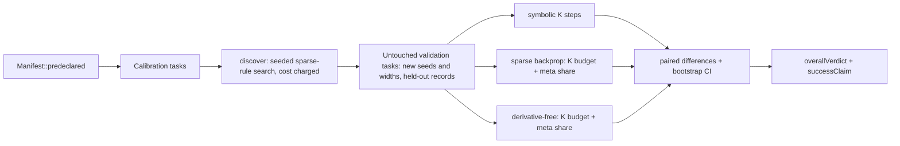

# PR summary — issue #268

## Summary

Adds an opt-in, offline research harness (`lamarck/src/local_rules/`) that
tests whether sparse symbolic local update rules beat Lamarck's sparse backprop
refinement at an equal record budget, with the meta-search cost counted.
Nothing in `run_optimisation` or the CLI calls it. The predeclared synthetic run
is **negative**: both primary baselines (sparse backprop and a derivative-free
search built on Lamarck's mirrored signed-perturbation helpers) beat the
discovered rules at K = 5, 10 and 20 once the meta-search is charged. The method, protocol and results are in
`docs/local-rules.md`.

This re-lands the harness from the closed PR #269 and fixes what that PR's last
review left open. A files run now refuses validation creatures that duplicate
each other: identical paired differences gave a zero-width interval, so one
number could decide the verdict. The example's usage header and
`docs/local-rules.md` section 8 now match the code.

After the completion checks, the derivative-free arm was rebuilt on
`mirror::signed_perturbation` and `mirror::mirror_candidate` in place of a
hand-written (1+1) search. Every report the runner writes now carries
`versions.sourceCommit` and `versions.sourceTreeDirty`. Five re-exports that
only the module itself used were dropped. The paper's full method still could
not be read from the sandbox, and the harness stays until the owner's
representative run decides it, so one criterion stays missing and one
partial.

Part of #268

## Spec

### Intent and Rationale

- The issue asks for a controlled comparison, not a feature. The harness is
  therefore a library module plus an example runner, and it never proposes
  creatures to the optimiser.
- Sparse backprop reuses Lamarck's own `LearningPlan`, `apply_learnings` and
  `calculate_learning_rate`. The baseline is the crate's real refinement path,
  not a re-implementation.
- The derivative-free arm reuses the crate's signed-perturbation helpers
  (`lamarck/src/mirror.rs`, issue #203). Each round steps one weight or
  hidden/output bias (`PerturbedScalar`), and `signed_perturbation` confirms the
  step. `mirror_candidate` builds the `−δ` twin under the default
  `BackpropConfig` limits, and both halves are scored. The better half is kept
  only if training MSE strictly falls. The candidate generator's batch path is
  not reused: it writes batches for the external scorer, while this offline
  harness scores in-process and charges record units.

### Essential Design Decisions

- **Budget.** The cost unit is one forward pass over one record. A forward pass
  plus one update costs 2. The amortised meta-search share is added to both
  primary baselines' budgets. The two `-app-only` arms get the symbolic arm's
  application budget alone, are reported, and never decide the verdict.
- **Residual.** It is the output error on output neurons only (`local_residual`).
  Hidden neurons get no residual term, because output error is not local
  hidden-neuron information.
- **No success claim without the owner.** A synthetic report is always
  `not-claimable-synthetic`. A files run that earns its place is only
  `pending-owner-review`.
- **Failed and duplicate runs.** A comparison with fewer than `minPairedTasks`
  (8) pairs, or with any failed run behind it, is `inconclusive`. A files run
  refuses duplicate or calibration-equal validation creatures, and refuses to
  run without an explicit `OUT_DIR`, so a private run cannot overwrite the
  public evidence.

### Undiscoverable Facts

- arXiv 2611.12248 could not be fetched from the sandbox. This run's
  `WebFetch https://arxiv.org/abs/2611.12248` returned `proxy refused the
  connection`, and PR #269's attempt got `CONNECT tunnel failed, response 403`.
  `docs/local-rules.md` section 2 records only a secondary outline and marks the
  method **not pinned**.
- The worker's pre-push gate replays the CI cargo steps. It reads
  `dtolnay/rust-toolchain@<sha>` as `cargo +<sha>`, which exits 101 on a host
  without rustup. This run's push was refused with
  `[PRE_PUSH_BLOCKED] Rust toolchain unavailable here: cargo +29eef336… --version exited 101`.
  The gate's per-run spec (`pre-push-spec.json`) was built from the workflows
  at run start, so the push went through only after the workaround commit was
  on the branch. The open sibling PRs #270 and #271 carry the same workaround.

## Evidence

Backend/CLI research harness. No UI files are touched.

- `docs/evidence/local-rules/manifest.json` and `summary.json` hold the
  predeclared synthetic run. They were regenerated with
  `cargo run --release --example local_rules_bench` from a clean tree at
  commit `f22e4f7` (`versions.sourceCommit`, `sourceTreeDirty: false`, crate
  0.1.47), then committed on top in `5f28cec`. `git diff f22e4f7 HEAD -- lamarck`
  is empty. `manifest.json` is unchanged. In `summary.json` only the
  derivative-free rows moved, because that arm's algorithm changed; the
  sparse-backprop rows, discovered rules, meta cost and coverage are as before.
- The result is `overallVerdict: negative`, with `successClaim:
  not-claimable-synthetic` and coverage of 360 planned, 360 completed and 0
  failed. In the `all` group (n = 24 paired tasks, held-out MSE, symbolic
  minus baseline, bootstrap 95% CI), both primary baselines are worse for the
  rules at every K:

| K | vs sparse-backprop | vs derivative-free |
|---|---|---|
| 5 | +0.256 [0.128, 0.395] worse | +0.268 [0.136, 0.411] worse |
| 10 | +0.149 [0.066, 0.245] worse | +0.161 [0.076, 0.259] worse |
| 20 | +0.088 [0.047, 0.132] worse | +0.099 [0.057, 0.145] worse |

- Without the meta share (the `-app-only` arms), the rules come out better than
  both baselines at every K. For `derivative-free-app-only` at K = 20 the result
  is now -0.541 [-0.963, -0.218]; it was inconclusive under the old (1+1) arm. So
  the negative verdict comes from the cost of discovering the rules, which is
  the cost the issue says to count.

## Acceptance Criteria

<!-- vibe-spec-review inputs="diff+issue-body" -->

- **met** — Discover sparse polynomial rules from input, output, weight, local residual where legitimately available, and inexpensive products, per activation family — evidence: `lamarck/src/local_rules/rule.rs`, `lamarck/src/local_rules/search.rs`, `lamarck/tests/local_rules.rs::delta_rule_lowers_training_mse` — reviewer: met
- **met** — Explicitly define how any residual is obtained: output error is not automatically local hidden-neuron information — evidence: `lamarck/tests/local_rules.rs::local_residual_is_output_only`, `lamarck/tests/local_rules.rs::residual_only_rule_leaves_hidden_synapses_and_biases_alone`, `docs/local-rules.md` section 4 — reviewer: met
- **met** — Compare 5–20 update steps with sparse backpropagation and derivative-free correction under equal total budget including meta-search — evidence: `lamarck/tests/local_rules.rs::baselines_get_the_symbolic_budget_plus_the_meta_share` — reviewer: met
- **met** — Test transfer to new creatures/widths and held-out data — evidence: `lamarck/src/local_rules/manifest.rs` (disjoint seeds, widths 2/8 against calibration width 4), `docs/evidence/local-rules/summary.json` — reviewer: met
- **met** — Keep as isolated experiment; canonical implementations belong in the existing training engine — evidence: `lamarck/src/lib.rs` (`pub mod local_rules`, not called by `run_optimisation` or the CLI) — reviewer: met
- **missing** — Read and pin the full method before reproducing it — reviewer: missing — reason: arXiv 2611.12248 is still unreachable from the sandbox (`WebFetch`: `proxy refused the connection`; `curl`: `CONNECT tunnel failed, response 403`), so the paper was not read. `docs/local-rules.md` section 2 records only a secondary outline and marks the method and its arXiv version not pinned.
- **met** — First inspect current code, merged work and repository instructions. Reuse existing mechanisms — evidence: `lamarck/src/local_rules/baselines.rs` (sparse backprop through `LearningPlan`/`apply_learnings`; the derivative-free arm through `mirror::signed_perturbation`, `mirror::mirror_candidate` and `PerturbedScalar`), `lamarck/tests/local_rules.rs::derivative_free_accepts_the_mirrored_twin_when_plus_delta_loses` — reviewer: met
- **met** — Opt-in experiment only; preserve ordinary behaviour, interfaces, immutable parents and full authoritative acceptance. No automatic deployment or default change — evidence: `lamarck/tests/local_rules.rs::parent_is_unchanged_by_every_arm` — reviewer: met
- **met** — Predeclare controls, seeds, sample size, compute limits and success/failure criteria — evidence: `docs/evidence/local-rules/manifest.json`, `lamarck/tests/local_rules.rs::manifest_predeclares_the_minimum_paired_sample`, `lamarck/tests/local_rules.rs::files_run_refuses_duplicate_validation_creatures` — reviewer: met
- **met** — Identify code/model/data versions — evidence: `versions` in `docs/evidence/local-rules/summary.json` (crate 0.1.47, neat-core `v0.23.4`, task generator `local-rules-synthetic-v1`, `sourceCommit` `f22e4f7…`, `sourceTreeDirty: false`; `git diff f22e4f7 HEAD -- lamarck` is empty), the files-mode corpus key and fingerprints, `lamarck/tests/local_rules.rs::versions_with_source_refuses_anything_but_a_full_lowercase_sha` — reviewer: met
- **met** — separate calibration from untouched validation and count all preparation/search costs — evidence: `lamarck/tests/local_rules.rs::baselines_get_the_symbolic_budget_plus_the_meta_share` — reviewer: met
- **met** — Provide deterministic positive/negative correctness tests for new behaviour and pass the repository's normal quality checks — evidence: `lamarck/tests/local_rules.rs` (36 tests), and `./quality.sh` passed on the final head — reviewer: met
- **met** — Research runs are separate from routine feature CI — evidence: `lamarck/examples/local_rules_bench.rs`; the tests run only a reduced manifest — reviewer: met
- **met** — Deliver a reproducible command/manifest and machine-readable results with paired distributions, uncertainty, failures and actual coverage — evidence: `docs/evidence/local-rules/summary.json` (`pairedDifferences`, CIs, `failures`, `coverage`), `lamarck/tests/local_rules.rs::reduced_manifest_is_reproducible_and_fully_covered` — reviewer: met
- **met** — Fixtures alone do not demonstrate an optimisation benefit — evidence: `lamarck/tests/local_rules.rs::synthetic_source_never_supports_a_success_claim` — reviewer: met
- **met** — Record negative findings — evidence: `docs/local-rules.md` section 7, `CHANGELOG.md`, `README.md` — reviewer: met
- **partial** — remove optional code that does not earn its maintenance cost — evidence: `lamarck/src/local_rules/mod.rs` (five re-exports that only the module used are removed: `discover`, `rule_delta`, `describe`, `bootstrap_mean_ci`, `mean`), the old (1+1) search replaced by the crate's mirror helpers, `docs/local-rules.md` section 8 decision rule — reviewer: partial (first pass), met (re-review, which found every remaining item used or required by a public signature) — reason: the harness itself has a `negative` synthetic verdict. Whether it stays depends on the owner's representative files-mode run, which needs a private corpus and has no tracking issue, so I keep this partial.
- **met** — Do not claim success before representative runs — evidence: `lamarck/tests/local_rules.rs::files_report_claim_follows_its_source_and_verdict` — reviewer: met
- **met** — Keep public implementation and fixtures application-agnostic; private corpora/results and operational integration remain private — evidence: `lamarck/tests/local_rules.rs::out_dir_defaults_for_synthetic_mode_only`, `lamarck/tests/local_rules.rs::files_run_completes_and_names_its_source` — reviewer: met
- **unrequested** — Local `.github/actions/rust-toolchain` action used by `ci.yml` and `cargo-quality.yml`, a plain `rustup` toolchain step in `family-sync.yml`, a `CANONICAL_PATHS` fallback checked by rule 17 in `scripts/check-family-sync-workflow.sh` (two cases in `scripts/test-check-family-sync-workflow.sh`), and the CHANGELOG Fixed entry for them — reviewer: unrequested — reason: the worker's pre-push gate refuses every Rust push on these workflows (Undiscoverable Facts). CI still compiles with the `rust-toolchain.toml` pin.
- **unrequested** — Crate version 0.1.46 → 0.1.47 in `lamarck/Cargo.toml` and `Cargo.lock` — reviewer: unrequested — reason: the repository bumps on any `lamarck/src` change, and the committed evidence is stamped with 0.1.47.
- **unrequested** — `.gitleaks.toml`: the empty `[allowlist] commits = []` is replaced by `[extend] useDefault = true` (commit `fdd6170`, made by the worker) — reviewer: unrequested — reason: gitleaks 8.30.1 on the worker host refuses to load the old config (`[[allowlists]] must contain at least one check for: commits, paths, regexes, or stopwords`). The new config loads, keeps the default rule set and scans clean. CI's gitleaks workflow loads the file without `-c`.
- **unrequested** — The `-app-only` diagnostic arms and files mode — reviewer: unrequested — reason: the app-only arms show what the meta-search cost does to the verdict, and files mode is the private representative run the issue asks for. Neither decides the synthetic verdict.

## Standards Review

<!-- vibe-standards-review inputs="diff+CODING-STANDARDS.md" -->

- **clean** — No `CODING-STANDARDS.md` in this repository, so the reviewer used `CONTRIBUTING.md` and the README's development rules and safety invariants. It reported no violations. It checked the version bump (ahead of base), CHANGELOG under `[Unreleased]` matching `summary.json`, and the review-checked rules: SHA-pinned `uses:` (kept inside the local action), canonical `runlib.sh` and `family-pins.sh` untouched, TDD, no new dependency, streaming training-data reads, no duplication of core (backprop reuse), and parents never mutated. Optional notes: one over-long CHANGELOG line, and inconsistent blank-line spacing between the CHANGELOG entries.
- **violation** — README development rule "Use TDD for behaviour changes": no test showed that the derivative-free arm's `−δ` twin is scored (every test still passed with the twin removed) — evidence: `lamarck/src/local_rules/baselines.rs` (`derivative_free`) — reason: fixed in this diff by `lamarck/tests/local_rules.rs::derivative_free_accepts_the_mirrored_twin_when_plus_delta_loses`, red-checked (fails at seed 6 with the twin disabled).
- **violation** — doc accuracy: the CHANGELOG said every report records `versions.sourceCommit`, and the example header wrote `crate::mirror` where an example must name `neat_ai_lamarck::mirror` — evidence: `CHANGELOG.md`, `lamarck/examples/local_rules_bench.rs:5` — reason: fixed in this diff (CHANGELOG now says the runner stamps it and that it is `null` without the runner or without git).
- **clean** — Post-completion-check commits (`1aa2a1b`, `f22e4f7`, plus the evidence commits `2d45bd5` and `5f28cec`), reviewed separately: no new dependencies (only `std::process::Command`), parent immutability (`derivative_free` clones the parent), reuse rather than duplication (`mirror` helpers; the local `Scalar` enum was replaced by `mirror::PerturbedScalar`), CHANGELOG under `[Unreleased]`, `docs/local-rules.md` tables checked against `summary.json`, and the version bump (0.1.47 against Develop's 0.1.46, which is all CONTRIBUTING requires per PR). Left open, minor: the runner's git stamping in the example and the empty-scalars error path of `derivative_free` have no test, and the `+δ` step is not checked against the weight/bias limit that `mirror_candidate` applies to its twin (the crate's own `Random` strategy does not clamp either).
- **clean** — `.gitleaks.toml` (commit `fdd6170`), reviewed on its own after the main review: no contradiction with `CONTRIBUTING.md` or `README.md`. `[extend] useDefault = true` keeps the default rules: a planted fake secret was flagged with gitleaks 8.30.1. CI's `gitleaks detect` loads the file automatically and found no leaks. Not confirmed by a run: support in CI's pinned gitleaks 8.24.2, because the binary download returned HTTP 403 here.

## Test Plan

- Added `lamarck/tests/local_rules.rs` (36 tests, public API only, deterministic).
  It covers rule refusals, manifest refusals, the residual being output-only,
  parent immutability, derivative-free never raising training MSE, the verdict
  rule (`predeclared_verdict_follows_the_success_criterion`,
  `predeclared_verdict_ignores_other_groups_and_app_only_arms`), budget
  accounting, the minimum paired sample, failed runs
  (`a_failed_validation_run_is_recorded_and_never_decides_the_verdict`), the
  files-mode refusals and the success-claim rules.
- New this run: `lamarck/tests/local_rules.rs::files_run_refuses_duplicate_validation_creatures`.
  It refuses `[c2, c2]` ("validation creatures 0 and 1 share a fingerprint…")
  and `[c2, c3, c2]` ("0 and 2"), each with the minimum lowered to 2, and accepts
  `[c2, c3]` with n = 2. Before the fix it failed: `run_files` returned
  `Ok(Report …)` with identical fingerprints and `ci_low == ci_high`.
- `scripts/test-check-family-sync-workflow.sh` gains two rule-17 cases (missing
  fallback, stale fallback), and both expect exit 1. No existing assertion was
  removed or changed.
- New after the completion checks:
  - `derivative_free_accepts_the_mirrored_twin_when_plus_delta_loses`: three
    evaluations (the parent and one mirrored pair), sigma 1e-3, seeds 0–15, and
    training MSE must fall for every seed. Red-checked: with the twin disabled
    it fails at seed 6 (`0.92389… -> 0.92389…`).
  - `derivative_free_steps_one_scalar_per_accepted_round`: fails on the old
    (1+1) code.
  - `derivative_free_cost_matches_the_evaluations_for_odd_and_even_budgets`
    (budgets 1, 2, 7, 8, 41) and
    `derivative_free_moves_scalars_only_and_never_the_structure`.
  - `versions_current_has_no_source_commit`,
    `versions_with_source_records_a_full_sha_and_the_dirty_flag` and
    `versions_with_source_refuses_anything_but_a_full_lowercase_sha`.
- `cargo test -p neat_ai_lamarck --test local_rules`: 36 passed.
- `./quality.sh < /dev/null` on the final head: passed ("All quality checks
  passed!").

**Owner step:** run files mode on a representative private corpus with at least
8 distinct validation creatures, keeping `OUT_DIR` private
(`docs/local-rules.md` section 8). If the run is not `earns-its-place`, remove
`lamarck/src/local_rules/`, the example, its tests and the evidence.

**Not done or not checked:** the paper's method is not pinned (no network
access to arXiv). The example's git stamping and the empty-scalars error path of
`derivative_free` have no test. No representative corpus was run. Baseline hyperparameters
(backprop learning rate 0.01, derivative-free sigma 0.05) were not tuned.
