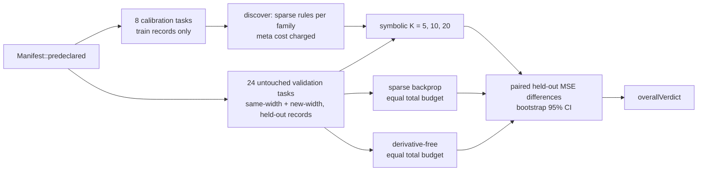

# PR summary — issue #268

## Summary

This PR adds an opt-in, offline experiment for issue #268. It finds sparse
symbolic local update rules for each activation family on calibration tasks,
then compares them with Lamarck's own sparse backprop and with a
derivative-free (1+1) search. Validation uses untouched tasks, and every arm
in the verdict gets the same total record budget, including the share of the
rule search, rounded down to whole steps for the baselines. A comparison needs
at least 8 paired tasks and is `inconclusive` if any run behind it failed, so
one number or the survivors of a failure cannot decide the verdict. The
predeclared synthetic verdict is **`negative`**. Every report also carries a
`successClaim`. It is always `not-claimable-synthetic` for fixtures, and only
`pending-owner-review` for a files run that earns its place, so the harness
cannot claim success before a representative run. Files mode also refuses to run
without an explicit `OUT_DIR`, so a private run cannot overwrite the public
evidence. Nothing in the optimiser, the
CLI or any default changes. Pinning the paper's full method is still open,
because the paper could not be read from the sandbox. The representative run on
a private creature and corpus is the owner's step. Part of #268.

One change is outside the experiment itself. The Rust jobs in `ci.yml`
(`quality`), `cargo-quality.yml` and `family-sync.yml` now install their
toolchain through a new local action, `.github/actions/rust-toolchain`. It wraps
the same pinned `dtolnay/rust-toolchain` step and asks for rustfmt and clippy.
`ci.yml` and `cargo-quality.yml` already asked for those. `family-sync.yml` asked
for none before, but `rust-toolchain.toml` lists both, and rustup honours that
file, so CI still builds with the toolchain and components that file pins. The action's own `stable` install now also gets rustfmt and clippy in `family-sync`. Without it, the worker's pre-push gate refused every
push of this branch (see Undiscoverable Facts). Because this branch now edits
`family-sync.yml`, the gate also replays that workflow's ShellCheck step without
the job's `env:`, and `set -u` stopped it on `CANONICAL_PATHS`. The step now
falls back to the job's own list, and validator rule 17 in
`scripts/check-family-sync-workflow.sh` fails if the fallback is missing or
differs. That is the same change as issue #266's commit `0832c75`, so whichever
branch lands second merges it without a conflict.

## Spec

### Intent and Rationale

- The issue asks whether discovered local rules can stand in for current refinement. The harness answers that under a fixed protocol: seeds, sample size, limits and the verdict rule are set in `Manifest::predeclared()`. It was committed together with the first recorded results (`2aa8f93`). A later review round added `min_paired_tasks` and the failed-run rule to it. Neither changes a seed, a limit or any recorded number, because every synthetic comparison has at least 8 pairs and no failed run. Git cannot show that it came before every run.
- The sparse-backprop arm drives Lamarck's existing `LearningPlan`, `apply_learnings` and `calculate_learning_rate` with `sparse_ratio`. Current refinement is therefore what is measured, not a second copy of it.

### Essential Design Decisions

- **Residual:** only an output neuron `k` has one, and it is `expected[k] − activation`. A hidden neuron has none, and features that use `r` are 0 there. Output error is never treated as local hidden-neuron information (`local_residual` in `lamarck/src/local_rules/rule.rs`).
- **Budget:** cost is counted in record units. One forward pass is 1 unit, a forward pass plus an update is 2, and held-out measurement is never charged. Every unit spent in the meta-search is charged and amortised over the 24 validation tasks. The primary arms get the symbolic arm's cost plus that share. The `-app-only` arms leave the share out and are diagnostics, not part of the verdict.
- **Backprop settings:** the sparse-backprop arm uses Lamarck's default `BackpropConfig` learning rate (0.01). The rule step uses `eta` = 0.05. The app-only "better" rows may partly reflect that difference, which is one reason they do not count.
- **Sample size and failed runs:** `min_paired_tasks` is 8. A comparison with fewer paired tasks is `inconclusive`, and a files run with fewer validation creatures is refused. A run that errors or gives a non-finite MSE is recorded in `failures`, and the comparisons that lose a pair to it record `missing` above 0 and are `inconclusive`. The choice is that a failed run is never dropped silently and never counts as a win. The other option, counting a failed symbolic run as `worse`, would let one broken creature decide a verdict. The files-mode set is only as large as the number of `--creature` flags, and all of them share the same records and seed, so this limit is a floor on evidence and not a guarantee that the sample is representative.
- **Private output:** files mode refuses to run without `OUT_DIR` (`resolve_out_dir`). Only synthetic mode defaults to the tracked `docs/evidence/local-rules`.
- **Keeping the code:** the harness stays only as the reproducer until the owner's representative files-mode run. If that run is not `earns-its-place`, `lamarck/src/local_rules/`, the example, its tests and its evidence are removed. This is an assumption: the issue asks to remove code that does not earn its cost, but also says not to judge from fixtures alone.

### Undiscoverable Facts

- arXiv 2611.12248 could not be read from the sandbox on 14 November 2026. `curl` of the export.arxiv.org abstract and the arxiv.org abstract and PDF failed with `CONNECT tunnel failed, response 403`. The fetch tool got "proxy refused the connection" on the arXiv abstract, HTML and PDF pages and on the alphaxiv and Hugging Face mirrors. Only web-search summaries came through. `docs/local-rules.md` section 2 records the outline they give: per-layer polynomial local losses over Penrose-diagram monomials, regressed against a global loss, with a Hadamard-product sparse prior and locality degree 1–3. It also records how this harness differs from that outline. The coefficient optimisation, the per-degree variable sets and the experimental settings were not found, so the method is not pinned. What is tested is the issue's description.
- The worker's pre-push gate reads a job's `dtolnay/rust-toolchain@<ref>` ref as the `cargo +<ref>` toolchain (`jobToolchain` in VibeCoder `worker/deno/lib/ci_cargo_checks.ts`). Here the ref is the commit SHA `29eef336…`, and this host has no rustup, so its probe `cargo +29eef336d9b2848a0b548edc03f92a220660cdb8 --version` exited 101 (`error: no such command: +…`). Three earlier runs of this issue ended there with no PR. That defect is in VibeCoder, which this repository does not depend on, so it cannot be fixed from here. The local action hides the ref from that inference. Running the worker's own `repoCiCargoChecks` on this checkout before the change planned three checks with `cargo +29eef…`; after it, plain `cargo clippy …` (`ci.yml`, `cargo-quality.yml`) and `cargo test --no-run …` (`family-sync.yml`).
- The 13 November research shortlist the issue cites is not in this repository.

## Evidence

Backend/research change only; no UI files.

Command: `cargo run --release --example local_rules_bench`. It writes
`docs/evidence/local-rules/manifest.json` and `summary.json`. Coverage is 360 of
360 planned runs completed, with 0 failures. The meta-search cost 1,622,016
record units. Versions: crate 0.1.47, neat-core v0.23.4, task generator
`local-rules-synthetic-v1`. The rules found were: identity `R*1 + XR*2`;
logistic `R*2 + W*-2 + XYY*2`; tanh `XYY*-0.5 + YR*-1 + Y*-2`.

In the table, each difference is symbolic minus baseline held-out MSE, so a
negative number means symbolic did better. n = 24 paired tasks per row.

| Arm | K | Mean diff | 95% CI | Verdict |
|---|---|---|---|---|
| sparse-backprop (primary) | 5 | +0.2563 | [0.1276, 0.3948] | worse |
| derivative-free (primary) | 5 | +0.2684 | [0.1360, 0.4108] | worse |
| sparse-backprop (primary) | 10 | +0.1490 | [0.0661, 0.2453] | worse |
| derivative-free (primary) | 10 | +0.1610 | [0.0759, 0.2599] | worse |
| sparse-backprop (primary) | 20 | +0.0876 | [0.0472, 0.1316] | worse |
| derivative-free (primary) | 20 | +0.0996 | [0.0570, 0.1461] | worse |
| sparse-backprop-app-only | 5 / 10 / 20 | −0.3726 / −0.3781 / −0.3198 | all below 0 | better (diagnostic) |
| derivative-free-app-only | 5 / 10 / 20 | −0.1987 / −0.1655 / −0.0342 | last straddles 0 | better, better, inconclusive (diagnostic) |

Once the search cost is counted, the rules lose to both baselines at every K.
That is a negative finding on synthetic fixtures only, and it proves no benefit
or harm on real creatures. `summary.json` records `"successClaim": "not-claimable-synthetic"`. Re-running
the bench at crate 0.1.47 reproduces both files byte for byte. The recorded
`crateVersion` was 0.1.46 until the auto-increment commit bumped the crate, so
the evidence was regenerated at 0.1.47. Its only changes are `crateVersion`,
the new `minPairedTasks` and `missing` (0 everywhere) fields, and the longer
`successCriterion` text. Every number and verdict is unchanged. The method write-up is
`docs/local-rules.md`. The
`CHANGELOG.md` and `README.md` entries link to it.

## Acceptance Criteria

<!-- vibe-spec-review inputs="diff+issue-body" -->

- **met** — "Discover sparse polynomial rules from input, output, weight, local residual where legitimately available, and inexpensive products, per activation family" — evidence: `lamarck/src/local_rules/rule.rs` (`Feature`, `RuleSet`), `lamarck/src/local_rules/search.rs::discover` — reviewer: met
- **met** — "Explicitly define how any residual is obtained: output error is not automatically local hidden-neuron information" — evidence: `lamarck/tests/local_rules.rs::local_residual_is_output_only`, `lamarck/tests/local_rules.rs::residual_only_rule_leaves_hidden_synapses_and_biases_alone` — reviewer: met
- **met** — "Compare 5–20 update steps with sparse backprop and derivative-free correction under equal total budget including meta-search" — evidence: `lamarck/src/local_rules/manifest.rs` (`STEP_RANGE`), `lamarck/src/local_rules/baselines.rs` — reviewer: met
- **met** — "Test transfer to new creatures/widths and held-out data" — evidence: `lamarck/src/local_rules/manifest.rs::predeclared`, `lamarck/tests/local_rules.rs::files_run_refuses_the_calibration_creature_as_validation` — reviewer: met
- **met** — "Keep as isolated experiment; canonical implementations belong in the existing training engine" — evidence: `lamarck/src/lib.rs` (`pub mod local_rules` is the only wiring) — reviewer: met
- **missing** — "Read and pin the full method before reproducing it" — evidence: `docs/local-rules.md` section 2 — reviewer: missing — reason: arXiv 2611.12248 cannot be fetched from the sandbox (403 / proxy refused), and only a search-summary outline is recorded; the coefficient optimisation, per-degree variables and experimental settings remain unread.
- **met** — "First inspect current code, merged work and repository instructions. Reuse existing mechanisms" — evidence: `lamarck/src/local_rules/baselines.rs` (`LearningPlan`, `apply_learnings`, `calculate_learning_rate`), `lamarck/src/local_rules/files.rs` — reviewer: met
- **met** — "Opt-in experiment only; preserve ordinary behaviour, interfaces, immutable parents and full authoritative acceptance. No automatic deployment or default change" — evidence: `lamarck/tests/local_rules.rs::parent_is_unchanged_by_every_arm` — reviewer: met
- **met** — "Predeclare controls, seeds, sample size, compute limits and success/failure criteria" — evidence: `lamarck/src/local_rules/manifest.rs::predeclared` (`min_paired_tasks`, `success_criterion` with the failed-run rule), `docs/evidence/local-rules/manifest.json`, `lamarck/tests/local_rules.rs::manifest_predeclares_the_minimum_paired_sample`, `lamarck/tests/local_rules.rs::files_run_refuses_fewer_creatures_than_the_minimum_paired_sample` — reviewer: met
- **partial** — "Identify code/model/data versions" — evidence: `docs/evidence/local-rules/summary.json` (`versions`) — reviewer: partial — reason: `crateVersion` is now 0.1.47, which differs from the base branch's 0.1.46, but no commit SHA is recorded, so the code version is not uniquely identified.
- **met** — "Separate calibration from untouched validation and count all preparation/search costs" — evidence: `lamarck/src/local_rules/manifest.rs::validate`, `lamarck/tests/local_rules.rs::manifest_refusals_name_their_cause` — reviewer: met
- **met** — "Provide deterministic positive/negative correctness tests for new behaviour" — evidence: `lamarck/tests/local_rules.rs` (28 tests), including `predeclared_verdict_follows_the_success_criterion`, `predeclared_verdict_ignores_other_groups_and_app_only_arms`, `baselines_get_the_symbolic_budget_plus_the_meta_share` and `a_failed_validation_run_is_recorded_and_never_decides_the_verdict` — reviewer: met
- **met** — "Pass the repository's normal quality checks" — evidence: `./quality.sh < /dev/null` exit 0, "All quality checks passed!" — reviewer: met
- **met** — "Research runs are separate from routine feature CI" — evidence: `lamarck/examples/local_rules_bench.rs`, tests use `reduced_manifest()` — reviewer: met
- **met** — "Deliver a reproducible command/manifest and machine-readable results with paired distributions, uncertainty, failures and actual coverage" — evidence: `docs/evidence/local-rules/summary.json`, `lamarck/tests/local_rules.rs::reduced_manifest_is_reproducible_and_fully_covered` — reviewer: met
- **met** — "Fixtures alone do not demonstrate an optimisation benefit" — evidence: `docs/local-rules.md` sections 1 and 7 — reviewer: met
- **met** — "Record negative findings" — evidence: `docs/local-rules.md` section 7, `CHANGELOG.md`, `docs/evidence/local-rules/summary.json` (`overallVerdict: negative`) — reviewer: met
- **partial** — "Remove optional code that does not earn its maintenance cost" — evidence: `docs/local-rules.md` section 8 decision rule — reviewer: partial — reason: the module and evidence stay after a negative synthetic verdict; removal waits on the owner's representative run.
- **met** — "Do not claim success before representative runs" — evidence: `lamarck/tests/local_rules.rs::synthetic_source_never_supports_a_success_claim`, `lamarck/tests/local_rules.rs::synthetic_report_is_not_claimable_as_a_success`, `lamarck/tests/local_rules.rs::files_report_claim_follows_its_source_and_verdict`, `lamarck/src/local_rules/experiment.rs::success_claim` — reviewer: met
- **met** — "Keep public implementation and fixtures application-agnostic; private corpora/results and operational integration remain private" — evidence: `lamarck/src/local_rules/experiment.rs::resolve_out_dir`, `lamarck/tests/local_rules.rs::out_dir_defaults_for_synthetic_mode_only`, `lamarck/tests/local_rules.rs::files_run_completes_and_names_its_source` — reviewer: met
- **met** — "Leave unassigned until an implementer actively starts" — evidence: issue assigned with `work-on` while in progress — reviewer: met
- **unrequested** — `.github/actions/rust-toolchain` local action used by `ci.yml`, `cargo-quality.yml` and `family-sync.yml` — reviewer: unrequested — reason: needed so the worker's pre-push gate can run plain `cargo` (see Undiscoverable Facts).
- **unrequested** — `CANONICAL_PATHS` fallback in `family-sync.yml`, validator rule 17 and its two tests — reviewer: unrequested — reason: the gate replays that step without the job's `env:` once this branch edits the workflow.
- **unrequested** — `CHANGELOG.md` Fixed entry for the toolchain action — reviewer: unrequested — reason: records the toolchain change.

## Test Plan

- Added `lamarck/tests/local_rules.rs` with 28 tests:
  - Positive: `delta_rule_lowers_training_mse`.
  - Hidden-residual negative, with an output-synapse positive control: `residual_only_rule_leaves_hidden_synapses_and_biases_alone`.
  - Immutable parents: `parent_is_unchanged_by_every_arm`.
  - Refusals, each with an accepted control: `sparse_rule_refusals_name_their_cause` and `manifest_refusals_name_their_cause`.
  - Baselines and statistics: `derivative_free_never_raises_training_mse`, `matched_count_arithmetic`, `verdict_from_confidence_interval` and `local_residual_is_output_only`.
  - Determinism and full coverage: `reduced_manifest_is_reproducible_and_fully_covered`.
  - Version pin: `neat_core_tag_matches_cargo_manifest`.
  - Files mode:
    - `files_run_completes_and_names_its_source`: no temp path is written to the summary.
    - `files_run_refuses_a_short_corpus_and_accepts_a_full_one`.
    - `files_run_refuses_the_calibration_creature_as_validation`.
    - `files_run_refuses_no_validation_creatures_and_mismatched_widths`.
    - `files_run_refuses_fewer_creatures_than_the_minimum_paired_sample`: one creature is refused, and two (the reduced minimum) complete with n = 2 and `missing` = 0.
    - `out_dir_defaults_for_synthetic_mode_only`: files mode with no `OUT_DIR` is refused with a message naming the tracked default, and the same call with an explicit `OUT_DIR` is accepted, as are both explicit synthetic and default synthetic.
  - Verdict rule and sample size:
    - `predeclared_verdict_follows_the_success_criterion`: `EarnsItsPlace`, `Negative` and `Inconclusive` branches, including better than only one baseline, better at one K but worse at another, and worse than backprop at only some K.
    - `predeclared_verdict_ignores_other_groups_and_app_only_arms`: a Better group or app-only row cannot change the verdict, and the same rows with `all`-group primary Better do.
    - `a_single_paired_task_cannot_decide_a_comparison`, `a_lost_run_makes_its_comparison_inconclusive` and `manifest_predeclares_the_minimum_paired_sample`.
  - Budget: `baselines_get_the_symbolic_budget_plus_the_meta_share` checks each arm's steps and `record_units` on a reduced run, and that `meta_cost` equals the candidate count times calibration tasks times the per-task units.
  - Failed runs: `a_failed_validation_run_is_recorded_and_never_decides_the_verdict` runs `run_files` with a creature whose synapse points at a missing neuron. All of its runs land in `failures`, the coverage counts add up, and every primary comparison that lost a pair is `inconclusive` and not `earns-its-place`.
  - Report contents: `synthetic_summary_carries_the_search_trace_and_source`.
  - No success before a representative run:
    - `synthetic_source_never_supports_a_success_claim`: every verdict on a synthetic source gives `NotClaimableSynthetic`. Positive controls: files with `EarnsItsPlace` gives `PendingOwnerReview`, and files with any other verdict gives `NoSuccess`.
    - `synthetic_report_is_not_claimable_as_a_success`: a real reduced synthetic report has the claim, and its JSON contains `"successClaim": "not-claimable-synthetic"`.
    - `files_report_claim_follows_its_source_and_verdict`.
  - Red-check: I temporarily made synthetic plus `EarnsItsPlace` return `PendingOwnerReview`. `synthetic_source_never_supports_a_success_claim` failed (18 passed, 1 failed), and passed again once the change was reverted.
  - Red-check for the budget: I temporarily multiplied the meta share by 0 in `run_arm`. `baselines_get_the_symbolic_budget_plus_the_meta_share` failed (27 passed, 1 failed), and the suite passed again once the change was reverted.
- `cargo test --test local_rules < /dev/null`: 28 passed. `cargo clippy` with the CI `-D` flags and `cargo fmt --all -- --check` are clean.
- `cargo run --release --example local_rules_bench < /dev/null`: regenerated at crate 0.1.47. The changes in `summary.json` are `crateVersion`, `minPairedTasks`, the longer `successCriterion` and `missing` (0) on each comparison, and `manifest.json` gains `minPairedTasks` and the same criterion text. The verdict is still `Negative`, with 360 of 360 runs complete, and every number is unchanged.
- `./quality.sh < /dev/null` on the working tree for this review round: exit 0, "All quality checks passed!". An earlier run in this session failed at codespell on an Italian word in a new doc line, which was then replaced. An earlier run at `5aa69ba` also passed. An earlier run failed `readme_contract::repository_layout_lists_every_lamarck_src_rs` because `local_rules` was missing from the README layout tree, so the line was added. That pass covers the `CANONICAL_PATHS` changes too.
- I ran the three CI cargo checks the worker's scanner now plans, with their workflow env (`CARGO_BUILD_JOBS=2 RUSTFLAGS="-D warnings"` for clippy), on the installed cargo 1.99.1. `cargo clippy --workspace --all-targets --all-features -- -D warnings -D clippy::filter_next -D clippy::collapsible_if` and the same without `--workspace` found no issues, and `cargo test --no-run --workspace --all-features` exited 0.
- Toolchain action: `actionlint` on `ci.yml`, `cargo-quality.yml` and `family-sync.yml` reported nothing. `scripts/check-family-sync-workflow.sh`, `scripts/test-check-family-sync-workflow.sh`, `scripts/check-bot-push-action.sh`, `scripts/check-cargo-quality-overlap.sh` and `scripts/test-check-cargo-quality-overlap.sh` passed. No validator rule was added for the toolchain action, because it does not alter what CI runs.
- `CANONICAL_PATHS` fallback: `scripts/test-check-family-sync-workflow.sh` gains two rule-17 cases, "gate step without a CANONICAL_PATHS fallback → fail" and "gate step fallback differs from CANONICAL_PATHS → fail", both exit 1, and the script passes. I replayed the family-sync "Gate the refreshed scripts" step and `ci.yml`'s "Run ShellCheck" step with `env -i PATH="$PATH" HOME="$HOME" bash --noprofile --norc -eo pipefail`: both exited 0, the first with "15 passed, 0 failed".
- No test was removed or skipped. In this review round I edited tests this PR added earlier: the files-mode tests now pass two validation creatures, because a run below `min_paired_tasks` is refused, and `files_run_refuses_no_validation_creatures_and_mismatched_widths` expects the new minimum-sample message for an empty list in place of "needs at least one validation creature". The base has no `local_rules` code, so no base test is changed.
- Not done: pinning the paper's full method, which the sandbox cannot fetch. The representative private-corpus run is the owner's step.

🤖 Generated with [Claude Code](https://claude.com/claude-code)
