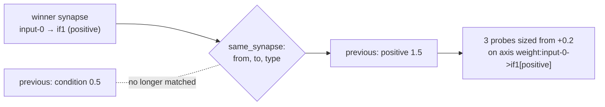

# Follow-up probes identify a synapse by role as well as endpoints (Issue #285)

## Summary

`plan_probes` and `probe_candidate` in `lamarck/src/followup.rs` matched a
synapse by `(from, to)` only. neat-core lets one source feed an `IF` neuron in
two roles, so on such a creature the follow-up burst compared the winner's
synapse with the wrong one and stepped the wrong weight. `ProbeTarget::Weight`
now carries the synapse type, both functions match on source, target and type,
and the weight axis name carries the type too, so retiring one role's axis no
longer retires the other's. Closes #285.

## Spec

### Intent and Rationale

- The synapse's identity is `(from, to, type)`, the same key neat-core's
  `validate_no_duplicate_synapses` uses, so matching on it is the smallest
  change that makes the pair unique.
- The follow-up axis name now comes from `mirror::weight_axis` rather than its
  own `format!`. Dead axes are mirror axis names, and one function keeps the two
  spellings from drifting.

### Essential Design Decisions

- An untyped synapse keeps the `weight:<from>-><to>` axis name. A typed one is
  `weight:<from>-><to>[<type>]`. Journals and reports of creatures without typed
  synapses are unchanged.
- I used the type rather than the synapse index (the issue allowed either). An
  index moves when the winner adds or removes a synapse, and the type does not.

### Undiscoverable Facts

- Dead axes live only in memory during a run (`run.rs` `dead_axes`, cleared on
  an accept). Nothing reads an axis name back across runs, so the new typed
  spelling needs no key bump. `report` pairs mirror halves by comparing axis
  strings within one journal. An older journal holds the untyped spelling for
  typed synapses too, so its pairing is unchanged.

## Evidence

Backend-only change; the tests below are the evidence.

## Test Plan

- Added to `lamarck/src/followup.rs`, on an `IF` fixture fed twice by
  `input-0` (condition 0.5, positive 1.5):
  - `a_moved_role_synapse_is_probed_on_that_role_only`: a +0.2 move on the
    positive role plans exactly three probes, all on
    `ProbeTarget::Weight { synapse_type: Some("positive") }`, with steps
    0.1, -0.1 and 0.2.
  - `unmoved_role_synapses_plan_no_probes`: an unchanged winner plans no probes
    and `FollowUpPlan::from_accept` returns `None`.
  - `follow_up_probes_step_the_role_synapse_that_moved`: the emitted candidates
    leave the condition weight at 0.5 and set the positive weight to 1.8, 1.6
    and 1.9.
  - `retiring_one_role_axis_leaves_the_other_role_live`: a retired
    `weight:input-0->if1[condition]` still lets all three probes through;
    a retired `weight:input-0->if1[positive]` stops all of them.
- Added to `lamarck/src/mirror.rs`: `a_typed_synapse_axis_names_its_role`.
  Moving the positive synapse gives axis `weight:input-0->if1[positive]` on
  synapse 1.
- Red before the fix: all five failed against the base production code. For
  example, `a_moved_role_synapse_is_probed_on_that_role_only` failed with
  `step 0.6 vs 0.1`, the condition weight moved to 1.1 instead of staying at
  0.5, and the mirror axis read `weight:input-0->if1` instead of
  `weight:input-0->if1[positive]`. The executor briefly dropped the
  `synapse_type` field from one expected value so base would compile, then
  restored it.
- Existing untyped-axis tests pass unchanged, so untyped synapses keep their
  spelling: `a_new_synapse_is_probed_at_nearby_weights` (`weight:input-0->o1`),
  `a_probe_on_a_retired_axis_is_not_proposed` (`weight:h1->o1`), and the
  mirror, run and report axis tests. No existing assertion was removed.
- Callers checked: the only production construction of `ProbeTarget::Weight` is in
  `plan_probes`, and the three synapse lookups (in `plan_probes` and the read
  and write in `probe_candidate`) all use `same_synapse`. `weight_axis` has two
  callers, `signed_perturbation` and `ProbeTarget::axis`, and both pass the
  type.
- Docs: I updated the `README.md` mirror-axis sentence in the mirrored-sampling
  section. It was the only hit for `weight:<` in `README.md` and `docs/`
  outside `docs/archive/`. I also added a `CHANGELOG.md` Fixed entry.
- `./quality.sh < /dev/null` on the code commit passed ("All quality checks
  passed!", 995 tests, 0 failed).

## Not done

None. GitHub CI on the pushed head has not been observed yet.
