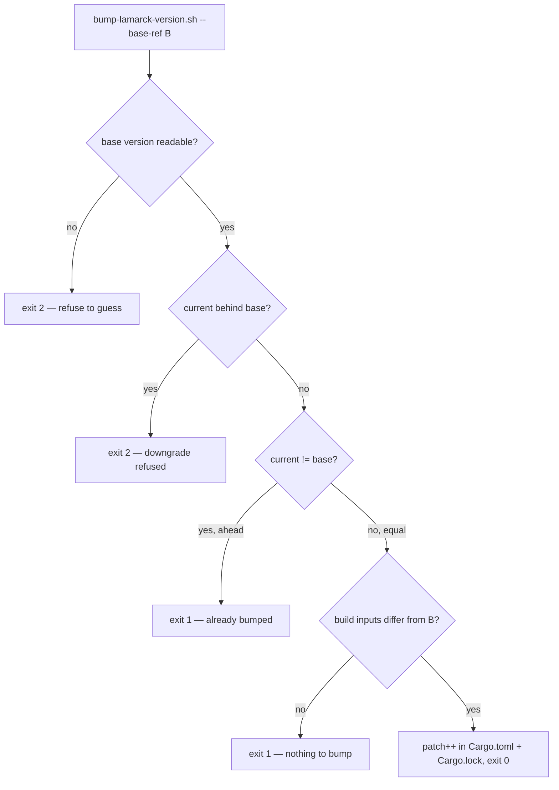

# PR summary — Issue #286

## Summary

`scripts/bump-lamarck-version.sh` skipped the bump whenever the branch held an
earlier `chore: auto-increment versions for changed projects` commit, before it
compared versions. So a PR that merged a base already at its bumped version
shipped changed crate sources under an unchanged version, and remote runners
kept the stale binary. The script now decides on versions only. It skips when
the branch version is ahead of base, and bumps when the version equals base and
the build inputs differ. A base whose manifest version cannot be read fails
with exit 2. Closes #286.

## Spec

### Intent and Rationale

- The issue's suggested fix: a version ahead of base already shows a bump, so
  the commit-subject check added nothing except the false skip. Removing it
  keeps the script idempotent, because after a bump the version is ahead.

### Essential Design Decisions

- A base with no readable `lamarck/Cargo.toml` version now fails with exit 2.
  Before this change the commit-subject skip was the only thing that stopped a
  second bump on a re-run in that case. Without it, every re-run would bump
  again. Failing loudly replaces that guard rather than guessing. Every branch
  of this repository carries the manifest, so no real PR should reach the
  failure.
- The downgrade refusal (Issue #152) still runs before the "ahead" skip.

### Undiscoverable Facts

- The issue reports this on PR #273 at `d4935a4e`: it holds bot commit
  `a6bcc83d`, and `lamarck/Cargo.toml` was 0.1.50 on both the head and
  `Develop`, yet Version Increment passed without a new bump.

## Evidence

Backend/CLI change only: shell scripts and docs, no UI file.

The earlier bot commit plays no part in the decision. The removed check sat
between the downgrade refusal and the "ahead" skip.

Red run of the new catch-up case against the unfixed script:
`FAIL base caught up to an earlier bump → bump again (expected '0', got '1')`.
Red run of the unreadable-base case before its guard:
`FAIL unreadable base version → error (expected '2', got '0')`, and the manifest
went 0.4.0 → 0.4.1.

Issue numbers the diff cites: #286 (Version bump is skipped when the base
catches up to a PR that already has an auto-increment commit), and #152, which
was already cited.

## Test Plan

- `scripts/test-bump-lamarck-version.sh`, new case "base caught up to an
  earlier bump → bump again". The branch bumps 0.1.50 → 0.1.51 with the bot
  commit subject. `Develop` then reaches 0.1.51 through another change, and the
  branch merges it. Two preconditions are checked: the version equals base, and
  the bot commit is still on the branch. Then the bump must exit 0 and write
  0.1.52 to `lamarck/Cargo.toml` and `Cargo.lock`. A re-run must exit 1 and
  leave 0.1.52.
- `scripts/test-bump-lamarck-version.sh`, new case "unreadable base version →
  error". The base manifest has no `version =` line, and the branch has a
  version and a source change. The bump must exit 2 and leave the manifest at
  0.4.0.
- Existing cases still pass: milestone base, Develop base, `--check`,
  docs-only skip, moved pin, downgrade, missing base ref, and re-run on a
  bumped branch. That last one now skips through the version comparison, as
  the old commit-subject skip no longer exists. No existing assertion was
  removed or edited.
- `scripts/check-version-increment-workflow.sh` still requires the commit
  subject in the workflow, because it is the bot's commit message. Only the OK
  message changed: "(idempotency grep target)" became "(bot commit message)".
  `scripts/test-check-version-increment-workflow.sh` passes.
- Docs updated: the script's header comment and exit codes, the README
  paragraph on `version-increment.yml`, and a `CHANGELOG.md` Fixed entry.
  `.github/workflows/version-increment.yml` was read and still holds ("bumps
  … if the branch is equal to its base branch (not already ahead)"), so it is
  unchanged. Two comments in `scripts/check-family-sync-workflow.sh` and
  `scripts/test-check-family-sync-workflow.sh` call a different subject
  (`chore: sync from NEAT-AI-core Develop`) that workflow's idempotency grep
  target. They are unaffected.
- `./quality.sh < /dev/null` was run on `7c68684` and passed with exit 0 ("All
  quality checks passed!"). It includes the bump test above, shellcheck and
  markdownlint.

## Not done

None.

## Remaining risk

- GitHub CI has not been watched on the pushed head.
- The fix applies to PRs only once this script is on their branch. A PR
  already open in the state the issue describes needs a merge of the base
  after this lands, so that the job re-runs.

🤖 Generated with [Claude Code](https://claude.com/claude-code)
