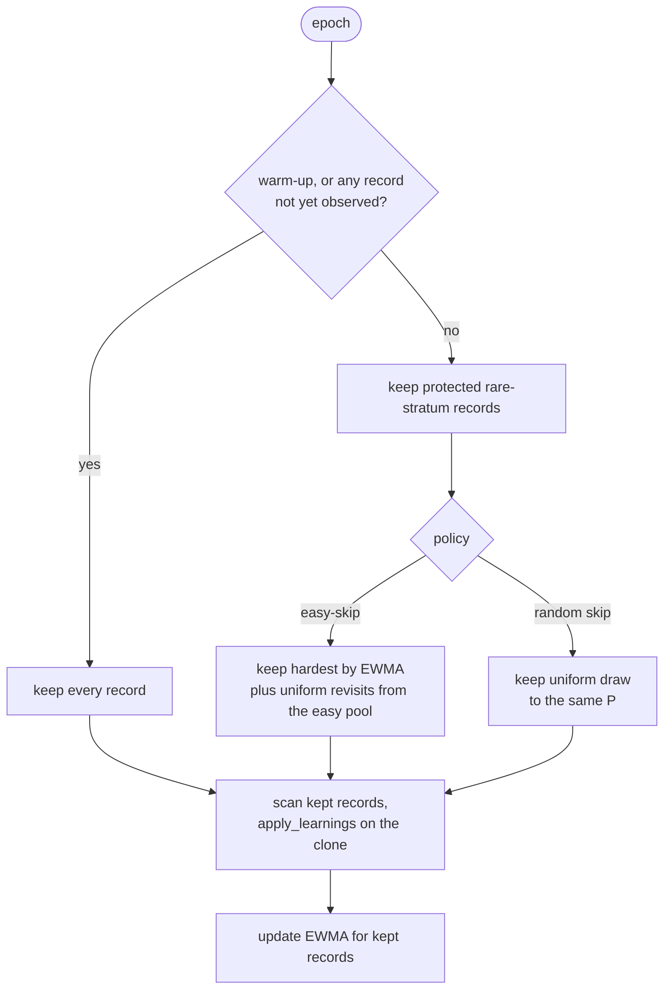

# Easy-record skipping experiment (Issue #267)

## Status

An **opt-in, offline experiment**. Nothing in the optimisation loop calls it,
no default has changed, and nothing has been ported into the run loop. The
code lives in `lamarck/src/record_skip/` and is exercised only by the
`record_skip_bench` example and `lamarck/tests/record_skip.rs`.

The results below are **synthetic only**. They do not show a NEAT-AI benefit,
and the representative corpus run is still outstanding. Easy-record skipping
is a hypothesis to test, not an established improvement.

## Source

The idea is attributed to arXiv 2611.10386, "Pruning DNA Sequence" (Satter,
Islam and Islam, v1 published 7 November 2026). The paper text could not be
read from the sandbox: `curl` to `arxiv.org`, `export.arxiv.org`, Semantic
Scholar, alphaXiv and Hugging Face all failed with "CONNECT tunnel failed,
response 403". Its method is therefore pinned from the authors' released code,
<https://github.com/FaiasPromit/pruning-dna-sequence> at commit
`804aedb94fda8c531f1e6406f62de769d045ebad` (`dnabert2/pretraining/run_mlm.py`,
`run_epoch_end_pruning`, and the `SP_*` / `RP_20%` configs):

- **Signal.** Each sequence's accuracy on its masked tokens, read from the
  ordinary training forward pass. No extra scoring pass or scoring model.
- **Rule (Sequence Pruning, SP).** At the end of every epoch, an active
  sequence whose accuracy, averaged over the last `pruning_window` epochs
  (default 1), lies in `[pruning_lower_threshold, pruning_upper_threshold]`
  (for example `[0.2, 1.0]` for `SP_20%`) is removed **for the rest of the
  run**. A sequence is eligible only when every slot of its window holds a
  real accuracy. Removed sequences are never revisited.
- **Controls.** `RP_20%` trains on a random subset fixed before training,
  sized to match `SP_20%`'s data savings; `LP_0%` removes the hardest
  (0%-accuracy) sequences instead. Savings are reported as the Data Savings
  Index, the share of the unpruned run's sequence processing avoided.
- **Budget.** A pruned run keeps the unpruned run's epoch count, so savings
  come from processing fewer sequences per epoch.

The scheme tested here is the one the issue describes, and it differs from SP
on purpose: a per-record error EWMA instead of a windowed accuracy (refinement
targets are continuous, so there is no token accuracy), a fixed processing
reduction per arm (25/50/75%) instead of a threshold, **temporary** omission
with periodic revisits instead of permanent removal, and rare-stratum
protection, which SP does not have. The matched random arm plays the role of
`RP`, but it is re-drawn each epoch at the same processed count rather than
fixed before training. SP itself is not reproduced as an arm.

## What is refined

- Each epoch drives Lamarck's own update path. `LearningPlan` and
  `LearningScan` (the same code `accumulate_creature_learning` uses) collect
  the learning signal, then `apply_learnings` applies it with
  `calculate_learning_rate`. Only the kept records are scanned.
- The parent creature is cloned, never modified.
- Difficulty scores live in a `DifficultyTracker` bound to a
  `DifficultyScope` (parent fingerprint, corpus key and record count).
  `ensure_scope` refuses reuse for a different parent or corpus, and
  `refine` calls it before every epoch's selection.
- Fitness and validation records are never pruned. After refinement the full
  training MSE and the untouched validation MSE are measured over every
  record. This audit is not charged to the arm's record-pass count.

## Schedule rules

From `DifficultyTracker::select` in `schedule.rs`:

- Warm-up epochs process every record. So does any epoch before every record
  has been observed at least once.
- Strata are equal-width bins of the first target value of each record.
- Strata holding less than `rareStratumShare` of the records are protected,
  and their records are always kept.
- With N records and reduction r, the target processed count is
  P = N - round(r * N).
- Easy-skip fills the remaining slots S = P - protected with the hardest
  records by EWMA, plus round(revisitShare * S) revisits drawn uniformly from
  the easy pool.
- Matched random skip keeps the same protected set and the same P, drawing the
  remaining slots uniformly. The only difference between the two arms is the
  difficulty signal.



## Predeclared protocol

Values come from `docs/evidence/record-skip/manifest.json`.

| Item | Value |
|------|-------|
| Epochs | 30 |
| Records | 2000 train, 1000 validation |
| Parent seed | 267 |
| Calibration seeds | 1-6 |
| Validation seeds | 1001-1012 |
| Reductions | 25%, 50%, 75% |
| Strata bins | 8 |
| Rare stratum share | 0.10 |
| Warm-up epochs | 1 |
| Calibration grid | EWMA alpha in {0.3, 0.7} x revisit share in {0.1, 0.25} |
| Learning rate | 0.2 |
| Bootstrap | 2000 resamples, seed 267 |
| Forgetting tolerance | 1e-4 |
| Versions | crate 0.1.46, neat-core v0.23.4 |

The learning rate 0.2 was chosen before the run from a full-arm sweep on two
seeds (final train MSE from 0.3816: 0.01 gave 0.2328, 0.05 gave 0.0958, 0.2
gave 0.0685, 0.5 gave 0.0771). It is fixed in `manifest.rs`.

Calibration uses the calibration seeds only and selects by training MSE,
never validation. It chose alpha 0.7 and revisit share 0.25.

Verdict rule (`verdict` in `stats.rs`): take the paired per-seed differences
of final validation MSE (treatment minus control) and a 95% percentile
bootstrap CI.

- `better` iff the CI upper bound is below 0 **and** the mean rare-stratum
  validation-MSE difference is at most 0 (and rare-stratum data exists).
- `worse` iff the CI lower bound is above 0.
- Otherwise `inconclusive`.

## How to run

```bash
# Synthetic suite (writes manifest.json, runs.jsonl, summary.json)
cargo run --release --example record_skip_bench -- OUT_DIR

# Smoke run
cargo run --release --example record_skip_bench -- OUT_DIR --smoke

# Override the manifest
cargo run --release --example record_skip_bench -- OUT_DIR --manifest FILE

# Corpus mode
cargo run --release --example record_skip_bench -- OUT_DIR \
  --creature FILE --training-data DIR [--validation-records N] [--max-records N]
```

In corpus mode `--validation-records` defaults to 2000 and `--max-records` to
20000. The validation set is the last N records of the loaded window.
Corpus-mode results stay private.

## Results (synthetic)

228 of 228 planned runs completed, 0 failed. Wall time was 15 s in release on
a shared, parallel container, so it is indicative only. The committed
evidence is `docs/evidence/record-skip/manifest.json` and `summary.json`
(`runs.jsonl` is not committed).

Per-arm means over the 12 validation seeds (initial train MSE 0.3875):

| Arm | Record passes | Processed share | Final train MSE | Validation MSE | Rare-stratum validation MSE | Forgotten share | Schedule ops | Revisit passes |
|-----|--------------:|----------------:|----------------:|---------------:|----------------------------:|----------------:|-------------:|---------------:|
| full | 60000 | 1.000 | 0.0842 | 0.0877 | 1.2300 | 0.381 | 0 | 0 |
| random-25 | 45500 | 0.758 | 0.0835 | 0.0869 | 1.1231 | 0.445 | 0 | 0 |
| easy-25 | 45500 | 0.758 | 0.0849 | 0.0884 | 1.2167 | 0.462 | 690820 | 10036 |
| random-50 | 31000 | 0.517 | 0.0876 | 0.0907 | 0.9374 | 0.562 | 0 | 0 |
| easy-50 | 31000 | 0.517 | 0.0847 | 0.0879 | 1.1351 | 0.487 | 691562 | 6411 |
| random-75 | 16500 | 0.275 | 0.1291 | 0.1307 | 0.5455 | 0.570 | 0 | 0 |
| easy-75 | 16500 | 0.275 | 0.0914 | 0.0938 | 0.8893 | 0.488 | 690689 | 2786 |

Paired comparisons (`comparisons` in `summary.json`; differences are
treatment minus control, 12 pairs each):

| Comparison | Role | Mean validation diff | CI low | CI high | Mean rare-stratum diff | Verdict |
|------------|------|---------------------:|-------:|--------:|-----------------------:|---------|
| easy-25 vs random-25 | primary | 0.0015 | 0.0008 | 0.0023 | 0.0936 | worse |
| easy-25 vs full | secondary | 0.0007 | 0.0003 | 0.0012 | -0.0133 | worse |
| random-25 vs full | secondary | -0.0008 | -0.0016 | 0.0001 | -0.1069 | inconclusive |
| easy-50 vs random-50 | primary | -0.0028 | -0.0049 | -0.0010 | 0.1977 | inconclusive |
| easy-50 vs full | secondary | 0.0002 | -0.0006 | 0.0011 | -0.0949 | inconclusive |
| random-50 vs full | secondary | 0.0030 | 0.0007 | 0.0058 | -0.2925 | worse |
| easy-75 vs random-75 | primary | -0.0368 | -0.0427 | -0.0312 | 0.3438 | inconclusive |
| easy-75 vs full | secondary | 0.0062 | 0.0029 | 0.0098 | -0.3407 | worse |
| random-75 vs full | secondary | 0.0430 | 0.0345 | 0.0524 | -0.6845 | worse |

Costs:

| Phase | Runs | Record passes | Revisit passes | Schedule ops |
|-------|-----:|--------------:|---------------:|-------------:|
| Calibration | 144 | 4,464,000 | 322,944 | 49,790,789 |
| Validation | 84 | 2,952,000 | 230,811 | 24,876,869 |

## Findings

These are findings on this synthetic suite only.

1. At 25% reduction, easy-skip is worse than matched random skipping and
   worse than full data.
2. At 50% and 75%, easy-skip has lower overall validation MSE than matched
   random (CI below zero) but higher rare-stratum validation MSE (+0.198 and
   +0.344), so the predeclared guard makes both comparisons inconclusive.
   Protecting the rare strata in the random arm raises their share of each
   batch, and hardest-first selection dilutes it again.
3. No easy-skip arm beats full data. easy-50 is inconclusive against full at
   52% of the record passes, and easy-75 is worse.
4. The forgotten share rises when records are skipped: 0.381 for full against
   0.46 to 0.57 for the skipped arms.
5. Calibration cost 4,464,000 record passes. That is more than the whole
   validation phase (2,952,000) and about 100 times the 43,500 passes easy-75
   saves per run, so at this scale the search does not pay for itself.

This is a negative and inconclusive result. Nothing is ported, and the module
stays opt-in only until the representative run decides whether to remove it.

## Outstanding

- Run the representative experiment on the private creature and corpus, on a
  quiet machine. This is an owner step, and the results stay private.
- Remove `record_skip/` if the representative run does not earn its
  maintenance cost.
