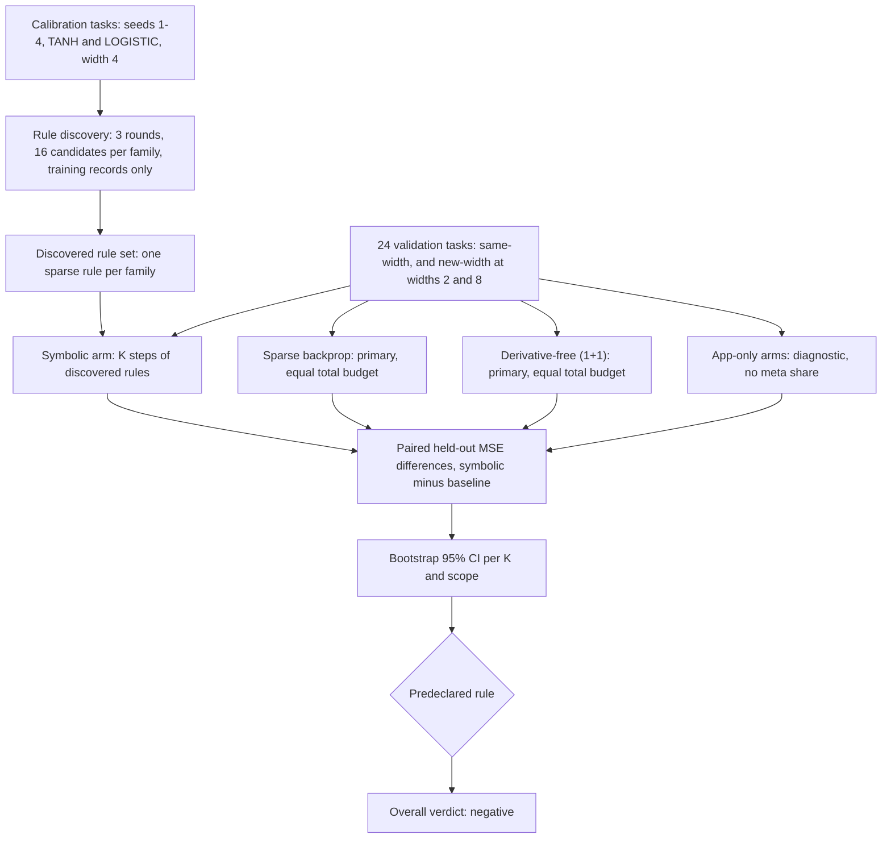

# Sparse symbolic local update rules (issue #268)

Lamarck's refinement moves weights and biases with sparse backprop. This
experiment asks whether a small, discovered, symbolic local update rule does
better at an **equal record budget**, once the cost of discovering the rule is
counted. The code is `lamarck/src/local_rules/`, the runner is
`lamarck/examples/local_rules_bench.rs`, the tests are
`lamarck/tests/local_rules.rs`, and the recorded synthetic results are
[`docs/evidence/local-rules/`](evidence/local-rules/) (`manifest.json`,
`summary.json`).

## 1. What is tested, and its status

The hypothesis is that sparse symbolic rules, discovered offline, can match or
beat Lamarck's current refinement. It is **opt-in and research only**:

- Nothing in `run_optimisation` or the CLI calls `local_rules`. Defaults are
  unchanged.
- Parents are never mutated. Every arm clones its parent before it changes
  anything.
- Full authoritative acceptance is untouched. The harness never proposes
  creatures to the optimiser, so no candidate it produces can be accepted.

The synthetic verdict is `negative` (section 7). Fixtures alone do not
demonstrate an optimisation benefit.

**No success before a representative run.** Each report carries
`successClaim` next to `overallVerdict`. `success_claim` in
`lamarck/src/local_rules/experiment.rs` sets it from the data source alone and
does not change the predeclared verdict rule:

| Source | `overallVerdict` | `successClaim` |
|---|---|---|
| synthetic | any, even `earns-its-place` | `not-claimable-synthetic` |
| files | `earns-its-place` | `pending-owner-review` |
| files | `negative` or `inconclusive` | `no-success` |

The code cannot tell whether a supplied creature and corpus are representative.
So even the best files result is only `pending-owner-review` until the owner
confirms it. The recorded synthetic run is `not-claimable-synthetic`.

## 2. Research starting point

The starting point is arXiv [2611.12248](https://arxiv.org/abs/2611.12248).
The paper's full text could **not** be read from the sandbox on 14 November 2026.
`curl` of `https://export.arxiv.org/abs/2611.12248`, `https://arxiv.org/abs/2611.12248`
and `https://arxiv.org/pdf/2611.12248` failed with
`CONNECT tunnel failed, response 403`. Fetching the abstract, HTML and PDF pages
and the alphaxiv and Hugging Face mirrors failed with "proxy refused the
connection". Only web-search summaries of those pages could be retrieved.

**Outline from web-search summaries (secondary, not read from the paper, so not a pin of the full method):**

- **Paper:** "A method to automatically discover symbolic local learning rules".
  Andrea Perin (Aalto University), Fabio Anselmi (University of
  Trieste), Stéphane Deny (Aalto University). Submitted 9 November 2026, in
  cs.LG, cs.NE and stat.ML. The arXiv version number was not visible.
- **Object learned:** a separate *local loss* per layer, not an update rule.
  The update is that loss's gradient.
- **Dictionary:** monomials of local tensor variables, enumerated using
  Penrose tensor-diagram notation. A layer's local loss is a weighted sum of
  its trace monomials.
- **Fit:** the method regresses the monomial coefficients so that the layerwise
  gradients together reduce a target global loss.
- **Sparsity:** coefficients are formed as a Hadamard product, which acts as an
  implicit sparse prior. The authors report that this improves results.
- **Locality degree:** degree 1 is purely local, degree 2 is local but not
  purely local, and degree 3 is global. Degree sweeps are run on
  classification and reconstruction.
- **Experiments:** classification, reconstruction and self-supervised tasks on
  small multilayer networks and minimal datasets.
- **Reported limitation:** loss falls more slowly under the discovered rules
  than under backprop.

**Not pinned.** How the coefficient regression is optimised was not found, for
example whether the inner training loop is unrolled. Also missing: the exact
variable set per degree, step counts, network sizes, datasets and
hyperparameters. A faithful reproduction of the paper is therefore still open.

**How this harness differs from that outline** (the left column is only as reliable as the search summaries):

| Paper (as summarised) | This harness |
|---|---|
| Learns a per-layer polynomial *loss*, and updates follow its gradient | Learns a sparse linear *update rule* directly (section 3) |
| Rules are per layer | Rules are per activation family, because NEAT creatures have no layers |
| Penrose-diagram monomials of local tensors, degree 1–3 | Fixed library of 9 scalar per-synapse features (section 3), polynomial order up to 3 (`XYY`, `WYY`), each using only the synapse's own neurons, so purely local in the paper's degree-1 sense. The residual exists only on output neurons (section 4) |
| Coefficients regressed against a global loss, with a Hadamard-product sparse prior | Seeded random sampling of sparse rules (at most 3 terms, coefficients from a fixed grid), keeping a candidate only when it lowers calibration training MSE (sections 3 and 6) |
| No equal-budget accounting reported in the summaries | The meta-search cost is charged to the symbolic arm (section 5) |

So this experiment tests the issue's description, which the summaries match
only in outline. A negative result here does not refute the paper's method.

## 3. Rule language

**Feature library**, in library order. Bias updates use `x = 1` and `w = bias`.

| Feature | Value | Notes |
|---------|-------|-------|
| `X` | presynaptic activation `x` | |
| `Y` | postsynaptic activation `y` | |
| `W` | current weight `w` | |
| `R` | residual `r` | `0` when the neuron has no residual |
| `XY` | `x * y` | |
| `XR` | `x * r` | `0` when there is no residual |
| `YR` | `y * r` | `0` when there is no residual |
| `WYY` | `w * y * y` | |
| `XYY` | `x * y * y` | |

**Rules.** Each activation family gets at most one sparse linear rule, with at
most `maxSupport` (3) terms, each feature at most once, and coefficients from
the grid in section 6. Families are `identity`, `tanh`, `logistic`, `relu` and
`other`. A family with no rule gets a zero update.

**Update.** For each synapse and bias, the rule delta is averaged over the
training records. The step is `eta * clamp(mean delta, -maxStep, +maxStep)`,
with `eta` = 0.05 and `maxStep` = 1.0.

## 4. Residual definition

The residual is defined explicitly, because the issue requires it:

- **Output neuron `k`:** `r = expected[k] - activation`. The target is
  presented to the output neuron, so it is legitimate local information.
- **Hidden neuron:** no residual. Features that use `r` (`R`, `XR`, `YR`)
  evaluate to `0`. The output error is **not** treated as local hidden-neuron
  information.

## 5. Arms and budget accounting

**Units.** A forward pass over one record costs 1 unit. A forward pass plus one
update costs 2 units. Held-out measurement and training-MSE measurement are
never charged.

**Meta-search.** Rule discovery is charged in full. Its total is then divided
evenly across the validation tasks (ceiling division) and added to the budget
of each **primary** arm, so that the symbolic arm's total (its update units plus
its meta share) is matched by the primary baselines' total, rounded down to whole steps or evaluations.

**Primary arms** (these decide the verdict, at equal total budget):

| Arm | What it is | Budget per task |
|-----|------------|-----------------|
| `symbolic` | Discovered sparse rules, `K` steps | `2 * K * 64` update units, plus meta share in the total |
| `sparse-backprop` | Lamarck's own `LearningPlan` and `apply_learnings`, `sparseRatio` 0.5 | `2 * 64` units per step, `2Kn + meta share` in total |
| `derivative-free` | (1+1) random search, Gaussian `sigma` 0.05 | `1` unit per evaluation, `2Kn + meta share` in total |

The sparse-backprop learning rate is Lamarck's `BackpropConfig` default,
`0.01` (`lamarck/src/backprop.rs:93`), and the manifest records it as
`backpropLearningRate`. The rule step uses `eta` = 0.05. The two rates were not
matched, and the backprop rate was not tuned. This is one reason a benefit
cannot be read off the results.

**App-only arms** are diagnostics. They get the symbolic budget with **no**
meta share: `sparse-backprop-app-only` and `derivative-free-app-only`. They
never count under the verdict rule.

## 6. Predeclared protocol

Every value below is fixed in `Manifest::predeclared()` and recorded in
`manifest.json`.

| Manifest key | Value |
|--------------|-------|
| `inputs` | 3 |
| `trainRecords` | 64 |
| `heldOutRecords` | 64 |
| `hiddenSquashes` | `TANH`, `LOGISTIC` |
| `calibrationSeeds` | 1, 2, 3, 4 |
| `calibrationWidth` | 4 |
| `validationGroups` | `same-width`: seeds 101-104, width 4; `new-width`: seeds 201-204, width 2; `new-width`: seeds 301-304, width 8 |
| `steps` (K) | 5, 10, 20 |
| `calibrationSteps` | 10 |
| `eta` | 0.05 |
| `maxStep` | 1.0 |
| `maxSupport` | 3 |
| `metaRounds` | 3 |
| `candidatesPerRound` | 16 |
| `coefficientGrid` | -2.0, -1.0, -0.5, 0.5, 1.0, 2.0 |
| `backpropLearningRate` | 0.01 |
| `sparseRatio` | 0.5 |
| `derivativeFreeSigma` | 0.05 |
| `bootstrapResamples` | 2000 |
| `bootstrapSeed` | 7 |
| `metaSeed` | 11 |
| `minPairedTasks` | 8 |

**Seeds and widths.** Calibration tasks drive rule discovery only. Validation
seeds are disjoint from calibration seeds (checked in code), and validation
tasks are only ever measured.

| Set | Seeds | Hidden width | Tasks (2 squashes) |
|-----|-------|--------------|--------------------|
| Calibration | 1-4 | 4 | 8 |
| Validation, same-width | 101-104 | 4 | 8 |
| Validation, new-width (transfer) | 201-204 | 2 | 8 |
| Validation, new-width (transfer) | 301-304 | 8 | 8 |

Validation totals 24 tasks, each with 64 training and 64 held-out records. The
held-out records are used only for measurement. The `new-width` label covers two
widths (2 and 8), so the 16 transfer tasks are pooled.

**Versions** (recorded in every report):

| Field | Value |
|-------|-------|
| Crate version | `0.1.47` (`lamarck/Cargo.toml`) |
| neat-core tag | `v0.23.4` |
| Task generator | `local-rules-synthetic-v1` |

**Success criterion** (`manifest.json`, quoted verbatim):

> earns-its-place iff the symbolic arm is Better than BOTH primary baselines (sparse-backprop, derivative-free) at at least one K and Worse than neither at any K; negative iff Worse than sparse-backprop at every K; otherwise inconclusive. A comparison is Inconclusive when it has fewer than min_paired_tasks paired tasks, or when any run behind it failed (a failed run is never dropped silently and never counts as a win). A files run with fewer than min_paired_tasks validation creatures is refused.

**Verdict rule** for each paired comparison. The difference is symbolic minus
baseline held-out MSE, so a negative value favours the symbolic arm. The 95%
percentile bootstrap CI of the mean difference uses 2000 resamples with seed 7.
The result is **Better** if the whole interval is below 0, **Worse** if the
whole interval is above 0, and **inconclusive** otherwise.

**Minimum sample and failed runs.** One paired difference gives a zero-width
interval, so a verdict from it would be a sign test on a single number. The
manifest therefore predeclares `minPairedTasks` = 8, and the same limit applies
to every protocol:

- A comparison with fewer than `minPairedTasks` paired tasks is
  `inconclusive` (`paired_verdict` in `lamarck/src/local_rules/stats.rs`).
- A files run with fewer than `minPairedTasks` validation creatures is refused
  with a named error. `Manifest::validate` refuses a synthetic protocol with
  fewer validation tasks, or a `minPairedTasks` below 2.
- A run that errors or gives a non-finite MSE is listed under `failures` and
  counted in `coverage.failed`. Each comparison records how many validation
  tasks it lost to such runs in `missing`, and any `missing` above 0 makes that
  comparison `inconclusive`. Failed runs therefore never vanish from a
  comparison, and a failed symbolic run never counts as a win. A failure of the
  symbolic arm affects every baseline at that K. A failure of one baseline
  affects only that baseline's comparisons.
- The overall verdict is `predeclared_verdict` over the `all`-group comparisons
  of the two primary arms. The app-only arms and the per-group comparisons
  never decide it.

In the recorded synthetic run, every comparison has `missing` 0 and
n = 8, 16 or 24, so the limit changes no verdict.

## 7. Results (synthetic, from `summary.json`)



**Coverage.** 360 planned (24 tasks x 3 K x 5 arms), 360 completed, 0 failed.

**Meta cost.** 1,622,016 record units, which is 144 scored candidates (3 rounds
x 3 families x 16) x 8 calibration tasks x 1,408 units each (10 rule steps at 2
units per record, plus 2 MSE passes at 1 unit per record, over 64 records). Its
amortised share is 67,584 units per validation task. At K = 5, that share is
almost all of the 68,224 units the primary arms receive per task.

**Discovered rules** (the `describe` form, from `discoveredRules`):

| Family | Rule | Effective terms for hidden neurons |
|--------|------|------------------------------------|
| `identity` | `R*1 + XR*2` | Output neuron only in this run (hidden neurons use TANH or LOGISTIC) |
| `logistic` | `R*2 + W*-2 + XYY*2` | `W*-2 + XYY*2` (`R` is `0` for hidden neurons) |
| `tanh` | `XYY*-0.5 + YR*-1 + Y*-2` | `XYY*-0.5 + Y*-2` (`YR` is `0` for hidden neurons) |

**Comparisons, group `all`** (n = 24 paired tasks each). `Mean diff` is
symbolic minus baseline, rounded to four decimal places. `Primary` marks the
arms that decide the verdict.

| Arm | Primary | K | n | Mean diff | 95% CI | Verdict |
|-----|---------|---|---|-----------|--------|---------|
| `sparse-backprop` | yes | 5 | 24 | 0.2563 | [0.1276, 0.3948] | worse |
| `derivative-free` | yes | 5 | 24 | 0.2684 | [0.1360, 0.4108] | worse |
| `sparse-backprop-app-only` | no | 5 | 24 | -0.3726 | [-0.6616, -0.1512] | better |
| `derivative-free-app-only` | no | 5 | 24 | -0.1987 | [-0.4025, -0.0249] | better |
| `sparse-backprop` | yes | 10 | 24 | 0.1490 | [0.0661, 0.2453] | worse |
| `derivative-free` | yes | 10 | 24 | 0.1610 | [0.0759, 0.2599] | worse |
| `sparse-backprop-app-only` | no | 10 | 24 | -0.3781 | [-0.6579, -0.1701] | better |
| `derivative-free-app-only` | no | 10 | 24 | -0.1655 | [-0.3425, -0.0217] | better |
| `sparse-backprop` | yes | 20 | 24 | 0.0876 | [0.0472, 0.1316] | worse |
| `derivative-free` | yes | 20 | 24 | 0.0996 | [0.0570, 0.1461] | worse |
| `sparse-backprop-app-only` | no | 20 | 24 | -0.3198 | [-0.5389, -0.1492] | better |
| `derivative-free-app-only` | no | 20 | 24 | -0.0342 | [-0.1131, 0.0293] | inconclusive |

**Same-width and new-width split.** For the primary arms the symbolic arm is
worse at every K in both groups, and the gap is larger on new-width tasks (at
K = 5 against sparse backprop: 0.121 for same-width, n = 8; 0.324 for new-width,
n = 16; mean differences rounded to three decimal places).

**Overall verdict: `negative`.** The predeclared rule gives this result because
the symbolic arm is worse than sparse backprop at every K.

**Interpretation.** With the meta-search cost included, the rules lose to both
primary baselines at every K. Excluding the meta-search, the rules beat the
app-only sparse-backprop arm at every K, and the app-only derivative-free arm at
K = 5 and 10 (inconclusive at K = 20). That diagnostic does not count under the
predeclared rule. The backprop learning rate is the default and was not tuned,
so the app-only result is **not** evidence of a benefit. The fixtures are
synthetic, and they alone do not demonstrate an optimisation benefit.

## 8. Representative run (owner step)

The synthetic fixtures are not the decision point. The owner runs one
representative corpus through files mode:

```text
cargo run --release --example local_rules_bench -- OUT_DIR \
  --calibration-creature PATH --creature PATH [--creature PATH ...] \
  --training-data DIR
```

The first `trainRecords` records train the calibration creature for rule
discovery. The next `trainRecords` are validation training records, and the
next `heldOutRecords` are held out. Validation creatures must differ from the
calibration creature and share its widths. The report's `dataSource` holds only
a corpus key and creature fingerprints, never paths or record values. The
validation group is labelled `files`.

Keep `OUT_DIR` and its results private. Do not commit them. Files mode refuses
to run without `OUT_DIR`, naming the missing argument, so a private run cannot
overwrite the tracked public evidence (`resolve_out_dir` in
`lamarck/src/local_rules/experiment.rs`). Give at least `minPairedTasks` (8)
`--creature` flags: a smaller run is refused.

The runner prints `success claim:` after the verdict. A files run that
`earns-its-place` reports `pending-owner-review`, never a success on its own.

**Decision rule.** If the representative run is also not `earns-its-place`,
remove `lamarck/src/local_rules/`, the example, its tests and the evidence. Until
then, the code is kept only as the reproducer.

## 9. How to reproduce

```text
cargo run --release --example local_rules_bench -- [OUT_DIR]
```

In synthetic mode `OUT_DIR` defaults to `docs/evidence/local-rules`. Every seed
is fixed in the manifest, so the synthetic run is deterministic. The runtime is
small, a few seconds in release. A re-run reproduces `manifest.json` and
`summary.json` byte for byte at the same crate version. The reports stamp
`versions.crateVersion`, so a later version bump changes that one line and the
evidence is then regenerated.
